# Coding · C

以 C23 为主线，按“语法 → 数据 → 算法 → 资源 → 工程”展开。遇到实现差异或旧教材口径时，在相关知识点就地说明。形象说法用来帮助理解，紧随其后的适用条件与代码边界负责把结论钉牢。

> [!info] 阅读约定
> `c` 代码块表示 C 源码；`text` 代码块表示输出、轨迹或示意。标明“错误示例”的代码用于辨析，不能作为正常实现执行。函数和片段的输入前提在附近说明；完整程序各自独立。

## 学习导航

### 总览

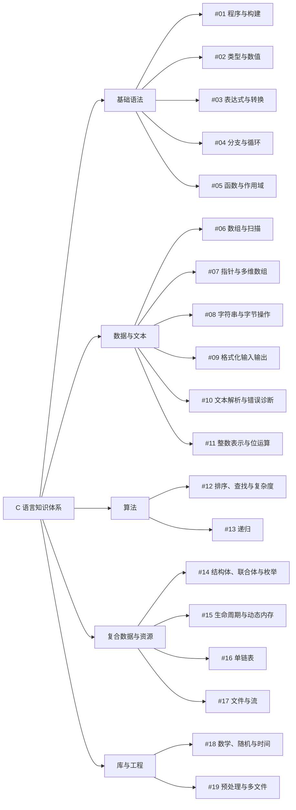

### 章节目录

- **基础语法**：[[#01 程序与构建|01 程序与构建]] → [[#02 类型与数值|02 类型与数值]] → [[#03 表达式与转换|03 表达式与转换]] → [[#04 分支与循环|04 分支与循环]] → [[#05 函数与作用域|05 函数与作用域]]
- **数据与文本**：[[#06 数组与扫描|06 数组与扫描]] → [[#07 指针与多维数组|07 指针与多维数组]] → [[#08 字符串与字节操作|08 字符串与字节操作]] → [[#09 格式化输入输出|09 格式化输入输出]] → [[#10 文本解析与错误诊断|10 文本解析与错误诊断]] → [[#11 整数表示与位运算|11 整数表示与位运算]]
- **算法**：[[#12 排序、查找与复杂度|12 排序、查找与复杂度]] → [[#13 递归|13 递归]]
- **复合数据与资源**：[[#14 结构体、联合体与枚举|14 结构体、联合体与枚举]] → [[#15 生命周期与动态内存|15 生命周期与动态内存]] → [[#16 单链表|16 单链表]] → [[#17 文件与流|17 文件与流]]
- **库与工程**：[[#18 数学、随机与时间|18 数学、随机与时间]] → [[#19 预处理与多文件|19 预处理与多文件]]

知识点按全文连续编号，跨章节不重置。完整知识点目录随每个知识簇折叠收纳；展开“知识图与目录”即可按图或文字定位。Obsidian 右侧大纲也可直接导航。

---

## 01 程序与构建

先认识程序怎样启动、怎样从源文件成为可执行程序，再进入代码里的对象与运算。

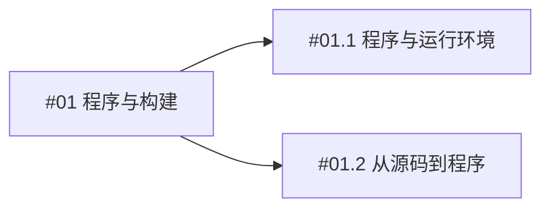

### 01.1 程序与运行环境

> [!note]- 知识图与目录
>
> ```mermaid
> flowchart LR
>   R["#01.1 程序与运行环境"]
>   N0["#1. main 是宿主入口"]
>   R --> N0
>   N1["#2. main 的返回类型"]
>   R --> N1
>   N2["#3. 无参数写成 void"]
>   R --> N2
>   N3["#4. main 可隐式返回零"]
>   R --> N3
>   N4["#5. argc 记录参数个数"]
>   R --> N4
>   N5["#6. argv 保存参数字符串"]
>   R --> N5
>   N6["#7. argv 首项表示程序名"]
>   R --> N6
>   N7["#8. argv 末项是空指针"]
>   R --> N7
>   N8["#9. 零表示成功退出"]
>   R --> N8
>   class R,N0,N1,N2,N3,N4,N5,N6,N7,N8 internal-link;
> ```
>
> ```mermaid
> flowchart LR
>   R["#01.1 程序与运行环境"]
>   N0["#10. 失败用 EXIT_FAILURE"]
>   R --> N0
>   class R,N0 internal-link;
> ```
>
> - [[#1. main 是宿主入口|1. main 是宿主入口]]
> - [[#2. main 的返回类型|2. main 的返回类型]]
> - [[#3. 无参数写成 void|3. 无参数写成 void]]
> - [[#4. main 可隐式返回零|4. main 可隐式返回零]]
> - [[#5. argc 记录参数个数|5. argc 记录参数个数]]
> - [[#6. argv 保存参数字符串|6. argv 保存参数字符串]]
> - [[#7. argv 首项表示程序名|7. argv 首项表示程序名]]
> - [[#8. argv 末项是空指针|8. argv 末项是空指针]]
> - [[#9. 零表示成功退出|9. 零表示成功退出]]
> - [[#10. 失败用 EXIT_FAILURE|10. 失败用 EXIT_FAILURE]]

#### 1. main 是宿主入口

在普通宿主环境中，运行环境调用 `main`，开始执行程序的主要逻辑。教材中的“C 程序从 `main` 开始”应放在这个场景下理解：运行库的启动、装载和初始化可能先发生；嵌入式等独立环境的入口由实现规定。

下面是一份可独立编译的最小示例。先认识外壳，再逐项理解其中的接口：

```c
#include <stdio.h>

int main(void)
{
    printf("Hello, C!\n");
    return 0;
}
```

`main` 是函数名，花括号内是函数体；`printf` 调用执行时才产生输出。源文件以 UTF-8 保存。

#### 2. main 的返回类型

常见标准宿主形式的返回类型是 `int`：`int main(void)`，或接收命令行参数的形式。`void main` 不能作为所有标准宿主环境都支持的通用写法。

这里的 `int` 说明退出状态的类型，不表示程序会把一个整数自动打印到屏幕。

#### 3. 无参数写成 void

`int main(void)` 中，参数表里的 `void` 表示不接收参数。可以把它读成：“这扇收件口不收参数”，而不是“收到了一个叫 void 的东西”。

C23 中空参数表 `int main()` 也表示无参数；阅读旧版 C 声明时要区分版本，详见 [[#152. 空参数表的版本差异|空参数表的版本差异]]。

#### 4. main 可隐式返回零

自 C99 起，从初次调用的 `main` 末尾离开，等价于返回 `0`。这是 `main` 的专门规则，不能推出“所有返回 `int` 的函数都可以不返回值”。

下面两种结尾在这个场景下具有相同的成功退出含义：显式 `return 0;`，或执行到 `main` 最后的 `}`。

#### 5. argc 记录参数个数

命令行形式常写作 `int main(int argc, char *argv[])`。`argc` 是参数个数，标准保证它非负；可用它限定对参数表的遍历。

参数个数包含提供的程序名位置，因此“用户额外输入了几个参数”与 `argc` 不一定是同一个数。比如常见环境下运行 `program one two`，`argc` 通常是 `3`。

#### 6. argv 保存参数字符串

`argv` 传统上来自 *argument vector*，可以理解为“启动程序时传进来的文字参数集合”。这些参数是字符串，即使看起来像 `123`，也要经过解析才成为整数值。

```c
#include <stdio.h>

int main(int argc, char *argv[])
{
    for (int i = 0; i < argc; ++i) {
        printf("argv[%d] = %s\n", i, argv[i]);
    }
    return 0;
}
```

名字 `argc`、`argv` 是习惯，可以换名；数组形参怎样调整成指针，见 [[#288. 数组形参只调整最外层|数组形参]]。

#### 7. argv 首项表示程序名

当 `argc > 0` 时，`argv[0]` 表示程序名；环境无法提供程序名时，它是空字符串。它不是用户额外输入的第一个业务参数，遍历业务参数时常从下一项开始。

#### 8. argv 末项是空指针

`argv[argc]` 是空指针，位于参数字符串序列之后，不能再把它当成有效字符串传给 `%s`。

不要把末项空指针与参数字符串内部的终止空字符混为一谈：前者结束指针序列，后者结束字符序列。

#### 9. 零表示成功退出

`main` 的返回值交给宿主环境。可移植地表达成功，使用 `0` 或 `<stdlib.h>` 的 `EXIT_SUCCESS`。

```c
#include <stdlib.h>

int main(void)
{
    return EXIT_SUCCESS;
}
```

退出状态是交给环境的信号，不是 `printf` 的输出内容。

#### 10. 失败用 EXIT_FAILURE

可移植地表示失败，使用 `<stdlib.h>` 的 `EXIT_FAILURE`。`return 1;` 是常见习惯，但标准对其他状态值如何映射到宿主环境，留给实现决定。

因此应记“成功用 `0/EXIT_SUCCESS`，失败用 `EXIT_FAILURE`”，不能把“所有非零值在一切 C 实现里都保证表示失败”当成标准规则。

### 01.2 从源码到程序

> [!note]- 知识图与目录
>
> ```mermaid
> flowchart LR
>   R["#01.2 从源码到程序"]
>   N0["#11. C 仍是高级语言"]
>   R --> N0
>   N1["#12. 接近底层的能力"]
>   R --> N1
>   N2["#13. 构建先后路线"]
>   R --> N2
>   N3["#14. 选择 C23 编译"]
>   R --> N3
>   N4["#15. 后缀只是角色线索"]
>   R --> N4
>   class R,N0,N1,N2,N3,N4 internal-link;
> ```
>
> - [[#11. C 仍是高级语言|11. C 仍是高级语言]]
> - [[#12. 接近底层的能力|12. 接近底层的能力]]
> - [[#13. 构建先后路线|13. 构建先后路线]]
> - [[#14. 选择 C23 编译|14. 选择 C23 编译]]
> - [[#15. 后缀只是角色线索|15. 后缀只是角色线索]]

#### 11. C 仍是高级语言

C 是高级编程语言，只是抽象层次相对较低，适合系统编程，并能高效映射到机器操作。不能因为它“接近硬件”，就把 C 当成汇编语言，或假定每条语句恰好对应一条机器指令。

#### 12. 接近底层的能力

可以把 C 想成允许你走近机器工作台的一套工具：能查看字节怎样排列、用掩码翻转哪些位、通过指针操作对象，并决定动态存储何时释放。系统、驱动、嵌入式和基础库常利用这些能力。

“走近工作台”仍需遵守语言规则：指针不等于可以任意猜测的物理地址，数组在 C 抽象机中的连续性也不保证物理 RAM 页相邻。

#### 13. 构建先后路线

常见工具链的理解路线是：

```text
.c 源码 → 预处理后的源码 → 汇编文本 → 目标文件 → 可执行程序
              头文件、宏                    其他目标文件和库 ↗
```

目标文件像尚待接好的半成品零件，链接器把引用与定义对上。工具链不一定为每一步都生成磁盘文件；详细接口分工见 [[#996. 翻译单元包含展开的头文件|翻译单元]]。

#### 14. 选择 C23 编译

使用支持 C23 的 GCC，在源文件所在目录可运行：

```text
gcc -std=c23 -Wall -Wextra -Wpedantic hello.c -o hello.exe
```

`-std=c23` 选择语言标准；警告帮助发现格式不匹配、缺少返回值等问题。Windows PowerShell 中可用 `./hello.exe` 运行成品。语言模式与目标 C 运行库是否支持某个新接口，仍须分别核对。

#### 15. 后缀只是角色线索

初学时先认清 `.c` 源代码、`.o/.obj` 目标文件、最终可执行程序三个角色。后缀是命名习惯，不能独自决定二进制格式；可执行文件也不一定带 `.exe`。

汇编文本、库、PE/ELF/Mach-O 及 ELF 的不同角色，见 [[#19.6 命名与构建产物|构建产物]]。

---

## 02 类型与数值

有了程序的外壳，接下来辨认保存数据的对象、约束对象的类型，以及数值的不同写法。

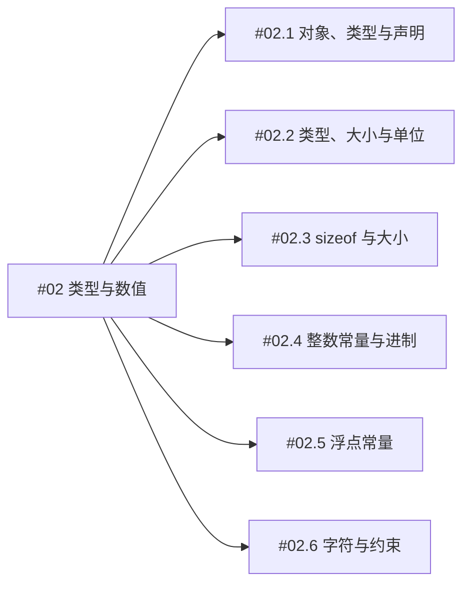

### 02.1 对象、类型与声明

> [!note]- 知识图与目录
>
> ```mermaid
> flowchart LR
>   R["#02.1 对象、类型与声明"]
>   N0["#16. 对象是存储区域"]
>   R --> N0
>   N1["#17. 类型是对象规格"]
>   R --> N1
>   N2["#18. 数组整体与元素"]
>   R --> N2
>   N3["#19. 初始化先于赋值"]
>   R --> N3
>   N4["#20. 共享声明说明符"]
>   R --> N4
>   N5["#21. 星号属于各自声明器"]
>   R --> N5
>   class R,N0,N1,N2,N3,N4,N5 internal-link;
> ```
>
> - [[#16. 对象是存储区域|16. 对象是存储区域]]
> - [[#17. 类型是对象规格|17. 类型是对象规格]]
> - [[#18. 数组整体与元素|18. 数组整体与元素]]
> - [[#19. 初始化先于赋值|19. 初始化先于赋值]]
> - [[#20. 共享声明说明符|20. 共享声明说明符]]
> - [[#21. 星号属于各自声明器|21. 星号属于各自声明器]]

#### 16. 对象是存储区域

C 中的对象是一块能表示值的数据存储区域。先把对象想成储物格：格子真正占着位置，能保存内容。这里的“对象”不是面向对象语言中那个包含类、继承等含义的对象。

`int score = 90;` 中，`score` 是一个对象。

#### 17. 类型是对象规格

类型像储物格上的规格标签：规定能表示哪些值、怎样解释它们、可以做什么运算。`int`、`char`、`double` 是基本类型的一部分；数组和指针又能在已有类型上构造新类型。

说出一种类型，不等于已经建立某个具体对象。`int[3]` 可以用作讨论数组类型的记法，但单独写 `int[3];` 不是定义数组变量的正确声明。

#### 18. 数组整体与元素

```c
int data[3] = {1, 2, 3};
```

`data` 是数组对象，`data[0]`、`data[1]`、`data[2]` 也各自是对象。可以同时讨论“整只储物柜”和“柜中的小格子”，但不能因此把整体和某一元素当成同一个层次。

#### 19. 初始化先于赋值

初始化在对象建立时提供初值，赋值在对象已经存在后改写内容：

```c
int score = 1;  /* 初始化 */
score = 2;      /* 赋值 */
```

普通自动局部对象若未初始化，不能假定为零；必须在后续读取前先得到有效值。静态存储期的默认初始化见 [[#748. 静态对象生存期贯穿程序|静态存储期]]。

#### 20. 共享声明说明符

`int a, b;` 可以让说明符 `int` 服务于多个声明器，相当于分别声明两个 `int` 对象。逗号分开的是各自的声明器，不是把整个写在前面的外观机械复制给后面。

#### 21. 星号属于各自声明器

```c
int a = 1;
int *p = &a, q = 3;
```

这里只有 `p` 是 `int *`，`q` 是 `int`。即使排版写成 `int* p, q;`，含义也一样。先看每个名字自己的那一段声明结构；初学时一个指针单独声明一行，更不容易看错。

### 02.2 类型、大小与单位

> [!note]- 知识图与目录
>
> ```mermaid
> flowchart LR
>   R["#02.2 类型、大小与单位"]
>   N0["#22. 按用途认识基本类型"]
>   R --> N0
>   N1["#23. char 的三种类型"]
>   R --> N1
>   N2["#24. 五种标准有符号整数"]
>   R --> N2
>   N3["#25. signed 与 unsigned"]
>   R --> N3
>   N4["#26. int 的等价简写"]
>   R --> N4
>   N5["#27. 大小由类型决定"]
>   R --> N5
>   N6["#28. int 不固定四字节"]
>   R --> N6
>   N7["#29. 标准最低整数范围"]
>   R --> N7
>   N8["#30. long 不保证更宽"]
>   R --> N8
>   class R,N0,N1,N2,N3,N4,N5,N6,N7,N8 internal-link;
> ```
>
> ```mermaid
> flowchart LR
>   R["#02.2 类型、大小与单位"]
>   N0["#31. 类型等级不等于字节数"]
>   R --> N0
>   N1["#32. bit 与 C 字节"]
>   R --> N1
>   N2["#33. 一个字节容纳基本字符"]
>   R --> N2
>   N3["#34. unsigned char 的范围"]
>   R --> N3
>   N4["#35. 表示位数不等于值位"]
>   R --> N4
>   class R,N0,N1,N2,N3,N4 internal-link;
> ```
>
> - [[#22. 按用途认识基本类型|22. 按用途认识基本类型]]
> - [[#23. char 的三种类型|23. char 的三种类型]]
> - [[#24. 五种标准有符号整数|24. 五种标准有符号整数]]
> - [[#25. signed 与 unsigned|25. signed 与 unsigned]]
> - [[#26. int 的等价简写|26. int 的等价简写]]
> - [[#27. 大小由类型决定|27. 大小由类型决定]]
> - [[#28. int 不固定四字节|28. int 不固定四字节]]
> - [[#29. 标准最低整数范围|29. 标准最低整数范围]]
> - [[#30. long 不保证更宽|30. long 不保证更宽]]
> - [[#31. 类型等级不等于字节数|31. 类型等级不等于字节数]]
> - [[#32. bit 与 C 字节|32. bit 与 C 字节]]
> - [[#33. 一个字节容纳基本字符|33. 一个字节容纳基本字符]]
> - [[#34. unsigned char 的范围|34. unsigned char 的范围]]
> - [[#35. 表示位数不等于值位|35. 表示位数不等于值位]]

#### 22. 按用途认识基本类型

| 用途 | 常用类型 |
| --- | --- |
| 一般整数计算 | `int`，需要更大范围时核对 `long`、`long long` |
| 非负计数、位掩码 | 适当宽度的无符号类型 |
| 字符及原始字节 | `char`；处理对象表示常用 `unsigned char` |
| 实浮点计算 | `float`、`double`、`long double` |
| 对象大小、容量 | `size_t` |
| 条件状态 | C23 的 `bool` |

类型名不是用途的绝对限制，但有清楚含义的选择能减少隐式转换带来的意外。具体范围与整数等级见 [[#11.3 整数提升与转换|整数提升]]。

#### 23. char 的三种类型

`char`、`signed char`、`unsigned char` 是三种不同类型。普通 `char` 表现为有符号还是无符号，由实现决定；不能无条件把它与其中一种当成同一类型。

字节处理中选择 `unsigned char`，有助于按非负字节值理解数据。字符分类函数还另有参数范围要求，见 [[#08.2 字符分类|字符分类]]。

#### 24. 五种标准有符号整数

五种标准有符号整数类型是 `signed char`、`short int`、`int`、`long int`、`long long int`，各有对应的无符号类型。`short`、`long` 等常见简写都应回到完整类型理解，而不是仅按名称猜测本机字节数。

#### 25. signed 与 unsigned

有符号整数能表示负数和非负数，无符号整数只表示非负数。无符号并不是“更大的正负整数”，也不会把赋在右边的负数原样保存下来。其运算规则见 [[#102. 无符号运算按模计算|无符号运算按模计算]]。

#### 26. int 的等价简写

`int`、`signed`、`signed int` 表示相同的类型；`unsigned` 等同 `unsigned int`。因此 `unsigned x;` 已完整声明了一个无符号整数对象，不是“忘了写类型”。

#### 27. 大小由类型决定

普通固定类型对象占用多少存储，由类型决定，不由当前数值决定。若某实现的 `int` 为 4 字节，放入 `1` 仍用 4 字节，不会自动缩成最省空间的形式。

写成 `0x01` 或 `1` 不改变这个对象的类型；十六进制写了几位，也不是数组元素占几字节的计算方法。

#### 28. int 不固定四字节

C 没有规定 `int` 在所有机器上固定为 4 字节。计算数组元素个数时往往无需知道它的实际字节数；若题目直接问总字节数，就需要题目环境或 `sizeof(int)` 提供信息。

考试若明确指定 2 字节，按指定环境分析，不要自行换成本机习惯。

#### 29. 标准最低整数范围

标准给的是必须至少容纳的范围，不是替每个平台固定 `sizeof`。C23 的标准有符号整数类型至少覆盖下表：

| 类型 | 至少覆盖的范围 | 表示这些值至少需要的位数（含符号位） | 常见实现 |
|---|---|---|---|
| `signed char` | `-128..127` | 8 | 8 位 |
| `short` | `-32768..32767` | 16 | 16 位 |
| `int` | `-32768..32767` | 16 | 32 位 |
| `long` | `-2147483648..2147483647` | 32 | 32 或 64 位 |
| `long long` | `-9223372036854775808..9223372036854775807` | 64 | 64 位 |

实际范围查询 `<limits.h>` 中的 `SCHAR_MIN`、`INT_MAX`、`LONG_MAX` 等宏。上表的位数不能直接当成字节数；一个 C 字节有 `CHAR_BIT` 位，某些整数类型还可能含填充位。C17 及更早标准允许的其他有符号表示，其最低负端点要求也不同，参见 [[#501. 补码是整数编码规则|C23 要求补码表示]]。

#### 30. long 不保证更宽

`long` 至少能覆盖标准要求的相应范围，但不保证比 `int` 占更多字节。常见 64 位 Windows 中二者都为 4 字节；常见 64 位 Linux 中 `long` 为 8 字节。这些是平台习惯，不能反过来作为语言保证。

大小关系满足 `sizeof(short) <= sizeof(int) <= sizeof(long) <= sizeof(long long)`，相邻项允许相等。

#### 31. 类型等级不等于字节数

`short`、`int`、`long`、`long long` 的整数转换等级不同，不表示它们在当前机器上一定占不同的字节数。等级是转换规则中的次序，`sizeof` 是存储大小，两个问题各问各的。

完整等级关系及它怎样决定提升和混合运算，见 [[#11.3 整数提升与转换|整数提升]]。

#### 32. bit 与 C 字节

一个 bit 是一个二进制位置，只能表示 `0` 或 `1`；一个 C 字节包含 `CHAR_BIT` 个 bit。`CHAR_BIT` 来自 `<limits.h>`，至少为 8。

`sizeof(char) == 1` 的“1”是一个 C 字节，不能据此断言所有机器都是 8 bit。

#### 33. 一个字节容纳基本字符

一个 C 字节必须足以表示基本执行字符集中的任一字符；普通字符类型因此适合保存这些单字节字符。这个保证不代表任意语言文字都只占一个字节：例如中文在 UTF-8 中通常需要多个字节。

#### 34. unsigned char 的范围

`unsigned char` 没有填充位，范围是 `0..UCHAR_MAX`。只有明确 `CHAR_BIT == 8` 时，才写成 `0..255`；此时共有 256 个不同值。

把一个 C 字节先当成有 256 个刻度的小表盘，有助于理解常见机器，但表盘刻度数来自前提，不能省掉前提。负数和超范围值怎样转换，见 [[#11.3 整数提升与转换|整数提升]]。

#### 35. 表示位数不等于值位

`sizeof 对象 * CHAR_BIT` 得到对象表示的总位数。某些类型可能有填充位，因此总位数不一定全用于表达数值。说“32 位”时，要确认说的是对象表示、值位、地址还是其他宽度。

### 02.3 sizeof 与大小

> [!note]- 知识图与目录
>
> ```mermaid
> flowchart LR
>   R["#02.3 sizeof 与大小"]
>   N0["#36. sizeof 查询大小"]
>   R --> N0
>   N1["#37. sizeof 通常不求值"]
>   R --> N1
>   N2["#38. size_t 是结果类型"]
>   R --> N2
>   N3["#39. 用 %zu 输出大小"]
>   R --> N3
>   class R,N0,N1,N2,N3 internal-link;
> ```
>
> - [[#36. sizeof 查询大小|36. sizeof 查询大小]]
> - [[#37. sizeof 通常不求值|37. sizeof 通常不求值]]
> - [[#38. size_t 是结果类型|38. size_t 是结果类型]]
> - [[#39. 用 %zu 输出大小|39. 用 %zu 输出大小]]

#### 36. sizeof 查询大小

`sizeof` 是运算符，可以查询类型或表达式类型对应的对象大小，单位是 C 字节。写类型名时需要括号，如 `sizeof(int)`；对象可写成 `sizeof data`。

它看的是类型与相应大小信息，不是在数当前变量里有几位数字，也不负责查询指针所指分配区的容量。

#### 37. sizeof 通常不求值

对于非变长类型，`sizeof` 不计算其表达式操作数的值，例如 `sizeof(x++)` 不会让 `x` 自增。涉及变长数组类型时存在运行时求值等特例，不能说“永远在编译时计算”。

对完整的非变长对象类型，`sizeof *p` 也不会沿指针 `p` 访问对象；即使 `p` 尚未初始化，这种用法仍只需要所指类型信息。例如分配时可写 `malloc(sizeof *p)`。

因此“先有一个实际变量才能使用 `sizeof`”也不成立：有合法、完整的类型信息，就可以使用 `sizeof(type)`。

#### 38. size_t 是结果类型

`sizeof` 的结果类型是 `size_t`，一种无符号整数类型。`<stddef.h>` 等标准头文件提供它。把它当作“专门记录容量和大小的计数器”可以帮助记忆，但它不是每个平台上固定相同宽度的一个新基本整数类型。

#### 39. 用 %zu 输出大小

`printf` 打印 `size_t` 使用 `%zu`：`z` 是长度修饰符，`u` 表示无符号十进制转换。不要把 `sizeof` 结果不加说明地配给 `%d`。

```c
#include <stdio.h>

int main(void)
{
    int data[5] = {0};
    printf("int: %zu bytes\n", sizeof(int));
    printf("array: %zu bytes\n", sizeof data);
    printf("count: %zu\n", sizeof data / sizeof data[0]);
    return 0;
}
```

这里最后一个结果为 `5`；真正数组的计数公式见 [[#178. 真正数组可用sizeof计数|数组元素计数]]。

记忆时可把 `size_t` 与长度修饰符 `z` 联系起来；`%u` 要求的是 `unsigned int`，不能因为 `size_t` 是无符号类型就随意换成 `%u`。

### 02.4 整数常量与进制

> [!note]- 知识图与目录
>
> ```mermaid
> flowchart LR
>   R["#02.4 整数常量与进制"]
>   N0["#40. 数值与写法分开"]
>   R --> N0
>   N1["#41. 十六进制前缀"]
>   R --> N1
>   N2["#42. 八进制前导零"]
>   R --> N2
>   N3["#43. C23 二进制前缀"]
>   R --> N3
>   N4["#44. 进制不决定符号性"]
>   R --> N4
>   N5["#45. 除二取余再倒读"]
>   R --> N5
>   N6["#46. 常见二的幂"]
>   R --> N6
>   N7["#47. 四位对应十六进制一位"]
>   R --> N7
>   N8["#48. 三位对应八进制一位"]
>   R --> N8
>   class R,N0,N1,N2,N3,N4,N5,N6,N7,N8 internal-link;
> ```
>
> ```mermaid
> flowchart LR
>   R["#02.4 整数常量与进制"]
>   N0["#49. 最高位左侧补零"]
>   R --> N0
>   N1["#50. 借二进制跨进制"]
>   R --> N1
>   N2["#51. 八进制的位组用途"]
>   R --> N2
>   N3["#52. 显示形式由格式决定"]
>   R --> N3
>   class R,N0,N1,N2,N3 internal-link;
> ```
>
> - [[#40. 数值与写法分开|40. 数值与写法分开]]
> - [[#41. 十六进制前缀|41. 十六进制前缀]]
> - [[#42. 八进制前导零|42. 八进制前导零]]
> - [[#43. C23 二进制前缀|43. C23 二进制前缀]]
> - [[#44. 进制不决定符号性|44. 进制不决定符号性]]
> - [[#45. 除二取余再倒读|45. 除二取余再倒读]]
> - [[#46. 常见二的幂|46. 常见二的幂]]
> - [[#47. 四位对应十六进制一位|47. 四位对应十六进制一位]]
> - [[#48. 三位对应八进制一位|48. 三位对应八进制一位]]
> - [[#49. 最高位左侧补零|49. 最高位左侧补零]]
> - [[#50. 借二进制跨进制|50. 借二进制跨进制]]
> - [[#51. 八进制的位组用途|51. 八进制的位组用途]]
> - [[#52. 显示形式由格式决定|52. 显示形式由格式决定]]

#### 40. 数值与写法分开

进制是数值的一种写法。`42`、`052`、`0x2A` 在这些 C 常量写法下表示同一个数值；相加相乘仍针对数值，不按字符串拼接。

可以把同一个数想成一个人换了不同的名牌：换进制名牌没有换掉这个人；换保存它的类型，则可能影响范围和转换结果。

#### 41. 十六进制前缀

`0x` 或 `0X` 表示后面的整数数字按十六进制解释。`0x2A` 等于 $2\times16+10=42$；`0x10` 是十进制 16，不是十进制 10。

前缀只声明解释方式，不是参与位权计算的两个有效数字。

#### 42. 八进制前导零

传统 C 八进制整数常量以 `0` 开头。因此 `010` 是十进制 8，`052` 是十进制 42；`08` 含有不允许的八进制数字，不是合法的这种整数常量。

数学上给整数前面补零通常不改值，但在 C 源码里，补前导 `0` 可能把十进制写法变成八进制，必须先分清语境。

#### 43. C23 二进制前缀

C23 将 `0b`、`0B` 前缀纳入标准，例如 `0b101010` 表示十进制 42。C17 及更早版本的编译器可能把它作为扩展接受，不能脱离题目指定版本一律判合法或非法。

#### 44. 进制不决定符号性

八进制、十六进制数也可以用 `int` 保存。之前示例常用 `unsigned int`，主要是为了配合无符号输出格式和位掩码操作，不是进制本身要求无符号。

整数常量的类型由数值、进制与后缀等共同决定；`u/U` 指定无符号候选类型，`l/L`、`ll/LL` 参与指定整数类型范围。后缀不是数字的一部分。

#### 45. 除二取余再倒读

把非负十进制整数转成二进制，可以反复除以二，记录每次余数，最后从下往上读。以 `13` 为例：

```text
13 ÷ 2 = 6 余 1
 6 ÷ 2 = 3 余 0
 3 ÷ 2 = 1 余 1
 1 ÷ 2 = 0 余 1
倒读余数：1101₂
```

最先取得的是最低位，所以不能顺着记录顺序读；数值零单独写成 `0`。

#### 46. 常见二的幂

记住几个刻度，能更快识别整数范围和位数关系：

| 数学值 | 十进制值 | 常见相邻端点 |
|---|---|---|
| $2^5$ | 32 | — |
| $2^{10}$ | 1024 | — |
| $2^{15}$ | 32768 | 32767 是它减一 |
| $2^{16}$ | 65536 | 65535 是它减一 |

这里的上标表示数学乘方；C 表达式中的 `^` 是按位异或。数值是否成为某种类型的端点，还取决于该类型的范围，不能只凭熟悉的数字猜类型。

#### 47. 四位对应十六进制一位

因为 $16=2^4$，二进制从右往左每四位一组，即可换成十六进制一位。最左组不足四位时，在左侧补零。

```text
1101 0010₂ → D 2 → 0xD2
1 0101₂    → 0001 0101₂ → 0x15
```

组内的零有位置意义；不能把 `0010` 随便挤成两位后再与其他组混排。

#### 48. 三位对应八进制一位

八进制一位对应三个二进制位：

```text
八进制数字： 5   2
对应三位：  101 010
所以052 = 101010₂
```

`2` 在这一组中写成 `010`，不能只写 `10`，因为后续还要保持每组三位的边界。

#### 49. 最高位左侧补零

为方便分组，在整数最高有效位的左边补零不改变其数学数值；在右边补零通常会改变位权，不能随意补。

分组时补过的零，也不要求全部打印出来：临时分组写成 `000 101 101`，八进制数码仍可写 `55`，作为 C 八进制常量再写 `055` 即可。

#### 50. 借二进制跨进制

十六进制与八进制互换，可让二进制当中间桥梁：

```text
0x2D → 0010 1101₂ → 101 101₂ → 八进制55 → C常量055
```

先按四位展开，再从右边按三位重分组。换的是分组方式，数值一直是十进制 45。

#### 51. 八进制的位组用途

Unix 类系统的权限常以八进制表达，因为每个八进制数字恰好对应三个位。这说明八进制仍有实际用途；它不意味着源码中任意十进制 `755` 都会自动被解释成八进制。

#### 52. 显示形式由格式决定

```text
这个整数有多大？      看数值。
这个对象能保存什么？  看类型。
这次输出怎样显示？    看格式说明符。
```

`int value = 0x2F;` 用 `%d` 可输出 47；将 `(unsigned int)value` 配 `%X` 可输出 `2F`。完整格式、前缀及零值边界见 [[#09.3 输出形式|进制显示]]，这里不要用“写了十六进制，所以必须用某种类型”来倒推。

### 02.5 浮点常量

> [!note]- 知识图与目录
>
> ```mermaid
> flowchart LR
>   R["#02.5 浮点常量"]
>   N0["#53. 小数写法属于浮点"]
>   R --> N0
>   N1["#54. f 后缀指定 float"]
>   R --> N1
>   N2["#55. L 后缀指定 long double"]
>   R --> N2
>   N3["#56. 三种标准实浮点"]
>   R --> N3
>   N4["#57. e 表示十进制指数"]
>   R --> N4
>   N5["#58. 十进制浮点是条件支持"]
>   R --> N5
>   class R,N0,N1,N2,N3,N4,N5 internal-link;
> ```
>
> - [[#53. 小数写法属于浮点|53. 小数写法属于浮点]]
> - [[#54. f 后缀指定 float|54. f 后缀指定 float]]
> - [[#55. L 后缀指定 long double|55. L 后缀指定 long double]]
> - [[#56. 三种标准实浮点|56. 三种标准实浮点]]
> - [[#57. e 表示十进制指数|57. e 表示十进制指数]]
> - [[#58. 十进制浮点是条件支持|58. 十进制浮点是条件支持]]

#### 53. 小数写法属于浮点

`12` 是整数常量，`12.0`、`12.00`、`1e3` 是浮点常量。无后缀的十进制浮点常量类型为 `double`；小数部分写成零，也不会把它变回 `int`。

#### 54. f 后缀指定 float

`3.14f`、`3.14F` 的类型是 `float`。后缀是写在常量末尾、用于指定类型的字母，不属于数值的指数。

#### 55. L 后缀指定 long double

`3.14L`、`3.14l` 的类型是 `long double`。大写 `L` 更容易与数字 `1` 区分。`long double` 不保证在所有平台上比 `double` 占更多字节或有更高精度。

#### 56. 三种标准实浮点

标准实浮点类型包括 `float`、`double`、`long double`，其可表示值集合依次包含前者。集合包含允许相等，因此不能断言三个类型在每台机器上都不同大小。

#### 57. e 表示十进制指数

浮点常量中的 `e/E` 表示乘以十的整数次幂：`2e3` 是 $2\times10^3$，不是 $2\times e^3$。`2e3f` 的指数部分是 `e3`，末尾 `f` 才是类型后缀。

数学函数 `exp` 所用常数 $e$ 的含义见数学库章节。

#### 58. 十进制浮点是条件支持

C23 还定义条件支持的 `_Decimal32`、`_Decimal64`、`_Decimal128`，对应 `df/DF`、`dd/DD`、`dl/DL` 后缀。不能假定所有实现都提供，也不能把它们与必须提供的三种标准实浮点类型混在同一个“处处可用”列表里。

### 02.6 字符与约束

> [!note]- 知识图与目录
>
> ```mermaid
> flowchart LR
>   R["#02.6 字符与约束"]
>   N0["#59. 普通字符常量是 int"]
>   R --> N0
>   N1["#60. 字符编码不是类型转换"]
>   R --> N1
>   N2["#61. ASCII 数值有前提"]
>   R --> N2
>   N3["#62. 单引号与双引号"]
>   R --> N3
>   N4["#63. 转义描述实际字符"]
>   R --> N4
>   N5["#64. 空字符与数字零字符"]
>   R --> N5
>   N6["#65. const 限制修改"]
>   R --> N6
>   N7["#66. const 不自动成为常量表达式"]
>   R --> N7
>   N8["#67. C23 constexpr 对象"]
>   R --> N8
>   class R,N0,N1,N2,N3,N4,N5,N6,N7,N8 internal-link;
> ```
>
> ```mermaid
> flowchart LR
>   R["#02.6 字符与约束"]
>   N0["#68. C23 auto 推导类型"]
>   R --> N0
>   N1["#69. 传统 auto 指定自动存储期"]
>   R --> N1
>   class R,N0,N1 internal-link;
> ```
>
> - [[#59. 普通字符常量是 int|59. 普通字符常量是 int]]
> - [[#60. 字符编码不是类型转换|60. 字符编码不是类型转换]]
> - [[#61. ASCII 数值有前提|61. ASCII 数值有前提]]
> - [[#62. 单引号与双引号|62. 单引号与双引号]]
> - [[#63. 转义描述实际字符|63. 转义描述实际字符]]
> - [[#64. 空字符与数字零字符|64. 空字符与数字零字符]]
> - [[#65. const 限制修改|65. const 限制修改]]
> - [[#66. const 不自动成为常量表达式|66. const 不自动成为常量表达式]]
> - [[#67. C23 constexpr 对象|67. C23 constexpr 对象]]
> - [[#68. C23 auto 推导类型|68. C23 auto 推导类型]]
> - [[#69. 传统 auto 指定自动存储期|69. 传统 auto 指定自动存储期]]

#### 59. 普通字符常量是 int

普通单字符常量 `'A'` 的类型是 `int`。“字符常量”描述语法类别，`int` 描述表达式类型，两句话可以同时成立。

```text
'A' → 一个int值 → 初始化char c时转换到char → c保存相应字符值
```

#### 60. 字符编码不是类型转换

在 ASCII 环境里 `'A'` 对应 65；这叫编码关系。把 `char` 值转换为 `int` 是类型转换；整数提升则是特定规则触发的一类转换，三者不能混为一个动作。

同一个有效 `int` 字符值，用 `%c` 按字符输出，用 `%d` 按十进制数输出，看到的外观不同。

#### 61. ASCII 数值有前提

| 字符 | ASCII 数值 |
| --- | --- |
| `'\0'` | 0 |
| `'\n'` | 10 |
| `'0'`、`'9'` | 48、57 |
| `'A'`、`'Z'` | 65、90 |
| `'a'`、`'z'` | 97、122 |

这是一张带环境条件的表，不是所有执行字符集的通用数值表。标准保证基本数字字符连续，不能顺便推出所有字母编码也连续。

#### 62. 单引号与双引号

`'A'` 是普通字符常量，`"A"` 是普通字符串字面量。后者含 `'A'` 与终止空字符的字符数组，前者是一个 `int` 值；不能因为视觉上都有字母 A 就互换。

#### 63. 转义描述实际字符

`'\n'` 表示一个换行字符，`'\\'` 表示一个反斜杠。`"a\nb"` 实际包含换行，不是反斜杠加字母 `n`。字符串外的双引号是源码语法，不会被自动输出成文件内容。

#### 64. 空字符与数字零字符

`'\0'` 是数值零的空字符，`'0'` 是数字字符。空字符不是一条“让程序停止运行”的命令；字符串函数按各自契约把它当作字符串结束标志。

#### 65. const 限制修改

`const` 对对象的访问施加只读类型约束。可以把它理解为给相应格子贴上“通过这里读取，不在这里改写”的标签；它不自动保证所有别名都不能修改底层对象。

`const` 与指针组合时，标签贴在指针盒子还是所指对象上，要分别读，见 [[#07.4 const 与指针|const 指针]]。

#### 66. const 不自动成为常量表达式

普通 `const int n = 3;` 不因为带 `const` 就自动成为 C 的整数常量表达式。要求常量表达式的 `case` 等位置，需要按对应语法规则判断。

不要把 C++ 的习惯直接套到所有版本的 C。

#### 67. C23 constexpr 对象

C23 的 `constexpr` 对象具有常量性与初始化约束，与普通 `const` 不同。例如：

```c
constexpr int capacity = 8;
int data[capacity] = {0};
```

这里 `capacity` 可用于要求相应常量表达式的场景。新关键字不能不加版本说明地放入旧版 C 答案。

#### 68. C23 auto 推导类型

C23 可在适用的对象定义中，由初始化器推导类型：`auto count = 3;` 得到 `int`，`auto value = 3.0;` 得到 `double`。完成推导后，对象仍有固定的静态类型，不是运行时随意换类型。

#### 69. 传统 auto 指定自动存储期

在普通块作用域中，`auto int x;` 显式指定自动存储期，通常写成 `int x;` 即可。这里已经写出 `int`，并没有请求从初始化器推导类型；C23 的推导用法见上一点，自动对象的生存期见 [[#15.1 作用域与生命周期|对象生命周期]]。

---

## 03 表达式与转换

类型说明能装什么，表达式说明怎样计算；先分清分组、求值和转换，才能可靠地写条件。

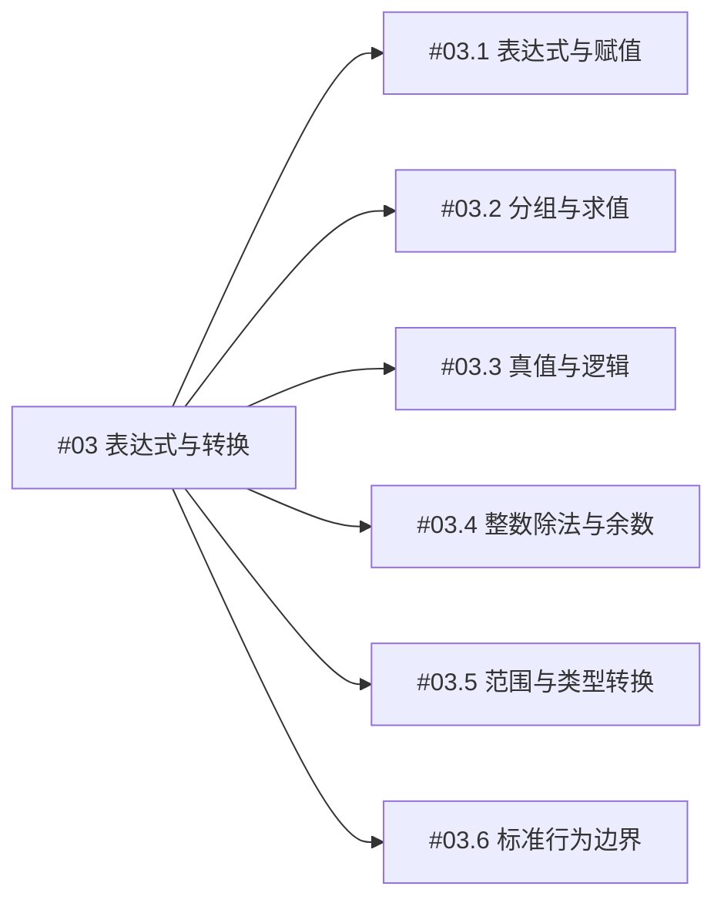

### 03.1 表达式与赋值

> [!note]- 知识图与目录
>
> ```mermaid
> flowchart LR
>   R["#03.1 表达式与赋值"]
>   N0["#70. 表达式加分号成语句"]
>   R --> N0
>   N1["#71. 赋值覆盖目标的旧值"]
>   R --> N1
>   N2["#72. 后赋值不改此前输出"]
>   R --> N2
>   N3["#73. 赋值左侧必须可写"]
>   R --> N3
>   N4["#74. 比较产生 int 零或一"]
>   R --> N4
>   N5["#75. 链式赋值向右结合"]
>   R --> N5
>   N6["#76. 赋值结果不是左值"]
>   R --> N6
>   class R,N0,N1,N2,N3,N4,N5,N6 internal-link;
> ```
>
> - [[#70. 表达式加分号成语句|70. 表达式加分号成语句]]
> - [[#71. 赋值覆盖目标的旧值|71. 赋值覆盖目标的旧值]]
> - [[#72. 后赋值不改此前输出|72. 后赋值不改此前输出]]
> - [[#73. 赋值左侧必须可写|73. 赋值左侧必须可写]]
> - [[#74. 比较产生 int 零或一|74. 比较产生 int 零或一]]
> - [[#75. 链式赋值向右结合|75. 链式赋值向右结合]]
> - [[#76. 赋值结果不是左值|76. 赋值结果不是左值]]

#### 70. 表达式加分号成语句

表达式可用于计算值，也可能伴随修改对象、输入输出等副作用。表达式后加分号可构成表达式语句。

```text
表达式：      value % 2 == 0
表达式语句：  value % 2 == 0;
```

第二种写法只计算并丢弃比较结果，不会把判断结果自动输出，也不会给 `value` 赋值。

#### 71. 赋值覆盖目标的旧值

给哪个可写对象赋值，就覆盖哪个对象原来保存的值：

```c
int score = 2;
score = 5;
```

像往同一个格子放入新的内容，原来的 `2` 不会自动另存备份。若存在多个指针别名，它们可能通过不同门牌访问同一格子；修改一个对象并不等于修改所有数值相同的独立对象。

#### 72. 后赋值不改此前输出

已经完成的输出不会因后来的赋值被追溯修改：

```c
#include <stdio.h>

int main(void)
{
    int value = 2;
    printf("%d\n", value);
    value = 5;
    printf("%d\n", value);
    return 0;
}
```

输出先是 `2`，后是 `5`。后一次改变格子里的值，不会把前一次已经写出的字符改写成别的字符。

#### 73. 赋值左侧必须可写

看到 `=`，先问“左边是不是一个可以写进去的格子”。标准术语是可修改左值。数值相同，不代表都能接收赋值；常量 `3` 不是这样的目标，普通数组整体也不能直接这样赋值。

结构体整体赋值有自己的规则，见复合类型章节。

#### 74. 比较产生 int 零或一

`b == c` 是比较，不是赋值；成立时产生 `int` 值 `1`，否则为 `0`。这不是一句只能放在 `if` 中的口头回答，而是能继续参加运算的值。

```c
int b = 2, c = 2;
int same = (b == c);  /* same得到1。 */
```

#### 75. 链式赋值向右结合

`a = b = c = 3` 按 `a = (b = (c = 3))` 分组：一个赋值号右边还可以是另一个赋值表达式。每次赋值都要按目标类型转换，不能据此忽略类型差异。

结合性说明语法分组，不等于为所有其他运算规定运行时求值顺序。

#### 76. 赋值结果不是左值

C 的赋值表达式产生赋值后的值，但结果不是左值。因此以下是**约束错误示例**：

```c
/* 错误示例：不能把赋值表达式的结果再当成赋值目标。 */
(a = b) = 9;
```

区别在于左侧是否具有可写身份，不在于它当前算出的数字是什么。

### 03.2 分组与求值

> [!note]- 知识图与目录
>
> ```mermaid
> flowchart LR
>   R["#03.2 分组与求值"]
>   N0["#77. 优先级决定跨层分组"]
>   R --> N0
>   N1["#78. 结合性决定同层分组"]
>   R --> N1
>   N2["#79. 括号明确预期分组"]
>   R --> N2
>   N3["#80. 括号不规定求值先后"]
>   R --> N3
>   N4["#81. 未排序修改会出错"]
>   R --> N4
>   N5["#82. 一元运算只取一个操作数"]
>   R --> N5
>   N6["#83. 后缀自增产生旧值"]
>   R --> N6
>   N7["#84. 前缀自增产生新值"]
>   R --> N7
>   class R,N0,N1,N2,N3,N4,N5,N6,N7 internal-link;
> ```
>
> - [[#77. 优先级决定跨层分组|77. 优先级决定跨层分组]]
> - [[#78. 结合性决定同层分组|78. 结合性决定同层分组]]
> - [[#79. 括号明确预期分组|79. 括号明确预期分组]]
> - [[#80. 括号不规定求值先后|80. 括号不规定求值先后]]
> - [[#81. 未排序修改会出错|81. 未排序修改会出错]]
> - [[#82. 一元运算只取一个操作数|82. 一元运算只取一个操作数]]
> - [[#83. 后缀自增产生旧值|83. 后缀自增产生旧值]]
> - [[#84. 前缀自增产生新值|84. 前缀自增产生新值]]

#### 77. 优先级决定跨层分组

不同优先级的运算符先按优先级形成语法分组。常用层级从高到低如下：

| 层级 | 运算符举例 |
| --- | --- |
| 后缀 | `()`、`[]`、`.`、`->`、后缀 `++ --` |
| 一元 | 前缀 `++ --`、`!`、`~`、`*`、`&`、一元 `+ -`、`sizeof` |
| 强制转换 | `(type)` |
| 乘除余、加减 | `* / %`，然后 `+ -` |
| 移位、大小比较、相等比较 | `<< >>`，然后 `< <= > >=`，然后 `== !=` |
| 按位 | `&`，然后 `^`，然后 <code>&#124;</code> |
| 逻辑 | `&&`，然后 <code>&#124;&#124;</code> |
| 条件、赋值、逗号 | `?:`，然后 `=` 等，最后 `,` |

例如 `a + b * c` 分组为 `a + (b * c)`。这里的“先”是分组层次，不能一概读成机器先执行哪一个操作数。

#### 78. 结合性决定同层分组

同一优先级还要看结合性：加减等常见二元运算从左向右结合，`a - b - c` 是 `(a - b) - c`；赋值从右向左结合。

一元、强制转换、条件 `?:` 和赋值等通常按右结合规则读。结合方向是括号如何补，不是各操作数怎样排队执行。

#### 79. 括号明确预期分组

不确定读者会怎样分组时，主动加括号。想先相加再乘，应写 `(a + b) * c`；检查某些位是否非零，应写 `(flags & mask) != 0u`。

括号是把语法结构钉清楚，不是为了堆满每一个子表达式。

#### 80. 括号不规定求值先后

`(f()) + (g())` 仍不保证先调用 `f`；函数实参也不能仅按书写顺序推断谁先求值。

想确保有依赖的操作按顺序完成，应拆成有明确先后关系的语句，而不是只在原式外面加更多括号。

#### 81. 未排序修改会出错

同一个标量对象的修改，与另一次修改或依赖其值的读取若处于不允许的未排序关系，会触发未定义行为。

```c
/* 未定义行为示例：不执行，也不推导固定输出。 */
i = i++ + 1;
printf("%d %d\n", i++, i++);
```

“某个编译器这一次从左到右算了”不能修复这个规则问题。

#### 82. 一元运算只取一个操作数

`!x`、`-x`、`*p`、`&value` 等都是一元运算：每次运算只需要一个操作数。相同符号在另一种位置可能是二元运算，如乘法 `a * b`。

先看所在语境和它抓住的操作数，再决定符号含义。

#### 83. 后缀自增产生旧值

`i++` 的表达式值是递增前的值，同时会使 `i` 递增。

```c
int i = 3;
int old = i++;  /* old为3，语句完成后i为4。 */
```

“拿旧值”不是“把修改无限推迟”。它规定这次运算的值计算与副作用关系，不能据此给复杂大表达式乱排顺序。

#### 84. 前缀自增产生新值

`++i` 递增 `i`，表达式产生递增后的值：

```c
int i = 3;
int now = ++i;  /* i和now均为4。 */
```

要先判断自增作用于哪个对象，再判断返回旧值还是新值。指针中的 `*q++` 与 `(*q)++` 另见 [[#249. 先判断自增抓住谁|指针自增]]。

### 03.3 真值与逻辑

> [!note]- 知识图与目录
>
> ```mermaid
> flowchart LR
>   R["#03.3 真值与逻辑"]
>   N0["#85. 条件把非零当真"]
>   R --> N0
>   N1["#86. 逻辑结果规范为零或一"]
>   R --> N1
>   N2["#87. 真值与退出状态分开"]
>   R --> N2
>   N3["#88. 零值先读接口契约"]
>   R --> N3
>   N4["#89. 逻辑与遇假就停"]
>   R --> N4
>   N5["#90. 逻辑或遇真就停"]
>   R --> N5
>   N6["#91. 按位与不负责短路"]
>   R --> N6
>   class R,N0,N1,N2,N3,N4,N5,N6 internal-link;
> ```
>
> - [[#85. 条件把非零当真|85. 条件把非零当真]]
> - [[#86. 逻辑结果规范为零或一|86. 逻辑结果规范为零或一]]
> - [[#87. 真值与退出状态分开|87. 真值与退出状态分开]]
> - [[#88. 零值先读接口契约|88. 零值先读接口契约]]
> - [[#89. 逻辑与遇假就停|89. 逻辑与遇假就停]]
> - [[#90. 逻辑或遇真就停|90. 逻辑或遇真就停]]
> - [[#91. 按位与不负责短路|91. 按位与不负责短路]]

#### 85. 条件把非零当真

`if` 等条件语境把标量的零值视为假、非零值视为真；空指针是假。输入的“真”不必恰好等于 `1`，例如整数 `7`、`-2` 都可作为真条件。

可以把条件当成验票口：它关心是否为零，不要求每张有效票都印着同一个数字。

#### 86. 逻辑结果规范为零或一

`!`、`&&`、`||` 产生 `int` 类型的 `0` 或 `1`。条件如何“吃进去”与逻辑运算如何“吐出来”是两件事：输入可有许多非零值，输出的真假则被规范为两个值。

#### 87. 真值与退出状态分开

条件里的 `0` 表示假；`main` 的退出状态 `0` 表示成功。`%` 的结果又只是余数。不要把数字 `0/1` 当成全 C 语言统一的“成功失败编码”。

`x % 2 == 0` 成立而产生 `1`，与 `return 0;` 表达成功并不矛盾：两者回答的不是同一个接口问题。

#### 88. 零值先读接口契约

| 场景 | 零的含义 |
| --- | --- |
| `if (condition)` | 条件为假 |
| `main` 返回值 | 成功退出 |
| `scanf` 返回值 | 成功赋值零项 |
| `feof` 返回值 | 文件尾指示器未设置 |

这些函数会在后面逐步展开。现在先建立习惯：不是背“零一定成功”或“零一定失败”，而是读清当前接口怎样解释它。

#### 89. 逻辑与遇假就停

`left && right` 先求左侧。左侧为假时，整个结果已确定为假，右侧不再求值；只有左侧为真时才继续右侧。这叫短路。

```c
int ready = 0;
int count = 0;
int result = ready && ++count;  /* result=0，count仍为0。 */
```

#### 90. 逻辑或遇真就停

`left || right` 先求左侧。左侧为真时，结果已经为真，右侧不执行；左侧为假时才需要继续检查。

两种短路都保证先完成左侧求值，再求需要执行的右侧，不要把这个特例推广到所有二元运算。

#### 91. 按位与不负责短路

`&` 是按位运算，左右两侧都要计算；它不能替代 `&&` 的短路控制。下面完整示例只含有有定义的独立修改：

```c
#include <stdio.h>

int main(void)
{
    int ready = 0;
    int count = 0;
    int a = ready && ++count;
    printf("%d %d\n", a, count);  /* 0 0 */
    int b = ready & ++count;
    printf("%d %d\n", b, count);  /* 0 1 */
    return 0;
}
```

右侧若含函数调用或变量修改，误把 `&&` 写成 `&`，可能改变程序行为。掩码结果与布尔值的区别见 [[#11.4 按位运算与掩码|位掩码]]。

### 03.4 整数除法与余数

> [!note]- 知识图与目录
>
> ```mermaid
> flowchart LR
>   R["#03.4 整数除法与余数"]
>   N0["#92. 整数商向零截断"]
>   R --> N0
>   N1["#93. 余数与被除数同号"]
>   R --> N1
>   N2["#94. 取余只接受整数"]
>   R --> N2
>   N3["#95. 除数不能为零"]
>   R --> N3
>   N4["#96. 商还必须能够表示"]
>   R --> N4
>   N5["#97. 商余能还原被除数"]
>   R --> N5
>   N6["#98. 偶数余二为零"]
>   R --> N6
>   N7["#99. 奇数别只比较一"]
>   R --> N7
>   N8["#100. 非负步数向上取整"]
>   R --> N8
>   class R,N0,N1,N2,N3,N4,N5,N6,N7,N8 internal-link;
> ```
>
> - [[#92. 整数商向零截断|92. 整数商向零截断]]
> - [[#93. 余数与被除数同号|93. 余数与被除数同号]]
> - [[#94. 取余只接受整数|94. 取余只接受整数]]
> - [[#95. 除数不能为零|95. 除数不能为零]]
> - [[#96. 商还必须能够表示|96. 商还必须能够表示]]
> - [[#97. 商余能还原被除数|97. 商余能还原被除数]]
> - [[#98. 偶数余二为零|98. 偶数余二为零]]
> - [[#99. 奇数别只比较一|99. 奇数别只比较一]]
> - [[#100. 非负步数向上取整|100. 非负步数向上取整]]

#### 92. 整数商向零截断

整数 `/` 得到向零截断的商：`7 / 3 == 2`，`-7 / 3 == -2`。不是总向下取整，也不会因为数学上有小数就自动得到浮点结果。

对非负整数，可先想成“分成完整小组后有几组”；遇到负数则回到向零截断规则。

#### 93. 余数与被除数同号

对有定义的整数运算，非零余数与被除数同号：`7 % 3 == 1`，`-7 % 3 == -1`，`7 % -3 == 1`。

非负场景中 `%` 可想成“分完还剩几个”；C 的负数余数不能无条件套成数学上总为非负的模。

#### 94. 取余只接受整数

`%` 的两侧必须是整数类型。浮点取余要使用相应数学库函数，不能把 `3.5 % 2.0` 当成合法 C 的普通取余写法。

#### 95. 除数不能为零

整数 `/`、`%` 的除数都必须非零，执行整数除零属于未定义行为。检查必须发生在运算之前，例如 `divisor != 0 && value % divisor == 0` 利用短路保护右侧。

#### 96. 商还必须能够表示

除数非零还不够，商也必须能由结果类型表示。C23 的 `int` 中，`INT_MIN / -1` 的数学结果比 `INT_MAX` 大，`INT_MIN % -1` 也触发同一类未定义行为。

不能因为余数在数学上看起来应为零，就跳过标准对这组操作的限制。

#### 97. 商余能还原被除数

当除数非零且商可表示时，满足 `(a / b) * b + a % b == a`。这把商与余数绑定为同一次整数除法的两个结果。

例如 `-7 / 3 == -2`、`-7 % 3 == -1`，于是 `(-2) * 3 + (-1) == -7`。

#### 98. 偶数余二为零

`x % 2 == 0` 判断偶数，正数、负数和零都适用。它判断的是除以二没有余数，不是“程序返回成功”。

#### 99. 奇数别只比较一

对任意整数，奇数用 `x % 2 != 0`；`x % 2 == 1` 只覆盖非负奇数等受限情景，因为负奇数除以二的余数可为 `-1`。

#### 100. 非负步数向上取整

当 `distance >= 0`、`step > 0` 时，最少需要多少个步长，可以写：

```c
int steps = distance / step + (distance % step != 0);
```

直观地说，先数走完几整步，只要还有距离就补一步。常见 `(distance + step - 1) / step` 还要求中间加法不溢出；上式避免了这次可能过大的加法。负数情景不能直接套这个公式。

### 03.5 范围与类型转换

> [!note]- 知识图与目录
>
> ```mermaid
> flowchart LR
>   R["#03.5 范围与类型转换"]
>   N0["#101. 有符号溢出未定义"]
>   R --> N0
>   N1["#102. 无符号运算按模计算"]
>   R --> N1
>   N2["#103. 绕回与溢出术语"]
>   R --> N2
>   N3["#104. 正偶数先检查再调整"]
>   R --> N3
>   N4["#105. 运算之前检查边界"]
>   R --> N4
>   N5["#106. 测试端点和零附近"]
>   R --> N5
>   N6["#107. 强制转换的写法"]
>   R --> N6
>   N7["#108. 转换不改源变量类型"]
>   R --> N7
>   N8["#109. 整数除法先于接收转换"]
>   R --> N8
>   class R,N0,N1,N2,N3,N4,N5,N6,N7,N8 internal-link;
> ```
>
> ```mermaid
> flowchart LR
>   R["#03.5 范围与类型转换"]
>   N0["#110. 转换位置改变运算语义"]
>   R --> N0
>   N1["#111. 转换可能丢失信息"]
>   R --> N1
>   N2["#112. 有无符号比较要核对"]
>   R --> N2
>   class R,N0,N1,N2 internal-link;
> ```
>
> - [[#101. 有符号溢出未定义|101. 有符号溢出未定义]]
> - [[#102. 无符号运算按模计算|102. 无符号运算按模计算]]
> - [[#103. 绕回与溢出术语|103. 绕回与溢出术语]]
> - [[#104. 正偶数先检查再调整|104. 正偶数先检查再调整]]
> - [[#105. 运算之前检查边界|105. 运算之前检查边界]]
> - [[#106. 测试端点和零附近|106. 测试端点和零附近]]
> - [[#107. 强制转换的写法|107. 强制转换的写法]]
> - [[#108. 转换不改源变量类型|108. 转换不改源变量类型]]
> - [[#109. 整数除法先于接收转换|109. 整数除法先于接收转换]]
> - [[#110. 转换位置改变运算语义|110. 转换位置改变运算语义]]
> - [[#111. 转换可能丢失信息|111. 转换可能丢失信息]]
> - [[#112. 有无符号比较要核对|112. 有无符号比较要核对]]

#### 101. 有符号溢出未定义

有符号普通整数运算的数学结果超出可表示范围时，行为未定义；向上超出 `INT_MAX` 和向下超出 `INT_MIN` 都不保证绕回。

C23 要求补码表示，也没有把有符号溢出改成合法环绕。表示规则和运算规则是两个问题。

#### 102. 无符号运算按模计算

若运算实际按某无符号类型进行，结果按该类型的模归入范围，像钟表走过最后一个刻度又从零开始。

```c
#include <limits.h>

/* 函数体片段。 */
unsigned int value = UINT_MAX;
value += 1u;  /* 结果为0。 */
```

小无符号类型可能先提升成 `int`，所以不能看见 `unsigned char` 就忽略整数提升；详见 [[#11.3 整数提升与转换|整数提升]]。

#### 103. 绕回与溢出术语

描述有定义的无符号模行为时，用“绕回（wrap around）”更能避免与有符号未定义溢出混淆。若以 8 个值位的无符号模型说明 `255` 后回零，还应说清实际运算或转换使用的类型。

术语的目的，是让读者知道这是标准规定的结果，不是越界后碰巧发生的故障现象。

#### 104. 正偶数先检查再调整

任务是：非正数返回 `0`；正偶数调整成不超过它的最近一个正奇数；正奇数保持原值。先排除非正数，再对正偶数减一：

```c
int positiveOddOrZero(int n)
{
    if (n <= 0)
        return 0;
    if (n % 2 == 0)
        --n;
    return n;
}
```

例如 `-2 → 0`、`0 → 0`、`6 → 5`、`7 → 7`。每个分支各管一类输入，不要先把所有偶数都减一再检查正负：C23 的 `INT_MIN` 是偶数，先减一会发生有符号溢出，之后返回 `0` 也救不回来。这里仅调整一个数，不是递归求和函数。

#### 105. 运算之前检查边界

先确定下一次操作能否表示，再执行操作。“先溢出，再判断是不是变小”无法补救未定义行为。

```c
#include <limits.h>

/* out须指向可写int；成功返回1，失败时不修改*out。 */
int increment_int(int value, int *out)
{
    if (value == INT_MAX) {
        return 0;
    }
    *out = value + 1;
    return 1;
}
```

#### 106. 测试端点和零附近

范围相关函数至少检查最小值、最小值加一、`-1`、`0`、`1`、最大值减一、最大值。端点暴露溢出风险，零附近暴露分支和奇偶规则是否正确。

除了最终结果，还要检查中间和、中间积或步进更新是否可表示。

#### 107. 强制转换的写法

显式转换写作 `(目标类型) 表达式`，如 `(double)x`。这是得到一个目标类型值的表达式，不是给变量重新声明类型。

#### 108. 转换不改源变量类型

对 `int x` 计算 `(double)x`，得到 `double` 值，`x` 自身仍是原来的 `int` 对象。可把它理解为从原盒子取内容，按另一种规格生成一份用于后续计算的值，没有把原盒子的标签撕掉。

#### 109. 整数除法先于接收转换

```c
int x = 5, y = 2;
double result = x / y;  /* 先整数除法得到2，再转double。 */
```

接收变量是 `double`，不会追溯改变右侧已经选定的整数除法。`(double)(x / y)` 也不能恢复先前丢掉的小数部分。

#### 110. 转换位置改变运算语义

```c
int x = 5, y = 2;
double result = (double)x / y;  /* 先转double，再得2.5。 */
```

转换放在除法前，才让除法按浮点语义进行。不要把“表达式最后的类型相同”当作“整个计算过程相同”。

#### 111. 转换可能丢失信息

浮点转整数会舍去小数部分，而且截断后的值必须能由目标整数类型表示；整数转浮点也可能丢精度。显式转换不是免费升级，更不是把越界或类型错误合法化的万能补丁。

#### 112. 有无符号比较要核对

```c
#include <stdio.h>

int main(void)
{
    int a = -1;
    unsigned int b = 1u;
    printf("%d\n", a < b);  /* 输出0。 */
    return 0;
}
```

这里 `a` 转为 `unsigned int`，对应 `UINT_MAX`，所以比较为假。代码可正常编译运行，也可能偏离直观的数学比较；详细规则见 [[#11.3 整数提升与转换|整数提升]]。

### 03.6 标准行为边界

> [!note]- 知识图与目录
>
> ```mermaid
> flowchart LR
>   R["#03.6 标准行为边界"]
>   N0["#113. 实现定义需要说明"]
>   R --> N0
>   N1["#114. 未指定不要求固定选择"]
>   R --> N1
>   N2["#115. 未定义行为没有固定结果"]
>   R --> N2
>   N3["#116. 一次运行不能证明合法"]
>   R --> N3
>   class R,N0,N1,N2,N3 internal-link;
> ```
>
> - [[#113. 实现定义需要说明|113. 实现定义需要说明]]
> - [[#114. 未指定不要求固定选择|114. 未指定不要求固定选择]]
> - [[#115. 未定义行为没有固定结果|115. 未定义行为没有固定结果]]
> - [[#116. 一次运行不能证明合法|116. 一次运行不能证明合法]]

#### 113. 实现定义需要说明

实现定义行为需要实现给出说明，例如普通 `char` 的符号性。读程序时应查当前实现说明，而不是把所有实现都想成本机这一种。

#### 114. 未指定不要求固定选择

未指定行为在标准允许的可能性中作选择，不要求实现记录每一次选择，也不保证每次都相同，例如某些操作数求值先后。

它们都不能被写成“这段代码必定按我本机观察的方式运行”，也不能因此与未定义行为合为一类。

#### 115. 未定义行为没有固定结果

未定义行为不是“编译器一定报错”，也不是“程序一定崩溃”。可以把它想成走出规则地图：这一次碰巧踩在平地上，不能据此画出一条可靠道路。

它可能看似正常、得到奇怪结果、崩溃，或影响优化。错误代码可用于解释意图，但不能据此推导标准保证的固定输出。

#### 116. 一次运行不能证明合法

一次运行得到预期结果，不证明代码没有越界、悬垂指针或未定义溢出。判断合法性要回到类型、对象范围、生命周期和求值规则。

测试能帮助发现问题；它不能把标准未保证的行为变成保证。

---

## 04 分支与循环

用条件选择道路，用循环重复步骤。读懂执行顺序，再建立数组扫描所需的状态意识。

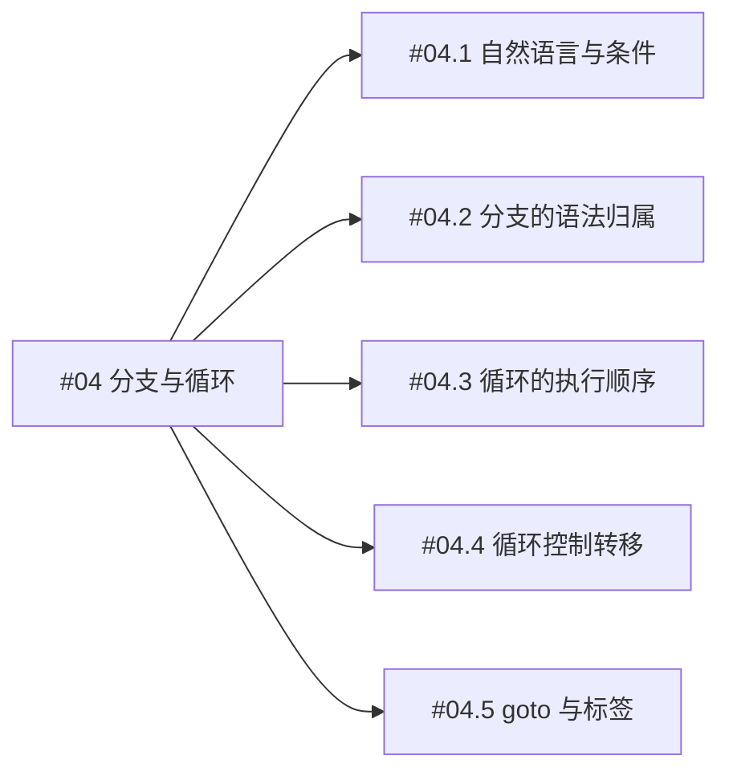

### 04.1 自然语言与条件

> [!note]- 知识图与目录
>
> ```mermaid
> flowchart LR
>   R["#04.1 自然语言与条件"]
>   N0["#117. 两个条件都要满足"]
>   R --> N0
>   N1["#118. 至少一个条件满足"]
>   R --> N1
>   N2["#119. 条件取反"]
>   R --> N2
>   N3["#120. 闭区间包含端点"]
>   R --> N3
>   N4["#121. 开区间排除端点"]
>   R --> N4
>   N5["#122. 区间外使用逻辑或"]
>   R --> N5
>   N6["#123. 不相等使用 !="]
>   R --> N6
>   N7["#124. 用余数判断整除"]
>   R --> N7
>   class R,N0,N1,N2,N3,N4,N5,N6,N7 internal-link;
> ```
>
> - [[#117. 两个条件都要满足|117. 两个条件都要满足]]
> - [[#118. 至少一个条件满足|118. 至少一个条件满足]]
> - [[#119. 条件取反|119. 条件取反]]
> - [[#120. 闭区间包含端点|120. 闭区间包含端点]]
> - [[#121. 开区间排除端点|121. 开区间排除端点]]
> - [[#122. 区间外使用逻辑或|122. 区间外使用逻辑或]]
> - [[#123. 不相等使用 !=|123. 不相等使用 !=]]
> - [[#124. 用余数判断整除|124. 用余数判断整除]]

#### 117. 两个条件都要满足

自然语言的“并且”“都满足”通常用 `&&` 连接。先分别写出两个可独立判断的条件，再把它们合起来。

`cond1 && cond2` 不是要求两侧都等于 `1`，而是把两侧各自按真假解释，并遵守短路规则。

#### 118. 至少一个条件满足

“或者”“至少一个满足”通常用 `||`：`cond1 || cond2`。两个都满足时也是真；若题目要求“恰好一个满足”，就要另行表达，不能把普通逻辑或当成排他选择。

#### 119. 条件取反

`!cond` 表示原条件不成立。对组合条件取反时，要同时改变连接方式：`!(a && b)` 等价于 `!a || !b`，`!(a || b)` 等价于 `!a && !b`。

可以先读成完整中文，再检查是不是把“都不是”误写成了“至少一个不是”。

#### 120. 闭区间包含端点

已知 `low <= high`，`x` 位于闭区间内写作 `x >= low && x <= high`。例如 `[1,100]` 包含 `1` 和 `100`。

不要直接写数学式 `low <= x <= high`：C 会先得到前一次比较的 `0/1`，再拿这个结果与 `high` 比较。

#### 121. 开区间排除端点

`x > low && x < high` 表示位于开区间内。与闭区间的不同就在两个边界：端点是否算有效输入，要由题意决定，不能随手换比较符号。

#### 122. 区间外使用逻辑或

已知 `low <= high`，不在闭区间内写作 `x < low || x > high`。落在左边或右边任一侧都算区间外，因此用 `||`。

左右两边不可能同时成立，若误用 `&&`，条件就无法表达原意。

#### 123. 不相等使用 !=

“两个数不相等”写 `a != b`，同样会产生表示真假的 `int` 值。它不是把两个对象的差值直接当作返回结果。

相等比较和赋值的区别见 [[#74. 比较产生 int 零或一|比较产生 int 零或一]]。后面的 `fp == NULL`、`*p == target` 使用相应比较规则，只是对象和情景不同。

#### 124. 用余数判断整除

`x % k == 0` 表示 `x` 能被 `k` 整除，`x % k != 0` 表示不能整除。比如“能被 3 整除”写成 `x % 3 == 0`。

前提仍是 `k != 0` 且相关商可表示。这个条件不会替你自动消除除零等错误；奇偶的负数边界见整数除法章节。

### 04.2 分支的语法归属

> [!note]- 知识图与目录
>
> ```mermaid
> flowchart LR
>   R["#04.2 分支的语法归属"]
>   N0["#125. if 控制紧接的一条语句"]
>   R --> N0
>   N1["#126. 花括号组成复合语句"]
>   R --> N1
>   N2["#127. 分号可以是一条空语句"]
>   R --> N2
>   N3["#128. else 就近配对"]
>   R --> N3
>   N4["#129. switch 选择入口"]
>   R --> N4
>   class R,N0,N1,N2,N3,N4 internal-link;
> ```
>
> - [[#125. if 控制紧接的一条语句|125. if 控制紧接的一条语句]]
> - [[#126. 花括号组成复合语句|126. 花括号组成复合语句]]
> - [[#127. 分号可以是一条空语句|127. 分号可以是一条空语句]]
> - [[#128. else 就近配对|128. else 就近配对]]
> - [[#129. switch 选择入口|129. switch 选择入口]]

#### 125. if 控制紧接的一条语句

没有花括号时，`if` 只控制紧接的一条语句。缩进只是给人看的排版，不能让后面两三条语句自动归入同一个条件。

```c
/* 片段：这里只在条件成立时增加passed。 */
if (score >= 60)
    ++passed;
++checked;  /* 无条件执行。 */
```

先看分号和花括号，再看缩进；嵌套分支和循环也按这个方法读。

#### 126. 花括号组成复合语句

`{ ... }` 形成复合语句，块中可以有声明和语句；整个块又能放在要求一条语句的位置。因此想连续执行多步，就把它们装进同一个语法盒子：

```c
if (score >= 60) {
    passed = 1;
    ++pass_count;
} else {
    passed = 0;
}
```

文件读取中，若失败时需要依次输出错误、关闭文件、返回失败，应把三步放进相应的同一块中；缩进本身不能决定执行范围。

#### 127. 分号可以是一条空语句

单独的 `;` 是合法空语句。下面是**逻辑错误示例**：

```c
/* 错误示例：条件实际控制的是空语句。 */
if (number > max);
{
    max = number;
}
```

分号已经把“条件成立时做什么”填成了“什么也不做”，后面的块随后无条件执行。这通常不是语法错误，所以不能只等编译失败来发现它。

#### 128. else 就近配对

没有相应花括号改变结构时，`else` 与最近尚未配对的 `if` 结合。不要用视觉上更远的缩进替它指定配对对象；需要排除歧义时明确加块。

#### 129. switch 选择入口

`switch` 根据整数或枚举表达式的值选择标签入口，适合离散取值的分派。可把 `case` 想成进入同一条道路的不同入口，标签本身不会自动拦住后续执行。

```c
/* 函数片段：不同数字可以进入同一段处理。 */
int classify(int code)
{
    switch (code) {
    case 1:
    case 2:
        return 10;
    case 3:
        return 20;
    default:
        return 0;
    }
}
```

`case` 常量、贯穿、重复值、`default` 位置等细规则在 [[#14.5 枚举与离散状态|枚举状态]] 中逐点说明。

### 04.3 循环的执行顺序

> [!note]- 知识图与目录
>
> ```mermaid
> flowchart LR
>   R["#04.3 循环的执行顺序"]
>   N0["#130. for 初始化只做一次"]
>   R --> N0
>   N1["#131. for 入体之前检查条件"]
>   R --> N1
>   N2["#132. for 更新在循环体之后"]
>   R --> N2
>   N3["#133. 第三格自增结果被丢弃"]
>   R --> N3
>   N4["#134. for 内声明名字的范围"]
>   R --> N4
>   N5["#135. while 先判断再执行"]
>   R --> N5
>   N6["#136. do 至少先执行一次"]
>   R --> N6
>   N7["#137. 先写轨迹再验条件"]
>   R --> N7
>   N8["#138. 删除可由不变量推出的条件"]
>   R --> N8
>   class R,N0,N1,N2,N3,N4,N5,N6,N7,N8 internal-link;
> ```
>
> - [[#130. for 初始化只做一次|130. for 初始化只做一次]]
> - [[#131. for 入体之前检查条件|131. for 入体之前检查条件]]
> - [[#132. for 更新在循环体之后|132. for 更新在循环体之后]]
> - [[#133. 第三格自增结果被丢弃|133. 第三格自增结果被丢弃]]
> - [[#134. for 内声明名字的范围|134. for 内声明名字的范围]]
> - [[#135. while 先判断再执行|135. while 先判断再执行]]
> - [[#136. do 至少先执行一次|136. do 至少先执行一次]]
> - [[#137. 先写轨迹再验条件|137. 先写轨迹再验条件]]
> - [[#138. 删除可由不变量推出的条件|138. 删除可由不变量推出的条件]]

#### 130. for 初始化只做一次

`for (初始化; 条件; 更新)` 进入这次循环时先做初始化，随后反复检查条件、执行循环体和更新。初始化不是每轮重新出生一次。

记忆路线：**出生一次 → 验票 → 干活 → 挪步 → 回去验票**。

#### 131. for 入体之前检查条件

`for` 的条件在进入每轮循环体之前检查。第一次就为假，循环体一次也不执行。

把条件想成门口验票：还没放行就不能先干活；不是循环体执行过以后才第一次查看条件。

#### 132. for 更新在循环体之后

正常完成循环体后，执行第三格更新，再回去检查条件。第三格中的递增不是在第一次检查前先做，也不会在条件为假退出后再多做一轮。

```c
#include <stdio.h>

int main(void)
{
    for (int i = 1; i <= 5; ++i) {
        printf("%d%c", i, i == 5 ? '\n' : ' ');
    }
    return 0;
}
```

输出 `1 2 3 4 5`，可以按初始化、验票、干活、更新逐步核对。

#### 133. 第三格自增结果被丢弃

对普通整数控制变量，第三格单独写 `i++` 或 `++i`，只需要其递增副作用，表达式的结果不参与后续计算，因此最终效果相同。

这不意味着把它们放进其他表达式也一样，更不意味着忽略递增越界的前提。

在指针循环的第三格中也一样：合法范围内的 `p++` 和 `++p` 都让指针前进一个元素。可以想成两位快递员：一位先报旧门牌再走，另一位先走再报新门牌；现场没人接收报出的门牌，所以单看这次移动，都会走到下一户。前提是指针算术始终合法，具体见 [[#249. 先判断自增抓住谁|指针自增]]。

#### 134. for 内声明名字的范围

第一格声明的名字只在该 `for` 的作用域内可见：

```c
for (int i = 1; i < 10; i += 4) {
    /* 此处可用i，循环体看到1、5、9。 */
}
/* 错误示例：这里已不能直接使用该局部名字i。 */
/* printf("%d", i); */
```

能推导最后一次更新得到 `13`，不表示循环后的名字仍然可见。数值轨迹与名字作用域是两个问题。

#### 135. while 先判断再执行

`while (条件)` 在每次进入循环体前检查条件，因此可能一次也不执行。循环体及其他更新必须让状态有机会接近终止条件，不能只写一个永远不变的真条件等它自行停止。

#### 136. do 至少先执行一次

`do { ... } while (条件);` 先执行循环体，再检查条件，所以至少进入一次。它与 `while` 的区别在第一次判断发生的位置，末尾分号也属于这条语句的语法。

#### 137. 先写轨迹再验条件

初值为 `2`、每轮加 `3`、条件是 `i < 10`：

```text
检查值       2   5   8   11
i<10         真  真  真  假
执行循环体   是  是  是  否
```

循环体执行三次，退出时控制变量可已越过最后一个合法处理值。条件每轮重新验票；多个 `&&` 条件还按短路规则逐个检查，不能把所有候选轨迹都算进执行次数。

#### 138. 删除可由不变量推出的条件

在 `for (int i = 1; i <= 5; ++i)` 中，有限执行范围已保证 `i > 0`，不必再把它重复写进循环条件。

删除前要证明它确实始终成立；若还有其他语句修改 `i`，或步进可能溢出，就不能仅凭初值正数推断整段执行都安全。

### 04.4 循环控制转移

> [!note]- 知识图与目录
>
> ```mermaid
> flowchart LR
>   R["#04.4 循环控制转移"]
>   N0["#139. break 离开最近一层"]
>   R --> N0
>   N1["#140. if 不是 break 的目标"]
>   R --> N1
>   N2["#141. continue 只结束本轮"]
>   R --> N2
>   N3["#142. for 的 continue 先去更新"]
>   R --> N3
>   N4["#143. while 的 continue 去判条件"]
>   R --> N4
>   N5["#144. continue 可能跳过推进"]
>   R --> N5
>   class R,N0,N1,N2,N3,N4,N5 internal-link;
> ```
>
> - [[#139. break 离开最近一层|139. break 离开最近一层]]
> - [[#140. if 不是 break 的目标|140. if 不是 break 的目标]]
> - [[#141. continue 只结束本轮|141. continue 只结束本轮]]
> - [[#142. for 的 continue 先去更新|142. for 的 continue 先去更新]]
> - [[#143. while 的 continue 去判条件|143. while 的 continue 去判条件]]
> - [[#144. continue 可能跳过推进|144. continue 可能跳过推进]]

#### 139. break 离开最近一层

`break` 立刻结束最近一层循环或 `switch`，然后从它后面继续。嵌套循环中的一个 `break` 不会自动跳出所有外层循环。

#### 140. if 不是 break 的目标

循环里套着 `if`，并不改变 `break` 向外寻找循环或 `switch` 的规则：

```c
/* 查找片段：找到一个负数后结束for。 */
for (int i = 0; i < n; ++i) {
    if (data[i] < 0) {
        first_negative = i;
        break;
    }
}
```

这里退出的是 `for`，不是“只退出这个 if”。

#### 141. continue 只结束本轮

`continue` 跳过本次迭代尚未执行的循环体部分，循环本身还继续。它不是 `break` 的弱化拼写；下一站由所在循环的执行模型决定。

#### 142. for 的 continue 先去更新

`for` 中遇到 `continue`，先去第三格执行更新，再判断条件。即使跳过了循环体末尾，第三格的正常更新仍会发生。

#### 143. while 的 continue 去判条件

`while` 和 `do ... while` 中，`continue` 直接转向循环条件检查，不会代替你执行原本放在循环体末尾的更新语句。

#### 144. continue 可能跳过推进

阅读 `while + continue` 时先找推进动作，确认不会被跳过去：

```c
int i = 0;
while (i < 5) {
    ++i;
    if (i % 2 == 0) {
        continue;
    }
    /* 此处处理1、3、5。 */
}
```

若把 `++i` 只放在可能被跳过的末尾，循环可能卡在同一个状态。不是 `continue` 自动产生下一值，而是程序中的更新真正推进了状态。

### 04.5 goto 与标签

> [!note]- 知识图与目录
>
> ```mermaid
> flowchart LR
>   R["#04.5 goto 与标签"]
>   N0["#145. 分号跳转冒号标记"]
>   R --> N0
>   N1["#146. goto 不能跨函数"]
>   R --> N1
>   N2["#147. goto 可汇合清理路径"]
>   R --> N2
>   class R,N0,N1,N2 internal-link;
> ```
>
> - [[#145. 分号跳转冒号标记|145. 分号跳转冒号标记]]
> - [[#146. goto 不能跨函数|146. goto 不能跨函数]]
> - [[#147. goto 可汇合清理路径|147. goto 可汇合清理路径]]

#### 145. 分号跳转冒号标记

`goto finish;` 是跳转语句，`finish:` 是标签。标签像路牌，单独出现不会主动把程序传送过去；程序也可以顺序走到它。

```c
#include <stdio.h>

int main(void)
{
    puts("start");
    goto finish;
    puts("skipped");
finish:
    puts("finish");
    return 0;
}
```

输出两行 `start`、`finish`，中间一条被跳过。

#### 146. goto 不能跨函数

`goto` 只能跳到同一函数内的标签，不能直接跳入另一个函数。它也不能越过限制，跳入变长修改类型标识符的作用域。

#### 147. goto 可汇合清理路径

普通选择与重复流程优先用 `if`、`for`、`while` 来表达。已经获得多个资源、不同失败路径需要汇合释放时，`goto` 可以用于一个清楚的清理出口。

跳到出口只改变控制流，不会自动释放内存或关闭文件；具体资源规则见 [[#17.15 缓冲与关闭|资源清理]]。

---

## 05 函数与作用域

把一段工作封装为接口，分清调用、传值与返回。后续的数组、指针和递归都建立在这些规则上。

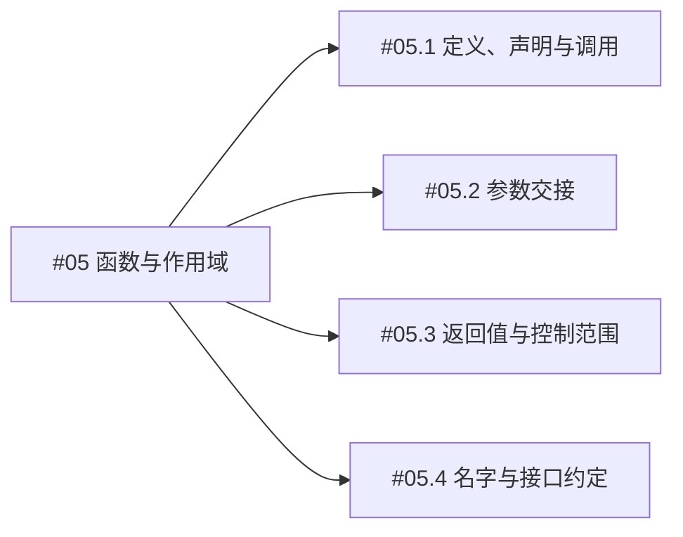

### 05.1 定义、声明与调用

> [!note]- 知识图与目录
>
> ```mermaid
> flowchart LR
>   R["#05.1 定义、声明与调用"]
>   N0["#148. 声明介绍函数接口"]
>   R --> N0
>   N1["#149. 定义提供函数体"]
>   R --> N1
>   N2["#150. 调用才执行函数体"]
>   R --> N2
>   N3["#151. 调用前需要可见声明"]
>   R --> N3
>   N4["#152. 空参数表的版本差异"]
>   R --> N4
>   N5["#153. void 返回类型不交回值"]
>   R --> N5
>   class R,N0,N1,N2,N3,N4,N5 internal-link;
> ```
>
> - [[#148. 声明介绍函数接口|148. 声明介绍函数接口]]
> - [[#149. 定义提供函数体|149. 定义提供函数体]]
> - [[#150. 调用才执行函数体|150. 调用才执行函数体]]
> - [[#151. 调用前需要可见声明|151. 调用前需要可见声明]]
> - [[#152. 空参数表的版本差异|152. 空参数表的版本差异]]
> - [[#153. void 返回类型不交回值|153. void 返回类型不交回值]]

#### 148. 声明介绍函数接口

函数声明告诉编译器函数名、返回类型和参数类型，像一份功能说明书，告诉调用者能送什么、会拿回什么：

```c
int add(int left, int right);
```

这行没有执行加法；跨文件声明如何保持兼容，见工程章节。

#### 149. 定义提供函数体

定义把实际步骤写出来。函数定义同时也是一种声明；但只有接口声明，不等于已经有函数体。

```c
#include <stdio.h>

int add(int left, int right);

int main(void)
{
    int total = add(2, 3);
    printf("%d\n", total);
    return 0;
}

int add(int left, int right)
{
    return left + right;
}
```

示例中的和可以由 `int` 表示。一般输入仍需检查范围，不能把示例小值当作所有调用都不溢出的证明。

#### 150. 调用才执行函数体

把函数体写在源文件里，不等于程序已经执行了它。只有执行到函数调用，才进入相应函数体；函数写在前面，也不表示运行时一定先调用它。

可以把定义想成“先把做事步骤登记好”，把调用想成“这次真的按步骤办事”。上例的 `add(2, 3)` 才是那次加法调用。

#### 151. 调用前需要可见声明

调用函数时，应已有可见的兼容函数声明。可以先提供原型，也可以让完整定义出现在调用之前；不要依赖历史上的隐式函数声明。

示例程序把 `add` 的原型写在 `main` 前，让编译器先读到这份调用合同。

#### 152. 空参数表的版本差异

C23 中 `int f();` 表示无参数函数；C17 及更早版本的这类函数声明中，空参数表不提供参数数量和类型信息。

`int f(void);` 明确表示无参数，阅读新旧材料时更容易保持清楚。不要把“空参数表的历史规则”直接套到 C23。

#### 153. void 返回类型不交回值

`void show(void)` 的第一个 `void` 表示函数不交回一个值；参数表中的 `void` 表示不接收参数。相同单词出现在两处，分别回答“交回什么”和“接收什么”。

`void` 不是据此可以定义普通变量并存放数值的一种对象类型。

### 05.2 参数交接

> [!note]- 知识图与目录
>
> ```mermaid
> flowchart LR
>   R["#05.2 参数交接"]
>   N0["#154. 实参送值形参接值"]
>   R --> N0
>   N1["#155. 形参也是普通变量"]
>   R --> N1
>   N2["#156. 形参也能成为实参"]
>   R --> N2
>   N3["#157. 调用者不是写程序的人"]
>   R --> N3
>   N4["#158. 值传递复制参数值"]
>   R --> N4
>   N5["#159. 传指针也复制指针值"]
>   R --> N5
>   class R,N0,N1,N2,N3,N4,N5 internal-link;
> ```
>
> - [[#154. 实参送值形参接值|154. 实参送值形参接值]]
> - [[#155. 形参也是普通变量|155. 形参也是普通变量]]
> - [[#156. 形参也能成为实参|156. 形参也能成为实参]]
> - [[#157. 调用者不是写程序的人|157. 调用者不是写程序的人]]
> - [[#158. 值传递复制参数值|158. 值传递复制参数值]]
> - [[#159. 传指针也复制指针值|159. 传指针也复制指针值]]

#### 154. 实参送值形参接值

实参是某次调用括号里送出的表达式，形参是函数参数表中声明的接收对象。读成“调用者送出 → 被调函数接收”，比把两个名词当成两种永久变量类别更清楚。

`show(number)` 中，表达式 `number` 是这次调用的实参；`void show(int value)` 中的 `value` 是接收它的形参。

#### 155. 形参也是普通变量

形参进入函数调用后，可以像普通变量一样读取和赋值。它不是除了局部变量、全局变量以外的某种神秘第三类存储。

这次调用用实参的值初始化它；随后在函数内改变它，仍要按正常的类型和赋值规则理解。

#### 156. 形参也能成为实参

```c
#include <stdio.h>

void show(int value)
{
    printf("%d\n", value);
}

void update(int number)
{
    show(number);
}

int main(void)
{
    update(7);
    return 0;
}
```

`number` 是 `update` 的形参；放进 `show(number)` 后，表达式 `number` 又成为 `show` 的实参。两种身份依赖不同的调用关系，可以同时成立，不必二选一。

#### 157. 调用者不是写程序的人

写程序的人、启动程序的人，都不是普通函数调用关系中“调用者”的含义。执行相应调用表达式的函数或执行上下文，才处在调用方位置。

上例调用链是 `main → update → show`；对 `show` 这次调用，`update` 是直接调用方。

#### 158. 值传递复制参数值

形参得到实参值的一份副本。像两个盒子起初装着相同数字，改其中一个，不会自动改另一个：

```c
#include <stdio.h>

void change_copy(int value)
{
    value = 99;
    printf("inside: %d\n", value);
}

int main(void)
{
    int score = 7;
    change_copy(score);
    printf("outside: %d\n", score);
    return 0;
}
```

```text
inside: 99
outside: 7
```

#### 159. 传指针也复制指针值

传递指针时，仍然复制指针值；两份指针可能指向同一个对象，所以经指针修改该对象能被调用方看到。给形参指针本身换地址，则不会直接改掉调用方的指针变量。

先记住“复制的是门牌卡，门牌可能指向同一间房”，具体操作见 [[#14.3 指针传参与类型别名|指针传参]]。

### 05.3 返回值与控制范围

> [!note]- 知识图与目录
>
> ```mermaid
> flowchart LR
>   R["#05.3 返回值与控制范围"]
>   N0["#160. return 结束当前调用"]
>   R --> N0
>   N1["#161. 返回值不是屏幕输出"]
>   R --> N1
>   N2["#162. 返回值可以被丢弃"]
>   R --> N2
>   N3["#163. 返回路径要提供有效值"]
>   R --> N3
>   N4["#164. exit 结束整个程序"]
>   R --> N4
>   N5["#165. 正常终止处理标准流"]
>   R --> N5
>   N6["#166. exit 不代替逐项释放"]
>   R --> N6
>   class R,N0,N1,N2,N3,N4,N5,N6 internal-link;
> ```
>
> - [[#160. return 结束当前调用|160. return 结束当前调用]]
> - [[#161. 返回值不是屏幕输出|161. 返回值不是屏幕输出]]
> - [[#162. 返回值可以被丢弃|162. 返回值可以被丢弃]]
> - [[#163. 返回路径要提供有效值|163. 返回路径要提供有效值]]
> - [[#164. exit 结束整个程序|164. exit 结束整个程序]]
> - [[#165. 正常终止处理标准流|165. 正常终止处理标准流]]
> - [[#166. exit 不代替逐项释放|166. exit 不代替逐项释放]]

#### 160. return 结束当前调用

执行 `return` 会结束当前这次函数调用，沿该路径位于它后面的语句不再执行。递归中它结束的是当前这一层，随后回到等待它的上一层。

它不像 `break` 那样只离开最近循环，也不像 `exit` 那样开始整个程序的正常终止。

#### 161. 返回值不是屏幕输出

```c
int square(int value)
{
    return value * value;  /* 前提：乘积可由int表示。 */
}
```

`square(3)` 交回数值 `9`，并不会自动在屏幕显示字符 `9`。`printf` 的输出与函数返回值是两个方向的动作，不会相互代替。

#### 162. 返回值可以被丢弃

`int result = square(3);` 才把该值写入 `result`；单独写 `square(3);` 可以调用后丢弃结果。

返回值也可以直接参加其他表达式，不一定先放入变量。因此应说“返回值只有参与赋值等相应操作时才会改写指定对象”，而不是要求每次调用都先接进一个盒子。

#### 163. 返回路径要提供有效值

普通非 `void` 函数应在需要返回值的路径上提供有效值。执行到末尾却没有返回值，随后调用者使用这个缺失的值，会造成未定义行为。

这与 `main` 自 C99 起末尾隐式返回零的专门规则不同。原来只为说明参数角色而写的 `update` 没有返回数值，应定义为 `void`，不要顺手写 `int` 却漏掉返回。

#### 164. exit 结束整个程序

普通函数执行 `exit(EXIT_SUCCESS)` 或 `exit(EXIT_FAILURE)`，会开始整个程序的正常终止，不是只退回上一层函数。

可以把普通 `return` 想成“当前这一站办完，回到上一站”，把 `exit` 想成“整条线路收工”。选择何时终止，应该由程序的错误处理设计决定。

#### 165. 正常终止处理标准流

正常终止会调用已注册的退出处理函数，并按标准处理尚未写出的流缓冲数据、关闭流等。从初次调用的 `main` 返回也进入正常终止过程。

若需要准确判断某个文件写入和关闭是否成功，仍应在程序可处理错误时显式检查，不能把所有检查都推给退出过程。

#### 166. exit 不代替逐项释放

`exit` 不会替程序逐个 `free` 所有动态对象。进程终止后的系统回收，与程序运行期间正确管理自己拥有的存储，是不同的问题。

逐层报告错误并让每层处理自己的资源，常更容易保持所有权清楚；动态对象的具体规则见生命周期章节。

### 05.4 名字与接口约定

> [!note]- 知识图与目录
>
> ```mermaid
> flowchart LR
>   R["#05.4 名字与接口约定"]
>   N0["#167. 局部名字不跨函数可见"]
>   R --> N0
>   N1["#168. 不同作用域可以重名"]
>   R --> N1
>   N2["#169. 重名不代表同一个对象"]
>   R --> N2
>   N3["#170. 合法结果不能兼作失败哨兵"]
>   R --> N3
>   N4["#171. 先明确接口承诺"]
>   R --> N4
>   class R,N0,N1,N2,N3,N4 internal-link;
> ```
>
> - [[#167. 局部名字不跨函数可见|167. 局部名字不跨函数可见]]
> - [[#168. 不同作用域可以重名|168. 不同作用域可以重名]]
> - [[#169. 重名不代表同一个对象|169. 重名不代表同一个对象]]
> - [[#170. 合法结果不能兼作失败哨兵|170. 合法结果不能兼作失败哨兵]]
> - [[#171. 先明确接口承诺|171. 先明确接口承诺]]

#### 167. 局部名字不跨函数可见

`main` 中声明的局部变量，不能靠在另一个函数里直接写相同名字来访问。名字像房间里的铭牌：在这间房里找得到，不表示每个房间都能直接看到它。

通过参数、返回值或受规则约束的共享接口传递信息，不能把“名字相同”当成传参。

#### 168. 不同作用域可以重名

不同作用域中可以有同名标识符。同一种业务含义采用相同局部名字很常见；若角色不同，换更清楚的名字有助阅读。

嵌套作用域还可能发生遮蔽，应先判断当前名字实际绑定哪一个声明，而不是仅按拼写判断。

#### 169. 重名不代表同一个对象

两个函数里各有一个局部 `score`，通常是两个不同对象。同名铭牌不等于同一只盒子，也不代表其中一个修改时另一个自动改变。

作用域、存储期与链接分别回答不同问题，完整对照见 [[#740. 作用域与存储期不等同|作用域与存储期]]。

#### 170. 合法结果不能兼作失败哨兵

如果真正的答案可以是 `0`，同时用 `0` 表示所有失败，会把“成功得到零”和“没有得到答案”混在一起。

接口可以让返回值表示状态，通过额外通道交回结果。下面完整函数保留这个约定：成功返回 `1` 并写入输出，失败返回 `0` 且不修改输出。指针语法会在后面详细解释。

```c
#include <limits.h>

/* out须指向有效的可写int。 */
int add_checked(int a, int b, int *out)
{
    if ((b > 0 && a > INT_MAX - b) ||
        (b < 0 && a < INT_MIN - b)) {
        return 0;
    }
    *out = a + b;
    return 1;
}
```

#### 171. 先明确接口承诺

返回值可能是状态、项数、字符数、位置或指针。检查它之前，要知道成功条件、是否允许部分完成，以及失败后输出对象还能否使用。

这一步是读接口的起点；各个库函数的具体承诺仍分别放在对应知识点，不能用一张笼统总表替代。

---

## 06 数组与扫描

数组把同类型对象排成一列；循环扫描它们时，只保存未来决策需要的历史。

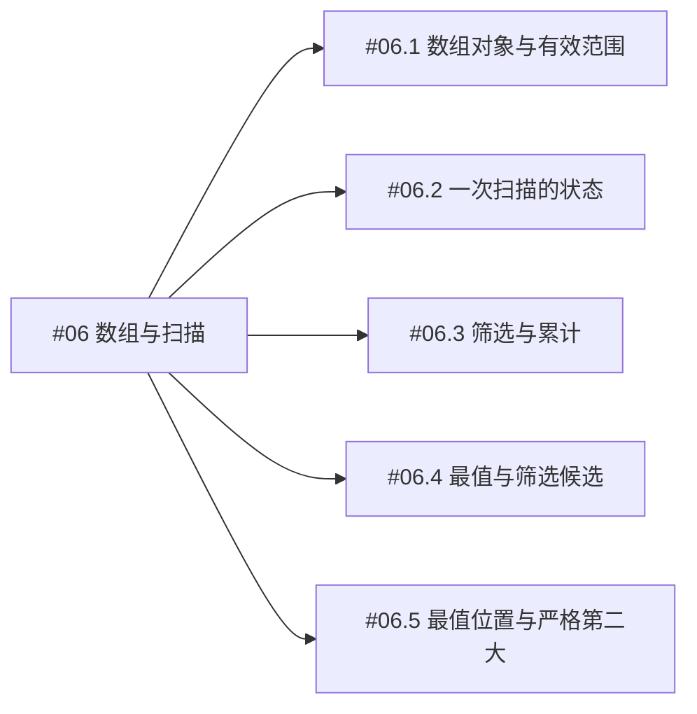

### 06.1 数组对象与有效范围

> [!note]- 知识图与目录
>
> ```mermaid
> flowchart LR
>   R["#06.1 数组对象与有效范围"]
>   N0["#172. 声明数量与访问下标"]
>   R --> N0
>   N1["#173. 下标从零计数"]
>   R --> N1
>   N2["#174. 合法下标到长度减一"]
>   R --> N2
>   N3["#175. 类型名不是数组名"]
>   R --> N3
>   N4["#176. 容量与有效长度"]
>   R --> N4
>   N5["#177. 逻辑空数组仍需合法存储声明"]
>   R --> N5
>   N6["#178. 真正数组可用sizeof计数"]
>   R --> N6
>   N7["#179. 反推数量须知道单元素大小"]
>   R --> N7
>   class R,N0,N1,N2,N3,N4,N5,N6,N7 internal-link;
> ```
>
> - [[#172. 声明数量与访问下标|172. 声明数量与访问下标]]
> - [[#173. 下标从零计数|173. 下标从零计数]]
> - [[#174. 合法下标到长度减一|174. 合法下标到长度减一]]
> - [[#175. 类型名不是数组名|175. 类型名不是数组名]]
> - [[#176. 容量与有效长度|176. 容量与有效长度]]
> - [[#177. 逻辑空数组仍需合法存储声明|177. 逻辑空数组仍需合法存储声明]]
> - [[#178. 真正数组可用sizeof计数|178. 真正数组可用sizeof计数]]
> - [[#179. 反推数量须知道单元素大小|179. 反推数量须知道单元素大小]]

#### 172. 声明数量与访问下标

`int data[5]` 声明 5 个整数元素；`data[2]` 访问下标为 2 的第三个元素。声明处的数字是数量，访问处的数字是位置，二者不能交换理解。

```c
int data[5] = {10, 20, 30, 40, 50};
int third = data[2];  /* 30 */
```

同样地，访问表达式 `a[i][j]` 里的 `i`、`j` 是当前选择的位置，不是在重新指定数组尺寸。

#### 173. 下标从零计数

下标以当前起点为参考，`data[0]` 不偏移，`data[2]` 偏移两个元素。可先把 `E1[E2]` 读成“从 `E1` 的起点选择偏移 `E2` 的元素”；严格指针等价式见 [[#07.2 数组转换与指针运算|数组与指针]]。

数组整体与某个元素的身份区别见 [[#222. 数组名不是首元素|数组名不是首元素]]。

#### 174. 合法下标到长度减一

长度为 `n` 的数组，元素下标是 `0` 到 `n - 1`。`int data[5]` 的最后一个元素是 `data[4]`，访问 `data[5]` 会越界。下标表达式不会自动检查范围。

#### 175. 类型名不是数组名

以下为**错误示例**，不能用类型名替代数组表达式：

```c
/* 错误示例 */
int[0][3]
```

`int` 是类型名，不是数组名。


声明中的长度与访问下标作用不同；多维示例和类型表见 [[#267. 声明定尺寸，下标选位置|声明定尺寸，下标选位置]] 与 [[#266. 一次下标剥掉一层|一次下标剥掉一层]]。

#### 176. 容量与有效长度

容量是数组真正拥有的格子数，逻辑长度是本次有效数据有多少。`int a[50]; int n;` 中应保证 `0 <= n && n <= 50`，再只处理前 `n` 项；不能把尚未赋值的备用格子当作输入。

```c
/* 假设前 n 项已赋值，且 0 <= n && n <= 50。 */
for (int i = 0; i < n; ++i) {
    /* 处理 a[i] */
}
```

#### 177. 逻辑空数组仍需合法存储声明

`n == 0` 可以表示没有有效元素，但不能因此写标准 C 的普通数组声明 `int a[0];`。可用已有数组配合零逻辑长度；允许空指针的接口也必须在零长度分支中不访问元素、不做指针算术。

#### 178. 真正数组可用sizeof计数

对真正的数组对象，`sizeof a / sizeof a[0]` 得到元素个数。整体字节数与单元素字节数中的平台因素会相消，不必假定 `int` 占 4 字节。

```c
#include <stdio.h>

int main(void)
{
    int a[] = {4, 7, 2};
    size_t n = sizeof a / sizeof a[0];
    printf("%zu\n", n);  /* 3 */
    return 0;
}
```

公式依赖数组身份仍被保留，见 [[#223. sizeof 保留数组类型|sizeof 保留数组类型]]；`sizeof` 的大小类型与 `%zu` 见 [[#02.3 sizeof 与大小|sizeof]]。

函数形参的数组写法会调整为指针，不能直接套此公式；接口应另传长度，见 [[#292. sizeof 数组形参得到指针大小|sizeof 数组形参得到指针大小]]。

#### 179. 反推数量须知道单元素大小

仅有整体字节数，不能在不知道单元素类型或大小时反推出元素数；二维还要分清所问的是行数、列数还是标量总数，相关条件见 [[#263. 二维数组的元素是行|二维数组]]。

### 06.2 一次扫描的状态

> [!note]- 知识图与目录
>
> ```mermaid
> flowchart LR
>   R["#06.2 一次扫描的状态"]
>   N0["#180. 状态只记必要历史"]
>   R --> N0
>   N1["#181. 累计量先初始化"]
>   R --> N1
>   N2["#182. 真实首项建立最值候选"]
>   R --> N2
>   N3["#183. 更大值替换当前冠军"]
>   R --> N3
>   N4["#184. 旧状态有用时先备份"]
>   R --> N4
>   N5["#185. 循环不变量检查阶段保证"]
>   R --> N5
>   N6["#186. 扫描函数的长度契约"]
>   R --> N6
>   class R,N0,N1,N2,N3,N4,N5,N6 internal-link;
> ```
>
> - [[#180. 状态只记必要历史|180. 状态只记必要历史]]
> - [[#181. 累计量先初始化|181. 累计量先初始化]]
> - [[#182. 真实首项建立最值候选|182. 真实首项建立最值候选]]
> - [[#183. 更大值替换当前冠军|183. 更大值替换当前冠军]]
> - [[#184. 旧状态有用时先备份|184. 旧状态有用时先备份]]
> - [[#185. 循环不变量检查阶段保证|185. 循环不变量检查阶段保证]]
> - [[#186. 扫描函数的长度契约|186. 扫描函数的长度契约]]

#### 180. 状态只记必要历史

扫描不必保存全部过去，只保存下一步所需的最小历史。

| 状态 | 负责什么 |
|---|---|
| `count` | 有几个 |
| `sum` | 累计多少 |
| `max` | 当前最大值 |
| `position` | 所需位置 |
| `found` | 是否已有合格对象 |

几个变量共同描述一个候选时，更新必须保持它们的对应关系。

#### 181. 累计量先初始化

`sum` 和 `count` 在累计前通常设为 `0`。自动局部声明 `int sum;` 不会自动得到零，直接 `sum += value` 会读取不确定值；“初始没有任何已累计项”才是零初值的依据。

#### 182. 真实首项建立最值候选

把最大值扫描想成打擂台：`max` 是一直留在台上的冠军，`number` 是新挑战者。首个真实输入先当初代冠军，不要凭空请一个 `0` 上台。

输入 `-7 -2 -9 -4 -6` 时，最大值是 `-2`。若初设 `max = 0`，没有挑战者能打败它，程序会给出一个根本没输入过的值。

#### 183. 更大值替换当前冠军

已建立最大值候选后，更新条件是 `number > max`，命中才执行 `max = number`。这是“新挑战者严格更强才换冠军”的直接翻译；相等项是否更新位置需另看位置规则。

#### 184. 旧状态有用时先备份

赋值覆盖目标原值，不会自动保留备份。后面还需要旧信息，就先保存：

```c
int temp = a[i];
a[i] = a[j];
a[j] = temp;
```

第二大候选要接住旧冠军，链表释放前要接住下一站，都是同一个“先保留再覆盖”的情景。

#### 185. 循环不变量检查阶段保证

循环不变量是在初始化、每轮维持和结束时都能检查的阶段性保证。例如扫描最值时，在每轮开始前，`max` 已经是前面处理过的元素的最大值；处理当前元素后，这个保证扩展到新的前缀。

```text
初始化：第一个数据成为候选
维持：比较新数据，必要时更新候选
结束：全部数据已处理，候选覆盖整个输入
```

选择排序中“左边已完成区域有序”、二分查找中“若目标存在，它仍在候选区间”也是同类保证。先说清状态代表什么，再判断一条更新是否丢失答案。

#### 186. 扫描函数的长度契约

本章扫描函数约定 `n >= 0`，非空时 `a` 指向至少 `n` 个已初始化的可读元素；输出参数必须有效。求和示例还要求每一步中间结果可由 `int` 表示。长度、容量、算术范围是不同检查，函数不会自动获得调用者数组的真实容量。

### 06.3 筛选与累计

> [!note]- 知识图与目录
>
> ```mermaid
> flowchart LR
>   R["#06.3 筛选与累计"]
>   N0["#187. 统计能被三整除的项"]
>   R --> N0
>   N1["#188. 累计负数之和"]
>   R --> N1
>   N2["#189. 累计偶数之和"]
>   R --> N2
>   N3["#190. 正数平均值须有分母"]
>   R --> N3
>   class R,N0,N1,N2,N3 internal-link;
> ```
>
> - [[#187. 统计能被三整除的项|187. 统计能被三整除的项]]
> - [[#188. 累计负数之和|188. 累计负数之和]]
> - [[#189. 累计偶数之和|189. 累计偶数之和]]
> - [[#190. 正数平均值须有分母|190. 正数平均值须有分母]]

#### 187. 统计能被三整除的项

计数从零开始，每个符合条件的输入贡献一次 `++count`。原题读取 5 项，对应 `countDivisibleBy3(a, 5)`；零长度返回零。

```c
int countDivisibleBy3(const int a[], int n)
{
    int count = 0;
    for (int i = 0; i < n; ++i)
        if (a[i] % 3 == 0)
            ++count;
    return count;
}
```

#### 188. 累计负数之和

只把 `a[i] < 0` 的项加入总和，原题输入数量为 6；每次整数相加都必须可表示。

```c
int sumNegative(const int a[], int n)
{
    int sum = 0;
    for (int i = 0; i < n; ++i)
        if (a[i] < 0)
            sum += a[i];
    return sum;
}
```

下面是直接读取 6 项的完整版本；输入约定为可由 `int` 表示的整数，格式不匹配或输入不足时停止，避免使用未赋值数据。

```c
#include <stdio.h>
#include <stdlib.h>

int main(void)
{
    int a[6];
    int sum = 0;
    for (int i = 0; i < 6; ++i) {
        if (scanf("%d", &a[i]) != 1) {
            fputs("Invalid input\n", stderr);
            return EXIT_FAILURE;
        }
        if (a[i] < 0)
            sum += a[i];
    }
    printf("%d\n", sum);
    return EXIT_SUCCESS;
}
```

#### 189. 累计偶数之和

偶数条件为 `% 2 == 0`，命中后加当前值而非只加一。原题 5 项对应 `sumEven(a, 5)`；负偶数也符合筛选。

```c
int sumEven(const int a[], int n)
{
    int sum = 0;
    for (int i = 0; i < n; ++i)
        if (a[i] % 2 == 0)
            sum += a[i];
    return sum;
}
```

#### 190. 正数平均值须有分母

正数平均值同时维护和与数量；没有正数时不存在本题要求的平均值，必须在除法前返回“无结果”。这里用 `double` 累加，避免先在 `int` 中形成可能溢出的总和，仍须保证浮点结果可表示并接受舍入。若沿用整数总和，须先保证累计不溢出，再用 `(double)sum / count`。

```c
int averagePositive(const int a[], int n, double *out)
{
    double sum = 0.0;
    int count = 0;
    for (int i = 0; i < n; ++i) {
        if (a[i] > 0) {
            sum += a[i];
            ++count;
        }
    }
    if (count == 0)
        return 0;
    *out = sum / count;
    return 1;
}
```

原题 5 项调用成功后输出平均值，失败输出 `No positive number.`。

### 06.4 最值与筛选候选

> [!note]- 知识图与目录
>
> ```mermaid
> flowchart LR
>   R["#06.4 最值与筛选候选"]
>   N0["#191. 求最大值"]
>   R --> N0
>   N1["#192. 求最小值"]
>   R --> N1
>   N2["#193. 新冠军重置次数"]
>   R --> N2
>   N3["#194. 一次扫描同时求两端最值"]
>   R --> N3
>   N4["#195. found标记候选是否存在"]
>   R --> N4
>   N5["#196. 首次命中直接建立候选"]
>   R --> N5
>   N6["#197. 偶数中的最大值"]
>   R --> N6
>   N7["#198. 奇数中的最小值"]
>   R --> N7
>   N8["#199. 正数中的最大值"]
>   R --> N8
>   class R,N0,N1,N2,N3,N4,N5,N6,N7,N8 internal-link;
> ```
>
> - [[#191. 求最大值|191. 求最大值]]
> - [[#192. 求最小值|192. 求最小值]]
> - [[#193. 新冠军重置次数|193. 新冠军重置次数]]
> - [[#194. 一次扫描同时求两端最值|194. 一次扫描同时求两端最值]]
> - [[#195. found标记候选是否存在|195. found标记候选是否存在]]
> - [[#196. 首次命中直接建立候选|196. 首次命中直接建立候选]]
> - [[#197. 偶数中的最大值|197. 偶数中的最大值]]
> - [[#198. 奇数中的最小值|198. 奇数中的最小值]]
> - [[#199. 正数中的最大值|199. 正数中的最大值]]

#### 191. 求最大值

首项建立候选，从下一项开始比较；空输入通过状态零报告，不把某个数据值当错误码。

```c
int maximum(const int a[], int n, int *out)
{
    if (n == 0)
        return 0;
    int max = a[0];
    for (int i = 1; i < n; ++i)
        if (a[i] > max)
            max = a[i];
    *out = max;
    return 1;
}
```

直接读取 5 个数时，先读首项，再读取剩余 4 项：

```c
#include <stdio.h>
#include <stdlib.h>

int main(void)
{
    int max;
    if (scanf("%d", &max) != 1)
        return EXIT_FAILURE;
    for (int i = 0; i < 4; ++i) {
        int number;
        if (scanf("%d", &number) != 1)
            return EXIT_FAILURE;
        if (number > max)
            max = number;
    }
    printf("%d\n", max);
    return EXIT_SUCCESS;
}
```

#### 192. 求最小值

最小值扫描使用 `<`，其余候选结构与最大值对称；空输入不能返回一个假想的首项。原题数量为 5。

```c
int minimum(const int a[], int n, int *out)
{
    if (n == 0)
        return 0;
    int min = a[0];
    for (int i = 1; i < n; ++i)
        if (a[i] < min)
            min = a[i];
    *out = min;
    return 1;
}
```

#### 193. 新冠军重置次数

更大值出现时，旧冠军次数已经无关，新的次数重设为 `1`；与当前最大值相等时才累加。`{3, 8, 8, 2, 8}` 得到最大值 `8`、次数 `3`。

```c
int maximumCount(const int a[], int n, int *outMax, int *outCount)
{
    if (n == 0)
        return 0;
    int max = a[0];
    int count = 1;
    for (int i = 1; i < n; ++i) {
        if (a[i] > max) {
            max = a[i];
            count = 1;
        } else if (a[i] == max) {
            ++count;
        }
    }
    *outMax = max;
    *outCount = count;
    return 1;
}
```

#### 194. 一次扫描同时求两端最值

最大与最小候选都来自首项，再各自接受新输入的挑战。一次遍历得到两个最值，不必先排序。原题数量为 5。

```c
int minMax(const int a[], int n, int *outMin, int *outMax)
{
    if (n == 0)
        return 0;
    int min = a[0];
    int max = a[0];
    for (int i = 1; i < n; ++i) {
        if (a[i] > max)
            max = a[i];
        if (a[i] < min)
            min = a[i];
    }
    *outMin = min;
    *outMax = max;
    return 1;
}
```

#### 195. found标记候选是否存在

`found == 0` 表示尚无合格对象，候选值还不是答案；`found == 1` 才表示可使用候选。候选中的占位零与“真的找到数值零”不能混为一谈。

#### 196. 首次命中直接建立候选

筛选像先验入场券：不符合条件就不能挑战；首位合格者直接成为冠军，之后才比较大小。可拆成“以前没找到 / 以前已找到”两个分支，也可用 `!found || value > max` 的短路条件表达。

#### 197. 偶数中的最大值

只让偶数入场；`{-8, -2, -6}` 的答案是 `-2`，不能拿初值零与它们竞争。`{1, 3, 5}` 没有偶数，返回零状态，调用者输出 `No even number.`。

```c
int maximumEven(const int a[], int n, int *out)
{
    int found = 0;
    int max = 0;  /* found 为 0 时，这个值还不是答案。 */
    for (int i = 0; i < n; ++i) {
        if (a[i] % 2 == 0) {
            if (!found || a[i] > max) {
                max = a[i];
                found = 1;
            }
        }
    }
    if (found)
        *out = max;
    return found;
}
```

#### 198. 奇数中的最小值

奇数条件写 `% 2 != 0`，包括负奇数；没有奇数时报告 `No odd number.`。原题处理 5 项。

```c
int minimumOdd(const int a[], int n, int *out)
{
    int found = 0;
    int min = 0;
    for (int i = 0; i < n; ++i) {
        if (a[i] % 2 != 0) {
            if (!found || a[i] < min) {
                min = a[i];
                found = 1;
            }
        }
    }
    if (found)
        *out = min;
    return found;
}
```

#### 199. 正数中的最大值

仅 `a[i] > 0` 的项有资格成为候选；没有正数时报告 `No positive number.`，不把零当作成功答案。

```c
int maximumPositive(const int a[], int n, int *out)
{
    int found = 0;
    int max = 0;
    for (int i = 0; i < n; ++i) {
        if (a[i] > 0) {
            if (!found || a[i] > max) {
                max = a[i];
                found = 1;
            }
        }
    }
    if (found)
        *out = max;
    return found;
}
```

### 06.5 最值位置与严格第二大

> [!note]- 知识图与目录
>
> ```mermaid
> flowchart LR
>   R["#06.5 最值位置与严格第二大"]
>   N0["#200. 第一个最小值位置"]
>   R --> N0
>   N1["#201. 最后一个最小值位置"]
>   R --> N1
>   N2["#202. 第一个最大值位置"]
>   R --> N2
>   N3["#203. 最后一个最大值位置"]
>   R --> N3
>   N4["#204. 下标与输入序号相差一"]
>   R --> N4
>   N5["#205. 位置变量不是元素值"]
>   R --> N5
>   N6["#206. 同时保存最大值首末位置"]
>   R --> N6
>   N7["#207. 严格与带等的记忆法"]
>   R --> N7
>   N8["#208. 严格第二大必须不同于最大值"]
>   R --> N8
>   class R,N0,N1,N2,N3,N4,N5,N6,N7,N8 internal-link;
> ```
>
> ```mermaid
> flowchart LR
>   R["#06.5 最值位置与严格第二大"]
>   N0["#209. 第二大需要有效标志"]
>   R --> N0
>   N1["#210. 旧最大值先降级"]
>   R --> N1
>   N2["#211. 一遍扫描求严格第二大"]
>   R --> N2
>   class R,N0,N1,N2 internal-link;
> ```
>
> - [[#200. 第一个最小值位置|200. 第一个最小值位置]]
> - [[#201. 最后一个最小值位置|201. 最后一个最小值位置]]
> - [[#202. 第一个最大值位置|202. 第一个最大值位置]]
> - [[#203. 最后一个最大值位置|203. 最后一个最大值位置]]
> - [[#204. 下标与输入序号相差一|204. 下标与输入序号相差一]]
> - [[#205. 位置变量不是元素值|205. 位置变量不是元素值]]
> - [[#206. 同时保存最大值首末位置|206. 同时保存最大值首末位置]]
> - [[#207. 严格与带等的记忆法|207. 严格与带等的记忆法]]
> - [[#208. 严格第二大必须不同于最大值|208. 严格第二大必须不同于最大值]]
> - [[#209. 第二大需要有效标志|209. 第二大需要有效标志]]
> - [[#210. 旧最大值先降级|210. 旧最大值先降级]]
> - [[#211. 一遍扫描求严格第二大|211. 一遍扫描求严格第二大]]

#### 200. 第一个最小值位置

更新条件用 `<`：相等时不更新，保留首次最小值。函数返回从零计数的下标；空输入返回 `-1`。

```c
int firstMinPosition(const int a[], int n)
{
    if (n == 0) return -1;
    int position = 0;
    for (int i = 1; i < n; ++i)
        if (a[i] < a[position]) position = i;
    return position;
}
```

#### 201. 最后一个最小值位置

更新条件用 `<=`：相等时也更新，后出现者覆盖早先位置。函数返回从零计数的下标；空输入返回 `-1`。

```c
int lastMinPosition(const int a[], int n)
{
    if (n == 0) return -1;
    int position = 0;
    for (int i = 1; i < n; ++i)
        if (a[i] <= a[position]) position = i;
    return position;
}
```

#### 202. 第一个最大值位置

更新条件用 `>`：相等时不更新，保留首次最大值。函数返回从零计数的下标；空输入返回 `-1`。

```c
int firstMaxPosition(const int a[], int n)
{
    if (n == 0) return -1;
    int position = 0;
    for (int i = 1; i < n; ++i)
        if (a[i] > a[position]) position = i;
    return position;
}
```

#### 203. 最后一个最大值位置

更新条件用 `>=`：相等时也更新，保留末次最大值。函数返回从零计数的下标；空输入返回 `-1`。

```c
int lastMaxPosition(const int a[], int n)
{
    if (n == 0) return -1;
    int position = 0;
    for (int i = 1; i < n; ++i)
        if (a[i] >= a[position]) position = i;
    return position;
}
```

#### 204. 下标与输入序号相差一

原题把第一个输入称为“第 1 个”，数组函数却返回下标 `0`。确认结果不是 `-1` 后，输出 `position + 1` 才得到序号。首项已单独读入时，后续循环的 `i == 0` 对应第二个输入，所以原代码会写 `i + 2`；不要机械照抄这个偏移。

#### 205. 位置变量不是元素值

`position` 保存下标，`a[position]` 才是该处的值。找位置时更新 `position = i`；把值写进位置变量会使后续下标访问失去意义。

#### 206. 同时保存最大值首末位置

新最大值出现，首末位置都重设为当前项；遇到相同最大值，只更新末次位置。

```c
int maximumPositions(const int a[], int n, int *first, int *last)
{
    if (n == 0)
        return 0;
    int max = a[0];
    int f = 0;
    int l = 0;
    for (int i = 1; i < n; ++i) {
        if (a[i] > max) {
            max = a[i];
            f = l = i;
        } else if (a[i] == max) {
            l = i;
        }
    }
    *first = f;
    *last = l;
    return 1;
}
```

#### 207. 严格与带等的记忆法

**小值严格留初见，小值带等留末见；大值严格留初见，大值带等留末见。** 这组口诀只汇总相等项是否覆盖旧位置，合起来就是“严格守旧，带等喜新”；四个独立任务与实现已分别列出。

#### 208. 严格第二大必须不同于最大值

“严格第二大”是小于最大值的最大不同值。`{9, 9, 7}` 的答案是 `7`；`{9, 9}` 没有答案，重复最大值不能凑成第二名。

#### 209. 第二大需要有效标志

`hasSecond` 区分“还没有第二个不同值”与“第二大恰好是占位值零”。无效时不依赖 `second` 的数值，因此全负数与包含 `INT_MIN` 的输入无需猜测一个足够小的哨兵。

#### 210. 旧最大值先降级

新最大值出现时，先 `second = max`，再 `max = a[i]`。旧冠军必须先交给第二名位置，不能先覆盖掉它；相等项忽略，小于最大值的项才有资格挑战第二大。

#### 211. 一遍扫描求严格第二大

成功返回 `1` 并写输出；空输入、单项、全相等或参数为空返回 `0`。时间为 $O(n)$，额外空间为 $O(1)$。`{-5, -2, -8}` 返回 `-5`，`{2, 1, 3}` 返回 `2`。

```c
#include <stddef.h>

int secondDistinct(const int a[], int n, int *out)
{
    if (a == NULL || out == NULL || n < 2)
        return 0;

    int max = a[0];
    int second = 0;
    int hasSecond = 0;
    for (int i = 1; i < n; ++i) {
        if (a[i] > max) {
            second = max;
            max = a[i];
            hasSecond = 1;
        } else if (a[i] < max && (!hasSecond || a[i] > second)) {
            second = a[i];
            hasSecond = 1;
        }
    }
    if (!hasSecond)
        return 0;
    *out = second;
    return 1;
}
```

---

## 07 指针与多维数组

从单个对象的地址出发，逐步走到数组步长、多维类型、函数参数和回调；每一步都要带着边界。

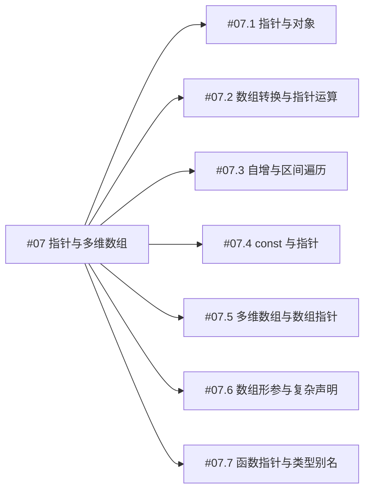

### 07.1 指针与对象

> [!note]- 知识图与目录
>
> ```mermaid
> flowchart LR
>   R["#07.1 指针与对象"]
>   N0["#212. 地址、指针与指针变量"]
>   R --> N0
>   N1["#213. 取地址得到指针"]
>   R --> N1
>   N2["#214. 解引用指定所指对象"]
>   R --> N2
>   N3["#215. 初始化指针要给地址"]
>   R --> N3
>   N4["#216. 声明星号与解引用星号"]
>   R --> N4
>   N5["#217. 一元星号与乘法星号"]
>   R --> N5
>   N6["#218. 复制数值不继承相邻关系"]
>   R --> N6
>   N7["#219. 空指针表示未指向对象"]
>   R --> N7
>   N8["#220. 非空不等于可以解引用"]
>   R --> N8
>   class R,N0,N1,N2,N3,N4,N5,N6,N7,N8 internal-link;
> ```
>
> - [[#212. 地址、指针与指针变量|212. 地址、指针与指针变量]]
> - [[#213. 取地址得到指针|213. 取地址得到指针]]
> - [[#214. 解引用指定所指对象|214. 解引用指定所指对象]]
> - [[#215. 初始化指针要给地址|215. 初始化指针要给地址]]
> - [[#216. 声明星号与解引用星号|216. 声明星号与解引用星号]]
> - [[#217. 一元星号与乘法星号|217. 一元星号与乘法星号]]
> - [[#218. 复制数值不继承相邻关系|218. 复制数值不继承相邻关系]]
> - [[#219. 空指针表示未指向对象|219. 空指针表示未指向对象]]
> - [[#220. 非空不等于可以解引用|220. 非空不等于可以解引用]]

#### 212. 地址、指针与指针变量

对象像房子，值像居民，地址像门牌；指针变量像保存门牌卡的盒子。三者不是同一种东西：
```text
p                指针变量，保存一个指针值
&residents[0]    指向首元素的指针值
residents[0]     一个int对象
*p               p所指的int对象
```
这个比喻用于区分身份，不表示真实指针必定就是普通整数门牌。

#### 213. 取地址得到指针

一元`&`取得适合取地址的对象或函数的地址。若`value`是`int`对象，`&value`的类型为`int *`：
```c
int value = 10;
int *p = &value;
```
取得地址不等于读取数值。位域、声明为`register`的对象等不能这样取地址。

#### 214. 解引用指定所指对象

一元`*`沿指针找到对象；取地址与解引用可看成相反方向：
```text
value ──&取地址──→ &value ──存入──→ p
  ↑                                  │
  └──────────── *p解引用 ──────────────┘
```
`*&value`指定的仍是`value`。前提是对象可取地址，且访问时指针和对象均有效。

#### 215. 初始化指针要给地址

地址票盒子需要地址，不能把居民携带的普通整数塞进去：
```c
int data[] = {4, 7, 9};
/* int *q = data[0]; */ /* 错误：运行时读取的int值不是地址 */
int *q = &data[0];
int *r = &data[2];
```
`data[2]`指定值为9的元素；`&data[2]`才是它的地址。空指针常量另有规则，不能把它与任意值为零的整数表达式混淆。

#### 216. 声明星号与解引用星号

`int *q = &data[2];`中，声明里的`*`说明`q`是指针；后来表达式中的`*q`则指定它所指的对象。先看语法位置，再解释符号。`int *p, q;`的逐声明器规则见[[#21. 星号属于各自声明器|星号属于各自声明器]]。

#### 217. 一元星号与乘法星号

符号含义取决于语境：
```text
*p       一元*：沿指针指定对象，只有一个操作数p
a * b    二元*：计算乘积，有两个操作数a、b
```
不能把一个符号在某一处的含义套到所有声明和表达式。

#### 218. 复制数值不继承相邻关系

源数组元素相邻，不代表复制后的两个独立变量也相邻：
```c
int a[] = {10, 20};
int x = a[0];
int y = a[1];
```
`x`和`y`得到元素值，未继承`a[0]`、`a[1]`的数组成员关系。不能通过对`&x`加1来访问`y`。

#### 219. 空指针表示未指向对象

空指针不指向对象或函数。C23可用`nullptr`；传统代码也使用相应头文件定义的`NULL`或整数常量`0`：
```c
#include <stddef.h>

void example(void)
{
    int *p = nullptr;
    int *q = NULL;
    int *r = 0;
    (void)p; (void)q; (void)r;
}
```
例如`malloc`失败返回空指针。空指针与字符串终止字符`'\0'`是不同概念。

#### 220. 非空不等于可以解引用

指针即使非空，也可能是尾后指针、悬垂指针或不适合当前类型访问的指针。读取前仍须保证对象生存期、类型、对齐及边界有效；写入时还须保证对象可修改。对象生存期见[[#15.1 作用域与生命周期|对象生命周期]]。

### 07.2 数组转换与指针运算

> [!note]- 知识图与目录
>
> ```mermaid
> flowchart LR
>   R["#07.2 数组转换与指针运算"]
>   N0["#221. 数组表达式通常转为首元素指针"]
>   R --> N0
>   N1["#222. 数组名不是首元素"]
>   R --> N1
>   N2["#223. sizeof 保留数组类型"]
>   R --> N2
>   N3["#224. 取整数组地址保留数组类型"]
>   R --> N3
>   N4["#225. 字符串初始化直接建立数组"]
>   R --> N4
>   N5["#226. typeof 保留数组类型"]
>   R --> N5
>   N6["#227. 指针加一跨过所指元素"]
>   R --> N6
>   N7["#228. 地址、类型与长度各有职责"]
>   R --> N7
>   N8["#229. 偏移量相对于当前位置"]
>   R --> N8
>   class R,N0,N1,N2,N3,N4,N5,N6,N7,N8 internal-link;
> ```
>
> ```mermaid
> flowchart LR
>   R["#07.2 数组转换与指针运算"]
>   N0["#230. 独立自增等价于加一赋回"]
>   R --> N0
>   N1["#231. 计算新地址不修改原指针"]
>   R --> N1
>   N2["#232. 指针算术不能越过数组边界"]
>   R --> N2
>   N3["#233. 尾后指针可以形成"]
>   R --> N3
>   N4["#234. 尾后位置不能读取"]
>   R --> N4
>   N5["#235. 尾后指针退回后可访问"]
>   R --> N5
>   N6["#236. 指针相减须来自同一数组"]
>   R --> N6
>   N7["#237. 指针差必须可由 ptrdiff_t 表示"]
>   R --> N7
>   N8["#238. ptrdiff_t 是有符号差值类型"]
>   R --> N8
>   class R,N0,N1,N2,N3,N4,N5,N6,N7,N8 internal-link;
> ```
>
> ```mermaid
> flowchart LR
>   R["#07.2 数组转换与指针运算"]
>   N0["#239. 用 %td 输出指针差"]
>   R --> N0
>   N1["#240. 查找后相减得到下标"]
>   R --> N1
>   N2["#241. 下标等价于指针加法解引用"]
>   R --> N2
>   N3["#242. 元素等价式与地址等价式"]
>   R --> N3
>   N4["#243. 整数组地址加一跨过整数组"]
>   R --> N4
>   class R,N0,N1,N2,N3,N4 internal-link;
> ```
>
> - [[#221. 数组表达式通常转为首元素指针|221. 数组表达式通常转为首元素指针]]
> - [[#222. 数组名不是首元素|222. 数组名不是首元素]]
> - [[#223. sizeof 保留数组类型|223. sizeof 保留数组类型]]
> - [[#224. 取整数组地址保留数组类型|224. 取整数组地址保留数组类型]]
> - [[#225. 字符串初始化直接建立数组|225. 字符串初始化直接建立数组]]
> - [[#226. typeof 保留数组类型|226. typeof 保留数组类型]]
> - [[#227. 指针加一跨过所指元素|227. 指针加一跨过所指元素]]
> - [[#228. 地址、类型与长度各有职责|228. 地址、类型与长度各有职责]]
> - [[#229. 偏移量相对于当前位置|229. 偏移量相对于当前位置]]
> - [[#230. 独立自增等价于加一赋回|230. 独立自增等价于加一赋回]]
> - [[#231. 计算新地址不修改原指针|231. 计算新地址不修改原指针]]
> - [[#232. 指针算术不能越过数组边界|232. 指针算术不能越过数组边界]]
> - [[#233. 尾后指针可以形成|233. 尾后指针可以形成]]
> - [[#234. 尾后位置不能读取|234. 尾后位置不能读取]]
> - [[#235. 尾后指针退回后可访问|235. 尾后指针退回后可访问]]
> - [[#236. 指针相减须来自同一数组|236. 指针相减须来自同一数组]]
> - [[#237. 指针差必须可由 ptrdiff_t 表示|237. 指针差必须可由 ptrdiff_t 表示]]
> - [[#238. ptrdiff_t 是有符号差值类型|238. ptrdiff_t 是有符号差值类型]]
> - [[#239. 用 %td 输出指针差|239. 用 %td 输出指针差]]
> - [[#240. 查找后相减得到下标|240. 查找后相减得到下标]]
> - [[#241. 下标等价于指针加法解引用|241. 下标等价于指针加法解引用]]
> - [[#242. 元素等价式与地址等价式|242. 元素等价式与地址等价式]]
> - [[#243. 整数组地址加一跨过整数组|243. 整数组地址加一跨过整数组]]

#### 221. 数组表达式通常转为首元素指针

数组本身始终是数组对象；多数表达式场景下，数组表达式转换为指向首元素的指针：
```c
char text[] = "Hello";
char *p = text; /* 这里text转换为&text[0] */
```
这是表达式转换，不是数组对象永久变成了指针。

#### 222. 数组名不是首元素

`data`命名整个数组对象，`data[0]`指定其中的首元素；不能把二者直接画等号：
```text
data      在多数普通表达式中转换为&data[0]
*data     指定data[0]
data[0]   首元素对象
```
一个是转换后的地址，一个是元素对象；不要把“首地址”缩成“首元素”。

#### 223. sizeof 保留数组类型

数组作为`sizeof`操作数时，不转换为首元素指针。若`p`指向行数组，`sizeof *p`也按整行数组计算：
```c
int row[4];
int (*p)[4] = &row;
/* sizeof row == sizeof *p == 4 * sizeof(int) */
```
`p`是指针，不代表`*p`也一定是指针。VLA另有运行时求值规则。

直接对真正数组使用`sizeof`得到整数组大小，正是数组元素计数公式的前提；若已改用普通指针保存首地址，不能再照搬这个前提。

#### 224. 取整数组地址保留数组类型

`&text`取得整个数组的地址，不发生首元素转换。对`char text[6]`，结果类型为`char (*)[6]`；`text`在普通表达式中转换的类型则是`char *`。它们即使对应相同起始位置，类型与后续步长也不同。

#### 225. 字符串初始化直接建立数组

`char text[] = "Hello";`是用字符串字面量初始化数组，建立六个字符位置并包含`'\0'`；不是把一个字符指针存入数组。

#### 226. typeof 保留数组类型

C23的`typeof`、`typeof_unqual`用于取得数组表达式类型时，不把该数组先转成首元素指针。这与普通初始化指针或函数传参的转换场景不同。

#### 227. 指针加一跨过所指元素

指针加1的步长由所指类型决定：`int *`前进一个`int`，`int (*)[3]`前进一整行`int[3]`。类型告诉程序每一步多大，不能机械地理解为加一个字节。

#### 228. 地址、类型与长度各有职责

首地址告诉程序从哪里出发，元素类型告诉程序每一步多大，长度告诉程序什么时候停。普通指针值不自动携带原数组的完整长度；接口通常还须传入数量或终点。

#### 229. 偏移量相对于当前位置

**p + n 中的 n 是相对位移，不是固定下标。**

#### 230. 独立自增等价于加一赋回

在更新合法且表达式结果被丢弃时，独立语句`p++;`和`p = p + 1;`都让`p`前进一格。这个等价描述不把两种表达式在所有嵌套语境下的结果值也视为相同。

#### 231. 计算新地址不修改原指针

`q + 1`只计算下一元素地址，不修改`q`；`q++`会更新`q`。像快递员“算出下一户门牌”与“把手里的当前门牌卡换掉”是两个动作。

#### 232. 指针算术不能越过数组边界

指针加减只允许结果位于同一数组元素范围或尾后一个位置。越界指针的形成就可能产生未定义行为，不能等到解引用才检查。单独对象在这些规则中视为长度为1的数组，不能据此跨去寻找另一个独立对象。

#### 233. 尾后指针可以形成

对`int a[3]`，`a + 3`是合法的尾后指针，可作为半开区间终点。它表示边界，不表示那里还有第四个数组元素。

#### 234. 尾后位置不能读取

`*(a + 3)`不能用来读取`int a[3]`的元素；尾后指针不能作为实际求值的解引用操作数。能形成边界地址不等于能读取边界位置。

#### 235. 尾后指针退回后可访问

尾后指针不能解引用，但可以在同一数组规则内“退回来”；一旦退回真实元素的位置，就又可以解引用。

#### 236. 指针相减须来自同一数组

相减的两个指针都须指向同一数组的元素或它的尾后位置。不能通过相减不同数组的指针来猜测两个独立对象之间的距离。

#### 237. 指针差必须可由 ptrdiff_t 表示

即使两个指针来自同一数组，其下标差仍必须能由`ptrdiff_t`表示；超出可表示范围属于未定义行为。

#### 238. ptrdiff_t 是有符号差值类型

`ptrdiff_t` 定义在 `<stddef.h>` 中，是专门用于表示指针相减结果的有符号整数类型，不是 `size_t`。同数组中两个位置相减，先后关系可以使差为正、零或负。

#### 239. 用 %td 输出指针差

`ptrdiff_t`对应`printf`的`%td`；`size_t`对应`%zu`。前者可以表示有意义的负下标差，不能未经分析改存入无符号长度类型。即使本次差值非负，也不能交换两种格式；格式匹配的是实参类型，不是当前正负。

#### 240. 查找后相减得到下标

查找成功后可用同数组中的指针差求下标；先检查返回值不是空指针。

```c
#include <stddef.h>
#include <stdio.h>
#include <string.h>

int main(void)
{
    char text[] = "Hello";
    char *p = strchr(text, 'l');

    if (p != NULL) {
        ptrdiff_t index = p - text;
        printf("%td %s\n", index, p); /* 2 llo */
    }
    printf("%zu\n", sizeof text); /* 6 */
    return 0;
}
```

先输出 `2 llo`：`%td` 打印下标，`%s` 从匹配位置读出后缀 `llo`；随后输出整个数组大小 `6`，其中包含末尾空字符。

#### 241. 下标等价于指针加法解引用

C定义`E1[E2]`等价于`*((E1) + (E2))`。对有效位置，`text[2]`与`*(text + 2)`指定同一元素，`&text[2]`与`text + 2`得到同一元素地址。

#### 242. 元素等价式与地址等价式

读等价式时先分清比较的层次：
```text
text[2]  与 *(text + 2)  指定同一个格子
&text[2] 与 text + 2     得到同一个地址
```
第一组讨论对象，第二组讨论指针值；不能混写成`text[2]`等于`text + 2`。

#### 243. 整数组地址加一跨过整数组

对`char text[6]`，`text + 1`前进一个字符；`&text + 1`前进一个完整`char[6]`数组，得到整个数组的尾后位置。指针类型决定跨度，不能因二者起始地址对应同一位置就视为可互换。

### 07.3 自增与区间遍历

> [!note]- 知识图与目录
>
> ```mermaid
> flowchart LR
>   R["#07.3 自增与区间遍历"]
>   N0["#244. 指针自增更新保存的地址"]
>   R --> N0
>   N1["#245. 移动指针不移动元素"]
>   R --> N1
>   N2["#246. 星号 q 后缀自增读取旧位置"]
>   R --> N2
>   N3["#247. 星号前缀自增读取新位置"]
>   R --> N3
>   N4["#248. 括号星号 q 后缀自增修改元素"]
>   R --> N4
>   N5["#249. 先判断自增抓住谁"]
>   R --> N5
>   N6["#250. 后缀自增比解引用结合紧"]
>   R --> N6
>   N7["#251. 半开区间不处理终点"]
>   R --> N7
>   N8["#252. 筛选条件检查所指元素"]
>   R --> N8
>   class R,N0,N1,N2,N3,N4,N5,N6,N7,N8 internal-link;
> ```
>
> ```mermaid
> flowchart LR
>   R["#07.3 自增与区间遍历"]
>   N0["#253. 区间次数等于下标差"]
>   R --> N0
>   N1["#254. 步进方向必须朝向终点"]
>   R --> N1
>   N2["#255. 逆序遍历先退再读"]
>   R --> N2
>   N3["#256. 反向遍历误用自增会越界"]
>   R --> N3
>   class R,N0,N1,N2,N3 internal-link;
> ```
>
> - [[#244. 指针自增更新保存的地址|244. 指针自增更新保存的地址]]
> - [[#245. 移动指针不移动元素|245. 移动指针不移动元素]]
> - [[#246. 星号 q 后缀自增读取旧位置|246. 星号 q 后缀自增读取旧位置]]
> - [[#247. 星号前缀自增读取新位置|247. 星号前缀自增读取新位置]]
> - [[#248. 括号星号 q 后缀自增修改元素|248. 括号星号 q 后缀自增修改元素]]
> - [[#249. 先判断自增抓住谁|249. 先判断自增抓住谁]]
> - [[#250. 后缀自增比解引用结合紧|250. 后缀自增比解引用结合紧]]
> - [[#251. 半开区间不处理终点|251. 半开区间不处理终点]]
> - [[#252. 筛选条件检查所指元素|252. 筛选条件检查所指元素]]
> - [[#253. 区间次数等于下标差|253. 区间次数等于下标差]]
> - [[#254. 步进方向必须朝向终点|254. 步进方向必须朝向终点]]
> - [[#255. 逆序遍历先退再读|255. 逆序遍历先退再读]]
> - [[#256. 反向遍历误用自增会越界|256. 反向遍历误用自增会越界]]

#### 244. 指针自增更新保存的地址

若`q`初始指向`data[0]`，合法的`q++`会让它改指向`data[1]`。快递员换的是当前门牌卡，不是在数组里复制或挪动元素。

#### 245. 移动指针不移动元素

变化的是 `q` 保存的地址，不是 `10`、`15` 这些居民搬家。对指针使用 `++`，效果是让它前进到同一数组的下一个元素。

#### 246. 星号 q 后缀自增读取旧位置

`int result = *(q++);`使用`q++`产生的旧指针找到原元素，再把元素值赋给`result`；`q`被更新为下一位置。须同时保证旧位置可读、新指针仍在允许范围内。

像快递员“先交旧门牌，再换新门牌”：解引用拿到的是旧门牌，原元素并没有跟着指针搬家。一般规则见[[#83. 后缀自增产生旧值|后缀自增产生旧值]]；这个比喻不承诺复杂表达式中所有操作数的求值顺序。

#### 247. 星号前缀自增读取新位置

`int result = *(++q);`先递增指针，再用它产生的新指针指定元素：
```c
int data[] = {10, 15, 20};
int *q = data;
int result = *(++q); /* result为15，q指向data[1] */
```
这相当于“先换新门牌，再交出去”，与`*(q++)`读取旧位置不同。新位置必须确实指向可读元素：若递增结果只是尾后指针，随即读取仍然越界。前缀通则见[[#84. 前缀自增产生新值|前缀自增产生新值]]。

#### 248. 括号星号 q 后缀自增修改元素

`(*q)++`让所指元素递增，指针`q`不变；表达式产生元素的旧值。对照`*q++`：它不递增原元素，而是更新指针。

#### 249. 先判断自增抓住谁

先看`++`或`--`作用于哪个对象，再分析它产生的值：
```text
*q++     ++抓住q：改变指针
(*q)++   ++抓住*q：改变所指整数
```
这是“地址盒子”与“居民携带数值”的区别，不能凭出现星号就认定修改的是元素。

#### 250. 后缀自增比解引用结合紧

语法把`*q++`分组为`*(q++)`，不是`(*q)++`。结合规则决定表达式结构，不决定其他无关操作数的运行时先后次序。

#### 251. 半开区间不处理终点

`[first, last)`包含起点，不包含终点；终点站只负责拦停，不处理`*last`。尾后指针很适合充当停止地址。

```c
#include <stdio.h>

int main(void)
{
    int data[] = {4, 7, 9, 12};
    for (const int *p = data; p != data + 4; ++p)
        printf("%d ", *p);
    putchar('\n');
    return 0;
}
```

循环只在成功确认尚未到终点后读取元素；更新表达式的结果未被使用，前缀、后缀自增在这里最终推进效果相同。

#### 252. 筛选条件检查所指元素

用`int *p`遍历整数区间时，题目里的“当前整数”是`*p`，所以输出偶数的筛选条件写成：
```c
/* 循环体片段：p指向当前有效int元素，且已包含<stdio.h>。 */
if (*p % 2 == 0)
    printf("%d ", *p);
```
把这一段放入前面的半开区间循环，可筛出4和12。`p`保存地址，`*p`才是参加余数运算的整数；不能写成`p % 2`。循环条件负责不越界，筛选条件负责选出偶数，两者分工不同。

#### 253. 区间次数等于下标差

在同一数组内，起点为`data + a`、终点为`data + b`，`a <= b`并每轮前进1时：
```text
次数 = b − a
处理 data[a] 到 data[b − 1]
```
先写轨迹，再用条件拦停；这里的差是元素数，不是字节数。

#### 254. 步进方向必须朝向终点

已确定同数组中的合法起止位置后，向更高下标走通常用`++`，向更低下标走通常用`--`。步进须让状态接近终点，还要确认不会先越界；不能用“最终碰到某地址”掩盖中途非法的指针形成。

#### 255. 逆序遍历先退再读

逆序遍历宜从尾后位置开始，在读取前先退回元素：

```c
#include <stdio.h>

int main(void)
{
    int data[] = {4, 7, 9, 8};
    for (const int *p = data + 4; p != data;) {
        --p;
        printf("%d ", *p);
    }
    putchar('\n'); /* 8 9 7 4 */
    return 0;
}
```

这种写法最终停在首元素地址，不会形成 `data - 1`。

#### 256. 反向遍历误用自增会越界

若起点已经是最后一个元素，却错误地使用 `p++`，下一步会到尾后位置，再次读取便越界：

```c
/* 错误示例，不要执行。 */
/* for (int *p = data + 3; p != data; ++p)
       printf("%d ", *p); */
```

步进方向必须朝向终点；“起点大于终点就减1”只在已经建立了同数组、合法位置与终止条件的前提下才有意义。

### 07.4 const 与指针

先用四格表定位限制层次，随后分别解释：
| 声明 | 可否换指向 | 可否经p改字符 |
|---|---|---|
| `char *p` | 可以 | 目标本身可写时可以 |
| `const char *p` | 可以 | 不可以 |
| `char *const p` | 不可以 | 目标本身可写时可以 |
| `const char *const p` | 不可以 | 不可以 |
需要修改字符串时，应使用可写数组；字符串字面量不能因由`char *`接收地址就变得可写。

> [!note]- 知识图与目录
>
> ```mermaid
> flowchart LR
>   R["#07.4 const 与指针"]
>   N0["#257. 指向 const 字符的指针"]
>   R --> N0
>   N1["#258. const 字符指针可以换指向"]
>   R --> N1
>   N2["#259. 不能经 const 字符指针写字符"]
>   R --> N2
>   N3["#260. 星号右边的 const 固定指针"]
>   R --> N3
>   N4["#261. 双重 const 固定两层"]
>   R --> N4
>   N5["#262. 写指针与写所指对象分开"]
>   R --> N5
>   class R,N0,N1,N2,N3,N4,N5 internal-link;
> ```
>
> - [[#257. 指向 const 字符的指针|257. 指向 const 字符的指针]]
> - [[#258. const 字符指针可以换指向|258. const 字符指针可以换指向]]
> - [[#259. 不能经 const 字符指针写字符|259. 不能经 const 字符指针写字符]]
> - [[#260. 星号右边的 const 固定指针|260. 星号右边的 const 固定指针]]
> - [[#261. 双重 const 固定两层|261. 双重 const 固定两层]]
> - [[#262. 写指针与写所指对象分开|262. 写指针与写所指对象分开]]

#### 257. 指向 const 字符的指针

`const char *p`或`char const *p`表示指向`const char`的指针。约束落在所指字符这一层，不是把指针盒子本身固定住。

#### 258. const 字符指针可以换指向

`const char *p`允许`p = another_string;`，因为修改的是指针变量保存的地址。能否换指向与能否写字符是两件事。

#### 259. 不能经 const 字符指针写字符

对`const char *p`，`*p = 'X';`、`p[0] = 'X';`都不合法。这不保证原对象经所有其他途径都不可修改：`char text[] = "Hello"; const char *p = text;`之后，`text[0] = 'Y';`仍可修改原数组。

#### 260. 星号右边的 const 固定指针

`char *const p`把当前指针层固定：初始化后不能再给`p`换地址。若所指字符对象本身可写，仍可通过`*p`修改它。

#### 261. 双重 const 固定两层

`const char *const p`同时约束指针与所指字符：既不能给`p`换地址，也不能通过它写字符。

#### 262. 写指针与写所指对象分开

`p = ...`修改地址盒子；`*p = ...`修改所指对象；`p[0] = ...`与后者是同一类动作。读`const`时逐层问“这一次赋值的目标是谁”，不能只看整句有没有`const`。

### 07.5 多维数组与数组指针

> [!note]- 知识图与目录
>
> ```mermaid
> flowchart LR
>   R["#07.5 多维数组与数组指针"]
>   N0["#263. 二维数组的元素是行"]
>   R --> N0
>   N1["#264. 维度分别决定各层数量"]
>   R --> N1
>   N2["#265. 二维下标先选行再选列"]
>   R --> N2
>   N3["#266. 一次下标剥掉一层"]
>   R --> N3
>   N4["#267. 声明定尺寸，下标选位置"]
>   R --> N4
>   N5["#268. 相邻行相距一行宽度"]
>   R --> N5
>   N6["#269. 连续布局不保证物理页相邻"]
>   R --> N6
>   N7["#270. 扁平位置按行宽换算"]
>   R --> N7
>   N8["#271. 整数组除叶子大小求总数"]
>   R --> N8
>   class R,N0,N1,N2,N3,N4,N5,N6,N7,N8 internal-link;
> ```
>
> ```mermaid
> flowchart LR
>   R["#07.5 多维数组与数组指针"]
>   N0["#272. 整数组除行大小求行数"]
>   R --> N0
>   N1["#273. 行大小除叶子大小求列数"]
>   R --> N1
>   N2["#274. 反推维度需要足够类型信息"]
>   R --> N2
>   N3["#275. 指针数组存放指针元素"]
>   R --> N3
>   N4["#276. 数组指针指向整行数组"]
>   R --> N4
>   N5["#277. 二维数组转为行指针"]
>   R --> N5
>   N6["#278. 零下标相对于当前行指针"]
>   R --> N6
>   N7["#279. 解引用行指针得到数组"]
>   R --> N7
>   N8["#280. 再取下标才得到行内元素"]
>   R --> N8
>   class R,N0,N1,N2,N3,N4,N5,N6,N7,N8 internal-link;
> ```
>
> ```mermaid
> flowchart LR
>   R["#07.5 多维数组与数组指针"]
>   N0["#281. 二级指针指向指针对象"]
>   R --> N0
>   N1["#282. 二维数组不是 int 双星号"]
>   R --> N1
>   N2["#283. 字符指针表的元素与访问"]
>   R --> N2
>   N3["#284. 字符指针表与二维表布局不同"]
>   R --> N3
>   N4["#285. 二维字符表每行容量固定"]
>   R --> N4
>   N5["#286. 字符表可写性取决于对象"]
>   R --> N5
>   N6["#287. 行连续不允许跨子数组读取"]
>   R --> N6
>   class R,N0,N1,N2,N3,N4,N5,N6 internal-link;
> ```
>
> - [[#263. 二维数组的元素是行|263. 二维数组的元素是行]]
> - [[#264. 维度分别决定各层数量|264. 维度分别决定各层数量]]
> - [[#265. 二维下标先选行再选列|265. 二维下标先选行再选列]]
> - [[#266. 一次下标剥掉一层|266. 一次下标剥掉一层]]
> - [[#267. 声明定尺寸，下标选位置|267. 声明定尺寸，下标选位置]]
> - [[#268. 相邻行相距一行宽度|268. 相邻行相距一行宽度]]
> - [[#269. 连续布局不保证物理页相邻|269. 连续布局不保证物理页相邻]]
> - [[#270. 扁平位置按行宽换算|270. 扁平位置按行宽换算]]
> - [[#271. 整数组除叶子大小求总数|271. 整数组除叶子大小求总数]]
> - [[#272. 整数组除行大小求行数|272. 整数组除行大小求行数]]
> - [[#273. 行大小除叶子大小求列数|273. 行大小除叶子大小求列数]]
> - [[#274. 反推维度需要足够类型信息|274. 反推维度需要足够类型信息]]
> - [[#275. 指针数组存放指针元素|275. 指针数组存放指针元素]]
> - [[#276. 数组指针指向整行数组|276. 数组指针指向整行数组]]
> - [[#277. 二维数组转为行指针|277. 二维数组转为行指针]]
> - [[#278. 零下标相对于当前行指针|278. 零下标相对于当前行指针]]
> - [[#279. 解引用行指针得到数组|279. 解引用行指针得到数组]]
> - [[#280. 再取下标才得到行内元素|280. 再取下标才得到行内元素]]
> - [[#281. 二级指针指向指针对象|281. 二级指针指向指针对象]]
> - [[#282. 二维数组不是 int 双星号|282. 二维数组不是 int 双星号]]
> - [[#283. 字符指针表的元素与访问|283. 字符指针表的元素与访问]]
> - [[#284. 字符指针表与二维表布局不同|284. 字符指针表与二维表布局不同]]
> - [[#285. 二维字符表每行容量固定|285. 二维字符表每行容量固定]]
> - [[#286. 字符表可写性取决于对象|286. 字符表可写性取决于对象]]
> - [[#287. 行连续不允许跨子数组读取|287. 行连续不允许跨子数组读取]]

#### 263. 二维数组的元素是行

`int a[2][3]`的直接元素是两个`int[3]`行数组，而不是六个直接隶属于外层的`int`。可以把它想成一栋楼：外层按楼层组织，内层按房间组织。
```c
int a[2][3] = {{10, 20, 30}, {40, 50, 60}};
```
```text
a
├─ a[0]：int[3] → 10 20 30
└─ a[1]：int[3] → 40 50 60
```

#### 264. 维度分别决定各层数量

对`int a[m][n]`，外层有`m`行，每行有`n`个`int`，叶子元素总数为`m × n`；合法下标分别是`0..m-1`和`0..n-1`。各维长度须满足相应数组声明规则，不能用某一维长度代替另一维。

#### 265. 二维下标先选行再选列

看到：

```c
a[i][j]
```

直接翻译：

```text
先选外层下标 i
再选里面下标 j
自然语言：第 i+1 个小数组里的第 j+1 个元素
```

#### 266. 一次下标剥掉一层

数组类型每取一次下标，就选取一层的元素。若`int data[7][8][9];`：
| 表达式 | 尚未进行普通数组转换时的类型 |
|---|---|
| `data` | `int[7][8][9]` |
| `data[1]` | `int[8][9]` |
| `data[1][2]` | `int[9]` |
| `data[1][2][3]` | `int` |
“还有几层”从类型结构中判断，不能靠括号里数字大小猜测。

#### 267. 声明定尺寸，下标选位置

`data[1][2]`中的1、2是所选位置，不是尺寸。剩余数组有多长要看原声明；不能据此断言“有两行、每行三个整数”。可以把声明数字看作楼层和房间数量，把使用下标看作门牌号。

#### 268. 相邻行相距一行宽度

`int box[3][5]`中，从一行开头到下一行开头跨过5个`int`的宽度。像连续铺5块地砖，数的是元素本身的宽度，不是砖之间的空白缝隙；C字节距离为`5 * sizeof(int)`。

#### 269. 连续布局不保证物理页相邻

数组元素是C抽象机中的连续邻居；运行环境可以把连续虚拟地址映射到不相邻的物理RAM页。语言层面的连续布局不是对RAM芯片内部排列的承诺。

#### 270. 扁平位置按行宽换算

零基下标`[i][j]`的行优先数学位置为`i × cols + j`，其中`cols`是每行元素数。这是布局换算，不授权把指向某一行元素的指针跨子数组解引用。

#### 271. 整数组除叶子大小求总数

对完整的`int shelf[4][2]`，`sizeof shelf / sizeof shelf[0][0]`得到8个叶子`int`。无需假定每个`int`占4字节。

```c
#include <stdio.h>

int main(void)
{
    int shelf[4][2] = {0};

    size_t rows = sizeof shelf / sizeof shelf[0];
    size_t cols = sizeof shelf[0] / sizeof shelf[0][0];
    size_t total = sizeof shelf / sizeof shelf[0][0];

    printf("%zu %zu %zu\n", rows, cols, total); /* 4 2 8 */
    return 0;
}
```

输出4、2、8，分别验证行数、列数与叶子总数；sizeof及size_t基础见类型章节。

#### 272. 整数组除行大小求行数

对完整的`int shelf[4][2]`，`sizeof shelf / sizeof shelf[0]`得到4行。分母必须是完整行数组的大小，不能误用叶子大小。

#### 273. 行大小除叶子大小求列数

对完整的`int shelf[4][2]`，`sizeof shelf[0] / sizeof shelf[0][0]`得到每行2个`int`。

#### 274. 反推维度需要足够类型信息

利用大小比值反推维度，须知道对象确实是相应的完整数组，并能取得整数组、一行与叶子类型的大小；不能对一个失去长度信息的指针照搬公式。

#### 275. 指针数组存放指针元素

`int *a[3]`先由`a[3]`确定是三元素数组，再由`*`说明每个元素为`int *`。数组里面存放指针值，不是三个被指对象本身。

#### 276. 数组指针指向整行数组

`int (*p)[3]`从`(*p)`确定`p`是指针，再由`[3]`确定它指向`int[3]`。同理，`int (*a)[4]`指向含4个`int`的一整行，不是含4个指针的数组。括号改变的是声明结构。

#### 277. 二维数组转为行指针

`int a[2][3]`在普通表达式中转为指向首行的`int (*)[3]`：
```c
int a[2][3] = {{10, 20, 30}, {40, 50, 60}};
int (*p)[3] = a;
```
`p`指向第一行，`p + 1`指向第二行。外层数组的直接元素是整行，所以前进一步跨过整行。

#### 278. 零下标相对于当前行指针

`[0]`取的是从当前指针位置开始的第0个元素，不永远是原数组第0行。`p`移到第二行后，`p[0]`指定第二行。

#### 279. 解引用行指针得到数组

沿用`int (*p)[3]`指向第一行：
```text
(p + 1)[0]
= *((p + 1) + 0)
= *(p + 1)
```
结果指定整个第二行`int[3]`，不是单个整数40。在多数普通表达式中，这个行数组还会继续转为首元素指针。

#### 280. 再取下标才得到行内元素

`(p + 1)[0][1]`先前进到第二行，再取当前行，最后取该行下标1的元素。在`{{10,20,30},{40,50,60}}`中结果是50；每一步剥去的类型层次不能省略。

#### 281. 二级指针指向指针对象

`int **`的直接目标是一个`int *`对象：
```c
int value = 10;
int *q1 = &value;
int **q = &q1;
```
```text
q：int ** → q1：int * → value：int
```
`*q`指定指针对象`q1`，`**q`才指定整数对象。

#### 282. 二维数组不是 int 双星号

`int a[2][3]`的常规转换类型是`int (*)[3]`，不是`int **`。因此：
```c
int a[2][3] = {{10, 20, 30}, {40, 50, 60}};
int (*p)[3] = a;
/* int **q = a; */ /* 错误：类型不兼容 */
```
强制转换不会在内存中凭空建立一层指针对象，不能用来修复这两种结构的差别。

#### 283. 字符指针表的元素与访问

```c
const char *names[] = {"Alice", "Bob", "Carol"};
char first = names[2][0]; /* 'C' */
```
数组本体存放三个字符指针；`names[2]`指向`"Carol"`，`*names[2]`与`names[2][0]`取到同一首字符，`names[2][1]`为`'a'`。两个下标不把指针数组变成二维字符数组。
```text
names[0] ──→ "Alice"
names[1] ──→ "Bob"
names[2] ──→ "Carol"
```

#### 284. 字符指针表与二维表布局不同

`const char *names[]`的直接元素是指针，字符串不存放在那些指针元素内部；`char names2[][6]`的直接元素是`char[6]`行数组，字符直接存放在数组本体中。

#### 285. 二维字符表每行容量固定

```c
char names2[][6] = {"Alice", "Bob", "Carol"};
```
```text
names2[0]：A l i c e \0
names2[1]：B o b \0 \0 \0
names2[2]：C a r o l \0
```
各行字符串长度可以不同，但每行都占6个字符位置；不能把`"Bob"`较短误认为第二行也随之缩短。

#### 286. 字符表可写性取决于对象

`names`的指针元素可换指向，但本例不能通过`const char *`修改字符；`names2`的行内`char`可以修改，整行数组却不能用普通赋值整体替换。类型与存储布局决定可进行的动作，不由“都有两个下标”决定。

#### 287. 行连续不允许跨子数组读取

```c
int m[2][3] = {{1, 2, 3}, {4, 5, 6}};
int *p = &m[0][0];
int *q = p + 3; /* 合法：第一行的尾后指针 */
/* printf("%d\n", *q); */ /* 错误：解引用第一行尾后指针 */
/* int x = m[0][3]; */   /* 同类错误 */
```

`m[0]`、`m[1]` 的确连续。但 `p` 所在的 `int` 数组对象是首行 `m[0]`；`p + 3` 的边界身份仍是该行的尾后指针。布局连续不能把两行自动合并成一个长度为6的 `int` 数组。

可以把首行尾后指针理解为“走到下一行门口，但手里仍是上一行的尾后门牌”。两行保证相邻，不是跑到了随机内存；不过这种布局上的相邻，也不会自动把尾后指针变成允许读取下一行的指针。

正确访问下一行，应先按外层数组结构选行：

```c
int x = m[1][0];       /* 4 */
int y = (*(m + 1))[0]; /* 4 */
```

扁平位置公式可用于计算位置、把多维下标映射到真正的一维数组；不能当作越过子数组边界的访问许可。

### 07.6 数组形参与复杂声明

> [!note]- 知识图与目录
>
> ```mermaid
> flowchart LR
>   R["#07.6 数组形参与复杂声明"]
>   N0["#288. 数组形参只调整最外层"]
>   R --> N0
>   N1["#289. 形参外层数字不是实际行数"]
>   R --> N1
>   N2["#290. 内层宽度不能一并省略"]
>   R --> N2
>   N3["#291. 省略外层长度须看声明情景"]
>   R --> N3
>   N4["#292. sizeof 数组形参得到指针大小"]
>   R --> N4
>   N5["#293. 从名字向外读声明"]
>   R --> N5
>   class R,N0,N1,N2,N3,N4,N5 internal-link;
> ```
>
> - [[#288. 数组形参只调整最外层|288. 数组形参只调整最外层]]
> - [[#289. 形参外层数字不是实际行数|289. 形参外层数字不是实际行数]]
> - [[#290. 内层宽度不能一并省略|290. 内层宽度不能一并省略]]
> - [[#291. 省略外层长度须看声明情景|291. 省略外层长度须看声明情景]]
> - [[#292. sizeof 数组形参得到指针大小|292. sizeof 数组形参得到指针大小]]
> - [[#293. 从名字向外读声明|293. 从名字向外读声明]]

#### 288. 数组形参只调整最外层

普通数组自己很规整，特殊规则发生在函数“收件栏”：形参被声明为数组时，最外层调整为指向其元素类型的指针。`int a[][5]`作为形参，调整为`int (*a)[5]`；实际收到地址票，不是把整栋楼按值搬进函数。

```c
#include <stddef.h>
#include <stdio.h>

void print_rows(const int a[][3], size_t rows)
{
    for (size_t i = 0; i < rows; ++i) {
        for (size_t j = 0; j < 3; ++j)
            printf("%d ", a[i][j]);
        putchar('\n');
    }
}

int main(void)
{
    int a[2][3] = {{10, 20, 30}, {40, 50, 60}};
    print_rows(a, 2);
    return 0;
}
```

每行宽度由形参类型固定为3，行数由rows提供；调用前须保证相应行存在。

#### 289. 形参外层数字不是实际行数

在函数形参位置，`int board[][4]`和`int board[7][4]`都调整为`int (*)[4]`。普通写法中的7不自动成为真实行数，也不自动检查调用者提供7行；接口还须传入`rows`。两种写法都保留每行4个`int`的行类型。

#### 290. 内层宽度不能一并省略

`int a[][5]`可以在形参中省略最外层数量；`int a[][]`没有给出完整的行类型，不能这样写。省掉外层数量不等于把所有维度都变成未知。

#### 291. 省略外层长度须看声明情景

省略外层长度不只出现在函数形参：`int a[] = {1, 2};`可由初始化推导长度；适当的`extern int a[];`也可声明不完整数组类型。真正定义普通数组对象时，必须最终能确定完整大小；不能把一种情景的省略规则无条件搬到另一种。

#### 292. sizeof 数组形参得到指针大小

形参调整完成后，`sizeof a`查询的是指针类型大小，不是调用者原数组的总大小。若`a`的调整类型为`int (*)[3]`，`sizeof a[0]`仍能得到一行大小，因为`a[0]`指定行数组。

一维形参`int a[]`也会调整为`int *a`；函数想知道有多少个有效元素，接口通常须另传长度，不能靠`sizeof a`找回。

#### 293. 从名字向外读声明

先从变量名出发，再按括号分组向外读。对`int (*p)[4]`：`p`是指针 → 所指是四元素数组 → 叶子类型为`int`。对更复杂的函数指针数组，也先读数组、再读指针、再读函数签名。

### 07.7 函数指针与类型别名

> [!note]- 知识图与目录
>
> ```mermaid
> flowchart LR
>   R["#07.7 函数指针与类型别名"]
>   N0["#294. 函数指针保存可调用的指针值"]
>   R --> N0
>   N1["#295. 单参数函数指针声明"]
>   R --> N1
>   N2["#296. 函数指针签名必须兼容"]
>   R --> N2
>   N3["#297. 双参数函数指针声明"]
>   R --> N3
>   N4["#298. 回调把操作交给调用者"]
>   R --> N4
>   N5["#299. 函数指针数组按下标选操作"]
>   R --> N5
>   N6["#300. 函数不能作为普通数组元素"]
>   R --> N6
>   N7["#301. typedef 建立别名而非新类型"]
>   R --> N7
>   N8["#302. 函数指针别名简化声明"]
>   R --> N8
>   class R,N0,N1,N2,N3,N4,N5,N6,N7,N8 internal-link;
> ```
>
> - [[#294. 函数指针保存可调用的指针值|294. 函数指针保存可调用的指针值]]
> - [[#295. 单参数函数指针声明|295. 单参数函数指针声明]]
> - [[#296. 函数指针签名必须兼容|296. 函数指针签名必须兼容]]
> - [[#297. 双参数函数指针声明|297. 双参数函数指针声明]]
> - [[#298. 回调把操作交给调用者|298. 回调把操作交给调用者]]
> - [[#299. 函数指针数组按下标选操作|299. 函数指针数组按下标选操作]]
> - [[#300. 函数不能作为普通数组元素|300. 函数不能作为普通数组元素]]
> - [[#301. typedef 建立别名而非新类型|301. typedef 建立别名而非新类型]]
> - [[#302. 函数指针别名简化声明|302. 函数指针别名简化声明]]

#### 294. 函数指针保存可调用的指针值

函数指针用于指向函数并通过它调用。函数名在多数表达式中转换为函数指针，也可显式取`&函数名`；它不是把整个函数体复制进一个变量。

#### 295. 单参数函数指针声明

函数指针用于保存能够调用兼容函数的指针值。函数名在多数表达式中转换为函数指针；也可以显式写 `&函数名`。

```c
int square(int n)
{
    return n * n; /* 前提：乘积在 int 范围内 */
}

void example(void)
{
    int (*fp)(int) = square;
    int a = fp(5);
    int b = (*fp)(5);
    (void)a;
    (void)b;
}
```

#### 296. 函数指针签名必须兼容

给`int (*fp)(int)`赋目标函数时，返回类型与形参类型、数量等须兼容：
| 目标函数 | 是否兼容 |
|---|---|
| `int f(int x)` | 是 |
| `int f(double x)` | 否，参数类型不同 |
| `double f(int x)` | 否，返回类型不同 |
| `int f(int x, int y)` | 否，参数数量不同 |
不能靠强制转换后调用不兼容类型来修补合同。

#### 297. 双参数函数指针声明

`int (*fp)(int, int)`说明`fp`指向接收两个`int`、返回`int`的函数。括号中的`*fp`先确定指针，后面的参数表再确定所指函数的输入。

#### 298. 回调把操作交给调用者

```c
#include <stdio.h>

int add(int a, int b)
{
    return a + b;
}

int multiply(int a, int b)
{
    return a * b;
}

int calculate(int a, int b, int (*operation)(int, int))
{
    return operation(a, b);
}

int main(void)
{
    printf("%d\n", calculate(3, 4, add));      /* 7 */
    printf("%d\n", calculate(3, 4, multiply)); /* 12 */
    return 0;
}
```

`calculate` 只负责传入数据并调用操作；调用者通过第三个实参选择算法。这里的运算示例要求结果可由 `int` 表示，`operation` 必须指向兼容函数。

#### 299. 函数指针数组按下标选操作

```c
/* add、subtract、multiply 须先有兼容声明；片段位于函数体内。 */
int (*operations[3])(int, int) = {add, subtract, multiply};
int result = operations[2](3, 4); /* 调用 multiply，得到12 */
```

下标选择函数指针，再用 `()` 调用。数组下标必须有效；数组元素保存指针，不会把函数体复制进数组。

#### 300. 函数不能作为普通数组元素

函数指针数组合法；“函数数组”不合法。函数不是普通对象数组可直接存放的元素类型，数组中保存的是指向函数的指针。

#### 301. typedef 建立别名而非新类型

`typedef`给已有类型建立另一个名字，不创造与原类型互不兼容的全新类型。别名不改变赋值、参数和返回值的兼容规则。

例如`typedef struct Student Student;`使`Student`成为`struct Student`的别名，两种写法仍指同一结构体类型；函数指针别名也遵循相同规则。

#### 302. 函数指针别名简化声明

`typedef` 为已有类型建立别名，不创建一个与原类型互不兼容的新类型：

```c
typedef int (*Operation)(int, int);

int calculate(int a, int b, Operation operation)
{
    return operation(a, b);
}
```

`Operation fp;` 等价于 `int (*fp)(int, int);`；`Operation operations[3];` 等价于相应的函数指针数组声明。类型结构仍然相同，只是用名字降低阅读负担。结构体标签与别名的关系见 [[#301. typedef 建立别名而非新类型|结构体类型别名]]。

---

## 08 字符串与字节操作

字符数组一旦带上终止符，就能按字符串处理；去掉字符串假设，则进入按数量操作字节的模型。

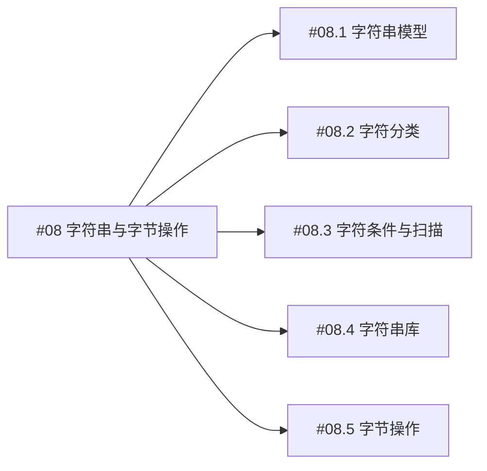

### 08.1 字符串模型

> [!note]- 知识图与目录
>
> ```mermaid
> flowchart LR
>   R["#08.1 字符串模型"]
>   N0["#303. 字符串初始化带终止符"]
>   R --> N0
>   N1["#304. 空字符不结束程序"]
>   R --> N1
>   N2["#305. NUL 与 NULL"]
>   R --> N2
>   N3["#306. 字符数组未必是字符串"]
>   R --> N3
>   N4["#307. strlen 遇首个零停止"]
>   R --> N4
>   N5["#308. 长度不含终止符"]
>   R --> N5
>   N6["#309. 容量不等于最低用量"]
>   R --> N6
>   N7["#310. 指针 sizeof 不给容量"]
>   R --> N7
>   N8["#311. 字节长度不等于字数"]
>   R --> N8
>   class R,N0,N1,N2,N3,N4,N5,N6,N7,N8 internal-link;
> ```
>
> ```mermaid
> flowchart LR
>   R["#08.1 字符串模型"]
>   N0["#312. strlen 返回 size_t"]
>   R --> N0
>   N1["#313. 长度输出用 %zu"]
>   R --> N1
>   N2["#314. 长度转 int 先查范围"]
>   R --> N2
>   N3["#315. 字面量不能修改"]
>   R --> N3
>   N4["#316. 指针遍历字符串"]
>   R --> N4
>   class R,N0,N1,N2,N3,N4 internal-link;
> ```
>
> - [[#303. 字符串初始化带终止符|303. 字符串初始化带终止符]]
> - [[#304. 空字符不结束程序|304. 空字符不结束程序]]
> - [[#305. NUL 与 NULL|305. NUL 与 NULL]]
> - [[#306. 字符数组未必是字符串|306. 字符数组未必是字符串]]
> - [[#307. strlen 遇首个零停止|307. strlen 遇首个零停止]]
> - [[#308. 长度不含终止符|308. 长度不含终止符]]
> - [[#309. 容量不等于最低用量|309. 容量不等于最低用量]]
> - [[#310. 指针 sizeof 不给容量|310. 指针 sizeof 不给容量]]
> - [[#311. 字节长度不等于字数|311. 字节长度不等于字数]]
> - [[#312. strlen 返回 size_t|312. strlen 返回 size_t]]
> - [[#313. 长度输出用 %zu|313. 长度输出用 %zu]]
> - [[#314. 长度转 int 先查范围|314. 长度转 int 先查范围]]
> - [[#315. 字面量不能修改|315. 字面量不能修改]]
> - [[#316. 指针遍历字符串|316. 指针遍历字符串]]

#### 303. 字符串初始化带终止符

字符串字面量初始化未写明长度的字符数组时，普通内容和末尾的空字符共同决定元素数量。`char text[] = "Hi";` 得到三个位置：`'H'`、`'i'`、`'\0'`。写 `"HELL"` 已经包含隐含终止符，不必再人为加一个 `\0`。

#### 304. 空字符不结束程序

`'\0'` 是值为零的空字符，字符串接口把它当作字符串结束标志；它不是“停止程序”命令。数组后面仍可能有其他元素，程序也会继续执行。

#### 305. NUL 与 NULL

NUL 是零值控制字符/空字符的常用名称，本身不是 C 预定义宏；`'\0'` 是表示零值字符的 C 写法；`NULL` 则是空指针常量宏。字符值和指针值属于不同问题，不能互换。

#### 306. 字符数组未必是字符串

字符数组只有在可访问范围内存在终止空字符时，才可交给要求终止字符串的接口。下面两种数组都没有为终止符留下位置：

```c
char a[3] = {'A', 'B', 'C'};
char b[2] = "Hi"; // C 允许省去装不下的终止符
/* printf("%s", a); */ // 错误例，不可执行
```

无精度限制的 `%s` 不会自动在数组物理末端停止，可能越界。

#### 307. strlen 遇首个零停止

`strlen` 从字符串起点逐字节数到第一个空字符之前，不计终止符，也不会自动识别实际数组容量。缺少可访问的终止符时调用可能越界，行为未定义。

```c
#include <stdio.h>
#include <string.h>
int main(void)
{
    char s[] = {'A', 'B', '\0', 'C', '\0'};
    printf("%zu\n", strlen(s)); // 2；后面的 C 仍在数组中
    return 0;
}
```

#### 308. 长度不含终止符

数组对象的大小与当前字符串长度不同：`char text[] = "Hello";` 的 `strlen(text)` 是 5，`sizeof text` 是 6。前者不计终止符，后者计算整个实际数组。

#### 309. 容量不等于最低用量

`char text[10] = "Hi";` 的当前长度为 2，实际数组占 10 个字节，另存一份完整的 Hi 至少需要 3 个位置；余下数组元素也初始化为零。`strlen(text) + 1` 的加法必须可表示，不能让大小计算绕回。

#### 310. 指针 sizeof 不给容量

若 `char *p = text;`，`sizeof p` 计算的是指针对象大小，不是 text 的数组容量。只有操作数仍为实际数组类型时，`sizeof text` 才给出整个数组占用量。

#### 311. 字节长度不等于字数

`strlen` 数的是终止符前的 `char` 单元，即字节字符串长度；UTF-8 中一个汉字可占多个字节，因此该结果不能直接当作人眼可见字符数。

#### 312. strlen 返回 size_t

`strlen(s)` 返回 `size_t`，应优先用同类型保存。`size_t` 是表示对象大小、字符串长度等非负数量的无符号整数类型，不能默认它就是 `int`。

#### 313. 长度输出用 %zu

输出 `size_t` 使用 `%zu`，而 `%d` 对应 `int`、`%u` 对应 `unsigned int`。说明符不匹配不能靠碰巧相同的存储大小补救。函数体片段：

```c
/* 已包含 <stdio.h>、<string.h>，s 是有效字符串。 */
printf("%zu\n", strlen(s));
```

#### 314. 长度转 int 先查范围

只有字符串长度不超过 `INT_MAX` 时，转为 `int` 才保持值。`(int)strlen(s)` 只是执行转换，不是范围验证；仍应先检查长度是否可表示。

#### 315. 字面量不能修改

`char *string = "I love China.";` 在 C 中可定义字符指针并用字面量首字符地址初始化，但通过它改写字面量内容属于未定义行为。只读用途优先使用 `const char *`；需要修改时写 `char text[] = "Hello";`，建立自己的可写副本。

#### 316. 指针遍历字符串

把指针看成门牌，`p` 是当前门牌，`*p` 是门牌对应的字符；`p++` 去下一个字符，`*p != '\0'` 表示尚未到字符串终点。计数器的 `count++` 只在目标条件命中时执行；`return` 把结果交还调用者，不是打印。这里仅保留原综合结论中关于字符串的部分，其数组形参和 int 指针规则另属相应章节。

### 08.2 字符分类

> [!note]- 知识图与目录
>
> ```mermaid
> flowchart LR
>   R["#08.2 字符分类"]
>   N0["#317. 字符分类的参数范围"]
>   R --> N0
>   N1["#318. 数字字符不是数值"]
>   R --> N1
>   N2["#319. 字母分类"]
>   R --> N2
>   N3["#320. 空白字符集合"]
>   R --> N3
>   N4["#321. 判断不会移动指针"]
>   R --> N4
>   N5["#322. 大小写转换要赋值"]
>   R --> N5
>   N6["#323. Locale 的作用"]
>   R --> N6
>   N7["#324. 练习的默认区域"]
>   R --> N7
>   class R,N0,N1,N2,N3,N4,N5,N6,N7 internal-link;
> ```
>
> - [[#317. 字符分类的参数范围|317. 字符分类的参数范围]]
> - [[#318. 数字字符不是数值|318. 数字字符不是数值]]
> - [[#319. 字母分类|319. 字母分类]]
> - [[#320. 空白字符集合|320. 空白字符集合]]
> - [[#321. 判断不会移动指针|321. 判断不会移动指针]]
> - [[#322. 大小写转换要赋值|322. 大小写转换要赋值]]
> - [[#323. Locale 的作用|323. Locale 的作用]]
> - [[#324. 练习的默认区域|324. 练习的默认区域]]

#### 317. 字符分类的参数范围

`<ctype.h>` 分类与大小写函数的参数必须是 `EOF` 或可表示为 `unsigned char` 的值。普通 `char` 可能为负，通常写 `isalpha((unsigned char)ch)`；来自 `fgetc` 的结果先存入 `int`、检查 EOF，不要提前转换成 `unsigned char` 而丢掉结束信号。

#### 318. 数字字符不是数值

`isdigit` 判断字符是否为十进制数字字符，非零为真、零为假，不保证真值恰为 1。`isdigit('7')` 为真，`isdigit('A')`、`isdigit(' ')` 为假；它不会把字符 7 转为整数 7。确认是数字字符后可用 `ch - '0'` 得到相应数值。

#### 319. 字母分类

默认 `"C"` locale 中，`isalpha` 判断英文字母，不把数字、空格、下划线算作字母。`isupper` 判断大写，`islower` 判断小写。标准保证数字字符 `'0'` 至 `'9'` 连续，不保证字母编码连续；原教材用字母区间比较时须附 ASCII 等连续编码前提。来自成功 `fgetc` 的 int 字符值可直接按合法参数使用。

#### 320. 空白字符集合

`isspace` 判断当前字符是否为空白。默认 C 环境的空格、`\t`、`\n`、`\r`、`\v`、`\f` 为真，`'A'`、`'5'`、`'\0'` 为假。返回值是分类结果，不是输入位置。

#### 321. 判断不会移动指针

`isspace` 只看当前字符，不会删除它或移动指针。若 end 是书签，判断只是看一眼书签处，`++end` 才把书签翻到下一格：

```c
/* 函数体片段，需 <ctype.h>；end 指向有效字符串。 */
while (isspace((unsigned char)*end))
    ++end;
```

`isspace('\0')` 为假，所以可在终止处停下。

#### 322. 大小写转换要赋值

`islower` 只判断，`tolower` 返回转换后的字符值；`toupper` 同样不自动改写原变量，字符不需转换时返回原值。真正保存结果的是赋值。

```c
#include <ctype.h>
void lower_text(char *text)
{
    for (; *text != '\0'; ++text)
        *text = (char)tolower((unsigned char)*text);
}
```

可写数组 `"AbC9"` 经此函数变成 `"abc9"`，数字保持不变。

#### 323. Locale 的作用

Locale（区域设置）决定部分字符分类、大小写、小数点、日期时间与排序规则。`"C"` locale 是标准规定的基础环境，不是中国地区缩写。改变设置后，相关规则可随之改变；字节级 `<ctype.h>` 也不等于完整 Unicode 字符处理。

#### 324. 练习的默认区域

没有特别说明时，本笔记字符分类练习采用程序启动时的默认 `"C"` locale。若程序调用 `setlocale` 改变区域设置，应按新的环境解释受它影响的分类和格式规则。

### 08.3 字符条件与扫描

> [!note]- 知识图与目录
>
> ```mermaid
> flowchart LR
>   R["#08.3 字符条件与扫描"]
>   N0["#325. ASCII 大写区间"]
>   R --> N0
>   N1["#326. ASCII 小写区间"]
>   R --> N1
>   N2["#327. 数字字符区间"]
>   R --> N2
>   N3["#328. 当前字符是否为目标"]
>   R --> N3
>   N4["#329. 非换行且非终止"]
>   R --> N4
>   N5["#330. 统计目标字符次数"]
>   R --> N5
>   N6["#331. 找到首个目标的双条件"]
>   R --> N6
>   class R,N0,N1,N2,N3,N4,N5,N6 internal-link;
> ```
>
> - [[#325. ASCII 大写区间|325. ASCII 大写区间]]
> - [[#326. ASCII 小写区间|326. ASCII 小写区间]]
> - [[#327. 数字字符区间|327. 数字字符区间]]
> - [[#328. 当前字符是否为目标|328. 当前字符是否为目标]]
> - [[#329. 非换行且非终止|329. 非换行且非终止]]
> - [[#330. 统计目标字符次数|330. 统计目标字符次数]]
> - [[#331. 找到首个目标的双条件|331. 找到首个目标的双条件]]

#### 325. ASCII 大写区间

若p指向当前字符，在ASCII等英文字母连续的编码环境中，大写判断可写`*p >= 'A' && *p <= 'Z'`。两个端点都要满足，不是只检查`*p`真假。标准可移植分类则用isupper并满足其参数范围；不要把ASCII字母连续性当作普遍C保证。

#### 326. ASCII 小写区间

ASCII等连续编码环境下，当前字符小写条件为`*p >= 'a' && *p <= 'z'`。它与大写区间使用不同端点；可移植分类可用islower，不能凭同一字母外观推断任意编码数值都连续。

#### 327. 数字字符区间

数字字符条件可写`*p >= '0' && *p <= '9'`，十进制数字字符连续性由C保证。这里比较的是字符编码值，不是要求数值对象本身处于0至9；统计数字字符时应判断这个条件，而不是仅写if(*p)。

#### 328. 当前字符是否为目标

`*p == 'X'`表示当前字符是X，`*p != 'X'`表示不是X；把目标放入变量时改写为`*p == target`或其相反条件。p是当前地址、*p是当前字符，不能误把地址本身与目标字符比较。

#### 329. 非换行且非终止

当前字符既不是换行也不是终止符，条件为`*p != '\n' && *p != '\0'`。这里两个排除条件必须同时满足，使用逻辑与；换行是可出现在字符串内部的实际字符，终止符是字符串边界，不能只排除其中一个就假定另一种也不存在。

#### 330. 统计目标字符次数

扫描整个字符串，只有当前字符等于目标时才累计；到\0结束，不把终止符算成普通内容。函数本身不打印：

```c
#include <stddef.h>
size_t count_target(const char *text, char target)
{
    size_t count=0;
    for (const char *p=text; *p!='\0'; ++p) {
        if (*p==target)
            ++count;
    }
    return count;
}
```

text必须是有效字符串，返回计数可表示为size_t；若查找目标是\0，本函数也不统计终止符。

#### 331. 找到首个目标的双条件

找首个X时继续走的条件是“未到末尾并且还没命中X”；target只是目标变量版。停止后须区分命中和到末尾：

```c
/* 函数体片段，text是有效字符串，target是目标非零字符。 */
const char *p;
for (p=text; *p!='\0' && *p!=target; ++p)
    ;
if (*p==target) {
    /* 找到第一个目标。 */
} else {
    /* 到了终止符，没有找到。 */
}
```

循环体的分号是有意的空语句，推进动作在for第三部分；不能删掉末尾条件而让指针越过字符串。目标为\0时则应另按查终止符的契约解释。

### 08.4 字符串库

> [!note]- 知识图与目录
>
> ```mermaid
> flowchart LR
>   R["#08.4 字符串库"]
>   N0["#332. 库函数的词根"]
>   R --> N0
>   N1["#333. 先读函数契约"]
>   R --> N1
>   N2["#334. 地址相等不是内容相等"]
>   R --> N2
>   N3["#335. strcmp 的结果符号"]
>   R --> N3
>   N4["#336. 首次不同决定字典序"]
>   R --> N4
>   N5["#337. 短前缀的比较"]
>   R --> N5
>   N6["#338. strncmp 只证明局部相同"]
>   R --> N6
>   N7["#339. strchr 返回首次位置"]
>   R --> N7
>   N8["#340. 查找失败返回 NULL"]
>   R --> N8
>   class R,N0,N1,N2,N3,N4,N5,N6,N7,N8 internal-link;
> ```
>
> ```mermaid
> flowchart LR
>   R["#08.4 字符串库"]
>   N0["#341. strrchr 找末次位置"]
>   R --> N0
>   N1["#342. strstr 找子串"]
>   R --> N1
>   N2["#343. 查找结果保持 const"]
>   R --> N2
>   N3["#344. 指针可作为后缀起点"]
>   R --> N3
>   N4["#345. strcpy 覆盖复制"]
>   R --> N4
>   N5["#346. strcpy 包含终止符"]
>   R --> N5
>   N6["#347. strcat 从原末尾追加"]
>   R --> N6
>   N7["#348. 覆盖和追加的字节变化"]
>   R --> N7
>   N8["#349. 复制追加返回原目标"]
>   R --> N8
>   class R,N0,N1,N2,N3,N4,N5,N6,N7,N8 internal-link;
> ```
>
> ```mermaid
> flowchart LR
>   R["#08.4 字符串库"]
>   N0["#350. 容量先于补零"]
>   R --> N0
>   N1["#351. strncpy 写满指定位置"]
>   R --> N1
>   N2["#352. strncpy 不总补终止符"]
>   R --> N2
>   N3["#353. strncat 的 n 是追加上限"]
>   R --> N3
>   N4["#354. strncat 仍写终止符"]
>   R --> N4
>   N5["#355. strtok 的分隔符集合"]
>   R --> N5
>   N6["#356. NULL 延续上次分词"]
>   R --> N6
>   N7["#357. 分词会改写原数组"]
>   R --> N7
>   N8["#358. 无词元不是空字符"]
>   R --> N8
>   class R,N0,N1,N2,N3,N4,N5,N6,N7,N8 internal-link;
> ```
>
> ```mermaid
> flowchart LR
>   R["#08.4 字符串库"]
>   N0["#359. 跳过前导分隔符"]
>   R --> N0
>   class R,N0 internal-link;
> ```
>
> - [[#332. 库函数的词根|332. 库函数的词根]]
> - [[#333. 先读函数契约|333. 先读函数契约]]
> - [[#334. 地址相等不是内容相等|334. 地址相等不是内容相等]]
> - [[#335. strcmp 的结果符号|335. strcmp 的结果符号]]
> - [[#336. 首次不同决定字典序|336. 首次不同决定字典序]]
> - [[#337. 短前缀的比较|337. 短前缀的比较]]
> - [[#338. strncmp 只证明局部相同|338. strncmp 只证明局部相同]]
> - [[#339. strchr 返回首次位置|339. strchr 返回首次位置]]
> - [[#340. 查找失败返回 NULL|340. 查找失败返回 NULL]]
> - [[#341. strrchr 找末次位置|341. strrchr 找末次位置]]
> - [[#342. strstr 找子串|342. strstr 找子串]]
> - [[#343. 查找结果保持 const|343. 查找结果保持 const]]
> - [[#344. 指针可作为后缀起点|344. 指针可作为后缀起点]]
> - [[#345. strcpy 覆盖复制|345. strcpy 覆盖复制]]
> - [[#346. strcpy 包含终止符|346. strcpy 包含终止符]]
> - [[#347. strcat 从原末尾追加|347. strcat 从原末尾追加]]
> - [[#348. 覆盖和追加的字节变化|348. 覆盖和追加的字节变化]]
> - [[#349. 复制追加返回原目标|349. 复制追加返回原目标]]
> - [[#350. 容量先于补零|350. 容量先于补零]]
> - [[#351. strncpy 写满指定位置|351. strncpy 写满指定位置]]
> - [[#352. strncpy 不总补终止符|352. strncpy 不总补终止符]]
> - [[#353. strncat 的 n 是追加上限|353. strncat 的 n 是追加上限]]
> - [[#354. strncat 仍写终止符|354. strncat 仍写终止符]]
> - [[#355. strtok 的分隔符集合|355. strtok 的分隔符集合]]
> - [[#356. NULL 延续上次分词|356. NULL 延续上次分词]]
> - [[#357. 分词会改写原数组|357. 分词会改写原数组]]
> - [[#358. 无词元不是空字符|358. 无词元不是空字符]]
> - [[#359. 跳过前导分隔符|359. 跳过前导分隔符]]

#### 332. 库函数的词根

`len` 是 length（长度），`cmp` 是 compare（比较），`cpy` 是 copy（复制），`cat` 是 concatenation（连接）。名称可帮助记忆，实际职责仍以参数与返回值契约为准。

#### 333. 先读函数契约

遇到陌生库函数，先核对参数类型及含义、返回类型及含义、是否修改原对象、所需容量及重叠限制。不能只凭函数名猜它是返回数量、比较结果，还是地址。字符串和字节函数由 `<string.h>` 提供声明。

#### 334. 地址相等不是内容相等

`char a[] = "Hello"; char b[] = "Hello";` 建立两个独立数组。表达式 `a == b` 比较数组转换后的首元素指针，不逐字符比较内容；文本相同不表示对象地址相同。

#### 335. strcmp 的结果符号

`strcmp(a, b)` 返回 `int`：负表示前者较小，零表示内容相同，正表示前者较大。相等判断写 `strcmp(a, b) == 0`；只依赖符号，不依赖必为 -1 或 1。此处比较的是有效的终止字符串。

#### 336. 首次不同决定字典序

`strcmp` 从左到右逐个比较，不是只比较首字符；第一对不同字符按 `unsigned char` 值决定返回符号，遇同时终止则相等。这是字节字典序，不是按当前语言习惯排列单词。

#### 337. 短前缀的比较

比较完整字符串时，短串的终止符也参与决定结果：

| 表达式 | 第一对不同字符 | 结果 |
|---|---|---|
| `strcmp("apple", "a")` | `'p'` 与 `\0` | 正 |
| `strcmp("a", "apple")` | `\0` 与 `'p'` | 负 |
| `strcmp("peanut", "p")` | `'e'` 与 `\0` | 正 |
| `strcmp("p", "peanut")` | `\0` 与 `'e'` | 负 |
| `strcmp("cat", "cat")` | 同时结束 | 零 |

对 apple/a，第 0 个字符相同，第 1 个字符才决定结果；不能只看第一个 a。

#### 338. strncmp 只证明局部相同

`strncmp(a, b, n)` 最多比较 n 个字符，遇终止符也停止，返回 int 的负、零、正。返回零仅证明所比较的部分相同，不能证明整串相同。例如前 4 字符相同可用于判断日志前缀 WARN。

#### 339. strchr 返回首次位置

`strchr(text, ch)` 返回首次匹配字符的位置指针，不直接返回数组下标。对 `char text[] = "Hello";`，`strchr(text, 'l')` 的结果等于 `text + 2`，不是“返回 p == text + 2 这个比较表达式”。终止符也可作为被查找字符。

#### 340. 查找失败返回 NULL

字符串查找未命中返回 `NULL`。必须先检查非空，之后才可解引用或把结果与原数组指针相减；不能把未命中的空指针当合法位置。

#### 341. strrchr 找末次位置

`strrchr(text, ch)` 与 `strchr` 的参数相同，但返回最后一次字符出现的位置；未找到仍为 `NULL`。例如 Hello 的两个 l，首次下标 2，末次下标 3。

#### 342. strstr 找子串

`strstr(text, sub)` 的第一参数是原字符串，第二参数是要找的子字符串，返回首次匹配起点，未找到返回 `NULL`。`strstr("banana", "ana")` 匹配第一个 ana；空子串匹配原串起点。

#### 343. 查找结果保持 const

C23 的 `strchr`、`strrchr`、`strstr` 等查找接口提供保持首参数 const 限定的类型泛型形式。从只读字符串查找时应以只读指针接收；旧表把全部结果一律记为 `char *`，不能据此去掉只读限制或修改字面量。

#### 344. 指针可作为后缀起点

指针虽然只指向一个字符，也可以作为该字符开始的后缀字符串起点，条件是后续仍有可访问终止符。Hello 中指向首个 l 的指针作为 `%s` 实参会输出 llo，而不是只输出单个 l。它没有创建新副本。

#### 345. strcpy 覆盖复制

`strcpy(dest, src)` 按“目标、来源”的顺序，把来源字符串从目标起始处覆盖复制。名称里的 cpy 可读成 copy，不是追加；目标要可写且容量足够，复制区域不得重叠。

#### 346. strcpy 包含终止符

`strcpy` 复制的不仅是可见字符，还包括来源末尾的 `\0`。复制 hello 至少需要 6 个 char 位置；不能只给 5 个，再指望函数在数组外补终止符。

#### 347. strcat 从原末尾追加

`strcat(dest, src)` 先找到目标原来的终止符，从那里追加来源，并写入新的终止符。目标在调用前必须已经是有效字符串，且总容量能容纳原内容、追加内容和终止符。

#### 348. 覆盖和追加的字节变化

下列操作都从相同初始数组独立执行，不是依次执行：

| 情况/下标 | 0 | 1 | 2 | 3 | 4 | 5 |
|---|---|---|---|---|---|---|
| 初始 `{'A','B','\0','x','x','x'}` | A | B | `\0` | x | x | x |
| `strcpy(text, "CDE")` | C | D | E | `\0` | x | x |
| `strcat(text, "CDE")` | A | B | C | D | E | `\0` |

这张表同时看清写入起点和未覆盖位置，不把覆盖误认作清空整个数组。

#### 349. 复制追加返回原目标

`strcpy`、`strcat` 返回原目标起始地址 dest；不是新建一个字符串，也不是返回长度或末尾地址。返回类型为字符指针这一点，不表示所有字符指针返回值都具有相同意义：查找函数返回匹配位置。

#### 350. 容量先于补零

先检查将写入的范围有没有超过目标对象的可写容量，再判断结果是否符合字符串终止规则。最后补一个 `\0`，不能补救此前已经发生的越界。

```c
/* 函数体片段，需 <string.h>。 */
char small[4];
/* strcpy(small, "hello"); */ // 错误，实际需要 6 个位置
char enough[6];
strcpy(enough, "hello");
```

若通过长度相加/相乘计算空间，也必须检查大小运算本身能否表示，防止绕回后申请得过小。各具体接口的容量条件分别见其原子点。

#### 351. strncpy 写满指定位置

`strncpy(dest, "ABC", 5)` 要写入目标数组的 **5 个字符位置**。为画出未被修改的第 6 个位置，假定 `dest` 至少有 6 个元素，则写入情况如下。

| 数组下标 | `0` | `1` | `2` | `3` | `4` | `5` |
|---|---|---|---|---|---|---|
| 内容 | `'A'` | `'B'` | `'C'` | `'\0'` | `'\0'` | 未修改 |
| 本次是否写入 | 是 | 是 | 是 | 是 | 是 | 否 |

其中 `dest[3]` 是来源字符串的终止符，`dest[4]` 是为了填满 5 个位置而补的零字节。`dest[5]` 的值取决于调用前的状态，**不能仅凭这次 `strncpy` 推断其数值**。

所以，从 `dest[0]` 开始已经形成了以 `\0` 结束的字符串，可用 `printf("%s", dest)` 输出 `ABC`。这里的前提是来源有效、目标容量至少为 5 字节且内存区域不发生不允许的重叠。若源字符串长度大于或等于 5，则 `strncpy` **不保证追加 `\0`**。

#### 352. strncpy 不总补终止符

来源长度小于 n 时，`strncpy` 复制终止符并继续补零直到写满 n 个位置；来源长度大于等于 n 时，不额外补终止符。目标至少有 n 个可写位置，来源和目标不得重叠。它不是一个自动安全的 strcpy。

#### 353. strncat 的 n 是追加上限

`strncat(dest, src, n)` 中，n 是最多从来源追加的普通字符数，不是目标总容量；它返回原 dest。目标先是有效字符串，并需容纳原长度加实际追加量。

#### 354. strncat 仍写终止符

`strncat` 在追加后还写入一个 `\0`，与 strncpy 不保证终止不同。容量要给原内容、实际追加内容和新终止符留足位置，不能把 n 直接当作最后可写字节数。

#### 355. strtok 的分隔符集合

`strtok` 可记为 string tokenizer（字符串分词器），delim 来自 delimiter。delim 是分隔字符集合，不是完整的分隔子串；`",:"` 表示逗号或冒号都可分隔。成功返回下一词元起点，没有词元返回 NULL。

#### 356. NULL 延续上次分词

首次把可写字符串交给 strtok，后续调用第一个参数传 NULL，表示继续处理上一次尚未处理的部分，而不是提供新字符串。

```c
/* 函数体片段，需 <string.h>。 */
char text[] = "cat:dog";
char *p = strtok(text, ":"); // 指向字符串 "cat"
char *q = strtok(NULL, ":");// 指向字符串 "dog"
```

这里 p、q 是词元字符串起点，应使用双引号描述；不是单个字符 c 或 d。strtok 保存内部进度，交错处理另一个字符串会影响原扫描。

#### 357. 分词会改写原数组

strtok 将已找到词元末尾的分隔字符改为 `\0`，使词元在原数组中形成独立终止字符串。返回值仍指向原数组内部，没有另行分配内容；因此输入必须可写，不能传字符串字面量让它修改。

#### 358. 无词元不是空字符

strtok 改写数组时写的是字符 `\0`，没有词元时返回的是指针值 NULL。一个是数组中的字符，一个是函数返回的空指针，不能因为都和零有关就混记。

#### 359. 跳过前导分隔符

strtok 会跳过前导和连续分隔符，不产生空词元；被跳过的前导逗号不一定改写。主要改写的是已识别词元末端的分隔符，不能认为数组里所有分隔字符都会变成零。

```text
输入：,cat:dog,,    分隔集合：,:
词元：cat、dog      没有开头或结尾的空词元
```

指针差的类型与输出格式见 [[#238. ptrdiff_t 是有符号差值类型|ptrdiff_t 是有符号差值类型]] 和 [[#239. 用 %td 输出指针差|用 %td 输出指针差]]。

打印位置差使用 [[#239. 用 %td 输出指针差|用 %td 输出指针差]] 中的类型契约。

查找结果转为下标的完整示例见 [[#240. 查找后相减得到下标|查找后相减得到下标]]；查找失败时不能先做指针减法。

### 08.5 字节操作

> [!note]- 知识图与目录
>
> ```mermaid
> flowchart LR
>   R["#08.5 字节操作"]
>   N0["#360. 字符串与字节缓冲区"]
>   R --> N0
>   N1["#361. memcpy 的字节契约"]
>   R --> N1
>   N2["#362. 未覆盖字节保持原值"]
>   R --> N2
>   N3["#363. memcpy 不补终止符"]
>   R --> N3
>   N4["#364. memmove 允许重叠"]
>   R --> N4
>   N5["#365. 重叠搬移的逐字节结果"]
>   R --> N5
>   N6["#366. 重叠 memcpy 属于 UB"]
>   R --> N6
>   N7["#367. 暂存只是效果模型"]
>   R --> N7
>   N8["#368. 字节区间用半开表示"]
>   R --> N8
>   class R,N0,N1,N2,N3,N4,N5,N6,N7,N8 internal-link;
> ```
>
> ```mermaid
> flowchart LR
>   R["#08.5 字节操作"]
>   N0["#369. 区域有交集就重叠"]
>   R --> N0
>   N1["#370. 不能排除重叠选 memmove"]
>   R --> N1
>   N2["#371. memset 按字节填充"]
>   R --> N2
>   N3["#372. 填字节一不是整数一"]
>   R --> N3
>   N4["#373. 全零不是通用初始化"]
>   R --> N4
>   N5["#374. 负一先转字节值"]
>   R --> N5
>   N6["#375. 填充可能破坏终止符"]
>   R --> N6
>   N7["#376. memcmp 比较指定字节"]
>   R --> N7
>   N8["#377. 零字节不终止 memcmp"]
>   R --> N8
>   class R,N0,N1,N2,N3,N4,N5,N6,N7,N8 internal-link;
> ```
>
> - [[#360. 字符串与字节缓冲区|360. 字符串与字节缓冲区]]
> - [[#361. memcpy 的字节契约|361. memcpy 的字节契约]]
> - [[#362. 未覆盖字节保持原值|362. 未覆盖字节保持原值]]
> - [[#363. memcpy 不补终止符|363. memcpy 不补终止符]]
> - [[#364. memmove 允许重叠|364. memmove 允许重叠]]
> - [[#365. 重叠搬移的逐字节结果|365. 重叠搬移的逐字节结果]]
> - [[#366. 重叠 memcpy 属于 UB|366. 重叠 memcpy 属于 UB]]
> - [[#367. 暂存只是效果模型|367. 暂存只是效果模型]]
> - [[#368. 字节区间用半开表示|368. 字节区间用半开表示]]
> - [[#369. 区域有交集就重叠|369. 区域有交集就重叠]]
> - [[#370. 不能排除重叠选 memmove|370. 不能排除重叠选 memmove]]
> - [[#371. memset 按字节填充|371. memset 按字节填充]]
> - [[#372. 填字节一不是整数一|372. 填字节一不是整数一]]
> - [[#373. 全零不是通用初始化|373. 全零不是通用初始化]]
> - [[#374. 负一先转字节值|374. 负一先转字节值]]
> - [[#375. 填充可能破坏终止符|375. 填充可能破坏终止符]]
> - [[#376. memcmp 比较指定字节|376. memcmp 比较指定字节]]
> - [[#377. 零字节不终止 memcmp|377. 零字节不终止 memcmp]]

#### 360. 字符串与字节缓冲区

先问处理的是终止字符串还是任意字节，再选接口。完整文本相等用 strcmp，前 n 字符/前缀用 strncmp，固定长度二进制内容用 memcmp；二进制数据可能在中途含零，不能交给 strlen 当作完整长度。

原例中完整密码文本、WARN 前缀、16 字节数据分别体现这三种语义；这些函数没有保密场景需要的固定执行时间保证。

#### 361. memcpy 的字节契约

`memcpy` 是 C 标准库 `<string.h>` 中的**字节复制函数**：把来源内存中的 `count` 个字节复制到目标内存。它不要求复制的是 C 字符串，也不会根据 `\0` 自动决定复制长度。

下面是**函数体内部**的一条示意调用，要求 `dest`、`src`、`count` 已经有有效定义：

```c
memcpy(dest, src, count);
```

名称中的 `mem` 表示 memory（内存），`cpy` 表示 copy（复制）。

| 参数或返回值 | 含义 |
|---|---|
| `dest` | 写入目标内存的起始地址 |
| `src` | 读取来源内存的起始地址 |
| `count` | 本次要复制的**字节数** |
| 返回值 `void *` | 返回目标地址 `dest` |

**适用前提：**来源和目标都必须具有足够的可访问字节，并且被复制的两个区域**不能重叠**。如需复制重叠区域，应使用 `memmove`。

与 `strcpy` 不同，`memcpy` 既不寻找字符串终止符，也不会额外追加 `\0`。

#### 362. 未覆盖字节保持原值

```c
char dest[6] = "xxxxx";

memcpy(dest, "ABC", 3);
```

复制前：

```text
x x x x x \0
```

复制后：

```text
A B C x x \0
```

为什么不是 `"ABC"`？

因为 `memcpy` 只覆盖前三个字节。原先的两个 `'x'` 和末尾的 `'\0'` 都保留下来。

#### 363. memcpy 不补终止符

memcpy 只复制明确指定的 n 个字节，不寻找字符串终止符，也不额外补零。若希望复制后的数组仍为完整字符串，必须自己把终止符包含在合法复制范围内，或按容量正确恢复它。

#### 364. memmove 允许重叠

`memmove(dest, src, count)` 从来源复制指定字节数到目标，返回 `void *` 的 dest；来源和目标可重叠，但仍须有足够的可读/可写字节。其参数结构与 memcpy 相同，差别在重叠许可，不在元素类型或变量名。

#### 365. 重叠搬移的逐字节结果

考虑可写数组：

```c
char text[] = "ABCDE";
memmove(text + 1, text, 3);
```

调用前，来源区域为下标 `0–2`（`A B C`），目标区域为下标 `1–3`，两个区域在下标 1、2 上重叠：

| 下标 | `0` | `1` | `2` | `3` | `4` | `5` |
|---|---|---|---|---|---|---|
| 调用前的字节 | `A` | `B` | `C` | `D` | `E` | `\0` |
| 来源区域 | ● | ● | ● | — | — | — |
| 目标区域 | — | ● | ● | ● | — | — |
| 调用后的字节 | `A` | `A` | `B` | `C` | `E` | `\0` |

重叠指两个**实际访问的字节区域存在交集**，并非仅指两个指针来源于同一个数组。这里应使用 `memmove`；若把它换成 `memcpy`，行为未定义。

#### 366. 重叠 memcpy 属于 UB

在同一 `char text[] = "ABCDE";` 上，`memcpy(text + 1, text, 3)` 的来源与目标有交集，行为未定义。不能把某次出现 AABCE 或其他结果当作保证；未定义行为也不等于必然崩溃。正确的重叠搬移示例使用 memmove。

#### 367. 暂存只是效果模型

C 标准把 `memmove` 的复制效果描述为：

```text
来源区域的 count 个字节
        ↓
仿佛先复制到一块独立的临时区域
        ↓
再复制到目标区域
```

因为写入目标的过程中不会破坏尚未读取的“原始来源”，所以能处理重叠。这里的**“仿佛”是行为要求**，并不意味着实现一定分配真正的临时数组；实际实现可以采用等效的优化方法。

#### 368. 字节区间用半开表示

对一个数组内从下标 `start` 开始、长度为 `count` 的**连续字节区间**，常用半开区间表示：

```text
[start, start + count)
```

左端包含、右端不包含。只有当 `count > 0` 时，最后一个实际占用的下标才是：

```text
start + count - 1
```

例如 `start = 1`、`count = 3`：

| 项目 | 内容 |
|---|---|
| 半开区间 | `[1, 4)` |
| 实际包含的下标 | `1、2、3` |
| 最后一个下标 | `1 + 3 - 1 = 3` |

若 `count = 0`，区间为空，不存在“最后一个元素”；计算区间时还必须确保下标和长度有效，不超出数组范围。

#### 369. 区域有交集就重叠

重叠看实际访问的字节区间是否有交集，不要求起点相同或两个区域完全一样。来源 [0,3)、目标 [1,4) 共享下标 1、2；同一个数组中两个不相交区间则可以不重叠。不能用“来自同一数组”替代范围检查。

#### 370. 不能排除重叠选 memmove

来源与目标确定不重叠时，memcpy 和 memmove 都可复制；存在重叠或不能排除重叠时选 memmove。两者都不为越界地址、悬垂指针或容量不足提供补救。

#### 371. memset 按字节填充

`memset` 位于 `<string.h>`，与复制函数不同，它**不读取另一块来源内存**，而是从目标地址开始，将指定的字节值写入连续的 `count` 个字节。

```c
void *memset(void *dest, int ch, size_t count);
```

| 参数或返回值       | 含义                           |
| ------------ | ---------------------------- |
| `dest`       | 从哪个内存地址开始写入                  |
| `ch`         | 要写入的字节值；先转换为 `unsigned char` |
| `count`      | 写入多少个**字节**                  |
| 返回值 `void *` | 返回 `dest`                    |

`mem` 表示 memory（内存），`set` 表示设置、填充。

例如：

```c
#include <string.h>

void fillBytes(void)
{
    unsigned char bytes[4];
    memset(bytes, 0xAB, sizeof bytes);
    /* bytes 的四个字节均写入 0xAB */
}
```

注意，它按**字节**填充，并不是按 `int` 数组元素赋值：不要用 `memset(int_array, 1, sizeof int_array)` 来表示“给每个 `int` 元素赋值为 1”；详细对照见下面的知识点。

#### 372. 填字节一不是整数一

如果目标是让 `int arr[5]` 的**每个元素都等于整数 `1`**，应该使用逐元素赋值，而不能写 `memset(arr, 1, sizeof arr)`。`memset` 将每个字节写成 `0x01`（8 位字节实现上），不等于把整个 `int` 对象赋值为 `1`。

```c
#include <stdio.h>

int main(void)
{
    int arr[5];
    for (int i = 0; i < 5; ++i)
        arr[i] = 1;
    for (int i = 0; i < 5; ++i)
        printf("%d ", arr[i]);
    return 0;
}
```

此例中的 `int` 不是普遍固定占四字节。若想赋其他整数值或对任意对象作有语义的初始化，优先使用元素赋值或合适的初始化表达式。

#### 373. 全零不是通用初始化

对有效的普通 `int` 数组，所有位均为零的对象表示对应数值 `0`；因此以下写法可以把每个元素变成整数零：

```c
#include <string.h>

void clearIntegers(void)
{
    int arr[5];
    memset(arr, 0, sizeof arr);
    /* 这里的 arr[0] 至 arr[4] 全为 0 */
}
```

但不要因此把 `memset(..., 0, ...)` 推广为“可以为任意 C 对象建立语义上的零值”：例如空指针或浮点零的**对象表示**并不普遍要求是全零字节。对指针和浮点等对象，使用适当的类型初始化更清晰、可移植。也不要把“按字节填零可以得到整数零”误说成“只有填零才可能对整数有意义”。

#### 374. 负一先转字节值

`memset(dest, ch, count)` 将第二个参数转换为 `unsigned char`，再把该字节值重复写入指定的 `count` 个字节。

```c
#include <string.h>

void fillOnes(void)
{
    unsigned char buf[4];
    memset(buf, -1, sizeof buf);
    /* 每个元素为 UCHAR_MAX；常见 CHAR_BIT == 8 时是 0xFF。 */
}
```

这里 `-1` 转换为 `unsigned char` 后得到 `UCHAR_MAX`。若每个字节是 8 位，数值为 `255`，其位模式为 `11111111`；C 并不要求所有实现都使用 8 位字节。对 `int`、指针、浮点对象，不应仅凭字节都变成 `0xFF` 就推断它们在 C 中的语义值。

#### 375. 填充可能破坏终止符

`memset` 只关心填入的字节值和 `count`，不会判断目标是不是 C 字符串，更不会主动追加 `\0`。

```c
#include <string.h>

void overwriteText(void)
{
    char text[6] = "hello";          // h e l l o \0
    memset(text, 'X', 3);            // X X X l o \0
    memset(text, 'X', sizeof text);  // X X X X X X（已无终止符）
}
```

第二次填充会覆盖原先的 `\0`，因此不能再把整个 `text` 当作以空字符结束的 C 字符串传给 `strlen`、`strcpy` 等函数，除非先恢复终止符。

如果明确填入 `0`，例如 `memset(text, 0, sizeof text)`，每个写入的字节会变成空字符；但这是**明确指定了填充值**，不是函数自动维护字符串终止符。

#### 376. memcmp 比较指定字节

`memcmp(a, b, count)` 按 unsigned char 值比较指定的 count 个字节，返回负、零、正的 int；第一对不同字节决定符号。两端必须有这么多可读取字节。它不会因零字节停止，也不等于按多字节整数的数学值比较。

结构体的填充也会参加字节比较；业务字段相等不能直接用整个结构体的 `memcmp` 结果判断。布局示例见 [[#716. 对齐可能插入填充字节|对齐可能插入填充字节]]，比较方法见 [[#720. 逻辑相等应逐成员判断|逻辑相等应逐成员判断]]。

#### 377. 零字节不终止 memcmp

对 `char a[] = {'A','\0','X'};` 与 `char b[] = {'A','\0','Y'};`：strcmp 返回零；memcmp 比前两字节也为零；比三字节时会看到 X/Y 差异，其符号取决于字符编码顺序（ASCII 中为负）。strncmp 遇终止符也会停止，而 memcmp 的边界仅由指定字节数决定。

---

## 09 格式化输入输出

格式字符串也是一份接口契约。先读清它消费或输出什么，再看类型、容量和返回值。

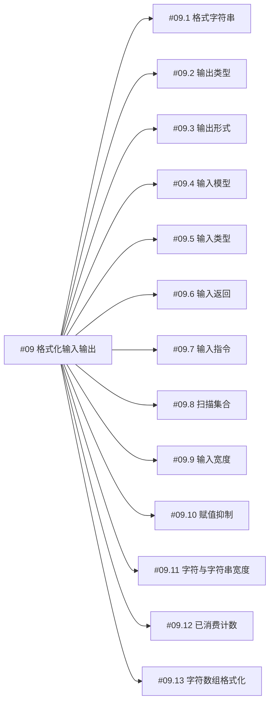

### 09.1 格式字符串

> [!note]- 知识图与目录
>
> ```mermaid
> flowchart LR
>   R["#09.1 格式字符串"]
>   N0["#378. 格式串也是实参"]
>   R --> N0
>   N1["#379. 转换说明从百分号开始"]
>   R --> N1
>   N2["#380. 普通字符直接输出"]
>   R --> N2
>   N3["#381. 双百分号输出百分号"]
>   R --> N3
>   N4["#382. 格式串在空字符处结束"]
>   R --> N4
>   class R,N0,N1,N2,N3,N4 internal-link;
> ```
>
> - [[#378. 格式串也是实参|378. 格式串也是实参]]
> - [[#379. 转换说明从百分号开始|379. 转换说明从百分号开始]]
> - [[#380. 普通字符直接输出|380. 普通字符直接输出]]
> - [[#381. 双百分号输出百分号|381. 双百分号输出百分号]]
> - [[#382. 格式串在空字符处结束|382. 格式串在空字符处结束]]

#### 378. 格式串也是实参

在 `printf(format, ...)` 中，format 本身就是实参，用来指挥后面各个参数的转换；它不需要另一个 `%...` 来把自己“填进格式串”。

#### 379. 转换说明从百分号开始

“占位符”是教学中的说法，标准术语是转换说明（conversion specification）。它从 `%` 开始，可能包含标志、宽度、精度和长度修饰，再由转换字符规定如何解释后面的对应实参。

#### 380. 普通字符直接输出

printf 实际看到的格式串中，普通的非百分号字符按原样输出。例如 `printf("ID=%d", 23)` 的 I、D、等号是格式串里的固定文字，不需要另行提供三个实参。

#### 381. 双百分号输出百分号

格式中的 `%` 用于开启转换；要输出一个字面百分号写 `%%`，它不消耗普通数据实参。不要把单个裸 `%` 当成普通输出字符。

#### 382. 格式串在空字符处结束

格式字符串也遵守 C 字符串的终止规则：printf 在第一个 `\0` 处结束解释；终止符后的字节不属于这次格式。`\0` 不是要求额外输出一个符号的转换说明。

### 09.2 输出类型

> [!note]- 知识图与目录
>
> ```mermaid
> flowchart LR
>   R["#09.2 输出类型"]
>   N0["#383. %d 接收有符号 int"]
>   R --> N0
>   N1["#384. %c 接收字符值"]
>   R --> N1
>   N2["#385. %s 接收字符串起点"]
>   R --> N2
>   N3["#386. 格式不会任意转换类型"]
>   R --> N3
>   N4["#387. float 传入省略号会提升"]
>   R --> N4
>   N5["#388. printf 的 %f 使用 double"]
>   R --> N5
>   N6["#389. printf 小写 l 不改浮点参数"]
>   R --> N6
>   N7["#390. long double 用大写 L"]
>   R --> N7
>   class R,N0,N1,N2,N3,N4,N5,N6,N7 internal-link;
> ```
>
> - [[#383. %d 接收有符号 int|383. %d 接收有符号 int]]
> - [[#384. %c 接收字符值|384. %c 接收字符值]]
> - [[#385. %s 接收字符串起点|385. %s 接收字符串起点]]
> - [[#386. 格式不会任意转换类型|386. 格式不会任意转换类型]]
> - [[#387. float 传入省略号会提升|387. float 传入省略号会提升]]
> - [[#388. printf 的 %f 使用 double|388. printf 的 %f 使用 double]]
> - [[#389. printf 小写 l 不改浮点参数|389. printf 小写 l 不改浮点参数]]
> - [[#390. long double 用大写 L|390. long double 用大写 L]]

#### 383. %d 接收有符号 int

printf 的 `%d` 把对应的 int 值按有符号十进制输出，不只是泛泛地“按十进制显示”。`%u` 对应 unsigned int，不能因实际值非负就忽略参数类型。

`size_t` 的输出契约见 [[#39. 用 %zu 输出大小|用 %zu 输出大小]]。

#### 384. %c 接收字符值

printf 的 `%c` 接收 int 字符值，输出一个字符。把字符看成居民，指针看成门牌：`%c` 要居民；p 指向字符时通常传 `*p`，不是把 p 地址本身交给 `%c`。

#### 385. %s 接收字符串起点

printf 的 `%s` 接收字符串起点地址，沿字符序列输出至终止空字符之前。`%s` 要的是起点门牌，因此 p 指向有效字符串时传 p，不是 `*p`。它不输出终止符。无精度限制的 `%s` 要求终止符在可访问范围内；仅有字符数组声明并不足够。

#### 386. 格式不会任意转换类型

整数可用不同进制写在 int 中，但输出格式有各自实参类型契约。八、十六进制输出的 `%o`、`%x`、`%X` 对应 unsigned int，不是要求变量原本必须使用某种进制类型。

```c
/* 函数体片段，需 <stdio.h>。 */
int value = 0x2F;
printf("%d %o %X\n", value, (unsigned int)value,
       (unsigned int)value); // 47 57 2F
```

说明符不会替调用者完成任意转换；不匹配可能导致未定义行为。

#### 387. float 传入省略号会提升

printf 是可变参数函数，`...` 部分的 float 实参先按默认实参提升转换为 double，低等级整数也按规则进行整数提升。

```c
/* 函数体片段，需 <stdio.h>。 */
float x = 3.5f;
printf("%f", x); // 实际传入的是 double 值 3.5
```

可以想成先把小杯里的值倒进 double 杯再交给函数；值的意义不变，实参类型改变。此规则不是 scanf 目标指针的提升规则。

#### 388. printf 的 %f 使用 double

printf 的 f 表示普通浮点输出形式，不表示“参数必须是 float”。直接传 double，或先由 float 提升得到 double，均可用 `%f`。这不允许把 double 指针交给 scanf 的 `%f`。

#### 389. printf 小写 l 不改浮点参数

现代 C 中，printf 的 `%lf` 与 `%f` 都处理 double，小写 l 在这些浮点转换中无效果。不要把 scanf 的长度修饰含义直接搬到 printf。

#### 390. long double 用大写 L

printf 输出 long double 使用 `%Lf`，大写 L 不等于小写 l。

```c
/* 函数体片段，需 <stdio.h>。 */
float x = 1.5f;
double y = 2.5;
long double z = 3.5L;
printf("%f %f %Lf\n", x, y, z);
```

### 09.3 输出形式

> [!note]- 知识图与目录
>
> ```mermaid
> flowchart LR
>   R["#09.3 输出形式"]
>   N0["#391. %x 默认不加前缀"]
>   R --> N0
>   N1["#392. %X 使用大写字母"]
>   R --> N1
>   N2["#393. 十六进制替代形式"]
>   R --> N2
>   N3["#394. 十六进制零不加前缀"]
>   R --> N3
>   N4["#395. %o 默认不补前导零"]
>   R --> N4
>   N5["#396. 八进制替代形式"]
>   R --> N5
>   N6["#397. printf 宽度只是最小宽度"]
>   R --> N6
>   N7["#398. 浮点精度指定小数位"]
>   R --> N7
>   N8["#399. 输出字段可以左右对齐"]
>   R --> N8
>   class R,N0,N1,N2,N3,N4,N5,N6,N7,N8 internal-link;
> ```
>
> ```mermaid
> flowchart LR
>   R["#09.3 输出形式"]
>   N0["#400. 零标志改变填充字符"]
>   R --> N0
>   N1["#401. 小数精度不改原值"]
>   R --> N1
>   N2["#402. 进制输出验证程序"]
>   R --> N2
>   class R,N0,N1,N2 internal-link;
> ```
>
> - [[#391. %x 默认不加前缀|391. %x 默认不加前缀]]
> - [[#392. %X 使用大写字母|392. %X 使用大写字母]]
> - [[#393. 十六进制替代形式|393. 十六进制替代形式]]
> - [[#394. 十六进制零不加前缀|394. 十六进制零不加前缀]]
> - [[#395. %o 默认不补前导零|395. %o 默认不补前导零]]
> - [[#396. 八进制替代形式|396. 八进制替代形式]]
> - [[#397. printf 宽度只是最小宽度|397. printf 宽度只是最小宽度]]
> - [[#398. 浮点精度指定小数位|398. 浮点精度指定小数位]]
> - [[#399. 输出字段可以左右对齐|399. 输出字段可以左右对齐]]
> - [[#400. 零标志改变填充字符|400. 零标志改变填充字符]]
> - [[#401. 小数精度不改原值|401. 小数精度不改原值]]
> - [[#402. 进制输出验证程序|402. 进制输出验证程序]]

#### 391. %x 默认不加前缀

printf 的 `%x` 将 unsigned int 按十六进制显示，字母使用 a 至 f，默认不输出 0x 前缀。`unsigned int value = 0xAF;` 配 `%x` 得到 af；输入常量带前缀不表示输出会自动保留它。

#### 392. %X 使用大写字母

`%X` 使用 A 至 F，普通形式不加 0X；与 `%x` 的大小写差别是显示形式差别。例如同一 0xAF 值分别显示 af、AF。

#### 393. 十六进制替代形式

非零 unsigned int 用 `%#x` 输出会加 0x，`%#X` 会加 0X；# 是替代形式标志。显示寄存器值或调试字节数据时，前缀让读者立即认出十六进制。

```text
0xAF 的输出：%#x → 0xaf；%#X → 0XAF
```

#### 394. 十六进制零不加前缀

数值为零时，普通精度下 `%#x` 输出 0，不是 0x0；%#X 也不会为零添加 0X。理解非零规则后还要单独检验零这个边界，不能把“有 # 就有前缀”作为无条件结论。

#### 395. %o 默认不补前导零

`%o` 按八进制输出 unsigned int，默认不额外加前导零。源代码常量 073 的数值用 `%o` 显示为 73；源代码整数前缀与输出文本不是同一个接口。

#### 396. 八进制替代形式

`%#o` 调整八进制输出，使替代形式以零开头。普通零值本身已经输出 0，不会再重复添加成 00；不能把它理解为永远在现有文本前机械拼一个零。

#### 397. printf 宽度只是最小宽度

`%8.2f` 的宽度 `8` 是整个字段的最小字符数，包含符号、整数、小数点和小数。结果超过宽度时照常完整输出；`printf("%5.2f", 123456.78)` 仍会完整显示数值，不能把宽度当作截断上限。

#### 398. 浮点精度指定小数位

`%.2f` 表示小数点后显示两位；`%2f` 却只指定最小宽度 `2`。不指定精度时，`%f` 默认显示 6 位小数。精度和宽度是两个插槽，不能把点号省去。

#### 399. 输出字段可以左右对齐

`printf("|%8.2f|", 12.34)` 显示 `|   12.34|`。默认右对齐、左侧补空格；`-` 标志改成左对齐，例如 `%-8.2f` 在右侧补空格。宽度计算的是整个格式化结果，不只是整数位。

#### 400. 零标志改变填充字符

`printf("%010.2f", 123.456)` 要求最小宽度 10、小数点后两位，需要填充时使用前导零，结果为 `0000123.46`。`0` 标志不会交换总宽度和精度的含义；若同时给出左对齐标志 `-`，则忽略这个补零标志。

#### 401. 小数精度不改原值

`%.2f` 按浮点定点形式显示小数点后两位，按格式规则舍入，不会把原变量本身改成“两位小数”。宽度规则见 [[#397. printf 宽度只是最小宽度|printf 宽度只是最小宽度]]。

#### 402. 进制输出验证程序

以下完整程序验证相同数值的输出形式与零边界，具体规则已在各原子点说明。

```c
#include <stdio.h>

int main(void)
{
    unsigned int value = 0xAF;
    printf("%x %X %#x %#X\n", value, value, value, value);
    printf("%o %#o\n", 073u, 073u);
    printf("%#x %#o\n", 0u, 0u);
    return 0;
}
```

```text
af AF 0xaf 0XAF
73 073
0 0
```

### 09.4 输入模型

> [!note]- 知识图与目录
>
> ```mermaid
> flowchart LR
>   R["#09.4 输入模型"]
>   N0["#403. scanf 从 stdin 读取"]
>   R --> N0
>   N1["#404. 格式串经数组转换传入"]
>   R --> N1
>   N2["#405. %d 解析数值而非字符码"]
>   R --> N2
>   N3["#406. 解析成功后再判断属性"]
>   R --> N3
>   N4["#407. 输入数据会排队等待"]
>   R --> N4
>   N5["#408. if 先调用再比较"]
>   R --> N5
>   class R,N0,N1,N2,N3,N4,N5 internal-link;
> ```
>
> - [[#403. scanf 从 stdin 读取|403. scanf 从 stdin 读取]]
> - [[#404. 格式串经数组转换传入|404. 格式串经数组转换传入]]
> - [[#405. %d 解析数值而非字符码|405. %d 解析数值而非字符码]]
> - [[#406. 解析成功后再判断属性|406. 解析成功后再判断属性]]
> - [[#407. 输入数据会排队等待|407. 输入数据会排队等待]]
> - [[#408. if 先调用再比较|408. if 先调用再比较]]

#### 403. scanf 从 stdin 读取

scanf 是从标准输入流 stdin 进行格式化输入的函数：取得输入字符，按格式解析，再把结果放入相应对象。stdin 在终端常来自键盘，也可以来自重定向文件或管道，不能永远等同于键盘。

#### 404. 格式串经数组转换传入

`"%d"` 是含 `%`、d、`\0` 的字符数组。传给 scanf 时，它通常转换为指向首元素的指针，再匹配只读格式参数；用途叫“格式字符串”，传递模型叫“字符指针”，两种说法不矛盾。

```text
"%d" → ['%', 'd', '\0'] → 指向首个 '%' 的指针
```

#### 405. %d 解析数值而非字符码

scanf 的 `%d` 把字符序列解释为十进制整数，`%c` 才直接读取字符。输入 X 给 `%d` 不会得到 ASCII 值 88；只有先按字符成功读取，再按该环境编码显示时，X 与 88 的联系才成立。

例如输入 `12 A`，`%d` 连续解析字符 `1`、`2` 得到数值 `12`，在空格处停止，不是仅取第一位 `1`。

#### 406. 解析成功后再判断属性

输入解析与奇偶判断是两阶段。先确认 scanf 得到了需要的整数，才能检查 `number % 2 == 0`；不能把“用户给了一个字符”与“已得到一个整数对象值”当作同一事实。

#### 407. 输入数据会排队等待

“输入缓冲区”可先理解为已经送来但程序尚未消费的数据在排队。字符通常经过输入来源、stdin、scanf/getchar 等输入函数逐步消费；这个模型不意味着所有输入都由键盘产生，也不意味每次调用会自动读掉整行。

#### 408. if 先调用再比较

`if (scanf("%d", &number) != 1)` 的顺序是：调用 scanf → 尝试读取和赋值 → 获得返回值 → 与 1 比较 → 决定分支。不是 if 条件成立后才调用 scanf；if 要先求出括号内表达式的真假。

### 09.5 输入类型

> [!note]- 知识图与目录
>
> ```mermaid
> flowchart LR
>   R["#09.5 输入类型"]
>   N0["#409. scanf 的 %f 目标是 float"]
>   R --> N0
>   N1["#410. scanf 的 %lf 目标是 double"]
>   R --> N1
>   N2["#411. scanf 的 %Lf 目标是 long double"]
>   R --> N2
>   class R,N0,N1,N2 internal-link;
> ```
>
> - [[#409. scanf 的 %f 目标是 float|409. scanf 的 %f 目标是 float]]
> - [[#410. scanf 的 %lf 目标是 double|410. scanf 的 %lf 目标是 double]]
> - [[#411. scanf 的 %Lf 目标是 long double|411. scanf 的 %Lf 目标是 long double]]

#### 409. scanf 的 %f 目标是 float

scanf的%f需要float*：它要把结果写进float对象，不能沿用printf中“float提升后按double传值”的理解。指针目标不会因可变参数机制自动变成另一种可写对象。

```c
/* 函数体片段，需<stdio.h>。 */
float x;
if (scanf("%f",&x)!=1) {
    /* 没取得所需浮点值。 */
}
```

#### 410. scanf 的 %lf 目标是 double

scanf中的小写l是长度修饰，配合f/e/g/a等浮点转换时需要double*；例如double y用scanf("%lf",&y)。与printf的%lf中l无效果不同，漏掉l可能让目标指针类型不匹配。

#### 411. scanf 的 %Lf 目标是 long double

long double输入需要大写L，例如long double z配scanf("%Lf",&z)。%f、%lf、%Lf分别写入float、double、long double对象；大小写属于接口契约，不是排版偏好。

### 09.6 输入返回

> [!note]- 知识图与目录
>
> ```mermaid
> flowchart LR
>   R["#09.6 输入返回"]
>   N0["#412. 返回成功赋值项数"]
>   R --> N0
>   N1["#413. 输入失败时的 EOF"]
>   R --> N1
>   N2["#414. 失败不提供新值"]
>   R --> N2
>   N3["#415. 匹配失败停止后续处理"]
>   R --> N3
>   class R,N0,N1,N2,N3 internal-link;
> ```
>
> - [[#412. 返回成功赋值项数|412. 返回成功赋值项数]]
> - [[#413. 输入失败时的 EOF|413. 输入失败时的 EOF]]
> - [[#414. 失败不提供新值|414. 失败不提供新值]]
> - [[#415. 匹配失败停止后续处理|415. 匹配失败停止后续处理]]

#### 412. 返回成功赋值项数

scanf 家族返回成功赋值的输入项数，不是字符数，也不是统一的成功/失败布尔值。单个 `%d` 成功时为 1；首个 `%d` 面对不能开始整数的 hello/X 时可匹配失败并返回 0。零的直接意思是“成功计数为零项”，不能和 main 的零退出状态混记。

#### 413. 输入失败时的 EOF

格式化输入在第一次转换完成前发生输入失败时返回 EOF；否则返回此前计入的成功赋值数量。输入失败可能来自文件尾或读取错误，不能将 EOF 一律当普通的零项匹配失败。被抑制的转换和 %n 对返回计数有特殊规则，仍应按接口规定分析。

#### 414. 失败不提供新值

原情景输入12X，格式为%*2d%1d：

```text
%*2d → 成功读走12 → 抑制赋值，不计返回项数
%1d  → 当前是X → 不能开始十进制整数 → 匹配失败
结果 → 计入的赋值为0，后续格式停止
```

若目标先写成`int a;`，此时仍没初始化、也没得到新赋值，不能猜成88等任意数。若已有旧值，也不能把它当本次成功输入；失败不提供新的有效结果。

#### 415. 匹配失败停止后续处理

scanf、sscanf 等从左到右处理格式，某条指令匹配失败后，不再继续后面的转换；返回此前成功完成并计入的赋值项数。后面的 %n 或变量也可能尚未赋值。

### 09.7 输入指令

> [!note]- 知识图与目录
>
> ```mermaid
> flowchart LR
>   R["#09.7 输入指令"]
>   N0["#416. 普通字符逐字匹配"]
>   R --> N0
>   N1["#417. 格式空白是跳过指令"]
>   R --> N1
>   N2["#418. 字符转换不跳前导空白"]
>   R --> N2
>   N3["#419. 不自动跳空白的例外"]
>   R --> N3
>   N4["#420. 连续 %s 自行跳空白"]
>   R --> N4
>   N5["#421. %s 后接 %c 的位置"]
>   R --> N5
>   N6["#422. 空字符不是待跳过空白"]
>   R --> N6
>   class R,N0,N1,N2,N3,N4,N5,N6 internal-link;
> ```
>
> - [[#416. 普通字符逐字匹配|416. 普通字符逐字匹配]]
> - [[#417. 格式空白是跳过指令|417. 格式空白是跳过指令]]
> - [[#418. 字符转换不跳前导空白|418. 字符转换不跳前导空白]]
> - [[#419. 不自动跳空白的例外|419. 不自动跳空白的例外]]
> - [[#420. 连续 %s 自行跳空白|420. 连续 %s 自行跳空白]]
> - [[#421. %s 后接 %c 的位置|421. %s 后接 %c 的位置]]
> - [[#422. 空字符不是待跳过空白|422. 空字符不是待跳过空白]]

#### 416. 普通字符逐字匹配

scanf 格式中的普通非空白字符要求输入出现同一字符；它不执行赋值，也不增加返回计数。

```c
/* 函数体片段，需 <stdio.h>，a、b 为 int。 */
scanf("%2d-%2d", &a, &b);
```

这里的横线必须匹配输入中的横线，不是一个 % 转换。遇不同字符时发生匹配失败，该不同字符及后续输入仍未读。

#### 417. 格式空白是跳过指令

格式串中的一个或连续多个空白字符都可消费输入中零个或多个空白，含空格、换行、制表等；不是要求恰好输入一个空格。

```text
格式 "%d ,%d"：12,34 和 12  ,34 都可匹配
```

格式空白通常要看到后续非空白或输入结束才能确认跳过完毕，交互输入末尾随意加空格或 \n 可能让程序继续等待。

#### 418. 字符转换不跳前导空白

`%c` 直接取下一个字符，空格和换行也会被读走；`" %c"` 则先由格式空白跳过所有前导空白，再取第一个非空白字符。

```c
/* 函数体片段，需 <stdio.h>，ch 为 char。 */
scanf("%c", &ch);
scanf(" %c", &ch);
```

是否跳空白不是同一种字符内容的两种显示法，而会影响消费输入的位置。

#### 419. 不自动跳空白的例外

多数转换会先跳过前导空白，%c、%[、%n 是主要例外。格式中另外显式写空白仍能先跳过空白；须区分“格式指令先做了什么”和“该转换自身做了什么”。

#### 420. 连续 %s 自行跳空白

连续的 `%s` 各自处理前导空白；例如容量足够时，`"%4s%5s"` 已能跨过两个单词之间的空格、换行或制表，不必为了这一目的写成 `"%4s %5s"`。宽度仍应按两个目标数组分别设置。

#### 421. %s 后接 %c 的位置

`"%s%c"` 中，%s 遇到的空白留给紧接的 %c；`"%s %c"` 中，中间格式空白先消费它，%c 再读取后面的非空白字符。两种格式改变的是消费位置。实际调用里的 %s 应有合适宽度，此处无宽度只用于解释相邻指令关系。

#### 422. 空字符不是待跳过空白

sscanf 面对的是 C 字符串：`\0` 结束其输入，不是格式空白指令可继续跳过的普通空白。%n 自身也不消费新的输入字符；不能指望它使扫描越过终止符。

### 09.8 扫描集合

> [!note]- 知识图与目录
>
> ```mermaid
> flowchart LR
>   R["#09.8 扫描集合"]
>   N0["#423. 集合匹配的连续性"]
>   R --> N0
>   N1["#424. 集合与反集合"]
>   R --> N1
>   N2["#425. 读取到换行之前"]
>   R --> N2
>   N3["#426. 集合和 %n 职责不同"]
>   R --> N3
>   class R,N0,N1,N2,N3 internal-link;
> ```
>
> - [[#423. 集合匹配的连续性|423. 集合匹配的连续性]]
> - [[#424. 集合与反集合|424. 集合与反集合]]
> - [[#425. 读取到换行之前|425. 读取到换行之前]]
> - [[#426. 集合和 %n 职责不同|426. 集合和 %n 职责不同]]

#### 423. 集合匹配的连续性

%[ 是 scanset（扫描字符集合）：只要下一个字符属于指定集合就继续读，碰到不属于的字符停止。它不自动跳过前导空白，并且至少需要匹配一个字符才能形成成功输入项。

#### 424. 集合与反集合

`%[abc]` 接受 a、b、c 这些字符；`%[^abc]` 接受除它们以外的字符。集合中的多个字符是成员名单，不是要求依次匹配完整字符串 abc。

#### 425. 读取到换行之前

`%[^\n]` 可读取直到换行之前，换行本身仍留在流中。实际调用要限制宽度并检查返回值：

```c
/* 函数体片段，需 <stdio.h>。 */
char text[100];
if (scanf("%99[^\n]", text) == 1) {
    /* 得到本次非空的换行前片段。 */
}
```

下一个就是换行时，匹配不到字符，不能当作已成功取得空行；长行还可能仅取到一段。

#### 426. 集合和 %n 职责不同

%[ 按字符名单取得一段文本；%n 不取得文本，仅记录本次到当前位置已消费的字符数量。前者写字符数组，后者按长度修饰写相应整数对象，不能把两种目标参数混用。

### 09.9 输入宽度

> [!note]- 知识图与目录
>
> ```mermaid
> flowchart LR
>   R["#09.9 输入宽度"]
>   N0["#427. 数字宽度是字符预算"]
>   R --> N0
>   N1["#428. 最大宽度不要求读满"]
>   R --> N1
>   N2["#429. 宽度截在符号处会失败"]
>   R --> N2
>   N3["#430. 未匹配字符留给后续"]
>   R --> N3
>   N4["#431. 下一次从当前位置继续"]
>   R --> N4
>   N5["#432. 字段宽度不保证数值可表示"]
>   R --> N5
>   class R,N0,N1,N2,N3,N4,N5 internal-link;
> ```
>
> - [[#427. 数字宽度是字符预算|427. 数字宽度是字符预算]]
> - [[#428. 最大宽度不要求读满|428. 最大宽度不要求读满]]
> - [[#429. 宽度截在符号处会失败|429. 宽度截在符号处会失败]]
> - [[#430. 未匹配字符留给后续|430. 未匹配字符留给后续]]
> - [[#431. 下一次从当前位置继续|431. 下一次从当前位置继续]]
> - [[#432. 字段宽度不保证数值可表示|432. 字段宽度不保证数值可表示]]

#### 427. 数字宽度是字符预算

`%3d` 可想成“最多 3 个字符的整数预算”，%2d 则最多取 2 个组成整数。正负号也花预算，自动跳过的前导空白不计入这个宽度。

```text
输入 42，格式 %1d%1d → 第一项 4，第二项 2
输入 +45X，格式 %3d → 转为 45，X 留下
```

输入项尽量长，但不超过字段宽度；不是每个数字各算一项。

`scanf("%8d", &x)` 同理最多消费 8 个字符，不补空格，也不要求读满；这与输出的最小排版宽度不同。

#### 428. 最大宽度不要求读满

数字转换的宽度是上限，不是必须读满的长度。输入 7X 时，%2d 可以只读一个数字 7 而成功，随后 X 未读；不能看到宽度为 2 就认为少一个字符必然失败。

#### 429. 宽度截在符号处会失败

原情景输入12-，格式%*2d%1d：

```text
%*2d → 消费12 → 第一项完成但不赋值，计数仍0
%1d  → 最多消费1字符 → 看见负号-
       -可作整数开头，但一字符预算已花完
       仅有符号无法形成完整整数 → 转换失败，不赋值
```

对-3用%1d同理；失败时可能已经消费合法前缀，不能假定所有输入仍原封不动。某些旧运行库的极端返回分类与标准模型有差异，使用时仍须确认成功赋值项数，不能在失败后使用未赋值目标。

#### 430. 未匹配字符留给后续

转换所识别输入项之后的第一个字符保持未读，例如 %3d 面对 +45X，X 留给后续操作。前缀已被消费但最终转换失败的情况须另行分析，不能把“第一个后续字符未读”扩大成“失败不消费任何字符”。

#### 431. 下一次从当前位置继续

scanf 不自动回到输入开头。输入 123456789，先用 %3d 和 %2d 得到 123、45；下次无宽度 %d 将从剩下的 6789 继续取得整数。

```text
%3d → 123 | %2d → 45 | %d → 6789
```

各指令依次消费同一个流，分成多个函数调用也遵守当前位置。

#### 432. 字段宽度不保证数值可表示

字段宽度限制字符数，不自动证明转换结果装得进目标类型。scanf的数值结果无法由目标对象表示时可能产生未定义行为；不能把“返回1”当作任意超长数字的可靠范围检查。面对不可信整数文本，先按行取得字符，再用strtol及范围、尾部检查。

### 09.10 赋值抑制

> [!note]- 知识图与目录
>
> ```mermaid
> flowchart LR
>   R["#09.10 赋值抑制"]
>   N0["#433. 星号仍然消费输入"]
>   R --> N0
>   N1["#434. 抑制项不计返回值"]
>   R --> N1
>   N2["#435. 抑制与宽度组合推演"]
>   R --> N2
>   class R,N0,N1,N2 internal-link;
> ```
>
> - [[#433. 星号仍然消费输入|433. 星号仍然消费输入]]
> - [[#434. 抑制项不计返回值|434. 抑制项不计返回值]]
> - [[#435. 抑制与宽度组合推演|435. 抑制与宽度组合推演]]

#### 433. 星号仍然消费输入

转换中的 * 表示“读并处理，但不存到目标对象”，不需要相应目标实参。它影响存不存，不影响读不读，不能认为被抑制项会留在流中。

#### 434. 抑制项不计返回值

成功完成的抑制赋值转换不计入 scanf 返回的成功赋值项数。返回值数的是本次计入的赋值，而不是所有已识别字段。

#### 435. 抑制与宽度组合推演

输入 12+45X，执行 `scanf("%*2d%3d", &a)`：

```text
%*2d → 消费 12 → 不赋值 → 返回计数仍为 0
%3d  → 消费 +45 → a 为 45 → 返回计数变为 1
X    → 不被本次整数转换消费
```

这里抑制的是第一项，不是将整个函数返回值强制清零。

### 09.11 字符与字符串宽度

> [!note]- 知识图与目录
>
> ```mermaid
> flowchart LR
>   R["#09.11 字符与字符串宽度"]
>   N0["#436. %c 宽度指定字符数"]
>   R --> N0
>   N1["#437. 多字符目标要够大"]
>   R --> N1
>   N2["#438. %c 不追加终止符"]
>   R --> N2
>   N3["#439. 字符数不等于赋值项数"]
>   R --> N3
>   N4["#440. %s 在空白处提前停止"]
>   R --> N4
>   N5["#441. %s 会补终止符"]
>   R --> N5
>   N6["#442. %c 与 %s 的同输入对照"]
>   R --> N6
>   N7["#443. 字符串宽度再加一格"]
>   R --> N7
>   class R,N0,N1,N2,N3,N4,N5,N6,N7 internal-link;
> ```
>
> - [[#436. %c 宽度指定字符数|436. %c 宽度指定字符数]]
> - [[#437. 多字符目标要够大|437. 多字符目标要够大]]
> - [[#438. %c 不追加终止符|438. %c 不追加终止符]]
> - [[#439. 字符数不等于赋值项数|439. 字符数不等于赋值项数]]
> - [[#440. %s 在空白处提前停止|440. %s 在空白处提前停止]]
> - [[#441. %s 会补终止符|441. %s 会补终止符]]
> - [[#442. %c 与 %s 的同输入对照|442. %c 与 %s 的同输入对照]]
> - [[#443. 字符串宽度再加一格|443. 字符串宽度再加一格]]

#### 436. %c 宽度指定字符数

%2d 是最多 2 个字符组成整数；%2c 则指定读取 2 个字符，空白也算在内，未写宽度默认 1。不能把数值的“可提前完成”理解套到字符字段上；输入不足时不得把目标当作已取得完整请求。

#### 437. 多字符目标要够大

%2c 需要两个可写字符位置，单个 char 对象不够：

```c
/* 函数体片段，需 <stdio.h>。 */
char pair[2];
int result = scanf("%2c", pair);
/* char ch; scanf("%2c", &ch); */ // 错误例，不可执行
```

输入“空格、A”时，成功得到 pair[0] 为 `' '`、pair[1] 为 `'A'`。

#### 438. %c 不追加终止符

%c 即使带宽度也不自动补 `\0`。成功的 %2c 得到两个字符，不因此成为可直接交给 %s、strlen 的字符串；若需要字符串，还要有额外空间并自行建立终止符。

#### 439. 字符数不等于赋值项数

一次 %2c 成功只完成一个输入项，返回计数增加 1 而非 2。%2d 也至多增加 1；宽度计量消费字符数，返回值计量赋值项数，不能相互替代。

#### 440. %s 在空白处提前停止

%s 先跳过前导空白，再读取非空白序列；宽度是最大字符数，遇空白可提前结束。输入 A BZ 配 %3s 时，仅取得 A，随后写终止符，结果为 `"A"`，不会为了凑 3 个字符跨过中间空格。

#### 441. %s 会补终止符

%s 成功后在已读字符末尾追加 `\0`；返回的目标数组于是按终止字符串规则使用。这个自动终止契约与 %c 不补零不同，也不表示容量总是足够。

#### 442. %c 与 %s 的同输入对照

对同样的输入 A BZ，%3c 取得 A、空格、B，不补终止符；%3s 只取 A，遇空格停止并补终止符。两者既有空白语义差异，也有输出存储形状差异；这不是单纯类型名称不同。

#### 443. 字符串宽度再加一格

%s、%[ 的字段宽度不包含额外写入的终止符。`char s[4];` 配 `%3s` 才为 `\0` 留下一格；%4s 可能需要第五格，不能因为目标有四格就直接写宽度 4。

原例 `char s[6]` 应配 `scanf("%5s", s)`。说明中的 `%Ns` 只是用 `N` 代指某个数字，实际不能把 `"%Ns"` 当成运行时动态宽度格式。

### 09.12 已消费计数

> [!note]- 知识图与目录
>
> ```mermaid
> flowchart LR
>   R["#09.12 已消费计数"]
>   N0["#444. %n 不取得新输入"]
>   R --> N0
>   N1["#445. %n 不增加赋值计数"]
>   R --> N1
>   class R,N0,N1 internal-link;
> ```
>
> - [[#444. %n 不取得新输入|444. %n 不取得新输入]]
> - [[#445. %n 不增加赋值计数|445. %n 不增加赋值计数]]

#### 444. %n 不取得新输入

%n 不读下一个字段，只将本次调用到当前位置已经消费的字符总数写入对应整数对象；计入此前消费的空白和普通匹配字符。它像问“目前已经走了多少格”，不是再向前走一格。

#### 445. %n 不增加赋值计数

执行 `scanf("%d%n", &x, &used)`，若成功从 12X 取得 12，used 为 2，函数返回仍为 1 而非 2；X 未读。%n 虽改写了整数对象，但标准特意将它排除在返回计数之外。前面的转换失败时，后续 %n 不执行。

### 09.13 字符数组格式化

> [!note]- 知识图与目录
>
> ```mermaid
> flowchart LR
>   R["#09.13 字符数组格式化"]
>   N0["#446. snprintf 的容量含终止符"]
>   R --> N0
>   N1["#447. snprintf 返回所需长度"]
>   R --> N1
>   N2["#448. snprintf 负值表示编码错误"]
>   R --> N2
>   N3["#449. 检查格式化截断"]
>   R --> N3
>   N4["#450. 完整有界格式化程序"]
>   R --> N4
>   class R,N0,N1,N2,N3,N4 internal-link;
> ```
>
> - [[#446. snprintf 的容量含终止符|446. snprintf 的容量含终止符]]
> - [[#447. snprintf 返回所需长度|447. snprintf 返回所需长度]]
> - [[#448. snprintf 负值表示编码错误|448. snprintf 负值表示编码错误]]
> - [[#449. 检查格式化截断|449. 检查格式化截断]]
> - [[#450. 完整有界格式化程序|450. 完整有界格式化程序]]

#### 446. snprintf 的容量含终止符

snprintf 的第二参数是允许写入的目标容量。容量为 20 时，最多存 19 个结果字符，最后留 1 格终止符；容量大于零时会按容量终止，不会为了完成格式结果越界。容量为零时不写，可以用于询问所需长度。

#### 447. snprintf 返回所需长度

snprintf 返回空间足够时本来需要写出的字符数，不含终止符；即使目标里实际只存了截断前缀，非负返回值仍是完整所需长度，不是本次实际存入量。

#### 448. snprintf 负值表示编码错误

snprintf 发生编码错误返回负值。不能不检查就把它转成 size_t，因为负值转换后可能成为很大的无符号值，混淆格式化错误与缓冲区不足。

#### 449. 检查格式化截断

先确认 snprintf 返回值非负，再比较 `(size_t)n >= capacity`；成立表示完整结果放不下，已经截断。小于容量且非负才说明有足够空间保存本次结果及终止符。

```text
char text[4]，格式为 ID=23：返回 5；实际存入 I D = \0
```

#### 450. 完整有界格式化程序

以下完整程序保存ID=23，检查编码错误和截断；成功后字符数组为I、D、=、2、3、\0。

```c
#include <stdio.h>
#include <stdlib.h>

int main(void)
{
    char text[20];
    int n = snprintf(text, sizeof text, "ID=%d", 23);
    if (n < 0) {
        fputs("Formatting failed\n", stderr);
        return EXIT_FAILURE;
    }
    if ((size_t)n >= sizeof text) {
        fputs("Output truncated\n", stderr);
        return EXIT_FAILURE;
    }
    puts(text);
    return EXIT_SUCCESS;
}
```

```text
ID=23
```

---

## 10 文本解析与错误诊断

把取得文本与解释文本分开：先保住整行，再验证转换、范围和尾部；错误诊断随接口契约使用。

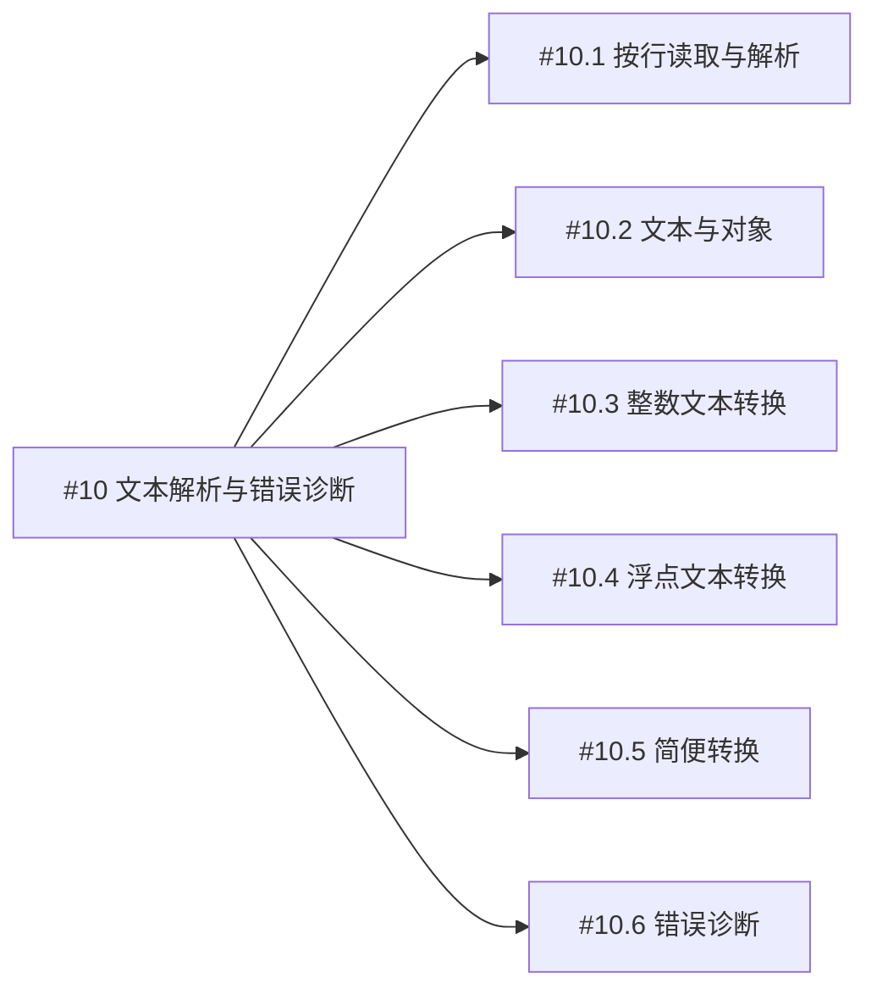

### 10.1 按行读取与解析

> [!note]- 知识图与目录
>
> ```mermaid
> flowchart LR
>   R["#10.1 按行读取与解析"]
>   N0["#451. sscanf 读取已有字符串"]
>   R --> N0
>   N1["#452. 先取行再解析"]
>   R --> N1
>   N2["#453. 两字段不等于整行有效"]
>   R --> N2
>   N3["#454. 用消费位置验证尾部"]
>   R --> N3
>   N4["#455. 长行仍须识别"]
>   R --> N4
>   class R,N0,N1,N2,N3,N4 internal-link;
> ```
>
> - [[#451. sscanf 读取已有字符串|451. sscanf 读取已有字符串]]
> - [[#452. 先取行再解析|452. 先取行再解析]]
> - [[#453. 两字段不等于整行有效|453. 两字段不等于整行有效]]
> - [[#454. 用消费位置验证尾部|454. 用消费位置验证尾部]]
> - [[#455. 长行仍须识别|455. 长行仍须识别]]

#### 451. sscanf 读取已有字符串

sscanf 从已有的 C 字符串解释格式，不再从键盘或文件读取新字符。`sscanf(text, "ID=%d", &id)` 的三个位置分别是来源文本、格式、目标地址；对 `"ID=23"`，成功可把 id 设为 23。它由 `<stdio.h>` 声明。

#### 452. 先取行再解析

把输入拆为两个阶段：fgets 负责取一行文本，sscanf 再解释字段，读不到文本与字段格式错误便更容易定位。

```text
文件第一行 101 85\n
     ↓ fgets(line, sizeof line, fp)
字符数组保存 "101 85\n"
     ↓ sscanf(line, "%d %d", &id, &score)
id = 101，score = 85，返回 2
```

这里假设行装得下、数字都能由 int 表示；任意外部数字还需严格范围检查，不能把 sscanf 当作 strtol 的替代。

#### 453. 两字段不等于整行有效

`sscanf("101 85junk", "%d %d", &id, &score)` 仍可能返回 2。达到预期赋值数量，只证明取到了字段，不证明尾部没有杂质；严格记录验证还要查看剩余文本。

#### 454. 用消费位置验证尾部

在格式末尾使用 `%n`，记录已处理字符数，再检查其后是否到达终止符。格式中的末尾空白可先消费允许的尾部空白；%n 自身不消费字符，也不增加返回计数。

下面是完整函数，前提是两个数已知可由 int 表示；任意用户数值应改用 strtol 系列逐项验证：

```c
#include <stdio.h>

int parse_score_line(const char *line, int *id, int *score)
{
    int used = -1;
    int n = sscanf(line, "%d %d %n", id, score, &used);
    if (n != 2 || used < 0)
        return 0;
    return line[used] == '\0';
}
```

#### 455. 长行仍须识别

fgets 加 sscanf 不能自动解决长行：未装下整行时，后半段会留在流里。若把每次 fgets 都当作独立记录，可能把上一条记录的尾巴误当下一条开头。应先确认行完整或按约定处理截断，再解析字段。

### 10.2 文本与对象

> [!note]- 知识图与目录
>
> ```mermaid
> flowchart LR
>   R["#10.2 文本与对象"]
>   N0["#456. 格式接口的方向"]
>   R --> N0
>   class R,N0 internal-link;
> ```
>
> - [[#456. 格式接口的方向|456. 格式接口的方向]]

#### 456. 格式接口的方向

fprintf、snprintf 都把对象值格式化成文本，前者写流、后者写字符数组；fscanf、sscanf 则把文本解析成对象值，前者读流、后者读已有字符串。它们可组合使用，而不是同一个函数换一种参数名。

### 10.3 整数文本转换

> [!note]- 知识图与目录
>
> ```mermaid
> flowchart LR
>   R["#10.3 整数文本转换"]
>   N0["#457. strtol 的三个参数"]
>   R --> N0
>   N1["#458. end 是停止位置书签"]
>   R --> N1
>   N2["#459. 跳空白与可选符号"]
>   R --> N2
>   N3["#460. 无数字用 end 判断"]
>   R --> N3
>   N4["#461. 范围错误的端点返回"]
>   R --> N4
>   N5["#462. 清 errno 后查本次范围"]
>   R --> N5
>   N6["#463. 认出数字不等于装得下"]
>   R --> N6
>   N7["#464. base 为零识别前缀"]
>   R --> N7
>   N8["#465. 数值前缀不是完整输入"]
>   R --> N8
>   class R,N0,N1,N2,N3,N4,N5,N6,N7,N8 internal-link;
> ```
>
> ```mermaid
> flowchart LR
>   R["#10.3 整数文本转换"]
>   N0["#466. 跳过允许的尾部空白"]
>   R --> N0
>   N1["#467. 严格转换为 int"]
>   R --> N1
>   class R,N0,N1 internal-link;
> ```
>
> - [[#457. strtol 的三个参数|457. strtol 的三个参数]]
> - [[#458. end 是停止位置书签|458. end 是停止位置书签]]
> - [[#459. 跳空白与可选符号|459. 跳空白与可选符号]]
> - [[#460. 无数字用 end 判断|460. 无数字用 end 判断]]
> - [[#461. 范围错误的端点返回|461. 范围错误的端点返回]]
> - [[#462. 清 errno 后查本次范围|462. 清 errno 后查本次范围]]
> - [[#463. 认出数字不等于装得下|463. 认出数字不等于装得下]]
> - [[#464. base 为零识别前缀|464. base 为零识别前缀]]
> - [[#465. 数值前缀不是完整输入|465. 数值前缀不是完整输入]]
> - [[#466. 跳过允许的尾部空白|466. 跳过允许的尾部空白]]
> - [[#467. 严格转换为 int|467. 严格转换为 int]]

#### 457. strtol 的三个参数

`strtol(text, &end, 10)` 由 `<stdlib.h>` 声明：text 是输入字符串，&end 让函数可写回停止位置，10 表示按十进制解释。返回类型是 long，不是 int；函数返回数值与通过指针输出位置各有职责。

#### 458. end 是停止位置书签

end 像书签，指向第一个未转换字符，而不是表示真假。`"  -123XYZ"` 可得到 -123，书签停在 X，end 作为后缀起点表示 `"XYZ"`。%n 保存的是字符偏移数量，end 直接保存相应位置的指针，二者不能按同一种参数传入。

#### 459. 跳空白与可选符号

strtol 先跳过前导空白，随后识别可选 + 或 -，再转换数字。符号本身不构成有效整数；只有空白或单独符号的文本仍可能没有任何数字转换。

#### 460. 无数字用 end 判断

没有成功转换数字时，strtol 返回 0，并让 end 等于原始 text 起点，即使曾尝试跳前导空白。`end == text` 才检查“一个数字也没转到”；合法字符串 `"0"` 同样返回数值零，不能单看返回值是否为 0。

#### 461. 范围错误的端点返回

strtol 超出 long 范围时设置 errno 为 ERANGE；正向超范围返回 LONG_MAX，负向超范围返回 LONG_MIN。合法输入也可能恰好等于这些端点，所以“返回最大值”本身不能代替范围状态检查。

#### 462. 清 errno 后查本次范围

调用前执行 `errno = 0;`，随后检查 `errno == ERANGE`，才能把旧错误与本次范围错误区分：

```c
/* 函数体片段，需 <stdlib.h>、<errno.h>；text 为有效字符串。 */
char *end;
errno = 0;
long number = strtol(text, &end, 10);
if (errno == ERANGE) {
    /* 本次发生范围错误。 */
}
```

这是 strtol 这类接口的约定，不表示所有函数调用前都机械清 errno。

#### 463. 认出数字不等于装得下

一长串 9 可以全部被识别，end 走到终止符，但数值仍然超出 long 范围。检查 end 是否离开起点回答语法识别问题，检查 ERANGE 回答范围问题，二者不能互相替代。

```text
9 9 9 9 9 … 9 \0
└── 数字全部识别 ──┘ ↑ end
```

图只表示扫描到哪里，不保证这些数字的数值可表示。

#### 464. base 为零识别前缀

base 可选 2 至 36，0 表示按文本前缀识别进制，包括八进制前导零、十六进制 0x/0X，以及 C23 的二进制 0b/0B。C17 不要求识别二进制前缀；编译器接受 C23 源码也不保证当前运行库已实现所有 C23 转换功能。

#### 465. 数值前缀不是完整输入

`"12X"` 的前面数字可以成功转换为 12，但整个字符串不符合“只允许一个整数”的要求。严格验证还要检查 end 之后是否只有允许的空白并最终到 `\0`，不能把有数值结果当成整串合法。

#### 466. 跳过允许的尾部空白

如果约定允许尾部空白，就在转换后用 `while (isspace((unsigned char)*end)) ++end;` 前进书签，再判断 `*end == '\0'`。isspace 仅分类，不移动指针、不删除字符；普通空格和制表都属于它可识别的空白。参数转换用于避免普通 char 的负值问题。

#### 467. 严格转换为 int

先获得 long，再确认它落在 INT_MIN 至 INT_MAX，最后才转为 int。下面保留完整函数，避免把范围、剩余文本和输出对象状态拆坏：返回 1 为成功，0 为失败；失败不改写 out。text 必须是有效字符串，out 指向可写 int。

```c
#include <stdlib.h>
#include <errno.h>
#include <limits.h>
#include <ctype.h>

int parse_int(const char *text, int *out)
{
    char *end;
    errno = 0;
    long value = strtol(text, &end, 10);
    if (end == text || errno == ERANGE)
        return 0;
    if (value < INT_MIN || value > INT_MAX)
        return 0;
    while (isspace((unsigned char)*end))
        ++end;
    if (*end != '\0')
        return 0;
    *out = (int)value;
    return 1;
}
```

### 10.4 浮点文本转换

> [!note]- 知识图与目录
>
> ```mermaid
> flowchart LR
>   R["#10.4 浮点文本转换"]
>   N0["#468. strtod 没有进制参数"]
>   R --> N0
>   N1["#469. 科学记数指数是十的幂"]
>   R --> N1
>   N2["#470. 浮点验证还看用途"]
>   R --> N2
>   class R,N0,N1,N2 internal-link;
> ```
>
> - [[#468. strtod 没有进制参数|468. strtod 没有进制参数]]
> - [[#469. 科学记数指数是十的幂|469. 科学记数指数是十的幂]]
> - [[#470. 浮点验证还看用途|470. 浮点验证还看用途]]

#### 468. strtod 没有进制参数

`strtod(text, &end)` 返回 double，第二参数输出停止位置，没有 strtol 的整数进制第三参数；它按浮点字符串语法解释输入。检查无数字、范围及尾随内容的思想仍适用。

#### 469. 科学记数指数是十的幂

`strtod("1.25e2XYZ", &end)` 可得到 125.0，end 停在 XYZ。e/E 在这里表示十进制指数，不是数学常数 e。

| 字符串 | 数学含义 | 数值 |
|---|---|---|
| `"2e3"` | $2\times10^3$ | 2000.0 |
| `"2e-3"` | $2\times10^{-3}$ | 0.002 |
| `"1.5E2"` | $1.5\times10^2$ | 150.0 |
| `"3.5"` | 普通小数 | 3.5 |

`exp(3.0)` 才是计算 $e^3$；即使数值前缀成功，XYZ 仍意味着整串验证不通过。

#### 470. 浮点验证还看用途

需要严格浮点输入时优先 strtod，而非只靠 atof。除了 end、范围和剩余文本，还须明确业务是否允许 NaN、无穷，以及当前 locale 使用何种小数点；“可被浮点语法识别”不自动等于“符合业务数值要求”。

### 10.5 简便转换

> [!note]- 知识图与目录
>
> ```mermaid
> flowchart LR
>   R["#10.5 简便转换"]
>   N0["#471. atoi 只取十进制前缀"]
>   R --> N0
>   N1["#472. atoi 缺少严格诊断"]
>   R --> N1
>   N2["#473. atof 返回 double"]
>   R --> N2
>   class R,N0,N1,N2 internal-link;
> ```
>
> - [[#471. atoi 只取十进制前缀|471. atoi 只取十进制前缀]]
> - [[#472. atoi 缺少严格诊断|472. atoi 缺少严格诊断]]
> - [[#473. atof 返回 double|473. atof 返回 double]]

#### 471. atoi 只取十进制前缀

atoi 从字符串开头（跳过前导空白和可选正负号后）取得十进制整数前缀，在不属于该数值的字符处停止，返回 int。例如 `atoi("3.75")` 得到 3，不是把完整小数四舍五入。

#### 472. atoi 缺少严格诊断

atoi 不能指定整数进制，不提供 end 输出，缺乏 strtol 的可靠范围诊断；无法仅从返回的零区分合法零与无转换。结果超出可表示范围还可能导致未定义行为，因此不能用它验证任意外部文本。

#### 473. atof 返回 double

`atof(const char *text)` 将开头符合浮点语法的部分转换为 double，例如 `atof("3.75")` 得到 3.75。它没有 end 输出和 strtod 的完整检查手段，不能把“得到一个浮点数”视为整串已严格验证。

### 10.6 错误诊断

> [!note]- 知识图与目录
>
> ```mermaid
> flowchart LR
>   R["#10.6 错误诊断"]
>   N0["#474. 错误路径由调用者决定"]
>   R --> N0
>   N1["#475. 先弄清成功条件"]
>   R --> N1
>   N2["#476. 完成数量也是结果"]
>   R --> N2
>   N3["#477. errno 是可修改左值宏"]
>   R --> N3
>   N4["#478. 旧错误不会自动清除"]
>   R --> N4
>   N5["#479. 返回值优先于 errno"]
>   R --> N5
>   N6["#480. EDOM 是定义域错误码"]
>   R --> N6
>   N7["#481. perror 输出到 stderr"]
>   R --> N7
>   N8["#482. perror 参数只是前缀"]
>   R --> N8
>   class R,N0,N1,N2,N3,N4,N5,N6,N7,N8 internal-link;
> ```
>
> ```mermaid
> flowchart LR
>   R["#10.6 错误诊断"]
>   N0["#483. 诊断前缀写清操作"]
>   R --> N0
>   N1["#484. 错误文字依赖环境"]
>   R --> N1
>   N2["#485. strerror 只返回说明"]
>   R --> N2
>   N3["#486. 先保存本次错误编号"]
>   R --> N3
>   N4["#487. 清理也要检查结果"]
>   R --> N4
>   class R,N0,N1,N2,N3,N4 internal-link;
> ```
>
> - [[#474. 错误路径由调用者决定|474. 错误路径由调用者决定]]
> - [[#475. 先弄清成功条件|475. 先弄清成功条件]]
> - [[#476. 完成数量也是结果|476. 完成数量也是结果]]
> - [[#477. errno 是可修改左值宏|477. errno 是可修改左值宏]]
> - [[#478. 旧错误不会自动清除|478. 旧错误不会自动清除]]
> - [[#479. 返回值优先于 errno|479. 返回值优先于 errno]]
> - [[#480. EDOM 是定义域错误码|480. EDOM 是定义域错误码]]
> - [[#481. perror 输出到 stderr|481. perror 输出到 stderr]]
> - [[#482. perror 参数只是前缀|482. perror 参数只是前缀]]
> - [[#483. 诊断前缀写清操作|483. 诊断前缀写清操作]]
> - [[#484. 错误文字依赖环境|484. 错误文字依赖环境]]
> - [[#485. strerror 只返回说明|485. strerror 只返回说明]]
> - [[#486. 先保存本次错误编号|486. 先保存本次错误编号]]
> - [[#487. 清理也要检查结果|487. 清理也要检查结果]]

#### 474. 错误路径由调用者决定

throw 是其他语言中的异常机制，不是标准 C 关键字。这里常见方式是函数用返回值报告结果，必要时按契约提供 errno，调用者决定继续、重试、返回还是退出。perror 只负责打印，不会自动结束当前函数、程序或跳转到清理路径。

#### 475. 先弄清成功条件

处理库调用先明确成功条件，再保存并检查结果，处理失败或部分完成，最后清理已经获得的资源。不要机械套一个 if：fopen 的成功是非空，fseek 成功为零，fread 则报告完整项数。具体接口契约已分别独立保留。

#### 476. 完成数量也是结果

检查返回值不仅问“是否发生故障”，还要问“是否完成请求”：短读、短写和格式化截断可能与简单的成功/失败布尔值不同。调用者应按实际完成量推进状态，而不是假定请求量全部完成。

#### 477. errno 是可修改左值宏

`<errno.h>` 提供 errno，它展开为可修改的 int 左值，用作规定错误编号机制的一部分。名称来自 error number；不要把它假定为每个函数都会统一更新的普通全局状态。

#### 478. 旧错误不会自动清除

errno 像记录错误的小本子：先前操作留下的编号，后一个操作成功不保证擦掉。标准允许成功的库调用保留或改变 errno，因此 `errno != 0` 不能单独证明刚刚失败。先检查该函数自己的结果，再按它承诺的 errno 语义解释。

#### 479. 返回值优先于 errno

fopen 返回有效 FILE 指针就表示打开成功，即使 errno 非零也不能推翻成功事实；返回 NULL 才表示打开失败。ISO C 不要求所有此类失败都设置详细 errno，常见运行环境可能有更强保证。通常无需仅为 fopen 先清 errno，因为返回指针已经可判别成功。

#### 480. EDOM 是定义域错误码

EDOM 是 `<errno.h>` 定义的非零错误码，用于数学定义域错误。它是错误编号，不是某个函数统一返回的数值；是否读取 errno 还要依据该函数的错误报告契约。

#### 481. perror 输出到 stderr

`perror(prefix)` 声明于 `<stdio.h>`，根据当前 errno 向 stderr 输出错误说明，返回 void。它自己打印，不返回那段说明字符串，也不替调用者退出程序；没有可靠当前错误码时应直接提供明确的操作失败信息。

#### 482. perror 参数只是前缀

`perror("Failed")`、`perror("Error")`、`perror("Open failed")` 都合法。参数是程序员提供的上下文前缀，实际原因由当前错误码解释；例如某环境可能出现 `Open failed: No such file or directory`，不是把该完整句子当参数写入。

#### 483. 诊断前缀写清操作

比起笼统的 Error，可用 `perror("Cannot open grades.txt")` 标明哪个文件、哪一步失败，让读者同时看到程序上下文与系统原因。前提是当前错误码确实对应这次失败；打印前不要先执行可能覆盖它的操作。

#### 484. 错误文字依赖环境

perror/strerror 生成的具体原因文本依赖运行环境和语言设置，不保证各机器使用同一句英文。测试和笔记应依赖失败类别与契约，不背诵某编号对应的固定句子。

#### 485. strerror 只返回说明

`<string.h>` 的 `strerror(code)` 返回指向对应错误说明字符串的指针，不直接打印。调用者可把指针交给 fprintf 自定格式。库管理这段说明，调用者不应改写或释放它；后续相关调用可能覆盖内容。

#### 486. 先保存本次错误编号

如果还要调用其他函数，先保存 errno，以免本次诊断被后续操作改写：

```c
/* 错误路径片段，需 <errno.h>、<string.h>、<stdio.h>。 */
int code = errno;
const char *message = strerror(code);
fprintf(stderr, "ERROR: %s\n", message);
```

code 保存本次编号，message 是说明的只读使用指针，最终由 fprintf 决定打印格式。

#### 487. 清理也要检查结果

后续步骤失败时，之前成功获得的流仍要关闭；关闭本身也可能失败。清理不是只写一句 fclose 就结束，需按调用者对错误报告的要求保留失败状态，不能让最后一次成功掩盖更早失败。各具体函数的错误条件已在所属章节各自说明。

---

## 11 整数表示与位运算

回到整数的内部表示，解释类型提升、补码与位模式怎样影响掩码和移位，而不把机器直觉当作通用保证。

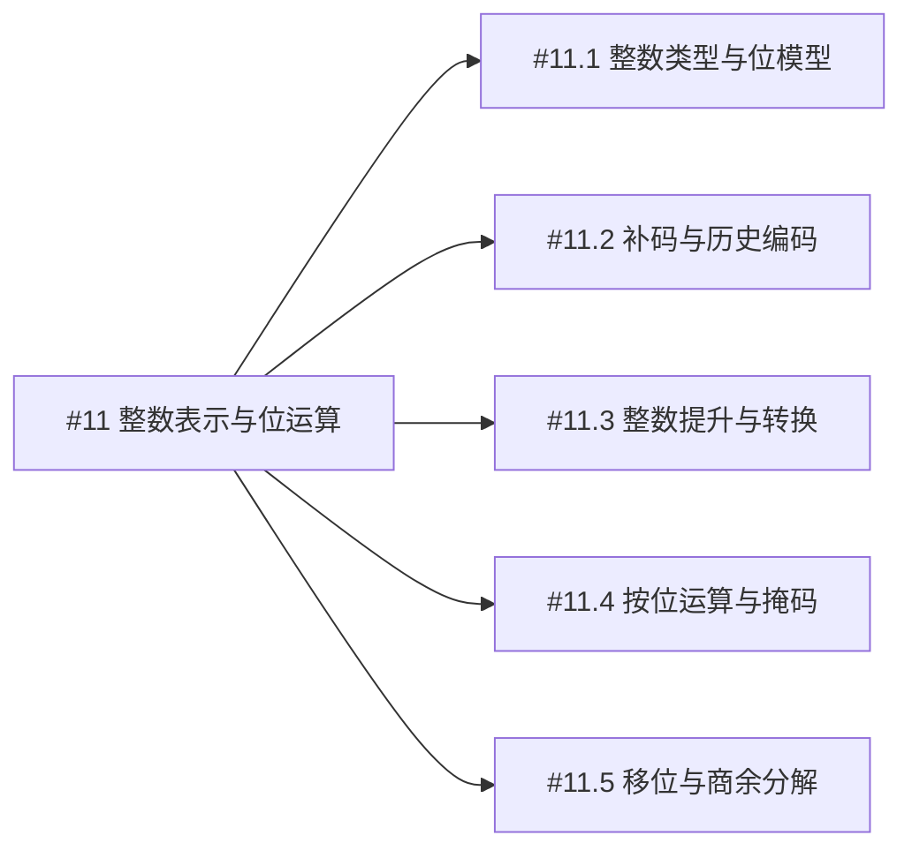

### 11.1 整数类型与位模型

> [!note]- 知识图与目录
>
> ```mermaid
> flowchart LR
>   R["#11.1 整数类型与位模型"]
>   N0["#488. 整数转换等级有固定顺序"]
>   R --> N0
>   N1["#489. 三种 char 的转换等级相同"]
>   R --> N1
>   N2["#490. 无符号值位决定值域"]
>   R --> N2
>   N3["#491. 无符号不需要负数编码"]
>   R --> N3
>   N4["#492. 位串须指定宽度与解释规则"]
>   R --> N4
>   N5["#493. 表示规则不等于运算规则"]
>   R --> N5
>   N6["#494. 位权表示这一位的贡献"]
>   R --> N6
>   N7["#495. 数值位参与整数取值"]
>   R --> N7
>   N8["#496. 补码符号位承担负权重"]
>   R --> N8
>   class R,N0,N1,N2,N3,N4,N5,N6,N7,N8 internal-link;
> ```
>
> ```mermaid
> flowchart LR
>   R["#11.1 整数类型与位模型"]
>   N0["#497. 填充位不参与整数数值"]
>   R --> N0
>   N1["#498. 值宽不等于全部存储位"]
>   R --> N1
>   N2["#499. 八位图示通常省略填充"]
>   R --> N2
>   N3["#500. 字符整数类型没有填充位"]
>   R --> N3
>   class R,N0,N1,N2,N3 internal-link;
> ```
>
> - [[#488. 整数转换等级有固定顺序|488. 整数转换等级有固定顺序]]
> - [[#489. 三种 char 的转换等级相同|489. 三种 char 的转换等级相同]]
> - [[#490. 无符号值位决定值域|490. 无符号值位决定值域]]
> - [[#491. 无符号不需要负数编码|491. 无符号不需要负数编码]]
> - [[#492. 位串须指定宽度与解释规则|492. 位串须指定宽度与解释规则]]
> - [[#493. 表示规则不等于运算规则|493. 表示规则不等于运算规则]]
> - [[#494. 位权表示这一位的贡献|494. 位权表示这一位的贡献]]
> - [[#495. 数值位参与整数取值|495. 数值位参与整数取值]]
> - [[#496. 补码符号位承担负权重|496. 补码符号位承担负权重]]
> - [[#497. 填充位不参与整数数值|497. 填充位不参与整数数值]]
> - [[#498. 值宽不等于全部存储位|498. 值宽不等于全部存储位]]
> - [[#499. 八位图示通常省略填充|499. 八位图示通常省略填充]]
> - [[#500. 字符整数类型没有填充位|500. 字符整数类型没有填充位]]

#### 488. 整数转换等级有固定顺序

普通标准整数类型的转换等级满足：
```text
signed char < short < int < long < long long
```
对应有符号与无符号类型等级相同。等级是类型转换规则使用的顺序，不保证每上升一级就多占几个字节；类型列表与大小基础见类型章节。

#### 489. 三种 char 的转换等级相同

```text
rank(char)
=
rank(signed char)
=
rank(unsigned char)
```

#### 490. 无符号值位决定值域

若无符号类型有$N$个数值位，它的范围为$0$到$2^N-1$，共有$2^N$个值。这里数的是参与数值表示的位，不把填充位也算进$N$；运算的模规则见表达式章节。

#### 491. 无符号不需要负数编码

无符号整数没有负值，因此不需要一位承担负权重，也不需要用负数补码来解释最高位。相同八位图样`10000000`，在八位无符号模型中是128，在八位补码有符号模型中才是−128；先看类型，才能读懂位图。

#### 492. 位串须指定宽度与解释规则

同一串位，配上不同解释规则，可以得到不同整数：
| 描述 | 含义 |
|---|---|
| 数学二进制数`101₂` | 5 |
| 三位补码`101` | −3 |
| C表达式`101` | 十进制101 |
| C23表达式`0b101` | 二进制常量，数值5 |
仅说“位串101”却不说明类型与宽度，信息不足。
| 三位位串 | 无符号值 | 补码有符号值 |
|---|---:|---:|
| `000` | 0 | 0 |
| `001` | 1 | 1 |
| `010` | 2 | 2 |
| `011` | 3 | 3 |
| `100` | 4 | −4 |
| `101` | 5 | −3 |
| `110` | 6 | −2 |
| `111` | 7 | −1 |
三位仅是教学模型，不表示普通`int`只有三位。

#### 493. 表示规则不等于运算规则

先分层，再推导：
```text
位层：有哪些0/1排列
类型与表示层：这些排列解释成什么值
运算层：这些值参加运算时遵守什么规则
```
C23有符号整数采用补码；这并不授予普通有符号算术无符号那样的绕回保证。历史原码、反码与现代补码的差别放在表示层讨论。

#### 494. 位权表示这一位的贡献

“某一位权重是 4”，就是：


> 这一位如果是 1，就贡献 4；如果是 0，就贡献 0。

#### 495. 数值位参与整数取值

数值位（value bits）真正参与数值表示。某位为1时贡献其对应的非负二进制权重，为0时不贡献；填充位不属于这些数值位。

#### 496. 补码符号位承担负权重

若补码共有$W$个参与数值与符号的位，最高符号位的权重是$-2^{W-1}$，不是“另贴一个负号”。八位模型的权重为：
```text
−128  64  32  16  8  4  2  1
```
所以`10000000`为−128，`11111111`为−1。

#### 497. 填充位不参与整数数值

填充位（padding bits）占存储位置，不参与整数数值表示。一般整数对象可能像：
```text
P | S | V V V V V V V
填充 符号  数值位
```
不能给P也分配一个数值权重来计算整数。

#### 498. 值宽不等于全部存储位

“值域恰为−128..127”说明需要八个用于值与符号的位，不自动证明对象总共只有八个存储位；一般整数类型还可能有填充。`sizeof(T) * CHAR_BIT`是总对象位数，不能一概充当有效整数位宽。

#### 499. 八位图示通常省略填充

本章画出的普通八位补码图，默认一位符号位、七位数值位、零填充位：
```text
S | V V V V V V V
```
看到一张八位教学图，先确认这是完整对象表示，还是只画了参与数值与符号的部分。

#### 500. 字符整数类型没有填充位

C23保证`signed char`和`unsigned char`没有填充位；不能因此推广为所有整数类型都没有填充。它们各占一个C字节，字节的位数仍由`CHAR_BIT`决定。

### 11.2 补码与历史编码

> [!note]- 知识图与目录
>
> ```mermaid
> flowchart LR
>   R["#11.2 补码与历史编码"]
>   N0["#501. 补码是整数编码规则"]
>   R --> N0
>   N1["#502. 补码正端由数值位凑满"]
>   R --> N1
>   N2["#503. 补码负端比正端多一个值"]
>   R --> N2
>   N3["#504. 原码把符号单独存放"]
>   R --> N3
>   N4["#505. 正数在三种编码中相同"]
>   R --> N4
>   N5["#506. 负数原码转反码保留符号位"]
>   R --> N5
>   N6["#507. 反码与补码只差末尾加一"]
>   R --> N6
>   N7["#508. 原码和反码各有两个零"]
>   R --> N7
>   N8["#509. 八位反码最高权重为负127"]
>   R --> N8
>   class R,N0,N1,N2,N3,N4,N5,N6,N7,N8 internal-link;
> ```
>
> ```mermaid
> flowchart LR
>   R["#11.2 补码与历史编码"]
>   N0["#510. 按位取反不等于反码编码"]
>   R --> N0
>   N1["#511. 固定宽度取反加一构造相反数"]
>   R --> N1
>   N2["#512. 负补码扩宽时补符号位"]
>   R --> N2
>   N3["#513. 补码全一表示负一"]
>   R --> N3
>   class R,N0,N1,N2,N3 internal-link;
> ```
>
> - [[#501. 补码是整数编码规则|501. 补码是整数编码规则]]
> - [[#502. 补码正端由数值位凑满|502. 补码正端由数值位凑满]]
> - [[#503. 补码负端比正端多一个值|503. 补码负端比正端多一个值]]
> - [[#504. 原码把符号单独存放|504. 原码把符号单独存放]]
> - [[#505. 正数在三种编码中相同|505. 正数在三种编码中相同]]
> - [[#506. 负数原码转反码保留符号位|506. 负数原码转反码保留符号位]]
> - [[#507. 反码与补码只差末尾加一|507. 反码与补码只差末尾加一]]
> - [[#508. 原码和反码各有两个零|508. 原码和反码各有两个零]]
> - [[#509. 八位反码最高权重为负127|509. 八位反码最高权重为负127]]
> - [[#510. 按位取反不等于反码编码|510. 按位取反不等于反码编码]]
> - [[#511. 固定宽度取反加一构造相反数|511. 固定宽度取反加一构造相反数]]
> - [[#512. 负补码扩宽时补符号位|512. 负补码扩宽时补符号位]]
> - [[#513. 补码全一表示负一|513. 补码全一表示负一]]

#### 501. 补码是整数编码规则

补码是一套把整数，尤其负整数，对应到固定宽度位模式的编码规则。它不是某个额外存储在变量旁边的“补码字段”，也不是要求每次计算都由程序员手动取反加一。

#### 502. 补码正端由数值位凑满

八位补码最高位为0时，其余位最多为`01111111`：
```text
64 + 32 + 16 + 8 + 4 + 2 + 1 = 127
```
因此同一八位有符号模型中没有正128。

#### 503. 补码负端比正端多一个值

补码W位（含符号、不含填充）的值域为：
$
-2^{W-1}\le x\le 2^{W-1}-1
$
八位模型为−128..127。负端多出的那个值，其正相反数不能由同一有符号类型表示；这不是数学上没有相反数，而是当前类型装不下。`INT_MIN`及溢出、绝对值的具体边界分别见表达式和数学函数章节。

#### 504. 原码把符号单独存放

原码可直译成“符号单独放一格，剩下直接写绝对值”。八位原码的`10000101`表示−5：最高位管符号，后七位写5。它与补码负权重模型是不同体系。

#### 505. 正数在三种编码中相同

对同一宽度、可表示的正数：
```text
+9原码 = 00001001
+9反码 = 00001001
+9补码 = 00001001
```
正数碰巧长得相同，不代表三种体系相同；C23有符号整数按补码解释，原码和反码用于历史或教材对照。

#### 506. 负数原码转反码保留符号位

从负5原码出发，符号位保持1，只翻转数值位：
```text
−5原码：1 | 0000101
             ↓数值位取反
−5反码：1 | 1111010
```
不能把`10000101`整个翻成`01111010`来称为“负5反码”。另一条等价路线是从正5的`00000101`出发，将整个八位全部取反；两条路线都得到`11111010`。

#### 507. 反码与补码只差末尾加一

对同一可由两套体系表示的负数，在相同固定宽度下：
```text
负数原码 → 符号不动、数值位取反 → 负数反码 → 加1 → 负数补码
−5：10000101 → 11111010 → 11111011
```
也可直接按补码位权构造结果；不要把中间这些编码步骤误当作变量同时保存三份值。

#### 508. 原码和反码各有两个零

原码用`00000000`表示正零、`10000000`表示负零；反码用`00000000`表示正零、`11111111`表示负零。补码没有独立负零，原来用于额外零的编码位置被用来表示最小负数。

#### 509. 八位反码最高权重为负127

对于 8 位反码，可以把最高位的作用等效看成：


-127   64   32   16   8   4   2   1

#### 510. 按位取反不等于反码编码

`~`是一个按位操作；反码是一套表示负数的编码方法。即使某些位图步骤都用到“翻转”，也不能把两者当作同一概念。`~`还须先遵守C的整数提升规则。

#### 511. 固定宽度取反加一构造相反数

在固定宽度补码模型内：
```text
+6：00000110
取反：11111001
加1：11111010（−6）

再取反：00000101
再加1：00000110（+6）
```
位权可验算`−128+64+32+16+8+2=−6`。这是位模式构造方法，不允许在C中对最小负数执行不可表示的取负运算。

#### 512. 负补码扩宽时补符号位

保持负数值而扩展补码宽度时，高位补1：
```text
8位−6：          1111 1010
16位−6：1111 1111 1111 1010
```
也可先写16位正6的`0000 0000 0000 0110`，取反为`1111 1111 1111 1001`，再加1得到同一结果。位权法适合理解验算，长位串用取反加一更快。

#### 513. 补码全一表示负一

```text
8-bit 补码的全 1  = -1

16-bit 补码的全 1 = -1
32-bit 补码的全 1 = -1
```

### 11.3 整数提升与转换

> [!note]- 知识图与目录
>
> ```mermaid
> flowchart LR
>   R["#11.3 整数提升与转换"]
>   N0["#514. 整数提升属于隐式转换"]
>   R --> N0
>   N1["#515. 提升保持原数值和符号"]
>   R --> N1
>   N2["#516. 能容纳全部值才提升为 int"]
>   R --> N2
>   N3["#517. 提升判断全部范围而非当前值"]
>   R --> N3
>   N4["#518. unsigned char 也可能变为 int"]
>   R --> N4
>   N5["#519. 常见整数提升场景"]
>   R --> N5
>   N6["#520. 取反针对提升后的类型宽度"]
>   R --> N6
>   N7["#521. 可表示的整数转换不改值"]
>   R --> N7
>   N8["#522. 转为无符号类型按模取值"]
>   R --> N8
>   class R,N0,N1,N2,N3,N4,N5,N6,N7,N8 internal-link;
> ```
>
> ```mermaid
> flowchart LR
>   R["#11.3 整数提升与转换"]
>   N0["#523. 通常算术转换先统一类型"]
>   R --> N0
>   N1["#524. 同符号整数转向较高等级"]
>   R --> N1
>   N2["#525. 无符号等级不低时转无符号"]
>   R --> N2
>   N3["#526. 较高有符号类型能容纳时保留"]
>   R --> N3
>   N4["#527. 其余异符号情况转对应无符号"]
>   R --> N4
>   class R,N0,N1,N2,N3,N4 internal-link;
> ```
>
> - [[#514. 整数提升属于隐式转换|514. 整数提升属于隐式转换]]
> - [[#515. 提升保持原数值和符号|515. 提升保持原数值和符号]]
> - [[#516. 能容纳全部值才提升为 int|516. 能容纳全部值才提升为 int]]
> - [[#517. 提升判断全部范围而非当前值|517. 提升判断全部范围而非当前值]]
> - [[#518. unsigned char 也可能变为 int|518. unsigned char 也可能变为 int]]
> - [[#519. 常见整数提升场景|519. 常见整数提升场景]]
> - [[#520. 取反针对提升后的类型宽度|520. 取反针对提升后的类型宽度]]
> - [[#521. 可表示的整数转换不改值|521. 可表示的整数转换不改值]]
> - [[#522. 转为无符号类型按模取值|522. 转为无符号类型按模取值]]
> - [[#523. 通常算术转换先统一类型|523. 通常算术转换先统一类型]]
> - [[#524. 同符号整数转向较高等级|524. 同符号整数转向较高等级]]
> - [[#525. 无符号等级不低时转无符号|525. 无符号等级不低时转无符号]]
> - [[#526. 较高有符号类型能容纳时保留|526. 较高有符号类型能容纳时保留]]
> - [[#527. 其余异符号情况转对应无符号|527. 其余异符号情况转对应无符号]]

#### 514. 整数提升属于隐式转换

小整数参与`c + 1`时会发生整数提升。它属于隐式类型转换；变量`c`自身的声明类型不因此永久改变。

#### 515. 提升保持原数值和符号

整数提升可以想成“小杯子的水倒进更大的杯子再计算”：换了计算容器，水没有变。整数提升保持数值，包括原来的正负号；它与后续缩窄转换不是同一操作。

#### 516. 能容纳全部值才提升为 int

对这里讨论的普通较低等级整数类型，若`int`能表示原类型的全部值，则提升为`int`；否则提升为`unsigned int`。教材常把char/short简写为“提升到int”，使用时须确认这一前提，不能省掉另一分支。

#### 517. 提升判断全部范围而非当前值

选择`int`还是`unsigned int`时，问的是原类型的**全部可能值**能否被`int`容纳，不是当前变量恰好等于1还是200。相同类型不会只因当前存了较小数值就换用另一条提升规则。

#### 518. unsigned char 也可能变为 int

常见八位`unsigned char`、至少16位`int`的平台中，`int`可容纳0..255，所以`unsigned char`参加运算通常先变成`int`。不能一看到变量名带`unsigned`就按八位无符号运算画图。

#### 519. 常见整数提升场景

见到char/short等较低等级整数参加下列运算，先检查整数提升：普通算术与整数比较，`& ^ |`，一元`+ - ~`，移位的两个操作数，`switch`控制表达式，以及可变参数中的默认实参提升。
这里讨论普通标准整数类型；C23位精确整数类型另有专门规则，不能机械套用。

#### 520. 取反针对提升后的类型宽度

`~` 作用于整数提升后的类型，不是看变量声明占几个字节就翻几个位。

```c
/* 假定 unsigned char 为8位，int能表示0～255。 */
unsigned char c = 0x0Fu;
int x = ~c;                   /* c先提升为int，C23下x为−16 */
unsigned char y = (unsigned char)~c; /* 转回8位后为0xF0 */
```

```text
c的8位示意：                 0000 1111
提升为32位int时：00000000 00000000 00000000 00001111
取反：          11111111 11111111 11111111 11110000
转为8位unsigned char：                         11110000
```

上面的32位仅是图示假设，实际位宽取决于实现。只有在转回八位 `unsigned char` 后，才可把最终图样概括为八位的 `0xF0`。

#### 521. 可表示的整数转换不改值

整数转换后目标类型能表示原值时，数值保持。假设`int`为32位、`unsigned char`为八位，33的高位原来全为0，转为`unsigned char`仍是33；缩小的是表示容器，不是数值。

#### 522. 转为无符号类型按模取值

允许负数写在无符号赋值右边，不表示无符号对象能保存负值；发生的是整数转换。对八位`unsigned char`：
```text
−1  → 255（UCHAR_MAX）
258 → 2（258 mod 256）
```
位宽未指定时应写`UCHAR_MAX`等实际边界，不能普遍写死255。任意转换到无符号整数类型，按最大值加1为模数得到目标范围内的值；不要故意依赖负数赋无符号而忽略其业务含义。

#### 523. 通常算术转换先统一类型

许多二元算术和比较先做整数提升，再按通常算术转换统一两侧类型。结果不能仅按左边变量声明或数学直觉决定。表达式章节的`-1 < 1u`示例因此为假；这里继续拆解选型规则，不重复完整程序。

#### 524. 同符号整数转向较高等级

整数提升之后，若两侧都是有符号，或两侧都是无符号，通常算术转换把较低等级的一侧转为较高等级类型。相同类型则无需再改类型。

#### 525. 无符号等级不低时转无符号

提升后异符号混合时，若无符号一侧等级不低于有符号一侧，后者转为该无符号类型。因此同等级的`int`和`unsigned int`一起比较，可能把负的`int`转换成很大的无符号值。

#### 526. 较高有符号类型能容纳时保留

异符号混合且有符号类型等级更高时，还要检查其范围；若它能表示无符号类型的全部值，则把无符号一侧转为该有符号类型。不能概括为“出现unsigned就全转unsigned”。

#### 527. 其余异符号情况转对应无符号

若较高等级的有符号类型仍不能表示另一侧无符号类型的全部值，通常算术转换将两侧都转为该有符号类型对应的无符号类型。等级与范围必须分别核对。

### 11.4 按位运算与掩码

> [!note]- 知识图与目录
>
> ```mermaid
> flowchart LR
>   R["#11.4 按位运算与掩码"]
>   N0["#528. 按位与只保留共同的一"]
>   R --> N0
>   N1["#529. 按位或只需一个一"]
>   R --> N1
>   N2["#530. 按位异或在不同处为一"]
>   R --> N2
>   N3["#531. 异或不是乘方"]
>   R --> N3
>   N4["#532. 掩码标记关心的位置"]
>   R --> N4
>   N5["#533. 与掩码保留一位、清除零位"]
>   R --> N5
>   N6["#534. 或掩码设置一位、保留零位"]
>   R --> N6
>   N7["#535. 异或掩码翻转选定位"]
>   R --> N7
>   N8["#536. 低 n 位全一对应二的幂减一"]
>   R --> N8
>   class R,N0,N1,N2,N3,N4,N5,N6,N7,N8 internal-link;
> ```
>
> ```mermaid
> flowchart LR
>   R["#11.4 按位运算与掩码"]
>   N0["#537. 取反掩码针对整个运算类型"]
>   R --> N0
>   N1["#538. 计算位结果不修改 flags"]
>   R --> N1
>   N2["#539. 复合按位赋值保存结果"]
>   R --> N2
>   N3["#540. 开启单个位保留其他位"]
>   R --> N3
>   N4["#541. 关闭单个位保留其他位"]
>   R --> N4
>   N5["#542. 翻转单个位并保存"]
>   R --> N5
>   N6["#543. 切换两次恢复原状态"]
>   R --> N6
>   N7["#544. 位编号从最低位零开始"]
>   R --> N7
>   N8["#545. 单比特掩码由一左移生成"]
>   R --> N8
>   class R,N0,N1,N2,N3,N4,N5,N6,N7,N8 internal-link;
> ```
>
> ```mermaid
> flowchart LR
>   R["#11.4 按位运算与掩码"]
>   N0["#546. u 后缀指定无符号类型"]
>   R --> N0
>   N1["#547. 与结果非零表示目标位命中"]
>   R --> N1
>   N2["#548. 按位与不保证返回零或一"]
>   R --> N2
>   N3["#549. 比较把位结果归一为零或一"]
>   R --> N3
>   N4["#550. 右移再与一直接取位值"]
>   R --> N4
>   N5["#551. 两种位测试原始结果不同"]
>   R --> N5
>   N6["#552. 位运算后比较先加括号"]
>   R --> N6
>   class R,N0,N1,N2,N3,N4,N5,N6 internal-link;
> ```
>
> - [[#528. 按位与只保留共同的一|528. 按位与只保留共同的一]]
> - [[#529. 按位或只需一个一|529. 按位或只需一个一]]
> - [[#530. 按位异或在不同处为一|530. 按位异或在不同处为一]]
> - [[#531. 异或不是乘方|531. 异或不是乘方]]
> - [[#532. 掩码标记关心的位置|532. 掩码标记关心的位置]]
> - [[#533. 与掩码保留一位、清除零位|533. 与掩码保留一位、清除零位]]
> - [[#534. 或掩码设置一位、保留零位|534. 或掩码设置一位、保留零位]]
> - [[#535. 异或掩码翻转选定位|535. 异或掩码翻转选定位]]
> - [[#536. 低 n 位全一对应二的幂减一|536. 低 n 位全一对应二的幂减一]]
> - [[#537. 取反掩码针对整个运算类型|537. 取反掩码针对整个运算类型]]
> - [[#538. 计算位结果不修改 flags|538. 计算位结果不修改 flags]]
> - [[#539. 复合按位赋值保存结果|539. 复合按位赋值保存结果]]
> - [[#540. 开启单个位保留其他位|540. 开启单个位保留其他位]]
> - [[#541. 关闭单个位保留其他位|541. 关闭单个位保留其他位]]
> - [[#542. 翻转单个位并保存|542. 翻转单个位并保存]]
> - [[#543. 切换两次恢复原状态|543. 切换两次恢复原状态]]
> - [[#544. 位编号从最低位零开始|544. 位编号从最低位零开始]]
> - [[#545. 单比特掩码由一左移生成|545. 单比特掩码由一左移生成]]
> - [[#546. u 后缀指定无符号类型|546. u 后缀指定无符号类型]]
> - [[#547. 与结果非零表示目标位命中|547. 与结果非零表示目标位命中]]
> - [[#548. 按位与不保证返回零或一|548. 按位与不保证返回零或一]]
> - [[#549. 比较把位结果归一为零或一|549. 比较把位结果归一为零或一]]
> - [[#550. 右移再与一直接取位值|550. 右移再与一直接取位值]]
> - [[#551. 两种位测试原始结果不同|551. 两种位测试原始结果不同]]
> - [[#552. 位运算后比较先加括号|552. 位运算后比较先加括号]]

#### 528. 按位与只保留共同的一

`&`逐位运算，只有两位都为1才得到1：
| A | B | A & B |
|---|---|---|
| 0 | 0 | 0 |
| 0 | 1 | 0 |
| 1 | 0 | 0 |
| 1 | 1 | 1 |
这是整数位图运算，不是逻辑短路与；后者的真假与副作用例见表达式章节。

#### 529. 按位或只需一个一

按位或`|`逐位运算：0或0为0；0或1、1或0、1或1都为1。可以记成“只要有一个1就亮”。它没有逻辑或的短路行为。

#### 530. 按位异或在不同处为一

`^`逐位比较，相同得0、不同得1：
| A | B | A ^ B |
|---|---|---|
| 0 | 0 | 0 |
| 0 | 1 | 1 |
| 1 | 0 | 1 |
| 1 | 1 | 0 |

#### 531. 异或不是乘方

C表达式`2 ^ 3`是按位异或，得到1，不是2的3次方8。数学乘方用幂记号，代码中的一般实数乘方用`pow`；整数小次方也可在可表示范围内直接相乘。

#### 532. 掩码标记关心的位置

掩码（mask）像一块有洞与无洞的模板：用各位的0、1告诉位运算哪些位置要保留、设置或翻转。`00001111`常用于关注低四位，`11110000`可在八位图示中关注高四位；具体作用仍取决于使用的是与、或还是异或。

#### 533. 与掩码保留一位、清除零位

`x & mask`中，掩码为1的位置保留`x`原位，为0的位置清零：
```text
x：       1010 1101
mask：    0000 1111
结果：    0000 1101
```
它不把掩码为1的位置强行设成1。

#### 534. 或掩码设置一位、保留零位

`x | mask`中，掩码为1的位置置1，为0的位置保留原值。它适合开启选定标志，不会把未选位置一并清空。

#### 535. 异或掩码翻转选定位

某位与0异或保持原样，与1异或发生0↔1翻转。因此`flags ^ mask`会翻转掩码为1的位置，其余不动。

#### 536. 低 n 位全一对应二的幂减一

连续n个低位1的无符号数值为$2^n-1$。四位`1111`为15、十六进制`F`；八位`11111111`为255、十六进制`FF`。这解释了`0x0Fu`为何常用于保留低四位。

#### 537. 取反掩码针对整个运算类型

画四位或八位示意时常截去高位；实际`unsigned int`通常不止这些位，`~mask`会按实际类型处理全部位。`0xF0u`仅选中位4..7，不自动表示“整个类型除低四位外的所有高位”。

#### 538. 计算位结果不修改 flags

`flags & ~mask;`、`flags & (1u << k)`等只计算值，不自动改变`flags`。只有赋值或复合赋值把结果存回，变量才更新。

#### 539. 复合按位赋值保存结果

对这里的简单变量`flags`：
```text
flags &= ~mask;  对应 flags = flags & ~mask;
flags |= mask;   对应 flags = flags | mask;
flags ^= mask;   对应 flags = flags ^ mask;
```
复合赋值把位结果写回。对复杂左操作数，复合赋值只求值左侧一次，不能不加分析照搬成书写两遍的展开式。

#### 540. 开启单个位保留其他位

若`mask`仅选中目标位，`flags |= mask;`确保它为1，其他位保持原值。用`flags |= (1u << k);`可开启bit k，前提是k合法。

#### 541. 关闭单个位保留其他位

`flags &= ~mask;`确保掩码选中的位置为0，其他位保持；单个位可写`flags &= ~(1u << k);`。不要用异或代替关闭：目标原来已经为0时，异或会把它打开。

#### 542. 翻转单个位并保存

`flags ^= (1u << k);`先由掩码找到bit k，再翻转该位并写回。它不检查原来是否开启，而是总把0变1、1变0。

#### 543. 切换两次恢复原状态

相同掩码连续异或两次会恢复原位状态。与之相对，重复开启仍保持开启，重复关闭仍保持关闭；“切换”与“确保开/关”不是同一种操作。

#### 544. 位编号从最低位零开始

本章从右向左按0、1、2、3……给数值位编号。检测bit 3，是询问第四个低位位置为0还是1，不是“第三个十进制数字”或“从左边数第三位”。

#### 545. 单比特掩码由一左移生成

`1u << k`把数值1中的唯一一位送到bit k，生成仅该位为1的掩码。`1u << 2`为4；使用变量k时，位号须满足类型的移位范围。

```c
#include <limits.h>
#include <stdio.h>

int main(void)
{
    unsigned int flags = 0x0Au;
    unsigned int k = 1u;

    if (k >= UINT_WIDTH)
        return 1;

    unsigned int mask = 1u << k;
    int enabled = (flags & mask) != 0u;
    printf("%s\n", enabled ? "ON" : "OFF"); /* ON */
    return 0;
}
```

这个程序把位号检查放在移位之前；输出ON。

#### 546. u 后缀指定无符号类型

`1u`是值为1、类型为`unsigned int`的整数常量。`u`不是左移运算符的特殊语法，而是常量类型后缀；用于位掩码可让左操作数采用明确的无符号规则，但仍须检查移位数量。

#### 547. 与结果非零表示目标位命中

`flags = 0x0Au`、`k = 1`时：
```text
flags：1010
mask： 0010
与后： 0010，数值2，非零
```
所以`if (flags & (1u << k))`成立，可输出`ON`或表示摄像头已开启的`Camera enabled`。这里不是比较两数相等：10不等于2，但二者共享bit 1。

#### 548. 按位与不保证返回零或一

`&`返回逐位计算的整数。例如`0x0Au & 0x02u`为2，而不是1。条件语境把2当真，不会反过来把这个位运算结果自动改成1。

#### 549. 比较把位结果归一为零或一

需要严格的0或1时写：
```c
int enabled = (flags & mask) != 0u;
```
位与先提取目标位，`!= 0u`再产生`int`类型的判断结果。

#### 550. 右移再与一直接取位值

`(flags >> k) & 1u`把bit k先送到最低位，再保留它，直接得到0或1。与“把掩码送到目标位”的`flags & (1u << k)`是两个观察方向。

#### 551. 两种位测试原始结果不同

令`flags = 0x0Cu`、`k = 2`：
```text
flags & (1u << 2)        得到4
(flags & (1u << 2)) !=0u 得到1
(flags >> 2) & 1u        得到1
```
状态判断相同，未归一化的原始位与结果不同。不能沿用`flags=0x0Au`却说bit 2开启，因为1010的bit 2是0。

#### 552. 位运算后比较先加括号

写`(flags & mask) != 0u`，不要误写`flags & mask != 0u`。相等比较比按位与结合得更紧，后者按`flags & (mask != 0u)`分组，可能只检测最低位。

### 11.5 移位与商余分解

> [!note]- 知识图与目录
>
> ```mermaid
> flowchart LR
>   R["#11.5 移位与商余分解"]
>   N0["#553. 移位移动二进制位置"]
>   R --> N0
>   N1["#554. 移位双方分别进行整数提升"]
>   R --> N1
>   N2["#555. 移位结果类型跟随左操作数"]
>   R --> N2
>   N3["#556. 移位数量不能为负"]
>   R --> N3
>   N4["#557. 移位数量必须小于左侧位宽"]
>   R --> N4
>   N5["#558. 无符号左移按模得到结果"]
>   R --> N5
>   N6["#559. 非负有符号左移要求结果可表示"]
>   R --> N6
>   N7["#560. 负有符号左移属于未定义行为"]
>   R --> N7
>   N8["#561. 非负右移得到整数商"]
>   R --> N8
>   class R,N0,N1,N2,N3,N4,N5,N6,N7,N8 internal-link;
> ```
>
> ```mermaid
> flowchart LR
>   R["#11.5 移位与商余分解"]
>   N0["#562. 被切掉的低位编码余数"]
>   R --> N0
>   N1["#563. 负有符号右移结果由实现定义"]
>   R --> N1
>   N2["#564. signed char 左移先由 int 计算"]
>   R --> N2
>   N3["#565. 窄化到 signed 超范围由实现定义"]
>   R --> N3
>   N4["#566. unsigned char 左移也可能在 int 中"]
>   R --> N4
>   N5["#567. UINT_MAX 左移展示无符号绕回"]
>   R --> N5
>   class R,N0,N1,N2,N3,N4,N5 internal-link;
> ```
>
> - [[#553. 移位移动二进制位置|553. 移位移动二进制位置]]
> - [[#554. 移位双方分别进行整数提升|554. 移位双方分别进行整数提升]]
> - [[#555. 移位结果类型跟随左操作数|555. 移位结果类型跟随左操作数]]
> - [[#556. 移位数量不能为负|556. 移位数量不能为负]]
> - [[#557. 移位数量必须小于左侧位宽|557. 移位数量必须小于左侧位宽]]
> - [[#558. 无符号左移按模得到结果|558. 无符号左移按模得到结果]]
> - [[#559. 非负有符号左移要求结果可表示|559. 非负有符号左移要求结果可表示]]
> - [[#560. 负有符号左移属于未定义行为|560. 负有符号左移属于未定义行为]]
> - [[#561. 非负右移得到整数商|561. 非负右移得到整数商]]
> - [[#562. 被切掉的低位编码余数|562. 被切掉的低位编码余数]]
> - [[#563. 负有符号右移结果由实现定义|563. 负有符号右移结果由实现定义]]
> - [[#564. signed char 左移先由 int 计算|564. signed char 左移先由 int 计算]]
> - [[#565. 窄化到 signed 超范围由实现定义|565. 窄化到 signed 超范围由实现定义]]
> - [[#566. unsigned char 左移也可能在 int 中|566. unsigned char 左移也可能在 int 中]]
> - [[#567. UINT_MAX 左移展示无符号绕回|567. UINT_MAX 左移展示无符号绕回]]

#### 553. 移位移动二进制位置

`<<`和`>>`可直观理解为把二进制位整体左移或右移若干位置；这种图像须服从提升后的类型、移位数量和可表示范围。不能仅凭位图被“挤出去”推导C结果。

#### 554. 移位双方分别进行整数提升

移位前两个操作数分别做整数提升；它不像普通加法那样再用通常算术转换把两侧统一成一个共同类型。先查左侧提升后的类型，再选择相应规则。

#### 555. 移位结果类型跟随左操作数

`x << n`与`x >> n`的结果类型是左操作数经整数提升后的类型。右侧位数变量是更高等级类型，不会因此把移位结果也升级到该类型。

#### 556. 移位数量不能为负

无论左侧有符号还是无符号，移位数量为负都属于未定义行为。不能把负的左移位数当作右移使用。

#### 557. 移位数量必须小于左侧位宽

移位数量须小于提升后左操作数的位宽；等于位宽也非法。不能因某CPU会截取位数低几位，就把`x << 位宽`当作C标准定义的运算。C23可用`UINT_WIDTH`等相应宏表达位宽，不把填充位混作数值位。

#### 558. 无符号左移按模得到结果

提升后左侧仍为无符号类型时，合法数量的左移相当于乘$2^n$后按结果无符号类型的范围取模。关键条件是**提升后仍为无符号**，不是原变量名字带unsigned即可。

#### 559. 非负有符号左移要求结果可表示

提升后左侧为非负有符号整数时，左移n位仅在数学乘积$x\times2^n$可由结果类型表示时有定义。简单情景可以记成左移1、2、3位分别乘2、4、8，但必须保留可表示前提。`INT_MAX << 1`不能作为可靠绕回计算。

不要先画“符号位被挤掉”后的图样，再把它当成C保证的答案。检查合法性要走在位图推演前面；一旦这条有符号左移规则的前提不成立，机械搬动位图不能补出一个标准结果。

#### 560. 负有符号左移属于未定义行为

`(-1) << 1`的左操作数是负的有符号整数，即使只移动一位，也属于未定义行为。补码表示不取消这一限制。

#### 561. 非负右移得到整数商

对无符号或非负有符号整数，合法的`x >> n`得到除以$2^n$后的整数商：
```text
57 = 00111001₂
00111 | 001
 商7    低三位
57 >> 3 = 7
```
右移本身只返回商，不会另行返回余数。

#### 562. 被切掉的低位编码余数

对无符号或非负有符号数，把最低n位切开，低位恰好表示除以$2^n$的余数：
```text
57：00111 | 001 → 57 = 7 × 8 + 1
45：00101 | 101 → 45 = 5 × 8 + 5
```
像十进制`123 | 45`满足$12345=123\times10^2+45$，右侧保留几位，就决定左侧乘相应进制的几次幂。
```c
unsigned int x = 57u;
unsigned int remainder = x & 0x07u; /* 1 */
```
`>>`没有替你保存丢掉的余数；要另用有效的低位掩码取出。

#### 563. 负有符号右移结果由实现定义

C23中，负的有符号整数右移结果仍由实现定义。不能把常见的算术右移、前补1或向负无穷取整当作所有C实现统一保证，也不能套用正数的向零整数商口诀。

#### 564. signed char 左移先由 int 计算

```c
signed char a = 100;
int x = a << 1; /* 得到int 200 */
```
`signed char`先提升为`int`，所以真正左移的是`int 100`；200可由`int`表示，左移这一步有定义。不要只盯着a原来的窄类型。

#### 565. 窄化到 signed 超范围由实现定义

`a = a << 1;`还会把先得到的`int 200`转回`signed char`。若目标能表示200，值保持；若不能，C23规定结果由实现定义，或产生实现定义的信号。常见八位实现可能得到−56，但标准不保证这个固定答案。这里的特殊步骤是赋值转换，不是前一步int左移溢出。

#### 566. unsigned char 左移也可能在 int 中

假定`unsigned char`为八位、`int`可表示0..255：
```c
unsigned char a = 200;
int x = a << 1; /* a先提升为int，因此得到400 */
```
这一步不是“八位unsigned左移后模256”。若随后写`a = a << 1;`，才因转回八位无符号类型而得到144；该转换规则已在“转为无符号类型按模取值”解释。

#### 567. UINT_MAX 左移展示无符号绕回

```c
#include <limits.h>

void example(void)
{
    unsigned int x = UINT_MAX;
    unsigned int y = x << 1;
    /* y == UINT_MAX - 1 */
    (void)y;
}
```
`unsigned int`不会提升为`int`，左移自身按无符号规则计算：
$
(2^N-1)\times2\bmod 2^N=2^N-2
$
它与unsigned char先提升、后缩窄的过程不同。

---

## 12 排序、查找与复杂度

在可靠扫描的基础上，把有序区、候选区间和不变量用于排序与查找，再比较它们的成本。

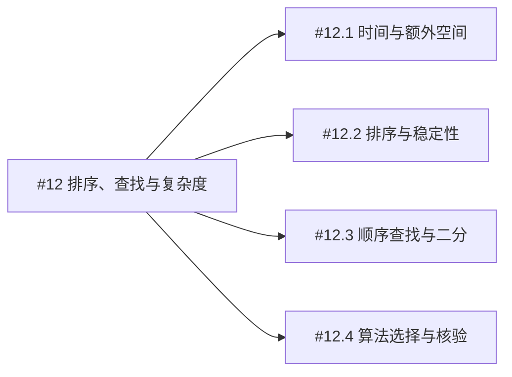

### 12.1 时间与额外空间

> [!note]- 知识图与目录
>
> ```mermaid
> flowchart LR
>   R["#12.1 时间与额外空间"]
>   N0["#568. 常量工作不随输入增长"]
>   R --> N0
>   N1["#569. 一次完整遍历是线性量级"]
>   R --> N1
>   N2["#570. 固定内层不产生平方量级"]
>   R --> N2
>   N3["#571. 双线性嵌套形成平方量级"]
>   R --> N3
>   N4["#572. 前后循环工作量相加"]
>   R --> N4
>   N5["#573. 相加后保留最快增长项"]
>   R --> N5
>   N6["#574. 固定倍数缩放形成对数"]
>   R --> N6
>   N7["#575. 线性外层乘对数内层"]
>   R --> N7
>   N8["#576. 分析先看规模与嵌套关系"]
>   R --> N8
>   class R,N0,N1,N2,N3,N4,N5,N6,N7,N8 internal-link;
> ```
>
> ```mermaid
> flowchart LR
>   R["#12.1 时间与额外空间"]
>   N0["#577. Big-O是渐近上界"]
>   R --> N0
>   N1["#578. 空间复杂度看存储增长"]
>   R --> N1
>   N2["#579. 辅助空间通常不计输入"]
>   R --> N2
>   N3["#580. 常量空间不等于零内存"]
>   R --> N3
>   N4["#581. 递归调用状态也占空间"]
>   R --> N4
>   N5["#582. 固定容量数组是常量空间"]
>   R --> N5
>   N6["#583. 时间与空间可独立变化"]
>   R --> N6
>   N7["#584. 相同任务可有不同内存成本"]
>   R --> N7
>   class R,N0,N1,N2,N3,N4,N5,N6,N7 internal-link;
> ```
>
> - [[#568. 常量工作不随输入增长|568. 常量工作不随输入增长]]
> - [[#569. 一次完整遍历是线性量级|569. 一次完整遍历是线性量级]]
> - [[#570. 固定内层不产生平方量级|570. 固定内层不产生平方量级]]
> - [[#571. 双线性嵌套形成平方量级|571. 双线性嵌套形成平方量级]]
> - [[#572. 前后循环工作量相加|572. 前后循环工作量相加]]
> - [[#573. 相加后保留最快增长项|573. 相加后保留最快增长项]]
> - [[#574. 固定倍数缩放形成对数|574. 固定倍数缩放形成对数]]
> - [[#575. 线性外层乘对数内层|575. 线性外层乘对数内层]]
> - [[#576. 分析先看规模与嵌套关系|576. 分析先看规模与嵌套关系]]
> - [[#577. Big-O是渐近上界|577. Big-O是渐近上界]]
> - [[#578. 空间复杂度看存储增长|578. 空间复杂度看存储增长]]
> - [[#579. 辅助空间通常不计输入|579. 辅助空间通常不计输入]]
> - [[#580. 常量空间不等于零内存|580. 常量空间不等于零内存]]
> - [[#581. 递归调用状态也占空间|581. 递归调用状态也占空间]]
> - [[#582. 固定容量数组是常量空间|582. 固定容量数组是常量空间]]
> - [[#583. 时间与空间可独立变化|583. 时间与空间可独立变化]]
> - [[#584. 相同任务可有不同内存成本|584. 相同任务可有不同内存成本]]

#### 568. 常量工作不随输入增长

$O(1)$ 表示操作数量不随 `n` 增长。例如一次数组元素读取、固定次数赋值，在本章单位成本模型下都是常量工作。它不表示操作耗时必定为零。

#### 569. 一次完整遍历是线性量级

每项做固定工作、共处理 `n` 项，工作量与 `n` 成正比，通常记作 $O(n)$。是否只有一层循环不是唯一依据，还要检查循环次数怎样依赖规模。

#### 570. 固定内层不产生平方量级

外层执行 `n` 次，内层始终执行 5 次，总工作量是 `5n`，仍为 $O(n)$。固定的 5 不会随输入变大，不能只因看到两层循环就判平方。

```c
/* 函数内的控制结构示意；注释处代表 O(1) 工作。 */
for (int i = 0; i < n; ++i) {
    for (int j = 0; j < 5; ++j) {
        /* 固定工作 */
    }
}
```

#### 571. 双线性嵌套形成平方量级

外层与内层都各自做 `n` 次固定工作，总次数为 `n × n`，量级是 $O(n^2)$。若内层随外层变化，就应先求实际总次数；例如 `0 + 1 + … + (n - 1)` 也为平方量级。

#### 572. 前后循环工作量相加

两段顺序执行的线性循环，总次数为 `n + n`，而非 `n × n`，所以仍为 $O(n)$。只有一段操作嵌在另一段每次迭代中时，才按每轮内层工作累计。

#### 573. 相加后保留最快增长项

`n + n²` 的渐近增长由平方项主导，记为 $O(n^2)$；`3n + 7` 为 $O(n)$。忽略固定常数与低阶项，必须发生在数清实际工作量之后。

#### 574. 固定倍数缩放形成对数

`1 → 2 → 4 → 8 → …` 的倍增，或从正 `n` 开始反复除二，都大约需要 $\log_2 n$ 次。固定改成乘三、除三只改变常数因子。下面以除法演示，避免直接倍增越界。

```c
/* n >= 1。使用除法示范，避免倍增到边界时发生整数溢出。 */
for (int remaining = n; remaining > 1; remaining /= 2) {
    /* O(1) 工作 */
}
```

#### 575. 线性外层乘对数内层

每个外层迭代都完成一次随 `n` 折半的过程，总工作量通常为 $O(n\log n)$。先确定内层实际次数，再与外层次数组合；不是见到两个循环就判平方。

```c
/* 外层线性，内层折半：O(n log n)。 */
for (int i = 0; i < n; ++i) {
    for (int remaining = n; remaining > 1; remaining /= 2) {
        /* O(1) 工作 */
    }
}
```

#### 576. 分析先看规模与嵌套关系

依次问：操作是否嵌套？每段执行次数是否随 `n` 增长？若随外层变化，总次数应怎样求和？固定内层与两个前后循环都不会自动变成平方量级。

#### 577. Big-O是渐近上界

Big-O 描述增长上界，不是精确操作次数；需要表达紧确同阶时可用 `Θ`。基础题常用 `O(n)` 命名线性量级，真实运行时间还受实现、硬件与输入影响。

#### 578. 空间复杂度看存储增长

固定数量工作变量的存储不随 `n` 增长，为 $O(1)$；额外保存 `n` 项通常为 $O(n)$。关键是规模关系，不是有没有数组这个语法。

#### 579. 辅助空间通常不计输入

辅助空间只统计为完成工作新增的存储，通常不计题目已经提供的输入数据。讨论总空间时应另说清是否把输入也算在内。

#### 580. 常量空间不等于零内存

$O(1)$ 表示额外内存不随输入规模增长，不表示完全不占内存；几个变量仍然有实际大小。

#### 581. 递归调用状态也占空间

不能只数函数体里的局部变量而漏掉尚未返回的递归调用状态。常见未消除调用的模型中，线性调用深度通常需要线性额外空间；数组与调用栈都是空间来源。

#### 582. 固定容量数组是常量空间

一个始终为 `int a[100]` 的数组，单看它的额外空间为 $O(1)$；只要没有随 `n` 创建更多存储，数组本身不会因为输入变大而增长。

#### 583. 时间与空间可独立变化

一次扫描可以同时为 $O(n)$ 时间与 $O(1)$ 额外空间：前者计工作次数，后者计新增存储。同一问题的不同实现还可能改变其中一项，不能由线性时间推出线性空间。

#### 584. 相同任务可有不同内存成本

同样求 Fibonacci，一种实现保存所有已算结果，另一种只记最近两项；任务相同并不强迫相同额外空间。具体比较在 [[#13 递归|递归]]。

### 12.2 排序与稳定性

> [!note]- 知识图与目录
>
> ```mermaid
> flowchart LR
>   R["#12.2 排序与稳定性"]
>   N0["#585. 稳定排序保持同值先后"]
>   R --> N0
>   N1["#586. 选择排序扫完再交换"]
>   R --> N1
>   N2["#587. 选择排序维持有序前区"]
>   R --> N2
>   N3["#588. 选择排序比较次数为平方级"]
>   R --> N3
>   N4["#589. 远距离交换使选择排序不稳定"]
>   R --> N4
>   N5["#590. 选择排序降序选最大"]
>   R --> N5
>   N6["#591. 插入排序像整理摸到的牌"]
>   R --> N6
>   N7["#592. 插入前必须保存当前值"]
>   R --> N7
>   N8["#593. 先检查j再访问前项"]
>   R --> N8
>   class R,N0,N1,N2,N3,N4,N5,N6,N7,N8 internal-link;
> ```
>
> ```mermaid
> flowchart LR
>   R["#12.2 排序与稳定性"]
>   N0["#594. 插入排序扩展有序前缀"]
>   R --> N0
>   N1["#595. 插入严格移动保持稳定"]
>   R --> N1
>   N2["#596. 插入排序受已有顺序影响"]
>   R --> N2
>   N3["#597. 插入降序移动较小值"]
>   R --> N3
>   N4["#598. 冒泡只交换相邻逆序项"]
>   R --> N4
>   N5["#599. 一趟冒泡固定最右项"]
>   R --> N5
>   N6["#600. 相邻访问要求少比一格"]
>   R --> N6
>   N7["#601. 普通冒泡有序也做平方比较"]
>   R --> N7
>   N8["#602. 冒泡严格交换保持稳定"]
>   R --> N8
>   class R,N0,N1,N2,N3,N4,N5,N6,N7,N8 internal-link;
> ```
>
> ```mermaid
> flowchart LR
>   R["#12.2 排序与稳定性"]
>   N0["#603. 冒泡降序反转比较方向"]
>   R --> N0
>   N1["#604. 交换标志每趟重置"]
>   R --> N1
>   N2["#605. 整趟无交换说明已有序"]
>   R --> N2
>   N3["#606. 提前结束改善最好时间"]
>   R --> N3
>   N4["#607. 相等也交换破坏稳定性"]
>   R --> N4
>   class R,N0,N1,N2,N3,N4 internal-link;
> ```
>
> - [[#585. 稳定排序保持同值先后|585. 稳定排序保持同值先后]]
> - [[#586. 选择排序扫完再交换|586. 选择排序扫完再交换]]
> - [[#587. 选择排序维持有序前区|587. 选择排序维持有序前区]]
> - [[#588. 选择排序比较次数为平方级|588. 选择排序比较次数为平方级]]
> - [[#589. 远距离交换使选择排序不稳定|589. 远距离交换使选择排序不稳定]]
> - [[#590. 选择排序降序选最大|590. 选择排序降序选最大]]
> - [[#591. 插入排序像整理摸到的牌|591. 插入排序像整理摸到的牌]]
> - [[#592. 插入前必须保存当前值|592. 插入前必须保存当前值]]
> - [[#593. 先检查j再访问前项|593. 先检查j再访问前项]]
> - [[#594. 插入排序扩展有序前缀|594. 插入排序扩展有序前缀]]
> - [[#595. 插入严格移动保持稳定|595. 插入严格移动保持稳定]]
> - [[#596. 插入排序受已有顺序影响|596. 插入排序受已有顺序影响]]
> - [[#597. 插入降序移动较小值|597. 插入降序移动较小值]]
> - [[#598. 冒泡只交换相邻逆序项|598. 冒泡只交换相邻逆序项]]
> - [[#599. 一趟冒泡固定最右项|599. 一趟冒泡固定最右项]]
> - [[#600. 相邻访问要求少比一格|600. 相邻访问要求少比一格]]
> - [[#601. 普通冒泡有序也做平方比较|601. 普通冒泡有序也做平方比较]]
> - [[#602. 冒泡严格交换保持稳定|602. 冒泡严格交换保持稳定]]
> - [[#603. 冒泡降序反转比较方向|603. 冒泡降序反转比较方向]]
> - [[#604. 交换标志每趟重置|604. 交换标志每趟重置]]
> - [[#605. 整趟无交换说明已有序|605. 整趟无交换说明已有序]]
> - [[#606. 提前结束改善最好时间|606. 提前结束改善最好时间]]
> - [[#607. 相等也交换破坏稳定性|607. 相等也交换破坏稳定性]]

#### 585. 稳定排序保持同值先后

稳定性要求相同关键字的记录保持原相对顺序。用字母标记身份才能看清这一点：

```text
原来： (2,A) (1,X) (2,B)
稳定： (1,X) (2,A) (2,B)
不稳： (1,X) (2,B) (2,A)
```

只比较前面的数字，后面的身份标记不参与排序。

#### 586. 选择排序扫完再交换

每趟从未排序区选最小值位置，扫描中只更新位置，扫完才把它放到本趟起点。像逐个选出队伍里最矮的人站到左边，不能每见到一个较小者就混成另一套交换结构。

```c
void selectionSort(int a[], int n)
{
    for (int i = 0; i < n - 1; ++i) {
        int minPosition = i;
        for (int j = i + 1; j < n; ++j) {
            if (a[j] < a[minPosition])
                minPosition = j;
        }
        if (minPosition != i) {
            int temp = a[i];
            a[i] = a[minPosition];
            a[minPosition] = temp;
        }
    }
}
```

#### 587. 选择排序维持有序前区

第 `i` 趟开始时，前 `i` 项已经是按序放好的最小若干项。扫描中 `minPosition` 指向本趟已检查部分的最小项；最终交换使已完成区扩展一项。

#### 588. 选择排序比较次数为平方级

比较次数为 $(n-1)+(n-2)+\cdots+1$，即使输入已经有序，仍要完整寻找剩余最小值。最好、平均、最坏时间均为 $O(n^2)$，只用少量工作变量，额外空间为 $O(1)$。

#### 589. 远距离交换使选择排序不稳定

`(2,A) (2,B) (1,X)` 首趟把末尾最小项与首项远距离交换后，变成 `(1,X) (2,B) (2,A)`，相等的两个 `2` 颠倒。

#### 590. 选择排序降序选最大

降序仍然扫完再交换，只把“找最小”镜像成“找最大”；每趟把最大剩余项放到左边。

```c
void selectionSortDescending(int a[], int n)
{
    for (int i = 0; i < n - 1; ++i) {
        int maxPosition = i;
        for (int j = i + 1; j < n; ++j) {
            if (a[j] > a[maxPosition])
                maxPosition = j;
        }
        if (maxPosition != i) {
            int temp = a[i];
            a[i] = a[maxPosition];
            a[maxPosition] = temp;
        }
    }
}
```

#### 591. 插入排序像整理摸到的牌

左侧牌已排好，新摸到一张先捏在 `temp` 中，把比它大的牌连续向右让位，再把它放进空位。第一项独自有序，所以从下标 `1` 开始。

```c
void insertionSort(int a[], int n)
{
    for (int i = 1; i < n; ++i) {
        int temp = a[i];
        int j = i;
        while (j > 0 && a[j - 1] > temp) {
            a[j] = a[j - 1];
            --j;
        }
        a[j] = temp;
    }
}
```

#### 592. 插入前必须保存当前值

右移会覆盖原来的 `a[i]`，因此必须先保存 `temp = a[i]`。在 `{2, 5, 7, 3}` 中，先捏住 `3`，依次右移 `7`、`5`，最后将 `3` 填到下标 `1`。

#### 593. 先检查j再访问前项

条件要写 `j > 0 && a[j - 1] > temp`。当 `j == 0` 时，左侧为假并短路，右侧不会访问 `a[-1]`；交换两边不能获得同样的越界保护。

#### 594. 插入排序扩展有序前缀

每趟把当前项插入已有序的前缀，完成后前 `i + 1` 项有序；未处理区尚不要求有序。这是不变量，不是新的 C 语法。

#### 595. 插入严格移动保持稳定

升序只移动严格大于 `temp` 的记录，相等项不会被新插入的同值记录越过；若改成 `>=`，就会改变这一稳定性保证。

#### 596. 插入排序受已有顺序影响

已经有序时每项只检查少量条件，最好时间为 $O(n)$；逆序时需大量右移，平均与最坏为 $O(n^2)$。固定工作变量使额外空间为 $O(1)$。

#### 597. 插入降序移动较小值

若要降序，把升序的 `a[j - 1] > temp` 改为 `<`，让较小记录向右让位；仍使用严格比较，保留同值先后。

```c
void insertionSortDescending(int a[], int n)
{
    for (int i = 1; i < n; ++i) {
        int temp = a[i];
        int j = i;
        while (j > 0 && a[j - 1] < temp) {
            a[j] = a[j - 1];
            --j;
        }
        a[j] = temp;
    }
}
```

#### 598. 冒泡只交换相邻逆序项

较大值像气泡往右漂：与右邻比，较大者换到右边，再与下一个邻居比。**泡泡邻比逆就换，大王一路漂最右。**

```c
void bubbleSort(int a[], int n)
{
    for (int i = 0; i < n - 1; ++i) {
        for (int j = 0; j < n - i - 1; ++j) {
            if (a[j] > a[j + 1]) {
                int temp = a[j];
                a[j] = a[j + 1];
                a[j + 1] = temp;
            }
        }
    }
}
```

#### 599. 一趟冒泡固定最右项

从左向右扫过相邻对后，迄今最大的值会跟着比较一路右移，最后成为本趟区间最右项。因此完成 `i` 趟后，最右边 `i` 项已就位。

#### 600. 相邻访问要求少比一格

内层访问 `a[j + 1]`，首趟末次应为 `a[n - 2]` 与 `a[n - 1]`；不能让 `j` 到达 `n - 1`。再扣除已经固定的右端 `i` 项，得到 `j < n - i - 1`。

#### 601. 普通冒泡有序也做平方比较

没有提前结束的版本仍跑完整趟数，最好、平均与最坏时间都为 $O(n^2)$，额外空间为 $O(1)$。不能把优化版的最好线性时间套到这个版本。

#### 602. 冒泡严格交换保持稳定

相等项不构成严格逆序，因此不会互换位置，升序用 `>`、降序用 `<` 时保留同值记录先后。

#### 603. 冒泡降序反转比较方向

降序在左项小于右项时交换，一趟把最小值推到最右；其他趟数和下标边界保持一致。

```c
void bubbleSortDescending(int a[], int n)
{
    for (int i = 0; i < n - 1; ++i) {
        for (int j = 0; j < n - i - 1; ++j) {
            if (a[j] < a[j + 1]) {
                int temp = a[j];
                a[j] = a[j + 1];
                a[j + 1] = temp;
            }
        }
    }
}
```

#### 604. 交换标志每趟重置

每趟先设 `swapped = 0`，本趟发生任何交换就置 `1`。若不在新一趟清零，上趟的状态会污染本趟判断，失去提前结束的意义。口诀：**每趟开旗先归零，一有交换旗就升。**

#### 605. 整趟无交换说明已有序

一整趟没有相邻逆序，说明未完成区已满足顺序；结合右端已就位区，可停止外层。零交换必须覆盖完整一趟，不能只因某一对没有交换就退出。

```c
void bubbleSortOptimized(int a[], int n)
{
    for (int end = n - 1; end > 0; --end) {
        int swapped = 0;
        for (int j = 0; j < end; ++j) {
            if (a[j] > a[j + 1]) {
                int temp = a[j];
                a[j] = a[j + 1];
                a[j + 1] = temp;
                swapped = 1;
            }
        }
        if (!swapped)
            break;
    }
}
```

#### 606. 提前结束改善最好时间

有序输入首趟检查后就结束，优化冒泡最好时间为 $O(n)$；平均和最坏仍为 $O(n^2)$，额外空间仍为 $O(1)$。降序优化只需将严格比较反向。

#### 607. 相等也交换破坏稳定性

把冒泡条件 `>` 改成 `>=` 会交换相等关键字，打乱附加身份标记的先后；对全相等数据，还会使每趟都报告发生交换。不能把“最后数值仍有序”当成稳定性的证明。

### 12.3 顺序查找与二分

> [!note]- 知识图与目录
>
> ```mermaid
> flowchart LR
>   R["#12.3 顺序查找与二分"]
>   N0["#608. 顺序查找不要求有序"]
>   R --> N0
>   N1["#609. 顺查最好常量最坏线性"]
>   R --> N1
>   N2["#610. 二分必须匹配有序前提"]
>   R --> N2
>   N3["#611. 闭区间还剩一项时继续"]
>   R --> N3
>   N4["#612. 二分维持候选不丢失"]
>   R --> N4
>   N5["#613. 中点避免先相加溢出"]
>   R --> N5
>   N6["#614. 普通二分命中任意位置"]
>   R --> N6
>   N7["#615. 首个命中后继续向左"]
>   R --> N7
>   N8["#616. 中点下标与中点值不同"]
>   R --> N8
>   class R,N0,N1,N2,N3,N4,N5,N6,N7,N8 internal-link;
> ```
>
> ```mermaid
> flowchart LR
>   R["#12.3 顺序查找与二分"]
>   N0["#617. 末个命中后继续向右"]
>   R --> N0
>   N1["#618. 首末位置推出出现次数"]
>   R --> N1
>   N2["#619. 不存在时不能机械代公式"]
>   R --> N2
>   N3["#620. 下界不是存在性判断"]
>   R --> N3
>   N4["#621. 半开模板不能混用闭区间更新"]
>   R --> N4
>   class R,N0,N1,N2,N3,N4 internal-link;
> ```
>
> - [[#608. 顺序查找不要求有序|608. 顺序查找不要求有序]]
> - [[#609. 顺查最好常量最坏线性|609. 顺查最好常量最坏线性]]
> - [[#610. 二分必须匹配有序前提|610. 二分必须匹配有序前提]]
> - [[#611. 闭区间还剩一项时继续|611. 闭区间还剩一项时继续]]
> - [[#612. 二分维持候选不丢失|612. 二分维持候选不丢失]]
> - [[#613. 中点避免先相加溢出|613. 中点避免先相加溢出]]
> - [[#614. 普通二分命中任意位置|614. 普通二分命中任意位置]]
> - [[#615. 首个命中后继续向左|615. 首个命中后继续向左]]
> - [[#616. 中点下标与中点值不同|616. 中点下标与中点值不同]]
> - [[#617. 末个命中后继续向右|617. 末个命中后继续向右]]
> - [[#618. 首末位置推出出现次数|618. 首末位置推出出现次数]]
> - [[#619. 不存在时不能机械代公式|619. 不存在时不能机械代公式]]
> - [[#620. 下界不是存在性判断|620. 下界不是存在性判断]]
> - [[#621. 半开模板不能混用闭区间更新|621. 半开模板不能混用闭区间更新]]

#### 608. 顺序查找不要求有序

从起点逐项检查，第一次相等就返回下标；全部检查后仍未找到返回 `-1`。

```c
int linearSearch(const int a[], int n, int target)
{
    for (int i = 0; i < n; ++i)
        if (a[i] == target)
            return i;
    return -1;
}
```

#### 609. 顺查最好常量最坏线性

首项命中为 $O(1)$；最后才找到或根本不存在时，需检查全部 `n` 项，最坏为 $O(n)$。只用少量位置变量，额外空间为 $O(1)$。

#### 610. 二分必须匹配有序前提

本章二分代码要求数组非递减。中点大小才能排除一整半区间；无序输入没有这项保证。先排序再做单次查找还要计算排序成本，不能只报二分那一步的时间。

#### 611. 闭区间还剩一项时继续

候选区间是包含两端的 `[left, right]`，因此 `left == right` 时仍需检查最后一项，条件是 `left <= right`；`left > right` 才为空。空逻辑数组用 `right = -1`，不会访问元素。

#### 612. 二分维持候选不丢失

不变量是：若目标存在，它仍位于当前候选区间。中项过大时排除中点及右侧，令 `right = middle - 1`；过小时令 `left = middle + 1`。每次必须严格缩小区间，避免重复检查同一中点。

#### 613. 中点避免先相加溢出

在本章非负合法下标范围内，`left + (right - left) / 2` 避免 `(left + right) / 2` 的和先超出 `int`。安全性来自这里的下标前提，并非任意正负整数区间的通用无溢出公式。

#### 614. 普通二分命中任意位置

命中即返回只保证某个匹配项，重复值时不保证首个或末个。每轮候选约减半，最坏时间为 $O(\log n)$，额外空间为 $O(1)$。

```c
int binarySearch(const int a[], int n, int target)
{
    int left = 0;
    int right = n - 1;
    while (left <= right) {
        int middle = left + (right - left) / 2;
        if (a[middle] == target)
            return middle;
        if (target < a[middle])
            right = middle - 1;
        else
            left = middle + 1;
    }
    return -1;
}
```

#### 615. 首个命中后继续向左

先保存本次中点为答案，再缩小右端，搜索是否有更早的匹配。最终未找到时保持 `-1`，最坏仍为对数时间。

> 首个命中还向左，答案先记莫急返。

可记成“左右答案；还有区间；取中点；中记左；大左；小右”。其中“大左”是中点值大于目标就向左搜，不能把它误读成把较大的下标写到左边。

```c
int firstPosition(const int a[], int n, int target)
{
    int left = 0;
    int right = n - 1;
    int answer = -1;
    while (left <= right) {
        int middle = left + (right - left) / 2;
        if (a[middle] == target) {
            answer = middle;
            right = middle - 1;
        } else if (a[middle] < target) {
            left = middle + 1;
        } else {
            right = middle - 1;
        }
    }
    return answer;
}
```

#### 616. 中点下标与中点值不同

`middle` 是下标，`a[middle]` 才是该位置的元素。位置答案应保存 `answer = middle`；比较目标值时用 `a[middle]`。两个身份不能因变量名都叫“中间”而混淆。

#### 617. 末个命中后继续向右

命中后保存位置并继续向右搜索，镜像于首个查找；相等时立即返回会漏掉后面重复项。

> 末个命中还向右，答案先记莫急返。

短记“末个要右走，命中不收手”：先记住当前合法位置，再向右挑战。

```c
int lastPosition(const int a[], int n, int target)
{
    int left = 0;
    int right = n - 1;
    int answer = -1;
    while (left <= right) {
        int middle = left + (right - left) / 2;
        if (a[middle] == target) {
            answer = middle;
            left = middle + 1;
        } else if (a[middle] < target) {
            left = middle + 1;
        } else {
            right = middle - 1;
        }
    }
    return answer;
}
```

#### 618. 首末位置推出出现次数

有序数组中相同值连续，次数为 `last - first + 1`。`{2, 5, 5, 5, 8}` 中首末下标为 `1`、`3`，所以出现 3 次。两个对数过程相加仍为 $O(\log n)$。

```c
int countOccurrences(const int a[], int n, int target)
{
    int first = firstPosition(a, n, target);
    if (first == -1)
        return 0;
    int last = lastPosition(a, n, target);
    return last - first + 1;
}
```

#### 619. 不存在时不能机械代公式

若首末都为 `-1`，代入 `last - first + 1` 会错误得到 `1`。所以先判断首个位置是否存在，不存在直接返回零，再计算末个位置。

#### 620. 下界不是存在性判断

下界是第一个 `>= target` 的位置。`{2, 5, 5, 8, 9}` 对 `6` 的下界是下标 `3`，值为 `8`，不代表找到了 `6`。`lower_bound` 是 C++ 标准库常见名称，标准 C 没有同名的这个数组算法。

```c
int lowerBound(const int a[], int n, int target)
{
    int left = 0;
    int right = n;
    while (left < right) {
        int middle = left + (right - left) / 2;
        if (a[middle] < target)
            left = middle + 1;
        else
            right = middle;
    }
    return left;
}
```

#### 621. 半开模板不能混用闭区间更新

这里的下界实现使用 `[left, right)`，初始 `right = n`，条件 `left < right`，向左保留候选时写 `right = middle`。它与前面闭区间的 `middle - 1`、`<=` 属于不同模板，不能只抄其中一半。返回 `n` 是合法插入位置，验证存在时先检查位置小于 `n`，再访问元素。

### 12.4 算法选择与核验

> [!note]- 知识图与目录
>
> ```mermaid
> flowchart LR
>   R["#12.4 算法选择与核验"]
>   N0["#622. 按核心动作辨认算法"]
>   R --> N0
>   N1["#623. 验证先覆盖边界形态"]
>   R --> N1
>   class R,N0,N1 internal-link;
> ```
>
> - [[#622. 按核心动作辨认算法|622. 按核心动作辨认算法]]
> - [[#623. 验证先覆盖边界形态|623. 验证先覆盖边界形态]]

#### 622. 按核心动作辨认算法

**选小坐左扫后换，插钥在手大右让；泡泡邻比逆就换，顺查挨个找到返；二查有序半边砍，循环边界现场算。**

选择排序抓“位置候选、扫后交换”，插入抓“保存、右移、填空位”，冒泡抓“相邻比较交换”，二分抓“有序与候选区间”。这是一套辨认线索，各算法规则和边界已分别列点。

作为上述规则的对照：

| 算法 | 核心动作 | 最好时间 | 最坏时间 | 额外空间 | 关键条件 |
|---|---|---|---|---|---|
| 一次扫描求最值或严格第二大 | 更新少量候选 | $O(n)$ | $O(n)$ | $O(1)$ | 第二大可能不存在 |
| 选择排序 | 找位置，扫完交换 | $O(n^2)$ | $O(n^2)$ | $O(1)$ | 通常不稳定 |
| 插入排序 | 保存当前项，连续右移 | $O(n)$ | $O(n^2)$ | $O(1)$ | 严格比较时稳定 |
| 普通冒泡 | 相邻逆序立即交换 | $O(n^2)$ | $O(n^2)$ | $O(1)$ | 严格比较时稳定 |
| 优化冒泡 | 无交换就结束 | $O(n)$ | $O(n^2)$ | $O(1)$ | 每趟重置标志 |
| 顺序查找 | 逐个检查 | $O(1)$ | $O(n)$ | $O(1)$ | 不要求有序 |
| 二分及首末边界 | 缩小候选区间 | $O(1)$ 或 $O(\log n)$ | $O(\log n)$ | $O(1)$ | 必须有序，边界模板一致 |
| Fibonacci 记忆化 | 缓存已解子问题 | 依缓存状态而定 | 一次完整求解 $O(n)$ | 通常 $O(n)$ | 缓存规模与输入匹配 |
| Fibonacci 迭代 | 只保留最近两项 | $O(n)$ | $O(n)$ | $O(1)$ | 每次加法可表示 |

首末边界查找即使命中也通常继续搜索，不能套用普通二分“首次中点命中即完成”的最好情况。固定小输入的表述按渐近量级理解，Fibonacci 的细节见 [[#13 递归|递归]]。

#### 623. 验证先覆盖边界形态

排序至少核验空逻辑数组、单项、已升序、已降序、全相等与重复关键字；查找核验目标在首项/末项/中间、不存在、全相等、目标小于全部值或大于全部值。极值扫描还要覆盖全负数和整数端点。

观察一次输出正确不足以证明算法正确。说明候选区间或已完成区域的不变量，再检查循环是否终止、每次访问是否在范围内，才能解释边界为何安全。

---

## 13 递归

函数可以调用自身。先保证问题缩小、基例可达，再观察返回途中留下的工作和资源成本。

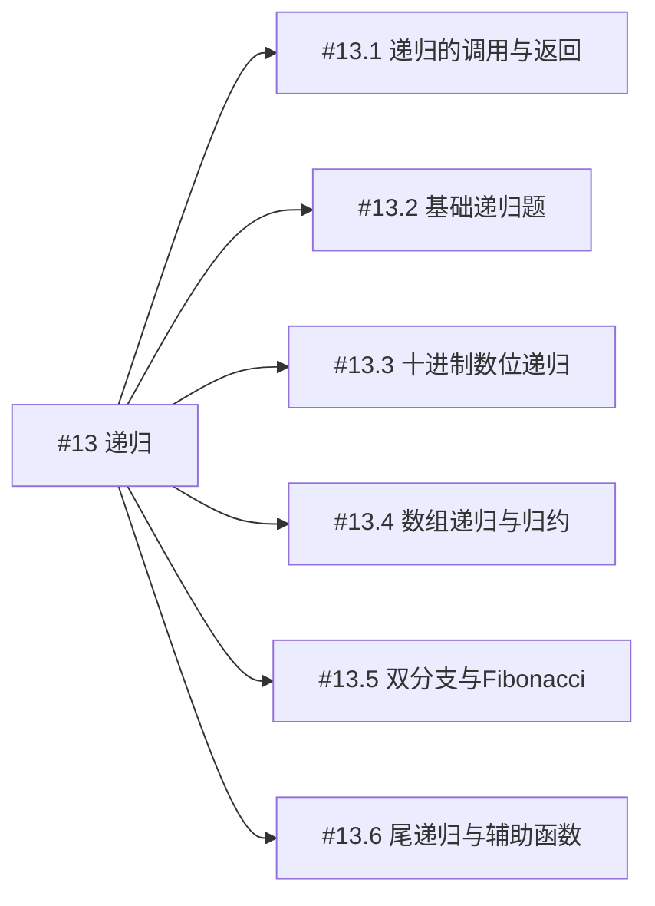

### 13.1 递归的调用与返回

> [!note]- 知识图与目录
>
> ```mermaid
> flowchart LR
>   R["#13.1 递归的调用与返回"]
>   N0["#624. 递归缩小同类问题"]
>   R --> N0
>   N1["#625. 设计递归先问三件事"]
>   R --> N1
>   N2["#626. 当前项与较小问题分工"]
>   R --> N2
>   N3["#627. 递归参数仍按值传递"]
>   R --> N3
>   N4["#628. 外层等待被调用层返回"]
>   R --> N4
>   N5["#629. 向下调用与向上返回"]
>   R --> N5
>   N6["#630. 乘法等待递归结果"]
>   R --> N6
>   N7["#631. 每层保留待完成计算"]
>   R --> N7
>   N8["#632. 普通自动现场不会互相覆盖"]
>   R --> N8
>   class R,N0,N1,N2,N3,N4,N5,N6,N7,N8 internal-link;
> ```
>
> ```mermaid
> flowchart LR
>   R["#13.1 递归的调用与返回"]
>   N0["#633. 基例不可达会持续深入"]
>   R --> N0
>   N1["#634. 调用栈后进先出"]
>   R --> N1
>   N2["#635. 栈帧保存调用现场"]
>   R --> N2
>   N3["#636. 入栈与出栈的直观动作"]
>   R --> N3
>   N4["#637. 递归深度不是总调用次数"]
>   R --> N4
>   N5["#638. 基例可达也可能耗尽调用资源"]
>   R --> N5
>   class R,N0,N1,N2,N3,N4,N5 internal-link;
> ```
>
> - [[#624. 递归缩小同类问题|624. 递归缩小同类问题]]
> - [[#625. 设计递归先问三件事|625. 设计递归先问三件事]]
> - [[#626. 当前项与较小问题分工|626. 当前项与较小问题分工]]
> - [[#627. 递归参数仍按值传递|627. 递归参数仍按值传递]]
> - [[#628. 外层等待被调用层返回|628. 外层等待被调用层返回]]
> - [[#629. 向下调用与向上返回|629. 向下调用与向上返回]]
> - [[#630. 乘法等待递归结果|630. 乘法等待递归结果]]
> - [[#631. 每层保留待完成计算|631. 每层保留待完成计算]]
> - [[#632. 普通自动现场不会互相覆盖|632. 普通自动现场不会互相覆盖]]
> - [[#633. 基例不可达会持续深入|633. 基例不可达会持续深入]]
> - [[#634. 调用栈后进先出|634. 调用栈后进先出]]
> - [[#635. 栈帧保存调用现场|635. 栈帧保存调用现场]]
> - [[#636. 入栈与出栈的直观动作|636. 入栈与出栈的直观动作]]
> - [[#637. 递归深度不是总调用次数|637. 递归深度不是总调用次数]]
> - [[#638. 基例可达也可能耗尽调用资源|638. 基例可达也可能耗尽调用资源]]

#### 624. 递归缩小同类问题

递归把原问题转为规模更小的同类问题，直到遇到可以直接回答的基例。求平方和时，去掉当前平方后仍然是一个平方和问题，不是临时换成另一种任务。

#### 625. 设计递归先问三件事

**何时停止、当前层做什么、剩余部分交给谁。** 先定基例，再确保递归参数缩小，最后选择合并方式。口诀：**先定终点，再缩问题，最后合结果。** “当前部分 + 较小问题”里的加号是思路占位，不要求每道题都用 C 的 `+`。

作为上述规则的对照：

| 自然语言要求      | 当前部分               | 递归关系的关键                         |
| ----------- | ------------------ | ------------------------------- |
| 从 1 到 n 求和  | `n`                | `n + sum(n - 1)`                |
| 求阶乘         | `n`                | `n * factorial(n - 1)`          |
| 求平方和        | `n * n`            | 当前平方 + 其余平方和                    |
| 求各位数字和      | `n % 10`           | 个位 + 剩余数位和                      |
| 求各位数字积      | `n % 10`           | 个位 × 剩余数位积                      |
| 统计整数位数      | `1`                | `1 + countDigits(n / 10)`       |
| 查找某个数位      | `n % 10 == target` | <code>&#124;&#124;</code>       |
| 统计数位出现次数    | `n % 10 == target` | `+`                             |
| 判断所有数位都满足条件 | 当前个位判断             | `&&`                            |
| 数组求和        | `*a`               | 当前元素 + 其余数组和                    |
| 数组查找        | `*a == target`     | <code>&#124;&#124;</code>       |
| 数组计数        | `*a == target`     | `+`                             |
| 双分支递归       | 两个较小问题             | `fib(n - 1) + fib(n - 2)`       |
| 尾递归求和       | 累加器                | `sumTail(n - 1, acc + n)`       |
| 尾递归阶乘       | 累加器                | `factorialTail(n - 1, acc * n)` |

返回值是当前层与较小问题的连接：先确定当前部分贡献什么，再选 `+`、`*`、`||` 或 `&&`，不要按函数外形死背。

#### 626. 当前项与较小问题分工

平方和 $1^2+2^2+3^2=14$ 可以分成当前项 $3^2=9$ 与较小问题 $1^2+2^2=5$。当前层只负责自己的项，不必重写一套求前面各项的代码；同类小问题由下一次调用负责。

#### 627. 递归参数仍按值传递

调用 `f(n - 1)` 时，把当前表达式 `n - 1` 的值复制给新一次调用的形参。前一层的形参不会因为新一层也叫 `n` 就自动被改写；普通函数与递归函数都遵循 C 的值传递规则。

#### 628. 外层等待被调用层返回

假设基例 `f(0)` 返回零，`f(2)` 等待 `f(1)`，`f(1)` 又等待 `f(0)`。`return 0` 只结束 `f(0)` 这一次调用，随后控制回到等待它的上一层，不能理解成把整条递归链一并跳过。

```text
f(2) 等 f(1)
  f(1) 等 f(0)
    f(0) 返回 0，再逐层返回
```

#### 629. 向下调用与向上返回

向下是开始下一次调用，向上是结束当前调用、回到它的调用者。先沿 `f(2) → f(1) → f(0)` 下探，命中基例后再沿相反方向返回。像下楼办事，走到能直接处理的楼层后，沿原路把结果交回去。

#### 630. 乘法等待递归结果

`return f(n - 1) * 3;` 中，本层必须先获得递归返回值，才能用它完成乘法并返回。乘法写在同一行，不表示在下探前已经算完。下面的完整示例基例返回 `2`，所以输入 `2` 依次得到 `2 → 6 → 18`。

```c
int triplePower(int n)
{
    if (n == 0)
        return 2;
    return triplePower(n - 1) * 3;
}
```

#### 631. 每层保留待完成计算

下探不会抹掉“回来还要做什么”的信息。

```text
f(2)：等待 f(1)，返回后还要 ×3
f(1)：等待 f(0)，返回后还要 ×3
f(0)：直接给出基例结果
```

可以想成每下一层楼，就在原楼层留下待办单；回程逐层完成自己的待办。

#### 632. 普通自动现场不会互相覆盖

递归不是让同一个普通局部变量不停覆盖自己，而是同一函数的不同执行各自有参数与自动状态。共享 `static` 对象是另外一种情景，不能把两种存储期混着理解。

#### 633. 基例不可达会持续深入

递归参数必须向可达基例推进。若只在 `n == 1` 停，却从 `0` 不停减一，轨迹为 `0 → -1 → -2 → …`，越走越远，可能耗尽调用资源，继续整数运算也可能越界。

#### 634. 调用栈后进先出

想象桌上有一摞盘子：

- 放入新盘子，只能放在最上面。

- 取走盘子，也先取最上面的。

- 最后放进去的盘子，最先取出来。


这叫 后进先出（LIFO，Last In, First Out）。
```text
调用栈示意（后进先出）
┌───────────────────┐
│ f(3)  ← 最上层   │  先返回
├───────────────────┤
│ f(2)              │
├───────────────────┤
│ f(1)  ← 最下层   │  后返回
└───────────────────┘
```
在程序里，**调用栈（Call Stack）**就是用类似的方式管理尚未结束的函数调用。

#### 635. 栈帧保存调用现场

递归调用时的栈（示意）：

```text
栈顶   ┌───────────────────────────────────┐
       │ factorial(0)：执行 return 1;       │  ← 最先返回
       ├───────────────────────────────────┤
       │ factorial(1)：等待 1 × factorial(0)│
       ├───────────────────────────────────┤
       │ factorial(2)：等待 2 × factorial(1)│
栈底   ├───────────────────────────────────┤
       │ factorial(3)：等待 3 × factorial(2)│
       └───────────────────────────────────┘
```

每次函数调用通常占用一块栈空间，称为栈帧（Stack Frame），用来保存当前调用所需的信息。这是常见实现的直观模型；C 标准并不规定必须采用这样的物理栈结构。

#### 636. 入栈与出栈的直观动作

- 入栈（Push）：开始一次新的函数调用。

- 出栈（Pop）：某次函数调用结束，撤销对应的栈帧。

#### 637. 递归深度不是总调用次数

从非负 `n` 每次减一至零，未优化模型中最多同时存在 `n + 1` 层调用；`countdown(3)` 是 4 层。深度描述同时尚未结束的路径，不等于整个运行中调用总数。C 不规定物理栈帧结构，实际资源与优化由实现决定。

#### 638. 基例可达也可能耗尽调用资源

基例可达不代表可以接受任意深输入；递归深度还必须在实现可承受范围内。各算术题另行限定数值范围，不能用“递归形式正确”替代资源检查。

### 13.2 基础递归题

> [!note]- 知识图与目录
>
> ```mermaid
> flowchart LR
>   R["#13.2 基础递归题"]
>   N0["#639. 空和与空积的基例值"]
>   R --> N0
>   N1["#640. 从一到n递归求和"]
>   R --> N1
>   N2["#641. 递归阶乘"]
>   R --> N2
>   N3["#642. 递归平方和"]
>   R --> N3
>   N4["#643. 递归立方和"]
>   R --> N4
>   N5["#644. 偶数递归步长须匹配输入"]
>   R --> N5
>   N6["#645. 任意非负上界求奇数和"]
>   R --> N6
>   N7["#646. 奇数和停在一要返回一"]
>   R --> N7
>   N8["#647. 奇数和走过一返回空和"]
>   R --> N8
>   class R,N0,N1,N2,N3,N4,N5,N6,N7,N8 internal-link;
> ```
>
> ```mermaid
> flowchart LR
>   R["#13.2 基础递归题"]
>   N0["#648. 基例位置与返回值要配对"]
>   R --> N0
>   N1["#649. 递归前打印得到降序"]
>   R --> N1
>   N2["#650. 递归后打印得到升序"]
>   R --> N2
>   class R,N0,N1,N2 internal-link;
> ```
>
> - [[#639. 空和与空积的基例值|639. 空和与空积的基例值]]
> - [[#640. 从一到n递归求和|640. 从一到n递归求和]]
> - [[#641. 递归阶乘|641. 递归阶乘]]
> - [[#642. 递归平方和|642. 递归平方和]]
> - [[#643. 递归立方和|643. 递归立方和]]
> - [[#644. 偶数递归步长须匹配输入|644. 偶数递归步长须匹配输入]]
> - [[#645. 任意非负上界求奇数和|645. 任意非负上界求奇数和]]
> - [[#646. 奇数和停在一要返回一|646. 奇数和停在一要返回一]]
> - [[#647. 奇数和走过一返回空和|647. 奇数和走过一返回空和]]
> - [[#648. 基例位置与返回值要配对|648. 基例位置与返回值要配对]]
> - [[#649. 递归前打印得到降序|649. 递归前打印得到降序]]
> - [[#650. 递归后打印得到升序|650. 递归后打印得到升序]]

#### 639. 空和与空积的基例值

加法递归处理完所有项时通常返回 `0`，因为 `a + 0 == a`；乘法通常返回 `1`，因为 `a * 1 == a`。这两个单位元帮助表达“剩余没有项”的结果，不能在求和与求积之间机械互换。

#### 640. 从一到n递归求和

限定 `n >= 0`，所有中间和均可由 `int` 表示。当前项是 `n`，剩余任务为前 `n - 1` 项之和。

```c
int sum(int n)
{
    if (n == 0)
        return 0;
    return n + sum(n - 1);
}
```

```text
sum(3) = 3 + sum(2)
       = 3 + 2 + 1 + sum(0)
       = 6
```

#### 641. 递归阶乘

限定 `n >= 0`，所有中间乘积均可由 `int` 表示；零阶乘为 `1`。

```c
int factorial(int n)
{
    if (n == 0)
        return 1;
    return n * factorial(n - 1);
}
```

```text
factorial(4) = 4 × 3 × 2 × 1 × factorial(0) = 24
```

#### 642. 递归平方和

当前贡献 `n * n`，加上前 `n - 1` 项的平方和；`sumSquares(3)` 得到 `14`。`n >= 0`，包括当前乘积在内的中间结果均须可表示。数学的 $n^2$ 在 C 中应写乘法，不能写按位异或 `n ^ 2`。

```c
int sumSquares(int n)
{
    if (n == 0)
        return 0;
    return n * n + sumSquares(n - 1);
}
```

#### 643. 递归立方和

立方和将当前项换成 `n * n * n`，其余递归关系保持为“当前项 + 剩余同类项”；`sumCubes(3)` 为 `36`，每次乘法与加法都须不溢出。

```c
int sumCubes(int n)
{
    if (n == 0)
        return 0;
    return n * n * n + sumCubes(n - 1);
}
```

#### 644. 偶数递归步长须匹配输入

此版本限定 `n` 为非负偶数，沿 `6 → 4 → 2 → 0` 抵达基例。传入正奇数不能达到 `0`，所以不能把“每次减二”直接当成接受任意上界的通用版本。

```c
int sumEven(int n)
{
    if (n == 0)
        return 0;
    return n + sumEven(n - 2);
}
```

#### 645. 任意非负上界求奇数和

上界是偶数时先跳过，奇数才加入累计，因此 `sumOdd(6)` 与 `sumOdd(5)` 都为 `9`；输入零返回零。

```c
int sumOdd(int n)
{
    if (n <= 0)
        return 0;
    if (n % 2 == 0)
        return sumOdd(n - 1);
    return n + sumOdd(n - 2);
}
```

#### 646. 奇数和停在一要返回一

对正奇数 `n` 每次减二，若在最后一个加数 `1` 停止，基例应返回 `1`。

```c
int sumOddAtOne(int n)
{
    if (n == 1)
        return 1;
    return n + sumOddAtOne(n - 2);
}
```

#### 647. 奇数和走过一返回空和

也可继续到 `-1`，此时剩余范围为空，返回 `0`。

```c
int sumOddPastOne(int n)
{
    if (n == -1)
        return 0;
    return n + sumOddPastOne(n - 2);
}
```

```text
sumOddPastOne(5) = 5 + 3 + 1 + sumOddPastOne(-1) = 9
```

#### 648. 基例位置与返回值要配对

错误地在 `n == 1` 返回 `0` 会漏掉最后一个加数，让结果少 `1`，未必崩溃。仅把终点改成 `n <= 0` 也不会让固定减二版本自动处理偶数上界：它可能求成另一组数。

#### 649. 递归前打印得到降序

先打印当前 `n`，再下探，输出发生在下楼途中。非负 `n` 下，调用 `printDescending(3)` 输出 `3 2 1`。

```c
#include <stdio.h>

void printDescending(int n)
{
    if (n == 0)
        return;
    printf("%d ", n);
    printDescending(n - 1);
}
```

#### 650. 递归后打印得到升序

先下探再打印，上一层等下一层回来才执行自己的输出。`printAscending(3)` 下探顺序仍为 `3 → 2 → 1 → 0`，回程输出却为 `1 2 3`。

```c
#include <stdio.h>

void printAscending(int n)
{
    if (n == 0)
        return;
    printAscending(n - 1);
    printf("%d ", n);
}
```

### 13.3 十进制数位递归

> [!note]- 知识图与目录
>
> ```mermaid
> flowchart LR
>   R["#13.3 十进制数位递归"]
>   N0["#651. 取模十得到个位"]
>   R --> N0
>   N1["#652. 整除十去掉个位"]
>   R --> N1
>   N2["#653. 零自身与处理完数位不同"]
>   R --> N2
>   N3["#654. 递归数位和"]
>   R --> N3
>   N4["#655. 单数位基例兼容零的数位积"]
>   R --> N4
>   N5["#656. 空积基例只适用正数入口"]
>   R --> N5
>   N6["#657. 递归统计数位数量"]
>   R --> N6
>   N7["#658. 判断数位基例不能提前除十"]
>   R --> N7
>   N8["#659. 逻辑或判断指定数位存在"]
>   R --> N8
>   class R,N0,N1,N2,N3,N4,N5,N6,N7,N8 internal-link;
> ```
>
> ```mermaid
> flowchart LR
>   R["#13.3 十进制数位递归"]
>   N0["#660. 加法统计指定数位次数"]
>   R --> N0
>   N1["#661. 逻辑与判断全部数位"]
>   R --> N1
>   class R,N0,N1 internal-link;
> ```
>
> - [[#651. 取模十得到个位|651. 取模十得到个位]]
> - [[#652. 整除十去掉个位|652. 整除十去掉个位]]
> - [[#653. 零自身与处理完数位不同|653. 零自身与处理完数位不同]]
> - [[#654. 递归数位和|654. 递归数位和]]
> - [[#655. 单数位基例兼容零的数位积|655. 单数位基例兼容零的数位积]]
> - [[#656. 空积基例只适用正数入口|656. 空积基例只适用正数入口]]
> - [[#657. 递归统计数位数量|657. 递归统计数位数量]]
> - [[#658. 判断数位基例不能提前除十|658. 判断数位基例不能提前除十]]
> - [[#659. 逻辑或判断指定数位存在|659. 逻辑或判断指定数位存在]]
> - [[#660. 加法统计指定数位次数|660. 加法统计指定数位次数]]
> - [[#661. 逻辑与判断全部数位|661. 逻辑与判断全部数位]]

#### 651. 取模十得到个位

非负十进制整数的 `n % 10` 是个位，例如 `307 % 10 == 7`。它提取本层需要处理的当前数位，不会修改原变量。

#### 652. 整除十去掉个位

非负整数的 `n / 10` 去掉个位，例如 `307 / 10 == 30`；继续得到 `30 / 10 == 3`。把此结果交给下一层，问题就少一位。

#### 653. 零自身与处理完数位不同

十进制数字 `0` 本身有一位，而“正整数全部数位处理完后剩余参数为零”可以充当辅助终点。数位和、数位积与数位数量的零基例不能直接互抄。目标数位须在 `0..9`，负数输入先另行设计安全符号处理，不能直接对 `INT_MIN` 调用 `abs`。

#### 654. 递归数位和

当前个位与剩余数位和相加。非负输入下 `digitSum(307) = 7 + 0 + 3 + 0 == 10`，零输入得到零。

```c
int digitSum(int n)
{
    if (n == 0)
        return 0;
    return n % 10 + digitSum(n / 10);
}
```

#### 655. 单数位基例兼容零的数位积

剩一位时直接返回该位，因此 `digitProduct(234) == 24`、`digitProduct(203) == 0`，直接输入零也得到零。所有中间乘积都须可表示。

```c
int digitProduct(int n)
{
    if (n < 10)
        return n;
    return (n % 10) * digitProduct(n / 10);
}
```

#### 656. 空积基例只适用正数入口

若辅助递归在参数零时返回 `1`，正数中间真实出现的零仍乘入结果，但“数位处理完的零”只贡献空积。此版本直接调用 `digitProductPositive(0)` 会返回 `1`，所以入口只能是正数。

```c
int digitProductPositive(int n)
{
    if (n == 0)
        return 1;
    return (n % 10) * digitProductPositive(n / 10);
}
```

#### 657. 递归统计数位数量

每层当前位贡献 `1`，仅当原参数 `n < 10` 时已经只剩一位。`countDigits(307) == 3`，`countDigits(0) == 1`。

```c
int countDigits(int n)
{
    if (n < 10)
        return 1;
    return 1 + countDigits(n / 10);
}
```

#### 658. 判断数位基例不能提前除十

错误条件 `n / 10 < 10` 会先丢一位，再判断剩余值大小，把 `30` 这样的两位数误判成一位。正确检查当前待处理整数本身是否小于十。

#### 659. 逻辑或判断指定数位存在

当前个位命中，或剩余数位存在目标，即返回真；当前位已命中时，`||` 短路，不再深入。`containsDigit(307, 7)` 为真，查 `5` 为假，零里也存在一位零。

```c
int containsDigit(int n, int target)
{
    if (n < 10)
        return n == target;
    return (n % 10 == target) || containsDigit(n / 10, target);
}
```

#### 660. 加法统计指定数位次数

每次比较得到 `0` 或 `1`，用加法统计全部贡献；不能把存在性的 `||` 原样套过来。`countDigit(727, 7) == 2`、`countDigit(203, 0) == 1`。

```c
int countDigit(int n, int target)
{
    if (n < 10)
        return n == target;
    return (n % 10 == target) + countDigit(n / 10, target);
}
```

#### 661. 逻辑与判断全部数位

当前个位为偶数，且剩余数位全为偶数，才返回真；当前位不满足时 `&&` 短路。`248`、`20`、`0` 返回真，`243` 为假。

```c
int allEvenDigits(int n)
{
    if (n < 10)
        return n % 2 == 0;
    return ((n % 10) % 2 == 0) && allEvenDigits(n / 10);
}
```

### 13.4 数组递归与归约

> [!note]- 知识图与目录
>
> ```mermaid
> flowchart LR
>   R["#13.4 数组递归与归约"]
>   N0["#662. 起点与长度共同缩小数组问题"]
>   R --> N0
>   N1["#663. 递归数组求和"]
>   R --> N1
>   N2["#664. 递归只前进会漏掉当前项"]
>   R --> N2
>   N3["#665. 数组计数累加比较结果"]
>   R --> N3
>   N4["#666. 数组存在性使用短路或"]
>   R --> N4
>   N5["#667. 零长度层不解引用尾后位置"]
>   R --> N5
>   N6["#668. 循环与递归都能表达归约"]
>   R --> N6
>   class R,N0,N1,N2,N3,N4,N5,N6 internal-link;
> ```
>
> - [[#662. 起点与长度共同缩小数组问题|662. 起点与长度共同缩小数组问题]]
> - [[#663. 递归数组求和|663. 递归数组求和]]
> - [[#664. 递归只前进会漏掉当前项|664. 递归只前进会漏掉当前项]]
> - [[#665. 数组计数累加比较结果|665. 数组计数累加比较结果]]
> - [[#666. 数组存在性使用短路或|666. 数组存在性使用短路或]]
> - [[#667. 零长度层不解引用尾后位置|667. 零长度层不解引用尾后位置]]
> - [[#668. 循环与递归都能表达归约|668. 循环与递归都能表达归约]]

#### 662. 起点与长度共同缩小数组问题

数位递归用 `% 10` 取当前位、`/ 10` 剩余；数组递归用 `*a` 取当前元素、`a + 1` 移到下一项，同时令剩余元素数减一。这里的 `n` 表示剩余数量，`n == 0` 时先返回，不能先解引用。

#### 663. 递归数组求和

限定 `n >= 0`，非空时至少有 `n` 项可读，所有中间和可表示。`{4, 7, 2}` 展开为 `4 + 7 + 2 + sumArray(尾后位置, 0) == 13`。

```c
int sumArray(const int *a, int n)
{
    if (n == 0)
        return 0;
    return *a + sumArray(a + 1, n - 1);
}
```

#### 664. 递归只前进会漏掉当前项

误写 `return sumArray(a + 1, n - 1);` 会把本层 `*a` 的贡献全丢掉。递归调用负责剩余部分，不会自动补上当前元素。

#### 665. 数组计数累加比较结果

`(*a == target)` 贡献零或一，加上剩余数组的出现次数。`{4, 7, 4, 2, 4}` 中 `4` 出现 3 次；空数组计数为零。

```c
int countValue(const int *a, int n, int target)
{
    if (n == 0)
        return 0;
    return (*a == target) + countValue(a + 1, n - 1, target);
}
```

#### 666. 数组存在性使用短路或

一项匹配就足以判真，后续递归可被短路跳过。对 `{4, 7, 2}` 查 `7` 为真、查 `5` 为假。

```c
int containsValue(const int *a, int n, int target)
{
    if (n == 0)
        return 0;
    return (*a == target) || containsValue(a + 1, n - 1, target);
}
```

#### 667. 零长度层不解引用尾后位置

最后一次递归可以传入原数组尾后指针与 `n == 0`。函数先处理基例立即返回，才不会访问不存在的元素；尾后位置可形成，不等于那里有一个合法元素。

#### 668. 循环与递归都能表达归约

归约把多个元素合成为一个结果，是算法思路，不是标准 C 的固定库函数。循环累计已处理部分，递归合并当前项与剩余结果；合并操作不同，初始单位元也要随之选择。

```c
int sumLoop(const int *a, int n)
{
    int result = 0;
    for (int i = 0; i < n; ++i)
        result += a[i];
    return result;
}
```

### 13.5 双分支与Fibonacci

> [!note]- 知识图与目录
>
> ```mermaid
> flowchart LR
>   R["#13.5 双分支与Fibonacci"]
>   N0["#669. 双分支递归产生两个子问题"]
>   R --> N0
>   N1["#670. Fibonacci基例与递推"]
>   R --> N1
>   N2["#671. 朴素Fibonacci递归"]
>   R --> N2
>   N3["#672. 调用树暴露重复子问题"]
>   R --> N3
>   N4["#673. 记忆化保存已解问题"]
>   R --> N4
>   N5["#674. 静态缓存Fibonacci的实现"]
>   R --> N5
>   N6["#675. 零缓存标记要求合法值非零"]
>   R --> N6
>   N7["#676. 迭代Fibonacci只留最近两项"]
>   R --> N7
>   N8["#677. 循环临时值离开后结果仍已保存"]
>   R --> N8
>   class R,N0,N1,N2,N3,N4,N5,N6,N7,N8 internal-link;
> ```
>
> ```mermaid
> flowchart LR
>   R["#13.5 双分支与Fibonacci"]
>   N0["#678. 记忆化与迭代的空间取舍"]
>   R --> N0
>   class R,N0 internal-link;
> ```
>
> - [[#669. 双分支递归产生两个子问题|669. 双分支递归产生两个子问题]]
> - [[#670. Fibonacci基例与递推|670. Fibonacci基例与递推]]
> - [[#671. 朴素Fibonacci递归|671. 朴素Fibonacci递归]]
> - [[#672. 调用树暴露重复子问题|672. 调用树暴露重复子问题]]
> - [[#673. 记忆化保存已解问题|673. 记忆化保存已解问题]]
> - [[#674. 静态缓存Fibonacci的实现|674. 静态缓存Fibonacci的实现]]
> - [[#675. 零缓存标记要求合法值非零|675. 零缓存标记要求合法值非零]]
> - [[#676. 迭代Fibonacci只留最近两项|676. 迭代Fibonacci只留最近两项]]
> - [[#677. 循环临时值离开后结果仍已保存|677. 循环临时值离开后结果仍已保存]]
> - [[#678. 记忆化与迭代的空间取舍|678. 记忆化与迭代的空间取舍]]

#### 669. 双分支递归产生两个子问题

一次调用可以发起两个更小调用，再合并两份结果。`fib(n - 1) + fib(n - 2)` 是典型结构；每个调用有自己的参数，不代表子问题彼此不同，也不代表不会重复计算。

#### 670. Fibonacci基例与递推

数列从 `fib(0) = 0`、`fib(1) = 1` 开始，其后 `fib(n) = fib(n - 1) + fib(n - 2)`。前七项为 `0, 1, 1, 2, 3, 5, 8`。

#### 671. 朴素Fibonacci递归

限定非负输入及可表示的结果，直接按递推式写函数。最坏时间为指数级，可用 $O(2^n)$ 上界，更紧量级为 $\Theta(\varphi^n)$；通常调用深度为 $O(n)$。

```c
int fib(int n)
{
    if (n <= 1)
        return n;
    return fib(n - 1) + fib(n - 2);
}
```

#### 672. 调用树暴露重复子问题

`fib(4)` 的两条分支都需要计算 `fib(2)`，所以没有缓存时会重复展开。

```text
fib(4)
├── fib(3)
│   ├── fib(2)
│   │   ├── fib(1)
│   │   └── fib(0)
│   └── fib(1)
└── fib(2)
    ├── fib(1)
    └── fib(0)
```

这是依赖结构，不承诺 C 的 `+` 左右操作数按图示先后执行。

#### 673. 记忆化保存已解问题

像把做过的题写进备忘录：首次求出结果就保存，再遇到相同参数直接查表。缓存容量随允许的 `n` 增长、每个子问题只求一次时，完整求解通常为 $O(n)$ 时间与 $O(n)$ 额外空间。容量、数值范围和调用深度仍分别受限。

#### 674. 静态缓存Fibonacci的实现

这个教学版本只支持 `0 <= n < 10`，无效输入返回 `-1`；`static` 数组让所有递归层及后续调用共用已算结果。固定十项缓存不能被当成任意输入的一般实现。

```c
int fibMemo(int n)
{
    static int cache[10] = {0};
    if (n < 0 || n >= 10)
        return -1;
    if (n <= 1)
        return n;
    if (cache[n] != 0)
        return cache[n];

    int left = fibMemo(n - 1);
    int right = fibMemo(n - 2);
    cache[n] = left + right;
    return cache[n];
}
```

#### 675. 零缓存标记要求合法值非零

该 Fibonacci 缓存只用于 `n >= 2`，这些值为正数，所以 `cache[n] == 0` 可以表示未算过；`fib(0)` 与 `fib(1)` 直接走基例。若别的任务合法结果也可能为零，就必须另设有效标志。

#### 676. 迭代Fibonacci只留最近两项

`prev` 与 `curr` 保留最近两项，先用它们计算 `next`，再依次更新。时间为 $O(n)$，额外空间为 $O(1)$，仍要求每次加法可表示。

```c
int fibIter(int n)
{
    if (n <= 1)
        return n;
    int prev = 0;
    int curr = 1;
    for (int i = 2; i <= n; ++i) {
        int next = prev + curr;
        prev = curr;
        curr = next;
    }
    return curr;
}
```

| i | 原prev | 原curr | next | 新prev | 新curr |
|---|---|---|---|---|---|
| 2 | 0 | 1 | 1 | 1 | 1 |
| 3 | 1 | 1 | 2 | 1 | 2 |
| 4 | 1 | 2 | 3 | 2 | 3 |
| 5 | 2 | 3 | 5 | 3 | 5 |

像接力传棒，先接住新一项再交接旧值；提前覆盖prev或curr会丢掉还要用的信息。

#### 677. 循环临时值离开后结果仍已保存

`next` 是本轮循环体的自动局部对象，离开该轮块后结束；`prev`、`curr` 在循环外，能跨轮保留。执行 `curr = next` 已复制数值，循环结束后返回 `curr` 不依赖那个已结束的临时对象。

#### 678. 记忆化与迭代的空间取舍

同样可达线性时间，记忆化通常需随 `n` 增长的缓存与调用状态，额外空间为 $O(n)$；迭代发现仅需最近两项，降到 $O(1)$。这张对照讨论的是一般规模，不能把固定 `cache[10]` 的实际容量直接改称随 `n` 增长。

### 13.6 尾递归与辅助函数

> [!note]- 知识图与目录
>
> ```mermaid
> flowchart LR
>   R["#13.6 尾递归与辅助函数"]
>   N0["#679. 尾递归返回后没有余算"]
>   R --> N0
>   N1["#680. 普通求和仍有回程加法"]
>   R --> N1
>   N2["#681. 尾调用消除不是C保证"]
>   R --> N2
>   N3["#682. 尾递归参数分别传任务与累计值"]
>   R --> N3
>   N4["#683. 尾递归求和在下探前累加"]
>   R --> N4
>   N5["#684. 尾递归阶乘在下探前累乘"]
>   R --> N5
>   N6["#685. 阶乘累乘入口选一"]
>   R --> N6
>   N7["#686. 改变累加器初值就改变问题"]
>   R --> N7
>   N8["#687. 包装函数隐藏累计初值"]
>   R --> N8
>   class R,N0,N1,N2,N3,N4,N5,N6,N7,N8 internal-link;
> ```
>
> ```mermaid
> flowchart LR
>   R["#13.6 尾递归与辅助函数"]
>   N0["#688. 先调用的辅助函数要先声明"]
>   R --> N0
>   N1["#689. 普通与尾递归的乘法时机"]
>   R --> N1
>   N2["#690. 递归每层自动对象独立"]
>   R --> N2
>   N3["#691. 递归层共享同一个static对象"]
>   R --> N3
>   class R,N0,N1,N2,N3 internal-link;
> ```
>
> - [[#679. 尾递归返回后没有余算|679. 尾递归返回后没有余算]]
> - [[#680. 普通求和仍有回程加法|680. 普通求和仍有回程加法]]
> - [[#681. 尾调用消除不是C保证|681. 尾调用消除不是C保证]]
> - [[#682. 尾递归参数分别传任务与累计值|682. 尾递归参数分别传任务与累计值]]
> - [[#683. 尾递归求和在下探前累加|683. 尾递归求和在下探前累加]]
> - [[#684. 尾递归阶乘在下探前累乘|684. 尾递归阶乘在下探前累乘]]
> - [[#685. 阶乘累乘入口选一|685. 阶乘累乘入口选一]]
> - [[#686. 改变累加器初值就改变问题|686. 改变累加器初值就改变问题]]
> - [[#687. 包装函数隐藏累计初值|687. 包装函数隐藏累计初值]]
> - [[#688. 先调用的辅助函数要先声明|688. 先调用的辅助函数要先声明]]
> - [[#689. 普通与尾递归的乘法时机|689. 普通与尾递归的乘法时机]]
> - [[#690. 递归每层自动对象独立|690. 递归每层自动对象独立]]
> - [[#691. 递归层共享同一个static对象|691. 递归层共享同一个static对象]]

#### 679. 尾递归返回后没有余算

尾递归的结构是：递归调用返回后，本层直接交出它的结果，不再做额外计算。判断看的是剩余工作，不是代码里是否把调用写在最后一行。

#### 680. 普通求和仍有回程加法

`return n + sum(n - 1);` 中，递归返回后本层还要加 `n`，所以不是尾递归。`return` 位于最后一行不能改变这个依赖关系。

#### 681. 尾调用消除不是C保证

编译器可能把尾递归转成类似循环的执行，复用调用状态；C 标准不保证这种优化。未消除调用时，尾递归也通常有线性调用深度，不能直接承诺 $O(1)$ 栈空间。

#### 682. 尾递归参数分别传任务与累计值

`n` 表示还剩多少任务，`acc` 表示已完成部分的累计值；累加器是普通形参，每层各有一份，新值通过实参传到下一层，不是一个所有层共享的静态变量。

#### 683. 尾递归求和在下探前累加

先把 `n` 加进新 `acc`，再进入下一层；到零时直接返回累计值。

```c
int sumTail(int n, int acc)
{
    if (n == 0)
        return acc;
    return sumTail(n - 1, acc + n);
}
```

```text
sumTail(3,0) → (2,3) → (1,5) → (0,6) → 6
```

#### 684. 尾递归阶乘在下探前累乘

将新乘积作为下一层的累计参数，回程不再逐层补乘。

```c
int factorialTail(int n, int acc)
{
    if (n == 0)
        return acc;
    return factorialTail(n - 1, acc * n);
}
```

```text
factorialTail(4,1) → (3,4) → (2,12) → (1,24) → (0,24) → 24
```

#### 685. 阶乘累乘入口选一

`acc = 1` 来自乘法单位元，乘以一不会改变应求的阶乘。它是接口选择的初值，不是 `factorialTail` 语法自动补出的规则。

#### 686. 改变累加器初值就改变问题

`factorialTail(4, 2)` 是合法调用，但计算 $2\times4!=48$，不再是单独的 `4!`。让初始累计值由调用者随意指定，必须相应改变函数契约。

#### 687. 包装函数隐藏累计初值

对外只提供 `factorial(n)`，内部选择 `acc = 1` 再交给辅助函数，调用者不用反复记住初值。下面是独立示例，不要与本章前面同名定义放进同一程序。

```c
/* 独立示例，与前面的同名函数不要重复定义在同一程序中。 */
int factorialTail(int n, int acc);

int factorial(int n)
{
    return factorialTail(n, 1);
}

int factorialTail(int n, int acc)
{
    if (n == 0)
        return acc;
    return factorialTail(n - 1, acc * n);
}
```

#### 688. 先调用的辅助函数要先声明

包装函数在辅助函数定义之前调用它，需要先给函数声明：`int factorialTail(int n, int acc);`。声明末尾是分号，提供类型规则；带函数体才是定义。参数名不改变这一区别。

#### 689. 普通与尾递归的乘法时机

普通阶乘等下一层返回再乘本层 `n`，尾递归在发出调用前已把本层乘法放进 `acc`。两者都要按 C 调用语义返回；尾递归省去的是回程乘法，不是语言必定省掉所有返回。

#### 690. 递归每层自动对象独立

普通自动局部对象与参数每层各有一份；例如各层的 `n`、`acc` 不会因同名自动合并。与静态共享状态的对照见 [[#15.1 作用域与生命周期|作用域与生命周期]]。

#### 691. 递归层共享同一个static对象

若局部对象声明为 `static`，所有层修改同一对象：`f(2)` 写成 2，下一层再写成 1，最深层写成 0；回程不会找回每层独有的那份旧静态值。适合共享缓存，不适合假装保存各层独立现场。

---

## 14 结构体、联合体与枚举

数组组织同类数据，结构体把不同字段组合成一个整体；联合体与枚举分别处理共享存储和离散状态。

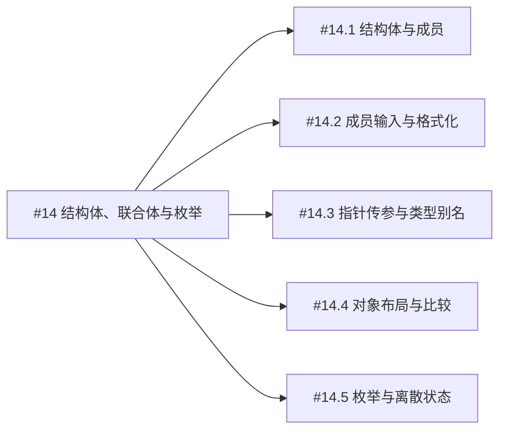

### 14.1 结构体与成员

> [!note]- 知识图与目录
>
> ```mermaid
> flowchart LR
>   R["#14.1 结构体与成员"]
>   N0["#692. 结构体组合一条记录"]
>   R --> N0
>   N1["#693. 点运算符选择对象成员"]
>   R --> N1
>   N2["#694. 顺序初始化对应成员顺序"]
>   R --> N2
>   N3["#695. 剩余成员按规则补齐"]
>   R --> N3
>   N4["#696. 指定初始化不依赖书写顺序"]
>   R --> N4
>   N5["#697. 花括号零初始化按成员语义"]
>   R --> N5
>   N6["#698. 同类型结构体可以整体赋值"]
>   R --> N6
>   N7["#699. 数组成员随整体赋值复制"]
>   R --> N7
>   N8["#700. 赋值后两个结构体仍独立"]
>   R --> N8
>   class R,N0,N1,N2,N3,N4,N5,N6,N7,N8 internal-link;
> ```
>
> ```mermaid
> flowchart LR
>   R["#14.1 结构体与成员"]
>   N0["#701. 记录排序要交换完整对象"]
>   R --> N0
>   N1["#702. 结构体数组先选记录再选成员"]
>   R --> N1
>   class R,N0,N1 internal-link;
> ```
>
> - [[#692. 结构体组合一条记录|692. 结构体组合一条记录]]
> - [[#693. 点运算符选择对象成员|693. 点运算符选择对象成员]]
> - [[#694. 顺序初始化对应成员顺序|694. 顺序初始化对应成员顺序]]
> - [[#695. 剩余成员按规则补齐|695. 剩余成员按规则补齐]]
> - [[#696. 指定初始化不依赖书写顺序|696. 指定初始化不依赖书写顺序]]
> - [[#697. 花括号零初始化按成员语义|697. 花括号零初始化按成员语义]]
> - [[#698. 同类型结构体可以整体赋值|698. 同类型结构体可以整体赋值]]
> - [[#699. 数组成员随整体赋值复制|699. 数组成员随整体赋值复制]]
> - [[#700. 赋值后两个结构体仍独立|700. 赋值后两个结构体仍独立]]
> - [[#701. 记录排序要交换完整对象|701. 记录排序要交换完整对象]]
> - [[#702. 结构体数组先选记录再选成员|702. 结构体数组先选记录再选成员]]

#### 692. 结构体组合一条记录

像把一本书的页数与价格装进同一张资料卡，结构体把不同类型成员组织为一个对象。各成员仍有自己的类型与存储，类型定义末尾需要分号。

```c
struct Book {
    int pages;
    double price;
};
```

#### 693. 点运算符选择对象成员

`struct Book b;` 声明对象后，`b.pages` 访问整数成员，`b.price` 访问浮点成员。`.` 左边是结构体或联合体对象，右边是成员名；`Student` 与 `student` 大小写不同。

#### 694. 顺序初始化对应成员顺序

按声明顺序填入年龄、成绩、名次，不能只按自己想象的含义打乱初始化项。

```c
struct Student {
    int age;
    double score;
    int rank;
};
struct Student s = {20, 88.5, 3};
```

#### 695. 剩余成员按规则补齐

`struct Student s = {20, 88.5};` 未给出的 `rank` 按初始化规则得到零。与完全没有初始化的自动对象不同，“提供了部分聚合初值”会触发对剩余成员的规定初始化。

#### 696. 指定初始化不依赖书写顺序

C99 起可以用成员名指定目标，因此书写顺序可与定义顺序不同。

```c
struct Student s = {
    .score = 88.5,
    .age = 20,
    .rank = 3
};
```

#### 697. 花括号零初始化按成员语义

`struct Node x = {0};` 是语言级初始化：整数成员得到整数零，指针成员得到该指针类型的空指针值。它不同于笼统地把每个字节清零；与 `calloc` 的区别见 [[#773. calloc与语言初始化不同|calloc 与语言初始化不同]]。

#### 698. 同类型结构体可以整体赋值

`b = a` 可复制同类型结构体成员值。它不要求程序员逐个写成员赋值，也不意味着同类型数组对象可直接 `x = y`。

```c
struct Point {
    int x;
    int y;
};

void example(void)
{
    struct Point a = {3, 5};
    struct Point b = {0};
    b = a;
    b.x = 9;  /* a.x 仍为 3，两个结构体没有合并成一个对象。 */
}
```

#### 699. 数组成员随整体赋值复制

结构体内部即使含数组成员，整体赋值也会复制数组内容。例如 `struct Record` 的 `fields[2]` 在副本中独立存在，修改副本数组不改变原数组；指针成员所指数据是否共享则另看浅拷贝。

#### 700. 赋值后两个结构体仍独立

整体赋值复制成员值，不把两个对象合并。复制 `struct Point a = {3,5}` 后再改副本的 `x`，原对象的 `x` 不变；如果成员本身是指针，所指目标可能共享，这是另一层对象关系。

#### 701. 记录排序要交换完整对象

按成绩或页数比较时，可以只看关键字段；交换时应交换整条记录，避免把同一对象的相关信息打散。

```c
/* students 是 struct Student 数组，两个下标均有效。 */
struct Student temp = students[i];
students[i] = students[minPosition];
students[minPosition] = temp;
```

#### 702. 结构体数组先选记录再选成员

`students[1].score` 先选择第二个结构体，再选择其中成绩。`students` 是数组名而不是类型，访问时不能写成 `struct students[1].score`。

```c
struct Student students[3] = {
    {.age = 18, .score = 85.0, .rank = 2},
    {.age = 19, .score = 92.0, .rank = 1},
    {.age = 18, .score = 80.0, .rank = 3}
};
```

### 14.2 成员输入与格式化

> [!note]- 知识图与目录
>
> ```mermaid
> flowchart LR
>   R["#14.2 成员输入与格式化"]
>   N0["#703. scanf成员参数要传地址"]
>   R --> N0
>   N1["#704. printf读取成员值"]
>   R --> N1
>   N2["#705. 结构体输入输出完整流程"]
>   R --> N2
>   class R,N0,N1,N2 internal-link;
> ```
>
> - [[#703. scanf成员参数要传地址|703. scanf成员参数要传地址]]
> - [[#704. printf读取成员值|704. printf读取成员值]]
> - [[#705. 结构体输入输出完整流程|705. 结构体输入输出完整流程]]

#### 703. scanf成员参数要传地址

格式化输入要修改对象，因此用 `&books[i].pages` 配 `%d`，用 `&books[i].price` 配 `%lf`。成员表达式先选出目标，`&` 再取得该目标地址；传成员值本身不是同一个接口。

#### 704. printf读取成员值

`printf("%d %.2f\n", books[i].pages, books[i].price);` 读取并格式化成员值，不需要取得这些成员的地址。输入与输出函数都叫格式化，不代表实参方向相同。

#### 705. 结构体输入输出完整流程

此流程为前面地址/值规则提供可运行情景：输入约定数值能由目标类型表示；读取成功后才使用记录。

```c
#include <stdio.h>
#include <stdlib.h>

struct Book {
    int pages;
    double price;
};

int main(void)
{
    struct Book books[2] = {0};
    for (int i = 0; i < 2; ++i) {
        if (scanf("%d %lf", &books[i].pages, &books[i].price) != 2)
            return EXIT_FAILURE;
    }
    for (int i = 0; i < 2; ++i)
        printf("%d %.2f\n", books[i].pages, books[i].price);
    return EXIT_SUCCESS;
}
```

字段宽度、浮点格式与字符数组容量的通用契约见 [[#09 格式化输入输出|格式化输入输出]]。

### 14.3 指针传参与类型别名

> [!note]- 知识图与目录
>
> ```mermaid
> flowchart LR
>   R["#14.3 指针传参与类型别名"]
>   N0["#706. 箭头访问指针所指成员"]
>   R --> N0
>   N1["#707. 解引用括号不能随便省略"]
>   R --> N1
>   N2["#708. 结构体指针偏移按整条记录"]
>   R --> N2
>   N3["#709. 结构体按值传参只改副本"]
>   R --> N3
>   N4["#710. 结构体指针参数可改原对象"]
>   R --> N4
>   N5["#711. const结构体指针限制经指针修改"]
>   R --> N5
>   N6["#712. const指针自身不能改指向"]
>   R --> N6
>   N7["#713. 两处const分别施加限制"]
>   R --> N7
>   N8["#714. 结构体标签与typedef名分属名字空间"]
>   R --> N8
>   class R,N0,N1,N2,N3,N4,N5,N6,N7,N8 internal-link;
> ```
>
> ```mermaid
> flowchart LR
>   R["#14.3 指针传参与类型别名"]
>   N0["#715. 自引用时先用已可见标签"]
>   R --> N0
>   class R,N0 internal-link;
> ```
>
> - [[#706. 箭头访问指针所指成员|706. 箭头访问指针所指成员]]
> - [[#707. 解引用括号不能随便省略|707. 解引用括号不能随便省略]]
> - [[#708. 结构体指针偏移按整条记录|708. 结构体指针偏移按整条记录]]
> - [[#709. 结构体按值传参只改副本|709. 结构体按值传参只改副本]]
> - [[#710. 结构体指针参数可改原对象|710. 结构体指针参数可改原对象]]
> - [[#711. const结构体指针限制经指针修改|711. const结构体指针限制经指针修改]]
> - [[#712. const指针自身不能改指向|712. const指针自身不能改指向]]
> - [[#713. 两处const分别施加限制|713. 两处const分别施加限制]]
> - [[#714. 结构体标签与typedef名分属名字空间|714. 结构体标签与typedef名分属名字空间]]
> - [[#715. 自引用时先用已可见标签|715. 自引用时先用已可见标签]]

#### 706. 箭头访问指针所指成员

`p->m` 等价于 `(*p).m`，其中 `p` 必须指向有效结构体或联合体对象。`.` 左边是对象，`->` 左边是指针；尾后指针与空指针都不能用来读成员。

#### 707. 解引用括号不能随便省略

`(*p).m` 中括号让 `*` 先得到对象；写成 `*p.m` 会先形成 `p.m`，要求 `p` 本身是结构体对象，含义不同。优先级解决表达式分组，不能凭外观把两式当作一样。

#### 708. 结构体指针偏移按整条记录

数组名转成元素指针后，`p + 1` 跨过一个完整结构体，`(p + 1)->pages` 与 `p[1].pages` 都选择下一条记录的页数。跨度含实现安排的填充，不是只跨过一个成员。

#### 709. 结构体按值传参只改副本

函数参数接收整个结构体值，修改该参数成员不会改调用者原结构体。返回副本里的年龄仅让这一修改可观察，不会自动把副本写回。以下需要本章 `struct Student` 定义。

```c
int changeCopy(struct Student s)
{
    s.age = 20;
    return s.age;
}
```

#### 710. 结构体指针参数可改原对象

传入 `&s` 后，参数仍按值接收地址，但通过该地址可修改调用者的结构体。以下需要本章 `struct Student` 定义。

```c
#include <stddef.h>

void changeOriginal(struct Student *p)
{
    if (p != NULL)
        p->age = 20;
}
```

#### 711. const结构体指针限制经指针修改

`const struct Book *p` 不能通过 `p` 修改普通成员，但可以读取，用于只读输出函数。它不把所有别名也变成只读，也不自动递归限定指针成员所指的一切对象。

```c
#include <stdio.h>

void printBook(const struct Book *p)
{
    printf("%d %.2f\n", p->pages, p->price);
}
```

#### 712. const指针自身不能改指向

`struct Student * const p` 限定的是指针变量自身，因此初始化后不能再改 `p` 指向哪里，但可通过它修改本来可修改的结构体成员。

#### 713. 两处const分别施加限制

`const struct Student * const p` 同时限制指针自身和经它访问的对象：既不能改指向，也不能通过它改普通成员。两项限制来自各自位置，不能只记成“有const就什么都不能动”。

#### 714. 结构体标签与typedef名分属名字空间

标签 `struct Student` 与普通标识符中的 typedef 名 `Student` 可以同名；写 `struct Student s` 与使用别名写 `Student s` 的解析路径不同。

`typedef` 的基本别名规则见 [[#301. typedef 建立别名而非新类型|typedef 建立别名而非新类型]]。

#### 715. 自引用时先用已可见标签

下例成员列表中标签 `struct Node` 已经可用，末尾的 typedef 名 `Node` 尚未完成声明，因此用标签声明自引用指针。

```c
typedef struct Node {
    int data;
    struct Node *next;
} Node;
```

### 14.4 对象布局与比较

> [!note]- 知识图与目录
>
> ```mermaid
> flowchart LR
>   R["#14.4 对象布局与比较"]
>   N0["#716. 对齐可能插入填充字节"]
>   R --> N0
>   N1["#717. 成员相等不保证全部表示相同"]
>   R --> N1
>   N2["#718. memcmp比较表示不是逻辑成员值"]
>   R --> N2
>   N3["#719. 结构体不能直接相等比较"]
>   R --> N3
>   N4["#720. 逻辑相等应逐成员判断"]
>   R --> N4
>   N5["#721. 联合体成员重叠存储"]
>   R --> N5
>   N6["#722. 联合体大小还受对齐影响"]
>   R --> N6
>   N7["#723. 联合体换成员读取不是数值转换"]
>   R --> N7
>   class R,N0,N1,N2,N3,N4,N5,N6,N7 internal-link;
> ```
>
> - [[#716. 对齐可能插入填充字节|716. 对齐可能插入填充字节]]
> - [[#717. 成员相等不保证全部表示相同|717. 成员相等不保证全部表示相同]]
> - [[#718. memcmp比较表示不是逻辑成员值|718. memcmp比较表示不是逻辑成员值]]
> - [[#719. 结构体不能直接相等比较|719. 结构体不能直接相等比较]]
> - [[#720. 逻辑相等应逐成员判断|720. 逻辑相等应逐成员判断]]
> - [[#721. 联合体成员重叠存储|721. 联合体成员重叠存储]]
> - [[#722. 联合体大小还受对齐影响|722. 联合体大小还受对齐影响]]
> - [[#723. 联合体换成员读取不是数值转换|723. 联合体换成员读取不是数值转换]]

#### 716. 对齐可能插入填充字节

```c
struct Grade {
    char grade;
    int score;
};
```

结构体大小不一定等于成员大小简单相加。实现可能在成员之间或末尾加入填充，以满足对齐要求。比如某平台上 `char` 为 1 字节、`int` 为 4 字节且要求 4 字节对齐，布局可能如下：

| 偏移 | 0 | 1–3 | 4–7 |
|---|---|---|---|
| 内容 | `grade` | 填充 | 一个完整 `int score` 的对象表示 |

此时 `sizeof(struct Grade)` 可能为 8。这是指定条件下的示例，不是标准规定的恒定大小。最后四个字节共同表示一个整数，并不是每个字节都各自保存完整的 `score`。结构体首成员之前没有填充，但成员之间与末尾可能有。

#### 717. 成员相等不保证全部表示相同

两条记录每个成员值完全一致，也不保证它们所有对象表示字节都相同。填充不是有业务含义的字段，不能从成员相等反推出每个填充字节一致。

#### 718. memcmp比较表示不是逻辑成员值

`memcmp(&a, &b, sizeof a)` 连填充都参与比较，可能在所有成员相等时仍返回非零；这是可能结果，不是说任意两次初始化必然产生不同填充。

#### 719. 结构体不能直接相等比较

即使 `a` 与 `b` 每个成员相同，`a == b` 也不是合法结构体相等比较。应把它明确标为不能通过标准 C 约束检查的错误示例，而不是猜它运行后返回什么。

#### 720. 逻辑相等应逐成员判断

对 `struct Grade { char grade; int score; };`，按所需字段比较业务意义。以下依赖该结构体定义。

```c
int sameGrade(struct Grade a, struct Grade b)
{
    return a.grade == b.grade && a.score == b.score;
}
```

#### 721. 联合体成员重叠存储

结构体让各成员共同组成一条记录，联合体让成员重叠使用同一块存储。像同一个抽屉换不同隔板方案，不能同时认为两套内容都各自保留。

```c
union Data {
    int i;
    double d;
};
```

#### 722. 联合体大小还受对齐影响

联合体存储足以容纳最大成员，也可能有对齐填充，不保证恰好等于最大成员的 `sizeof`。成员共享存储这一规则，不等于成员大小可以无条件直接取最大值作为最终对象大小。

#### 723. 联合体换成员读取不是数值转换

写 `value.i` 后再读 `value.d`，是在另一类型下解释重叠对象表示，并非把整数数值转换成double。结果受表示规则约束，可能涉及陷阱表示；需要辨认当前有效数据种类时，另设枚举标签更清楚。

### 14.5 枚举与离散状态

> [!note]- 知识图与目录
>
> ```mermaid
> flowchart LR
>   R["#14.5 枚举与离散状态"]
>   N0["#724. 首个未指定枚举值从零开始"]
>   R --> N0
>   N1["#725. 指定值后继续前项加一"]
>   R --> N1
>   N2["#726. 不同枚举名字可对应相同值"]
>   R --> N2
>   N3["#727. 枚举类型对象常量角色不同"]
>   R --> N3
>   N4["#728. C23枚举可指定底层类型"]
>   R --> N4
>   N5["#729. 状态机用当前状态与输入转移"]
>   R --> N5
>   N6["#730. 没有控制转移会贯穿后续代码"]
>   R --> N6
>   N7["#731. break退出所在switch"]
>   R --> N7
>   N8["#732. default是无匹配时的入口"]
>   R --> N8
>   class R,N0,N1,N2,N3,N4,N5,N6,N7,N8 internal-link;
> ```
>
> ```mermaid
> flowchart LR
>   R["#14.5 枚举与离散状态"]
>   N0["#733. default不要求写在末尾"]
>   R --> N0
>   N1["#734. case值必须唯一"]
>   R --> N1
>   N2["#735. 多个case可共享语句"]
>   R --> N2
>   N3["#736. case要求整数常量表达式"]
>   R --> N3
>   class R,N0,N1,N2,N3 internal-link;
> ```
>
> - [[#724. 首个未指定枚举值从零开始|724. 首个未指定枚举值从零开始]]
> - [[#725. 指定值后继续前项加一|725. 指定值后继续前项加一]]
> - [[#726. 不同枚举名字可对应相同值|726. 不同枚举名字可对应相同值]]
> - [[#727. 枚举类型对象常量角色不同|727. 枚举类型对象常量角色不同]]
> - [[#728. C23枚举可指定底层类型|728. C23枚举可指定底层类型]]
> - [[#729. 状态机用当前状态与输入转移|729. 状态机用当前状态与输入转移]]
> - [[#730. 没有控制转移会贯穿后续代码|730. 没有控制转移会贯穿后续代码]]
> - [[#731. break退出所在switch|731. break退出所在switch]]
> - [[#732. default是无匹配时的入口|732. default是无匹配时的入口]]
> - [[#733. default不要求写在末尾|733. default不要求写在末尾]]
> - [[#734. case值必须唯一|734. case值必须唯一]]
> - [[#735. 多个case可共享语句|735. 多个case可共享语句]]
> - [[#736. case要求整数常量表达式|736. case要求整数常量表达式]]

#### 724. 首个未指定枚举值从零开始

`enum Day { MONDAY, TUESDAY, WEDNESDAY };` 中，首项未指定则为零，依次得到 `0, 1, 2`。枚举用名字表达离散状态，不是字符串列表。

#### 725. 指定值后继续前项加一

`enum Level { LOW, MEDIUM = 10, HIGH };` 得到 `LOW == 0`、`MEDIUM == 10`、`HIGH == 11`；未指定项按前一项加一，不会在手工赋值后重新从零计数。

#### 726. 不同枚举名字可对应相同值

`enum Result { FAIL = 0, ERROR = 0, OK = 1 };` 合法。名字不同不要求整数值不同；它与同一switch中case值必须唯一是两条规则。

#### 727. 枚举类型对象常量角色不同

`enum Direction d = LEFT;` 中，`enum Direction` 是类型，`d` 是对象，`LEFT` 是枚举常量，`case LEFT:` 是将常量用于分派标签。它们不是四种写法指同一个变量。

#### 728. C23枚举可指定底层类型

例如 `enum Flag : unsigned char { FLAG_OFF, FLAG_ON };` 显式选择底层类型。C23 下不能把所有枚举常量一概说成int，也不要无条件断言枚举对象固定占几个字节。

#### 729. 状态机用当前状态与输入转移

**我现在是什么状态 + 接下来发生什么 → 决定下一步去哪里。** 枚举让状态有名字，switch可按状态或输入选择处理；变量里的整数编号只是状态的编码。

```c
#include <stdio.h>

enum Status { IDLE, RUNNING, FAILED };

void report(enum Status state)
{
    switch (state) {
    case IDLE:
        puts("Idle");
        break;
    case RUNNING:
        puts("Running");
        break;
    default:
        puts("Unknown or failed");
        break;
    }
}
```

入口分派见 [[#129. switch 选择入口|switch 选择入口]]；这里继续检查各标签及离开路径。

#### 730. 没有控制转移会贯穿后续代码

从一个case进入后，若没有break、return等转移，执行会继续向下，可能经过后续case或default。缩进和标签外观不能自动阻止贯穿。

#### 731. break退出所在switch

位于当前switch中的break结束这个switch，然后继续switch之后的语句；它不是退出整个函数，也不会结束一个仅仅包在里面的if。

#### 732. default是无匹配时的入口

没有case匹配时才选择default作为入口；没有default则跳过整个switch体。即使已有case匹配，先前语句的贯穿仍可能执行到default标签后面的代码。

#### 733. default不要求写在末尾

default的无匹配入口语义不取决于它物理上放在哪里；但把它放在中间时仍须考虑进入后向下贯穿，不能用“位置自由”推断其后代码不会执行。

#### 734. case值必须唯一

同一switch的case经要求的类型转换后必须为不同值。即使枚举名字 `FAIL` 与 `ERROR` 不同，若都为零，就不能同时作为该switch的两个case。

#### 735. 多个case可共享语句

不同case标签可以连续排在同一处理代码前，使多个值共用行为；这没有违反值唯一性。

```c
/* 假设 code 是整型表达式。 */
switch (code) {
case 1:
case 2:
    puts("One or two");
    break;
default:
    puts("Other");
}
```

#### 736. case要求整数常量表达式

case标签需要整数常量表达式，可用相应枚举常量或符合要求的宏展开。普通const对象不自动获得这个资格，C23 constexpr与它不同；详细区别见 [[#66. const 不自动成为常量表达式|const 不自动成为常量表达式]]。

---

## 15 生命周期与动态内存

类型与名字之外，还要追问对象活多久、谁负责释放、复制时共享了什么。这些是链表和资源管理的基础。

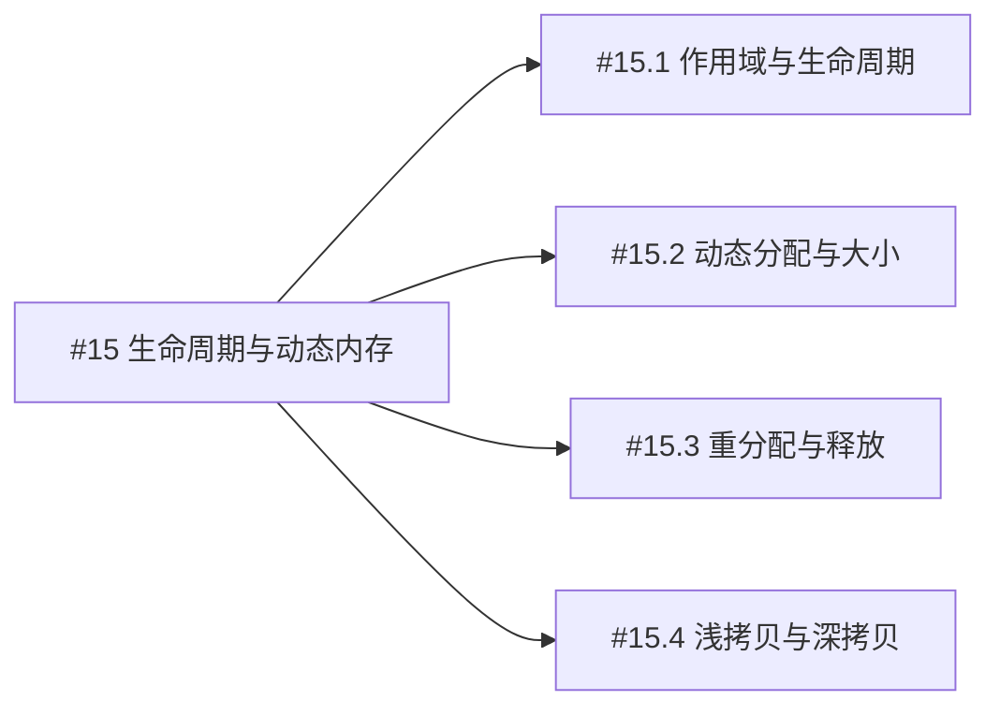

### 15.1 作用域与生命周期

> [!note]- 知识图与目录
>
> ```mermaid
> flowchart LR
>   R["#15.1 作用域与生命周期"]
>   N0["#737. C对象不等于面向对象实例"]
>   R --> N0
>   N1["#738. 作用域限定名字可用位置"]
>   R --> N1
>   N2["#739. 生存期决定对象何时存在"]
>   R --> N2
>   N3["#740. 作用域与存储期不等同"]
>   R --> N3
>   N4["#741. 普通自动对象随块执行存活"]
>   R --> N4
>   N5["#742. 局部变量不必每次调用新建"]
>   R --> N5
>   N6["#743. 自动对象每次执行重新初始化"]
>   R --> N6
>   N7["#744. static局部值跨调用保留"]
>   R --> N7
>   N8["#745. 静态对象在程序启动前初始化"]
>   R --> N8
>   class R,N0,N1,N2,N3,N4,N5,N6,N7,N8 internal-link;
> ```
>
> ```mermaid
> flowchart LR
>   R["#15.1 作用域与生命周期"]
>   N0["#746. 静态局部适合封装跨调用状态"]
>   R --> N0
>   N1["#747. 参数接口可操作隐藏状态"]
>   R --> N1
>   N2["#748. 静态对象生存期贯穿程序"]
>   R --> N2
>   N3["#749. 线程存储期每线程一份"]
>   R --> N3
>   N4["#750. 分配对象不随创建函数返回消失"]
>   R --> N4
>   N5["#751. 返回自动数组地址不会延寿"]
>   R --> N5
>   N6["#752. 返回动态字符串转移释放责任"]
>   R --> N6
>   N7["#753. 安全返回取决于所指对象生存期"]
>   R --> N7
>   N8["#754. static局部地址可在返回后使用"]
>   R --> N8
>   class R,N0,N1,N2,N3,N4,N5,N6,N7,N8 internal-link;
> ```
>
> ```mermaid
> flowchart LR
>   R["#15.1 作用域与生命周期"]
>   N0["#755. 对象存在不表示名字到处可见"]
>   R --> N0
>   N1["#756. 返回指针可修改同一静态对象"]
>   R --> N1
>   N2["#757. 静态对象无需永久指针维持存在"]
>   R --> N2
>   N3["#758. 不再访问静态对象不是动态泄漏"]
>   R --> N3
>   N4["#759. 静态对象地址不能交给free"]
>   R --> N4
>   N5["#760. CPU寄存器是硬件存储位置"]
>   R --> N5
>   N6["#761. register只是访问优化建议"]
>   R --> N6
>   N7["#762. register对象不能使用取地址运算符"]
>   R --> N7
>   class R,N0,N1,N2,N3,N4,N5,N6,N7 internal-link;
> ```
>
> - [[#737. C对象不等于面向对象实例|737. C对象不等于面向对象实例]]
> - [[#738. 作用域限定名字可用位置|738. 作用域限定名字可用位置]]
> - [[#739. 生存期决定对象何时存在|739. 生存期决定对象何时存在]]
> - [[#740. 作用域与存储期不等同|740. 作用域与存储期不等同]]
> - [[#741. 普通自动对象随块执行存活|741. 普通自动对象随块执行存活]]
> - [[#742. 局部变量不必每次调用新建|742. 局部变量不必每次调用新建]]
> - [[#743. 自动对象每次执行重新初始化|743. 自动对象每次执行重新初始化]]
> - [[#744. static局部值跨调用保留|744. static局部值跨调用保留]]
> - [[#745. 静态对象在程序启动前初始化|745. 静态对象在程序启动前初始化]]
> - [[#746. 静态局部适合封装跨调用状态|746. 静态局部适合封装跨调用状态]]
> - [[#747. 参数接口可操作隐藏状态|747. 参数接口可操作隐藏状态]]
> - [[#748. 静态对象生存期贯穿程序|748. 静态对象生存期贯穿程序]]
> - [[#749. 线程存储期每线程一份|749. 线程存储期每线程一份]]
> - [[#750. 分配对象不随创建函数返回消失|750. 分配对象不随创建函数返回消失]]
> - [[#751. 返回自动数组地址不会延寿|751. 返回自动数组地址不会延寿]]
> - [[#752. 返回动态字符串转移释放责任|752. 返回动态字符串转移释放责任]]
> - [[#753. 安全返回取决于所指对象生存期|753. 安全返回取决于所指对象生存期]]
> - [[#754. static局部地址可在返回后使用|754. static局部地址可在返回后使用]]
> - [[#755. 对象存在不表示名字到处可见|755. 对象存在不表示名字到处可见]]
> - [[#756. 返回指针可修改同一静态对象|756. 返回指针可修改同一静态对象]]
> - [[#757. 静态对象无需永久指针维持存在|757. 静态对象无需永久指针维持存在]]
> - [[#758. 不再访问静态对象不是动态泄漏|758. 不再访问静态对象不是动态泄漏]]
> - [[#759. 静态对象地址不能交给free|759. 静态对象地址不能交给free]]
> - [[#760. CPU寄存器是硬件存储位置|760. CPU寄存器是硬件存储位置]]
> - [[#761. register只是访问优化建议|761. register只是访问优化建议]]
> - [[#762. register对象不能使用取地址运算符|762. register对象不能使用取地址运算符]]

#### 737. C对象不等于面向对象实例

C术语里的对象不要求方法、继承或类。一个普通 `int` 变量、数组和结构体都可以是对象；不要因“对象”一词误套另一种语言范式。

#### 738. 作用域限定名字可用位置

作用域回答源代码里哪些位置可使用这个名字。可以把名字想成房门铭牌：在当前代码位置看不到这块铭牌，不等于对应的房间已不存在。

#### 739. 生存期决定对象何时存在

生存期回答运行过程中对象何时存在、何时可合法访问。房间已经拆掉，留下地址也不能继续进去；指针存在不等于其目标仍存在。

#### 740. 作用域与存储期不等同

作用域管名字在哪里能写，存储期管对应存储持续多久。静态局部对象能在函数返回后存在，但局部名字仍不能在外部直接使用；链接则是另一个关于声明身份的问题，见 [[#19.3 链接与模块边界|作用域与链接]]。

#### 741. 普通自动对象随块执行存活

通常的非VLA自动对象，其生存期从进入关联块到离开块；初始化在执行到声明时进行。递归再次进入块会有本次执行自己的对象。VLA从执行其声明起持续到离开相应作用域，不能把两种起点无条件混说。

#### 742. 局部变量不必每次调用新建

“局部”说的是名字范围，不等于“自动”。带 `static` 的局部对象在不同调用间持续是同一个对象；判断是否每次各一份，必须看存储期。

#### 743. 自动对象每次执行重新初始化

每次调用执行到 `int x = 10` 都初始化本次对象，所以随后加一，连续三次调用都输出 `11`，不是 `11, 12, 13`。

```c
#include <stdio.h>

void automaticExample(void)
{
    int x = 10;
    ++x;
    printf("%d\n", x);
}
```

#### 744. static局部值跨调用保留

静态局部一直是同一个对象，修改不会因返回函数而自动丢失。连续三次调用下面函数输出 `11, 12, 13`；这里约定调用次数不导致整数越界。

```c
#include <stdio.h>

void staticExample(void)
{
    static int x = 10;
    ++x;
    printf("%d\n", x);
}
```

#### 745. 静态对象在程序启动前初始化

静态存储期对象按C规则在程序启动前完成初始化，之后不会每次调用重新初始化；未显式给值的静态整数也得到零。不要误套C++局部静态对象首次走到声明才动态初始化的模型。

#### 746. 静态局部适合封装跨调用状态

函数要记住上次状态，又希望局部名字不暴露到外部时，可使用static局部对象。调用计数、连续编号、小型状态与共享缓存都是这一情景的例子。

#### 747. 参数接口可操作隐藏状态

外部不能直接写局部名字，却可调用函数约定的操作接口。依次执行 `updateState(0)`、`updateState(0)`、`updateState(1)`，输出 `1, 2, 10`。

```c
#include <stdio.h>

void updateState(int mode)
{
    static int value = 0;
    if (mode == 1)
        value = 10;
    else
        ++value;
    printf("%d\n", value);
}
```

#### 748. 静态对象生存期贯穿程序

文件作用域对象以及块作用域的static对象都具有静态存储期，持续整个程序执行期间；static局部的名字仍受块作用域限制。

#### 749. 线程存储期每线程一份

为补全C23存储期分类，还要区分 `thread_local` 对象：每个线程有自己一份，生存期贯穿该线程执行。它既不是每次函数调用一份，也不是所有线程共享同一普通静态对象。

#### 750. 分配对象不随创建函数返回消失

局部指针变量可随本次函数返回结束，但成功分配的对象持续到 `free` 或相应 `realloc` 处理。对象是否继续存在，不取决于创建它的那次调用是否还在栈上。

#### 751. 返回自动数组地址不会延寿

下列是错误示例：局部数组在返回后结束生存期，随后通过返回指针访问它属于未定义行为；一次运行似乎还能打印不构成合法性证明。

```c
/* 错误：函数返回后，text 的生存期已经结束。 */
char *badText(void)
{
    char text[] = "HELLO";
    return text;
}
```

#### 752. 返回动态字符串转移释放责任

分配成功后返回动态字符串，调用者检查非空、使用并最终free。局部指针变量结束，不会释放它曾指向的动态对象。

```c
#include <stdlib.h>
#include <string.h>

char *makeText(void)
{
    char *p = malloc(sizeof "HELLO");
    if (p == NULL)
        return NULL;
    memcpy(p, "HELLO", sizeof "HELLO");
    return p;
}
```

#### 753. 安全返回取决于所指对象生存期

同样是返回地址，自动数组、静态对象、动态对象和调用者提供的数组有不同后续有效期。先问地址指向什么、由谁管理，而不是只问“这个指针变量是不是局部的”。字符串字面量还要遵守不可修改内容的边界。

#### 754. static局部地址可在返回后使用

```c
int *makeNumber(void)
{
    static int number = 42;
    return &number;
}
```

现在 `number` 仍然是在函数内部声明的，作用域没有变。

但是，由于增加了 `static`，它具有静态存储期：对象会一直存在到程序结束，而不是在函数返回时结束生存期。

所以：

```c
int *p = makeNumber();

printf("%d", *p);  // 42
```

这是合法的。

普通 `int number = 42` 与 `static int number = 42` 是两种独立声明示例，不能同名写在同一作用域里。

#### 755. 对象存在不表示名字到处可见

函数返回后，static局部对象还在，但外部不能直接使用它的局部名字；可以通过返回指针或函数接口访问。看不到铭牌，不等于房间被拆掉。

#### 756. 返回指针可修改同一静态对象

返回的是同一静态对象的地址，外部 `*p = 10` 改的就是它；下一次调用继续该状态。

```c
#include <stdio.h>

int *counter(void)
{
    static int value = 0;
    ++value;
    return &value;
}

int main(void)
{
    int *p = counter();  /* value 成为 1 */
    *p = 10;             /* 修改同一个静态对象 */
    printf("%d\n", *p);          /* 10 */
    printf("%d\n", *counter());  /* 11 */
    return 0;
}
```

#### 757. 静态对象无需永久指针维持存在

没有一个长期指针变量保存地址，静态对象也依然存在；函数再次执行时可以重新取得其地址。与丢失动态分配最后句柄不同，它的生存期不是靠地址簿保住的。

#### 758. 不再访问静态对象不是动态泄漏

以后不再使用static局部对象，它仍按语言规定存在到程序结束。保留了无用状态可能浪费空间，但不等于遗忘释放malloc对象；二者资源管理机制不同。

#### 759. 静态对象地址不能交给free

静态对象不由malloc家族获得，无需free，也不能对 `&staticObject` 调用free。是否拥有一个可取得的地址，与它是否满足free契约是不同问题。

#### 760. CPU寄存器是硬件存储位置

CPU内部的寄存器是速度很快的硬件存储位置；C关键字register与这个历史优化动机有关，但不能把一个语言声明直接等同于实际硬件分配结果。

#### 761. register只是访问优化建议

`register int index` 建议尽可能快速访问，实际是否放入CPU寄存器由实现决定，现代编译器也会自行优化。它不产生一个可由程序强制指定的硬件位置。

#### 762. register对象不能使用取地址运算符

C23仍禁止对register对象写 `&index`，即使编译器事实上把它放在普通内存。历史上的寄存器动机帮助记忆，但真正适用的是语言约束，而不是运行后查看它是否进了寄存器。

作为上述规则的对照：

|声明方式|是否跨函数调用保留局部变量的值|能否直接使用 `&` 取地址|
|---|---|---|
|`int x` / `auto int x`|否|能|
|`register int x`|否|不能|
|`static int x`|是|能|

### 15.2 动态分配与大小

> [!note]- 知识图与目录
>
> ```mermaid
> flowchart LR
>   R["#15.2 动态分配与大小"]
>   N0["#763. 动态内存函数声明在stdlib"]
>   R --> N0
>   N1["#764. malloc参数是字节数"]
>   R --> N1
>   N2["#765. 分配失败先检查空指针"]
>   R --> N2
>   N3["#766. malloc不会自动初始化内容"]
>   R --> N3
>   N4["#767. 动态对象主要靠地址找到"]
>   R --> N4
>   N5["#768. sizeof指针与所指对象不同"]
>   R --> N5
>   N6["#769. sizeof len与len数值不同"]
>   R --> N6
>   N7["#770. 元素数量乘大小先查溢出"]
>   R --> N7
>   N8["#771. 零大小分配不提供可访问元素"]
>   R --> N8
>   class R,N0,N1,N2,N3,N4,N5,N6,N7,N8 internal-link;
> ```
>
> ```mermaid
> flowchart LR
>   R["#15.2 动态分配与大小"]
>   N0["#772. calloc将分配区域位清零"]
>   R --> N0
>   N1["#773. calloc与语言初始化不同"]
>   R --> N1
>   class R,N0,N1 internal-link;
> ```
>
> - [[#763. 动态内存函数声明在stdlib|763. 动态内存函数声明在stdlib]]
> - [[#764. malloc参数是字节数|764. malloc参数是字节数]]
> - [[#765. 分配失败先检查空指针|765. 分配失败先检查空指针]]
> - [[#766. malloc不会自动初始化内容|766. malloc不会自动初始化内容]]
> - [[#767. 动态对象主要靠地址找到|767. 动态对象主要靠地址找到]]
> - [[#768. sizeof指针与所指对象不同|768. sizeof指针与所指对象不同]]
> - [[#769. sizeof len与len数值不同|769. sizeof len与len数值不同]]
> - [[#770. 元素数量乘大小先查溢出|770. 元素数量乘大小先查溢出]]
> - [[#771. 零大小分配不提供可访问元素|771. 零大小分配不提供可访问元素]]
> - [[#772. calloc将分配区域位清零|772. calloc将分配区域位清零]]
> - [[#773. calloc与语言初始化不同|773. calloc与语言初始化不同]]

#### 763. 动态内存函数声明在stdlib

`malloc`、`calloc`、`realloc`、`free` 的声明由 `<stdlib.h>` 提供。C中malloc返回的 `void *` 可转换为适当对象指针，不必为普通对象分配额外写强制类型转换。

#### 764. malloc参数是字节数

malloc在运行时申请指定字节数，成功给出分配存储的起始地址；`malloc(sizeof *p)` 表达为一个所指类型对象准备存储。

#### 765. 分配失败先检查空指针

malloc可能失败并返回空指针，必须在解引用或初始化成员前判断。先检查，再给完整节点设置语义值，成功后才交给其他代码使用。

```c
#include <stdlib.h>

struct Item {
    int value;
    struct Item *next;
};

struct Item *makeItem(int value)
{
    struct Item *p = malloc(sizeof *p);
    if (p == NULL)
        return NULL;
    p->value = value;
    p->next = NULL;
    return p;
}
```

#### 766. malloc不会自动初始化内容

租到一间空房，不代表里面已有零值家具。malloc得到的存储没有自动建立 `value == 0` 或 `next == NULL` 的保证；先显式初始化，再读取成员。

#### 767. 动态对象主要靠地址找到

动态分配对象不像 `struct Node a` 那样必然有一个直接命名该对象的源码变量名；程序通常通过保存的指针访问它。指针变量与所指对象是两层关系，覆盖指针不等于结束目标生存期。

#### 768. sizeof指针与所指对象不同

`sizeof p` 是指针对象大小，`sizeof *p` 是所指类型对象大小；为一个节点分配空间时通常需要后者。它跟着类型走，改指针目标类型时较不容易遗漏分配大小。

这里询问所指类型，不会真的读取普通非VLA目标，见 [[#37. sizeof 通常不求值|sizeof 通常不求值]]。

#### 769. sizeof len与len数值不同

如果某实现 `sizeof(size_t) == 8` 且 `size_t len = 20`，`malloc(sizeof len)` 申请8字节，`malloc(len)` 申请20字节。前者问变量自身的类型大小，后者把变量当前值当请求数量，二者不能互换。

#### 770. 元素数量乘大小先查溢出

`count * sizeof *p` 在size_t中环绕，可能把大需求变成小分配；随后按原数量写入仍会越界。相乘前用除法界限检查，零数量由本接口主动处理。

```c
#include <stdint.h>
#include <stdlib.h>

int *allocateInts(size_t count)
{
    if (count == 0)
        return NULL;  /* 此接口用 NULL 表示空数组。 */
    int *p;
    if (count > SIZE_MAX / sizeof *p)
        return NULL;
    return malloc(count * sizeof *p);
}
```

#### 771. 零大小分配不提供可访问元素

malloc等零大小请求可返回空指针或可供释放的非空指针；非空也不表示那里有一个可访问元素。程序可直接在接口层把零长度表示为NULL，避开依赖实现的返回差异。

#### 772. calloc将分配区域位清零

calloc按对象数量与单对象大小申请存储，并将分配区域所有位清零。这里整数元素成功后为零，仍要检查失败。

```c
#include <stdlib.h>

int *zeroInts(size_t n)
{
    if (n == 0)
        return NULL;
    return calloc(n, sizeof(int));
}
```

#### 773. calloc与语言初始化不同

全零位模式不保证所有指针类型都表示空指针，也不能不加条件概括任意浮点表示。`struct Node x = {0}` 则按成员类型进行语言级初始化。需要动态节点尾链接时，显式写 `p->next = NULL` 表达最清楚。

### 15.3 重分配与释放

> [!note]- 知识图与目录
>
> ```mermaid
> flowchart LR
>   R["#15.3 重分配与释放"]
>   N0["#774. realloc可能改变地址"]
>   R --> N0
>   N1["#775. realloc保留较小长度的旧内容"]
>   R --> N1
>   N2["#776. 非零realloc失败保留旧分配"]
>   R --> N2
>   N3["#777. 临时指针防止丢失原句柄"]
>   R --> N3
>   N4["#778. C23不能用realloc零大小释放"]
>   R --> N4
>   N5["#779. 安全调整动态数组的接口"]
>   R --> N5
>   N6["#780. free释放对象但不自动清空句柄"]
>   R --> N6
>   N7["#781. 释放后别名成为失效指针"]
>   R --> N7
>   N8["#782. 同一分配不能重复free"]
>   R --> N8
>   class R,N0,N1,N2,N3,N4,N5,N6,N7,N8 internal-link;
> ```
>
> ```mermaid
> flowchart LR
>   R["#15.3 重分配与释放"]
>   N0["#783. free空指针合法"]
>   R --> N0
>   N1["#784. free只接受有效分配起点"]
>   R --> N1
>   N2["#785. 指针置空不会释放存储"]
>   R --> N2
>   N3["#786. 丢失最后释放途径形成泄漏"]
>   R --> N3
>   class R,N0,N1,N2,N3 internal-link;
> ```
>
> - [[#774. realloc可能改变地址|774. realloc可能改变地址]]
> - [[#775. realloc保留较小长度的旧内容|775. realloc保留较小长度的旧内容]]
> - [[#776. 非零realloc失败保留旧分配|776. 非零realloc失败保留旧分配]]
> - [[#777. 临时指针防止丢失原句柄|777. 临时指针防止丢失原句柄]]
> - [[#778. C23不能用realloc零大小释放|778. C23不能用realloc零大小释放]]
> - [[#779. 安全调整动态数组的接口|779. 安全调整动态数组的接口]]
> - [[#780. free释放对象但不自动清空句柄|780. free释放对象但不自动清空句柄]]
> - [[#781. 释放后别名成为失效指针|781. 释放后别名成为失效指针]]
> - [[#782. 同一分配不能重复free|782. 同一分配不能重复free]]
> - [[#783. free空指针合法|783. free空指针合法]]
> - [[#784. free只接受有效分配起点|784. free只接受有效分配起点]]
> - [[#785. 指针置空不会释放存储|785. 指针置空不会释放存储]]
> - [[#786. 丢失最后释放途径形成泄漏|786. 丢失最后释放途径形成泄漏]]

#### 774. realloc可能改变地址

调整大小可能移动存储。成功后使用返回的新指针，旧指针及其旧存储别名不能继续依赖，即使地址数值看起来没有变化；别名管理是重分配接口的一部分。

#### 775. realloc保留较小长度的旧内容

成功重分配保留新旧大小中较小范围内的内容；扩展区域没有因此自动初始化。扩容后的新增元素应在读取前另行赋值，缩容也不能继续访问已超出新范围的旧元素。

#### 776. 非零realloc失败保留旧分配

非零大小请求失败返回NULL，原分配仍有效。失败状态与旧对象是否还存在要分清，调用者可以继续使用或释放原对象。

#### 777. 临时指针防止丢失原句柄

先用临时指针接realloc结果，成功才更新正式句柄。像换房暂存新钥匙：没换成，旧钥匙还在。直接 `p = realloc(p, bytes)` 失败时会覆盖唯一旧地址，可能泄漏。

#### 778. C23不能用realloc零大小释放

C23中 `realloc(p, 0)` 是未定义行为，不能沿用某些旧版教材或实现的零大小效果。要清空动态数组，应明确free并把拥有者指针置空。

#### 779. 安全调整动态数组的接口

此函数在零数量时明确释放，在乘法不可表示或分配失败时保留原句柄，成功才提交新指针。`pp` 必须指向有效拥有者变量，`*pp` 为NULL或尚未释放的分配起点。

```c
#include <stdint.h>
#include <stdlib.h>

int resizeInts(int **pp, size_t count)
{
    if (count == 0) {
        free(*pp);
        *pp = NULL;
        return 1;
    }
    if (count > SIZE_MAX / sizeof **pp)
        return 0;
    int *temporary = realloc(*pp, count * sizeof **pp);
    if (temporary == NULL)
        return 0;
    *pp = temporary;
    return 1;
}
```

#### 780. free释放对象但不自动清空句柄

free释放动态存储，不会替所有有关指针变量执行 `p = NULL`。释放的是它们曾共同指向的对象，指针变量本身仍是独立对象。

#### 781. 释放后别名成为失效指针

原对象结束后，指向它的旧指针值变成不确定，不能继续解引用、重复释放或依赖比较结果。可以直接给各句柄赋NULL覆盖旧值；只清一个句柄不会自动清其他别名。

```c
#include <stdlib.h>

void releaseExample(void)
{
    int *p = malloc(sizeof *p);
    if (p == NULL)
        return;
    int *q = p;
    *p = 10;
    free(p);
    p = NULL;
    q = NULL;  /* 覆盖这个别名，不再读取其已失效的旧值。 */
}
```

#### 782. 同一分配不能重复free

两个指针复制同一分配地址，不产生两份独立所有权。通过一个释放后，不能再通过另一个释放同一块；重复释放属于未定义行为。

#### 783. free空指针合法

`free(NULL)` 合法且不做事。它方便把已清空的拥有者交给统一清理路径，但不能把“已释放的旧指针”误当成已经自动为NULL。

#### 784. free只接受有效分配起点

非空实参必须是匹配分配函数取得、尚未释放的分配起点。自动数组、静态对象、字符串字面量、数组中间位置都不符合；能取得地址不代表能释放。

#### 785. 指针置空不会释放存储

`p = NULL` 只改指针变量，分配对象仍占着存储；`free(p)` 才执行对应释放。先丢最后地址再置空，无法靠空指针把旧对象找回来。

#### 786. 丢失最后释放途径形成泄漏

租来的房还在，最后一把钥匙却扔了，不能算退租。程序失去所有可用访问与释放途径，而动态分配仍未释放，就是典型内存泄漏；接口应明确谁创建、谁最终释放、失败时谁清理。

### 15.4 浅拷贝与深拷贝

> [!note]- 知识图与目录
>
> ```mermaid
> flowchart LR
>   R["#15.4 浅拷贝与深拷贝"]
>   N0["#787. 指针成员赋值只复制地址"]
>   R --> N0
>   N1["#788. 成员访问先于外侧解引用"]
>   R --> N1
>   N2["#789. 数组成员与指针目标复制不同"]
>   R --> N2
>   N3["#790. 深拷贝先准备独立存储"]
>   R --> N3
>   N4["#791. 深拷贝没有特殊赋值运算符"]
>   R --> N4
>   N5["#792. 字符串副本应预留终止符"]
>   R --> N5
>   N6["#793. 独立字符串副本互不影响"]
>   R --> N6
>   N7["#794. 记录克隆成功后再交出结果"]
>   R --> N7
>   class R,N0,N1,N2,N3,N4,N5,N6,N7 internal-link;
> ```
>
> - [[#787. 指针成员赋值只复制地址|787. 指针成员赋值只复制地址]]
> - [[#788. 成员访问先于外侧解引用|788. 成员访问先于外侧解引用]]
> - [[#789. 数组成员与指针目标复制不同|789. 数组成员与指针目标复制不同]]
> - [[#790. 深拷贝先准备独立存储|790. 深拷贝先准备独立存储]]
> - [[#791. 深拷贝没有特殊赋值运算符|791. 深拷贝没有特殊赋值运算符]]
> - [[#792. 字符串副本应预留终止符|792. 字符串副本应预留终止符]]
> - [[#793. 独立字符串副本互不影响|793. 独立字符串副本互不影响]]
> - [[#794. 记录克隆成功后再交出结果|794. 记录克隆成功后再交出结果]]

#### 787. 指针成员赋值只复制地址

`a`与`b`仍是两个结构体，但指针成员可能都指向同一个目标：

```c
/* 局部对象声明放入函数体；类型定义可放文件作用域。 */
struct Data { int *p; };
int x = 10;
struct Data a = {&x};
struct Data b = a;
```

```text
a.p ──┐
      ├──→ 同一个 x = 10
b.p ──┘
```

修改 `*a.p`，通过 `b.p` 也会看到变化；没有额外复制一份int对象。

#### 788. 成员访问先于外侧解引用

|表达式|含义|是否合法|
|---|---|---|
|`b.p`|读取结构体 `b` 的指针成员|合法|
|`*(b.p)`|解引用该成员，访问 `x`|合法|
|`*b.p`|与 `*(b.p)` 完全相同|合法|
|`(*b).p`|试图先解引用 `b`|不合法，因为 `b` 是结构体变量，不是指针|
只有当 `b` 本身是结构体指针时，`(*b).p` 才有意义，此时也可以写成 `b->p`。

#### 789. 数组成员与指针目标复制不同

结构体整体赋值会复制数组成员内容，却不会自动复制指针指向的数据。副本的 `fields[0]` 可独立修改，而两个 `name` 仍可指向同一字符数组。

```c
struct Record {
    int fields[2];
    char *name;
};

void shallowExample(void)
{
    char text[] = "CAT";
    struct Record a = {{1, 2}, text};
    struct Record b = a;
    b.fields[0] = 9;  /* a.fields[0] 仍是 1。 */
    b.name[0] = 'B';  /* a.name 也看到 "BAT"。 */
}
```

#### 790. 深拷贝先准备独立存储

深拷贝先为关联数据取得独立存储，再复制内容，让新指针指向新数据。像复印资料卡时，除了抄写仓库地址，还真正另外建了一个存放相同货物的仓库。

#### 791. 深拷贝没有特殊赋值运算符

C的 `b = a` 不会自动按业务所有权遍历指针并复制整片关联对象。深拷贝是程序员依数据结构主动实现的过程，不是另一种隐藏在等号里的通用赋值。

作为上述规则的对照：

| 比较方面 | 浅拷贝 | 深拷贝 |
|---|---|---|
|复制指针保存的地址|是|通常会为副本设置新地址|
|复制指针指向的数据|否|是|
|复制后是否共用原数据|是|否|
|修改原数据是否可能影响副本|可能|两份独立数据通常互不影响|

注意：深拷贝需要程序员根据实际数据类型、内存分配方式等自行实现；在 C 中，简单的 `b = a` 不会自动替指针成员进行深拷贝。

你可以记住两句话：

浅拷贝：复制地址，不复制地址指向的数据。

深拷贝：另外复制一份数据，再让副本的指针指向它。

#### 792. 字符串副本应预留终止符

字符串副本需 `strlen(p) + 1` 字节：strlen不计末尾空字符，加一为它留位置。这里p必须指向有效C字符串；更一般的大小计算仍要检查加法、乘法和目标容量。

#### 793. 独立字符串副本互不影响

复制后修改q得到FOG，p仍为DOG，说明有两块独立数据。分配成功才复制，最后释放自己获得的q。

```c
#include <stdio.h>
#include <stdlib.h>
#include <string.h>

int main(void)
{
    char text[] = "DOG";
    const char *p = text;
    size_t bytes = strlen(p) + 1;
    char *q = malloc(bytes);
    if (q == NULL)
        return EXIT_FAILURE;

    memcpy(q, p, bytes);  /* 连终止符一起复制到独立存储。 */
    q[0] = 'F';
    printf("%s\n%s\n", p, q);  /* DOG，然后 FOG。 */
    free(q);
    return EXIT_SUCCESS;
}
```

#### 794. 记录克隆成功后再交出结果

把独立分配和内容复制封装起来；分配失败不改输出，成功才提交完整副本。需要下方结构体定义，out不能与src重叠且尚不拥有资源；覆盖已有资源前须先明确旧所有权处理。

```c
#include <stdlib.h>
#include <string.h>

struct OwnedRecord {
    int fields[2];
    char *name;
};

/* src->name 是有效字符串；out 与 src 不重叠，且 out 尚不拥有资源。 */
int cloneRecord(const struct OwnedRecord *src, struct OwnedRecord *out)
{
    size_t bytes = strlen(src->name) + 1;
    char *name = malloc(bytes);
    if (name == NULL)
        return 0;
    memcpy(name, src->name, bytes);
    struct OwnedRecord copy = {{src->fields[0], src->fields[1]}, name};
    *out = copy;
    return 1;
}

void destroyRecord(struct OwnedRecord *record)
{
    free(record->name);
    record->name = NULL;
}
```

---

## 16 单链表

把结构体、指针和动态内存连起来：节点像车厢，next 保存下一节的地址，head 则记住入口。

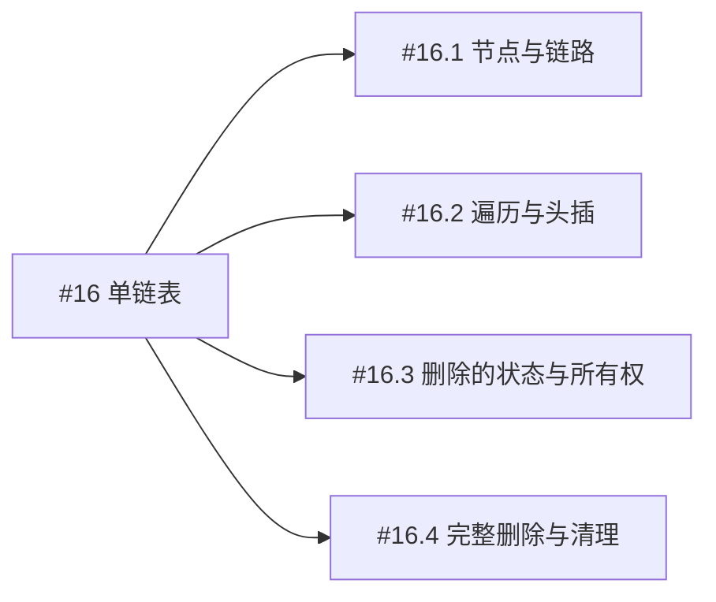

### 16.1 节点与链路

> [!note]- 知识图与目录
>
> ```mermaid
> flowchart LR
>   R["#16.1 节点与链路"]
>   N0["#795. 自引用结构体可含同类型指针"]
>   R --> N0
>   N1["#796. 节点不能直接包含自身对象"]
>   R --> N1
>   N2["#797. next保存下一节点地址"]
>   R --> N2
>   N3["#798. 尾节点以空指针结束"]
>   R --> N3
>   N4["#799. 空指针不能解引用成员"]
>   R --> N4
>   N5["#800. 链顺序取决于链接而非声明顺序"]
>   R --> N5
>   N6["#801. 入口可达性定义这条链"]
>   R --> N6
>   N7["#802. head只是首节点入口的常用名"]
>   R --> N7
>   N8["#803. head遍历指针与next是不同位置"]
>   R --> N8
>   class R,N0,N1,N2,N3,N4,N5,N6,N7,N8 internal-link;
> ```
>
> ```mermaid
> flowchart LR
>   R["#16.1 节点与链路"]
>   N0["#804. 移动书签不会移动节点"]
>   R --> N0
>   N1["#805. 修改next才是在改写链接"]
>   R --> N1
>   class R,N0,N1 internal-link;
> ```
>
> - [[#795. 自引用结构体可含同类型指针|795. 自引用结构体可含同类型指针]]
> - [[#796. 节点不能直接包含自身对象|796. 节点不能直接包含自身对象]]
> - [[#797. next保存下一节点地址|797. next保存下一节点地址]]
> - [[#798. 尾节点以空指针结束|798. 尾节点以空指针结束]]
> - [[#799. 空指针不能解引用成员|799. 空指针不能解引用成员]]
> - [[#800. 链顺序取决于链接而非声明顺序|800. 链顺序取决于链接而非声明顺序]]
> - [[#801. 入口可达性定义这条链|801. 入口可达性定义这条链]]
> - [[#802. head只是首节点入口的常用名|802. head只是首节点入口的常用名]]
> - [[#803. head遍历指针与next是不同位置|803. head遍历指针与next是不同位置]]
> - [[#804. 移动书签不会移动节点|804. 移动书签不会移动节点]]
> - [[#805. 修改next才是在改写链接|805. 修改next才是在改写链接]]

#### 795. 自引用结构体可含同类型指针

链表节点像一节车厢，data装货，next写下一节车厢的地址。定义中的struct Node尚未完整，但可用指向自身标签的指针作为成员。

```c
struct Node {
    int data;
    struct Node *next;
};
```

#### 796. 节点不能直接包含自身对象

如果成员直接是另一个 `struct Node` 对象，就要求内部再含一个同样对象，无限继续，无法构成完整有限对象；指针成员只存放链接，不在本节点内部嵌入下一整节节点。

#### 797. next保存下一节点地址

节点通过next构成路径，地址不要求连续。

```text
head → [10 | next] → [20 | next] → [30 | NULL]
```

next不是“自动找下一个变量”的命令，而是节点内部保存的一个指针值。

#### 798. 尾节点以空指针结束

尾节点next为NULL表示没有下一节点；NULL是空指针常量宏，不是一个真正可访问的空节点。空链的入口也可以为NULL。

#### 799. 空指针不能解引用成员

只有当前指针指向有效节点时，才能访问 `p->data` 或 `p->next`。p为NULL时再取成员属于未定义行为，不能靠节点中data是否为零来判断终点。

#### 800. 链顺序取决于链接而非声明顺序

即使依次声明a、b、c，也可让路径为a→c→b。下面自动节点只用于展示链接，在演示函数结束后不再存活，不能交给会free的动态删除函数。

```c
#include <stddef.h>

void linkExample(void)
{
    struct Node a = {10, NULL};
    struct Node b = {20, NULL};
    struct Node c = {30, NULL};
    a.next = &c;
    c.next = &b;
    struct Node *head = &a;
    /* 链表顺序为 10 → 30 → 20，由 next 而非声明顺序决定。 */
    (void)head;
}
```

该函数依赖本章完整struct Node定义。

#### 801. 入口可达性定义这条链

从head反复沿next能够走到的节点，才属于这个入口所表示的链；内存中还存在其他Node对象，不代表它们自动是这条链的成员。

#### 802. head只是首节点入口的常用名

head不是C关键字，通常是保存首节点地址的变量。变量名换成first也不会改变链表原理；真正重要的是它保管哪条链的入口。

#### 803. head遍历指针与next是不同位置

把head想成总地址簿、p想成当前页书签、next想成每页上写着的下一站地址：

```text
head：入口变量中的地址
p：   遍历变量中的地址
next：某个节点内部成员中的地址
```

它们可暂时保存同一地址，仍是不同的指针对象。

#### 804. 移动书签不会移动节点

`p = head` 复制入口地址；`p = p->next` 改的是p这个书签本身。节点并没有被复制到另一个位置，链内next也不会因p前进而自动改变。

#### 805. 修改next才是在改写链接

`p->next = q` 修改的是当前节点内部的指针成员，因此改变沿链可走到的下一站。它与仅让本地遍历变量p改指向不同，读代码时先找赋值左侧到底是哪一个对象。

### 16.2 遍历与头插

> [!note]- 知识图与目录
>
> ```mermaid
> flowchart LR
>   R["#16.2 遍历与头插"]
>   N0["#806. 遍历沿next逐站前进"]
>   R --> N0
>   N1["#807. 只读遍历通常保留head"]
>   R --> N1
>   N2["#808. 推进唯一入口可能丢失整链"]
>   R --> N2
>   N3["#809. 头插先连旧头再换入口"]
>   R --> N3
>   N4["#810. 反转头插赋值会产生自环"]
>   R --> N4
>   N5["#811. 动态头插失败时保留旧链"]
>   R --> N5
>   N6["#812. 新节点指针不能多取一层地址"]
>   R --> N6
>   N7["#813. 重复头插反转输入顺序"]
>   R --> N7
>   class R,N0,N1,N2,N3,N4,N5,N6,N7 internal-link;
> ```
>
> - [[#806. 遍历沿next逐站前进|806. 遍历沿next逐站前进]]
> - [[#807. 只读遍历通常保留head|807. 只读遍历通常保留head]]
> - [[#808. 推进唯一入口可能丢失整链|808. 推进唯一入口可能丢失整链]]
> - [[#809. 头插先连旧头再换入口|809. 头插先连旧头再换入口]]
> - [[#810. 反转头插赋值会产生自环|810. 反转头插赋值会产生自环]]
> - [[#811. 动态头插失败时保留旧链|811. 动态头插失败时保留旧链]]
> - [[#812. 新节点指针不能多取一层地址|812. 新节点指针不能多取一层地址]]
> - [[#813. 重复头插反转输入顺序|813. 重复头插反转输入顺序]]

#### 806. 遍历沿next逐站前进

先确认p不是NULL，读当前数据，再把书签移到下一站。入口为NULL就不进入循环。需要本章struct Node定义。

```c
#include <stdio.h>

void printList(const struct Node *head)
{
    const struct Node *p = head;
    while (p != NULL) {
        printf("%d ", p->data);
        p = p->next;
    }
    putchar('\n');
}
```

#### 807. 只读遍历通常保留head

想以后还能回到开头，就用单独的p遍历，把head保留。只有首节点真的改变，例如头插、删头时，才需要更新正式入口。

#### 808. 推进唯一入口可能丢失整链

不断执行 `head = head->next` 会把入口推进到终点。如果链拥有动态节点、其他地方也没有保留旧路径，而节点尚未释放，就失去释放途径。移动书签与保管资源入口应分清。

#### 809. 头插先连旧头再换入口

先 `newNode->next = head` 保存旧入口，再 `head = newNode`：

```text
原来：head → [20] → [30] → NULL
先接：newNode[10].next → 旧head
再换：head → [10] → [20] → [30] → NULL
```

像给车队最前面添一节，必须先知道旧首车厢在哪。

#### 810. 反转头插赋值会产生自环

若先 `head = newNode`，再 `newNode->next = head`，新节点会指向自己，旧链入口还可能丢失。错误来自覆盖旧信息后又把新入口误当旧入口，并不是malloc本身创建了环。

#### 811. 动态头插失败时保留旧链

先成功分配并初始化节点，再接入链；失败返回零，不改调用者入口。参数head是入口变量的地址，通过 `*head` 提交新首节点。需要本章struct Node定义。

```c
#include <stdlib.h>

int pushFront(struct Node **head, int value)
{
    if (head == NULL)
        return 0;
    struct Node *newNode = malloc(sizeof *newNode);
    if (newNode == NULL)
        return 0;
    newNode->data = value;
    newNode->next = *head;
    *head = newNode;
    return 1;
}
```

#### 812. 新节点指针不能多取一层地址

newNode已经是Node地址，接链时用它本身；`&newNode` 是局部指针变量的地址，类型为 `struct Node **`，不能当成 `struct Node *` 塞进next。

#### 813. 重复头插反转输入顺序

依次头插1、2、3，最终入口路径是3→2→1。头插没有错，但若题目要求保持原输入顺序，就要另选构建方式；不要把“最新项在最前”误读为保持输入顺序。

### 16.3 删除的状态与所有权

> [!note]- 知识图与目录
>
> ```mermaid
> flowchart LR
>   R["#16.3 删除的状态与所有权"]
>   N0["#814. 动态删除要求节点可被释放"]
>   R --> N0
>   N1["#815. 释放前先保存后继信息"]
>   R --> N1
>   N2["#816. 释放后再读next是错误机制"]
>   R --> N2
>   N3["#817. 删除非头节点先让前驱绕过"]
>   R --> N3
>   N4["#818. previous表示最后保留的前驱"]
>   R --> N4
>   N5["#819. 保留节点时两个书签都前进"]
>   R --> N5
>   N6["#820. 删除头节点改入口变量"]
>   R --> N6
>   N7["#821. 头与非头都改原来的入链位置"]
>   R --> N7
>   class R,N0,N1,N2,N3,N4,N5,N6,N7 internal-link;
> ```
>
> - [[#814. 动态删除要求节点可被释放|814. 动态删除要求节点可被释放]]
> - [[#815. 释放前先保存后继信息|815. 释放前先保存后继信息]]
> - [[#816. 释放后再读next是错误机制|816. 释放后再读next是错误机制]]
> - [[#817. 删除非头节点先让前驱绕过|817. 删除非头节点先让前驱绕过]]
> - [[#818. previous表示最后保留的前驱|818. previous表示最后保留的前驱]]
> - [[#819. 保留节点时两个书签都前进|819. 保留节点时两个书签都前进]]
> - [[#820. 删除头节点改入口变量|820. 删除头节点改入口变量]]
> - [[#821. 头与非头都改原来的入链位置|821. 头与非头都改原来的入链位置]]

#### 814. 动态删除要求节点可被释放

本章会free节点的删除函数要求无环且节点来自有效的独立动态分配，链表拥有这些节点，删除后外部不再使用旧别名。自动节点演示只用于连链，不满足free契约。

#### 815. 释放前先保存后继信息

节点一旦free，就不能再依赖它提供下一站。先将 `current->next` 保存在仍有效的局部指针中，再改链与释放；“记下一站”必须发生在对象生存期结束之前。

#### 816. 释放后再读next是错误机制

以下是错误示例，current已经不再指向一个可访问节点：

```c
/* 错误：释放后读取旧对象。 */
free(current);
current = current->next;
```

看起来只是为了前进，实际仍执行了解引用；赋值目标合法不能修复右侧的失效访问。

#### 817. 删除非头节点先让前驱绕过

让previous的next接到current后继，再释放current：

```c
/* 函数内片段：previous、current均有效，current由链表拥有。 */
struct Node *next = current->next;
previous->next = next;
free(current);
current = next;
```

像拆车厢，先接通前后两节，再把中间一节交还。

#### 818. previous表示最后保留的前驱

previous指向已处理部分最后一个保留节点；若尚无保留节点，它为NULL。current指向当前待审查项或终点。非空前驱存在时，通常保持 `previous->next == current`。

#### 819. 保留节点时两个书签都前进

确认current保留后，执行 `previous = current`，再 `current = current->next`。前驱追到刚处理完的节点，当前书签去下一站；两句顺序反过来会改变“前驱”身份。

#### 820. 删除头节点改入口变量

头节点没有普通前驱，因此改 `head = current->next`；不能在previous为NULL时写 `previous->next`。删头的特殊性来自保存入口的链接位置不同。

#### 821. 头与非头都改原来的入链位置

删除的共同本质是改写“原本指向current的那个指针”。头节点对应head变量，非头节点对应前驱内部next成员；理解存放地址的位置，才能统一推导两种情况。

### 16.4 完整删除与清理

> [!note]- 知识图与目录
>
> ```mermaid
> flowchart LR
>   R["#16.4 完整删除与清理"]
>   N0["#822. 删除首个匹配找到即停"]
>   R --> N0
>   N1["#823. 首删未命中保持原链"]
>   R --> N1
>   N2["#824. 搜索先检查指针再读成员"]
>   R --> N2
>   N3["#825. 删除分支不推进previous"]
>   R --> N3
>   N4["#826. 删除全部匹配扫描到终点"]
>   R --> N4
>   N5["#827. 返回新入口必须由调用者接回"]
>   R --> N5
>   N6["#828. 二级指针可统一定位待改链接"]
>   R --> N6
>   N7["#829. 销毁整链每个节点释放一次"]
>   R --> N7
>   N8["#830. 清空入口不等于销毁链"]
>   R --> N8
>   class R,N0,N1,N2,N3,N4,N5,N6,N7,N8 internal-link;
> ```
>
> ```mermaid
> flowchart LR
>   R["#16.4 完整删除与清理"]
>   N0["#831. 删除不替外部节点别名置空"]
>   R --> N0
>   N1["#832. 删除循环每条路径都要推进"]
>   R --> N1
>   N2["#833. 构建失败也要清理已建部分"]
>   R --> N2
>   class R,N0,N1,N2 internal-link;
> ```
>
> - [[#822. 删除首个匹配找到即停|822. 删除首个匹配找到即停]]
> - [[#823. 首删未命中保持原链|823. 首删未命中保持原链]]
> - [[#824. 搜索先检查指针再读成员|824. 搜索先检查指针再读成员]]
> - [[#825. 删除分支不推进previous|825. 删除分支不推进previous]]
> - [[#826. 删除全部匹配扫描到终点|826. 删除全部匹配扫描到终点]]
> - [[#827. 返回新入口必须由调用者接回|827. 返回新入口必须由调用者接回]]
> - [[#828. 二级指针可统一定位待改链接|828. 二级指针可统一定位待改链接]]
> - [[#829. 销毁整链每个节点释放一次|829. 销毁整链每个节点释放一次]]
> - [[#830. 清空入口不等于销毁链|830. 清空入口不等于销毁链]]
> - [[#831. 删除不替外部节点别名置空|831. 删除不替外部节点别名置空]]
> - [[#832. 删除循环每条路径都要推进|832. 删除循环每条路径都要推进]]
> - [[#833. 构建失败也要清理已建部分|833. 构建失败也要清理已建部分]]

#### 822. 删除首个匹配找到即停

先搜索，找到后只断链和释放一次，返回可能改变的新入口。需要struct Node定义及动态所有权前提。

```c
#include <stdlib.h>

struct Node *deleteFirst(struct Node *head, int target)
{
    struct Node *previous = NULL;
    struct Node *current = head;
    while (current != NULL && current->data != target) {
        previous = current;
        current = current->next;
    }
    if (current == NULL)
        return head;
    if (previous == NULL)
        head = current->next;
    else
        previous->next = current->next;
    free(current);
    return head;
}
```

口诀：**先找；没找返头；删头改头，非头改前；释放返头。**

#### 823. 首删未命中保持原链

搜索结束current为NULL表示未找到，直接返回原head，不释放任何节点。若current有效且previous为NULL则命中头，否则命中非头；这些状态来自搜索不变量。

#### 824. 搜索先检查指针再读成员

条件写 `current != NULL && current->data != target`。左边为假就短路，右边不访问成员；把两部分倒过来会在空链或走到终点时先解引用空指针。

#### 825. 删除分支不推进previous

删除的节点不能成为“最后一个保留节点”，所以current去下一站，previous原地不动。连续匹配尤其能检验这个规则。

```text
7 → 7 → 2 → 7 → 3，删全部7
先连删两个头：previous一直为NULL，head逐次推进到2
保留2：previous才指向2
再删中间7：让2.next接到3
结果：2 → 3
```

记法：**删：记、接、放、走；留：前追、当前走。**

#### 826. 删除全部匹配扫描到终点

找到一个目标后仍继续，空链与全匹配都沿同一状态规则处理。时间O(n)，额外空间O(1)，最终返回更新的入口。

```c
#include <stdlib.h>

struct Node *deleteAll(struct Node *head, int target)
{
    struct Node *previous = NULL;
    struct Node *current = head;
    while (current != NULL) {
        if (current->data == target) {
            struct Node *next = current->next;
            if (previous == NULL)
                head = next;
            else
                previous->next = next;
            free(current);
            current = next;
        } else {
            previous = current;
            current = current->next;
        }
    }
    return head;
}
```

#### 827. 返回新入口必须由调用者接回

调用写 `head = deleteFirst(head, target)` 或 `head = deleteAll(head, target)`。只调用却丢弃返回值，删头后调用者可能保留已失效入口；不删头的某次运行正常不能证明可以忽略它。

#### 828. 二级指针可统一定位待改链接

link先指向head变量，后续指向某节点内部next成员，`*link` 是那里当前存的节点地址。统一改写该位置即可避开头/非头分支；没有新增一个节点。需要本章Node定义，head参数必须指向有效入口变量。

```c
#include <stdlib.h>

int deleteFirstLink(struct Node **head, int target)
{
    struct Node **link = head;
    while (*link != NULL && (*link)->data != target)
        link = &(*link)->next;
    if (*link == NULL)
        return 0;
    struct Node *removed = *link;
    *link = removed->next;
    free(removed);
    return 1;
}
```

#### 829. 销毁整链每个节点释放一次

重复“记后继→放当前→去后继”，直到终点，最后把调用者入口置空。空链直接完成，清空后经同一入口再次清理也安全。需要有效入口变量地址和动态拥有链。

```c
#include <stdlib.h>

void freeList(struct Node **head)
{
    struct Node *current = *head;
    while (current != NULL) {
        struct Node *next = current->next;
        free(current);
        current = next;
    }
    *head = NULL;
}
```

#### 830. 清空入口不等于销毁链

只把head设成NULL不会遍历free旧节点。销毁需要沿链实际释放拥有的每个节点；入口置空不能替代对象生命周期操作。

#### 831. 删除不替外部节点别名置空

节点释放后，外部旧别名不会自动置空，必须停止使用。只维护好head不足以让所有曾保存节点地址的变量重新有效。

#### 832. 删除循环每条路径都要推进

continue结束本轮并进入下一轮，可能跳过写在后面的指针前进。随意增加continue或移动共有更新语句后，必须重新检查所有路径是否前进、是否保留正确previous。

#### 833. 构建失败也要清理已建部分

完整流程展示头插构建、首删、全删与销毁：分配中途失败也释放先前成功的节点。下面main与本章所有同名函数、完整Node定义放同一文件即可运行。

```c
#include <stdio.h>
#include <stdlib.h>

int main(void)
{
    struct Node *head = NULL;
    const int values[] = {3, 7, 2, 7, 7};
    for (size_t i = 0; i < sizeof values / sizeof values[0]; ++i) {
        if (!pushFront(&head, values[i])) {
            freeList(&head);
            return EXIT_FAILURE;
        }
    }
    printList(head);                /* 7 7 2 7 3 */
    head = deleteFirst(head, 7);
    printList(head);                /* 7 2 7 3 */
    head = deleteAll(head, 7);
    printList(head);                /* 2 3 */
    freeList(&head);
    return EXIT_SUCCESS;
}
```

---

## 17 文件与流

把内存中的数据送入流，再从流取回数据；从打开关闭逐步深入到位置、状态、读写切换和完整复制。

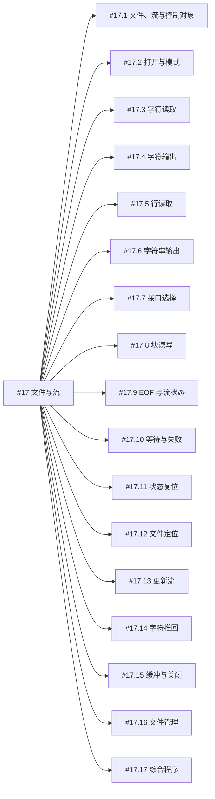

### 17.1 文件、流与控制对象

> [!note]- 知识图与目录
>
> ```mermaid
> flowchart LR
>   R["#17.1 文件、流与控制对象"]
>   N0["#834. FILE 指针指向控制对象"]
>   R --> N0
>   N1["#835. 管理处负责流状态"]
>   R --> N1
>   N2["#836. stdin 是标准输入流"]
>   R --> N2
>   N3["#837. stdout 是正常输出流"]
>   R --> N3
>   N4["#838. stderr 独立承载诊断"]
>   R --> N4
>   class R,N0,N1,N2,N3,N4 internal-link;
> ```
>
> - [[#834. FILE 指针指向控制对象|834. FILE 指针指向控制对象]]
> - [[#835. 管理处负责流状态|835. 管理处负责流状态]]
> - [[#836. stdin 是标准输入流|836. stdin 是标准输入流]]
> - [[#837. stdout 是正常输出流|837. stdout 是正常输出流]]
> - [[#838. stderr 独立承载诊断|838. stderr 独立承载诊断]]

#### 834. FILE 指针指向控制对象

`FILE *fp` 声明一个指向 FILE 对象的指针变量；fopen 成功返回的值指向管理该流的 FILE 控制对象，不是磁盘正文起始字节。教材“文件型指针，指向已打开文件”的说法可用于辨认类型，精确理解还需保留控制对象这一层。

#### 835. 管理处负责流状态

把外部文件看成仓库，流是业务通道，FILE 对象是管理处的记录和控制面板，fp 是管理处地址。标准库拿着地址让管理处处理缓冲、位置和错误，而不是拿 fp 直接钻到磁盘字节里改写。

```text
FILE 类型 → 管理记录的图纸
FILE 对象 → 按图纸存在的一份真实管理记录
fp        → 保存管理记录地址的指针变量
fp → FILE 控制对象 → 管理一条流 → 关联外部文件
```

同一个层次关系也可用“金库、柜台、业务通道”理解，类比服务于分清对象身份。

#### 836. stdin 是标准输入流

stdin 的英文是 standard input，用于接收输入；终端运行时常接键盘，但可被重定向到文件或管道。输入缓冲可先理解为已送达但尚未消费的排队数据，不能把这一流永远等同于键盘。

#### 837. stdout 是正常输出流

stdout（standard output）用于正常结果，终端运行时通常显示在终端，也可能被重定向到文件或其他接收方。printf 默认使用这一流，不意味着它永远输出到实体屏幕。

#### 838. stderr 独立承载诊断

stderr（standard error）用于错误和诊断。即使 stdout 与 stderr 默认都出现在同一终端上，它们仍是两个独立输出流，可以具有不同重定向和缓冲行为。

### 17.2 打开与模式

> [!note]- 知识图与目录
>
> ```mermaid
> flowchart LR
>   R["#17.2 打开与模式"]
>   N0["#839. 路径字符串不是文件本身"]
>   R --> N0
>   N1["#840. 模式由接口解释"]
>   R --> N1
>   N2["#841. fopen 调用需要两个实参"]
>   R --> N2
>   N3["#842. 打开动作与返回结果"]
>   R --> N3
>   N4["#843. 返回值不带调用者变量名"]
>   R --> N4
>   N5["#844. NULL 判断打开失败"]
>   R --> N5
>   N6["#845. r 不创建缺失文件"]
>   R --> N6
>   N7["#846. w 创建或截断"]
>   R --> N7
>   N8["#847. a 保留并追加"]
>   R --> N8
>   class R,N0,N1,N2,N3,N4,N5,N6,N7,N8 internal-link;
> ```
>
> ```mermaid
> flowchart LR
>   R["#17.2 打开与模式"]
>   N0["#848. b 表示二进制模式"]
>   R --> N0
>   N1["#849. 原始字节用字符数组"]
>   R --> N1
>   N2["#850. 加号允许更新读写"]
>   R --> N2
>   N3["#851. x 排他创建"]
>   R --> N3
>   N4["#852. 打开失败后的退出契约"]
>   R --> N4
>   class R,N0,N1,N2,N3,N4 internal-link;
> ```
>
> - [[#839. 路径字符串不是文件本身|839. 路径字符串不是文件本身]]
> - [[#840. 模式由接口解释|840. 模式由接口解释]]
> - [[#841. fopen 调用需要两个实参|841. fopen 调用需要两个实参]]
> - [[#842. 打开动作与返回结果|842. 打开动作与返回结果]]
> - [[#843. 返回值不带调用者变量名|843. 返回值不带调用者变量名]]
> - [[#844. NULL 判断打开失败|844. NULL 判断打开失败]]
> - [[#845. r 不创建缺失文件|845. r 不创建缺失文件]]
> - [[#846. w 创建或截断|846. w 创建或截断]]
> - [[#847. a 保留并追加|847. a 保留并追加]]
> - [[#848. b 表示二进制模式|848. b 表示二进制模式]]
> - [[#849. 原始字节用字符数组|849. 原始字节用字符数组]]
> - [[#850. 加号允许更新读写|850. 加号允许更新读写]]
> - [[#851. x 排他创建|851. x 排他创建]]
> - [[#852. 打开失败后的退出契约|852. 打开失败后的退出契约]]

#### 839. 路径字符串不是文件本身

fopen 的 filename 是路径字符串；`"log.txt"` 不是外部文件本身，也不是等待打印的文字。库读取这些字符并交给运行环境按路径解释。`const char *filename` 表示接口读取文件名字符，不通过该参数修改它们。

#### 840. 模式由接口解释

`"w"` 本身只是一个字符串；它被作为 fopen 的模式参数后才表示写入。字符 w 没有脱离具体接口的通用“写磁盘”力量，也不能把其他函数中的同字符一律如此解释。

#### 841. fopen 调用需要两个实参

文章把 fopen() 当函数简称，不表示零实参调用合法。实际原型要求文件名与模式两个实参；应写如 `fopen("log.txt", "w")`，不能把介绍文字中的空括号原样当可编译调用。

#### 842. 打开动作与返回结果

调用 fopen 不只计算一个地址：它尝试按模式打开/创建文件并建立关联流，随后返回结果。`FILE *fp = fopen(...);` 再把返回的指针值复制进 fp。

```text
实际动作：打开或创建 → 按模式处理文件 → 建立流
交回结果：成功返回 FILE 控制对象指针；失败返回空指针
```

#### 843. 返回值不带调用者变量名

fopen 不会“返回名叫 fp 的指针”。函数不知道调用者会把返回值保存到 fp、second 还是别的变量；它只按接口返回一个指针值。

#### 844. NULL 判断打开失败

fopen 失败返回 NULL，成功返回有效 FILE 指针。条件应写 `fp == NULL`，不是赋值 `fp = NULL`；是否要让主程序返回 EXIT_FAILURE 或普通函数返回自定失败码，由调用层接口约定决定。

#### 845. r 不创建缺失文件

以 r/rb 打开已有文件读取；文件不存在时打开失败，不会悄悄创建。不能同时描述成“成功创建文件”又“返回空指针”：成功和失败对应不同返回结果。

#### 846. w 创建或截断

w/wb 在文件不存在时尝试创建，已有文件则截断原内容后重新写入。它像先撕掉旧笔记本全部页面，再交给你一本空本子，不是接着原笔记本写；需要保留旧内容时先选对模式。

#### 847. a 保留并追加

a/ab 在文件不存在时尝试创建，已有内容保留，写入落在末尾。它适合追加，不等于可以任意覆盖文件中间；追加与更新覆盖的差异另见相应定位情景。

#### 848. b 表示二进制模式

模式中的 b 是 binary。wb 表示二进制写入，rb 表示二进制读取；不是只能写字符 0 和 1，而是按二进制方式处理，避免文本模式允许的字符表示转换，例如常见系统的换行处理。Windows 上这种差别尤其明显。

#### 849. 原始字节用字符数组

原始文件字节常放在 unsigned char 数组中，例如 `{0xFF, 0xA0, 0x12}`。一个元素占一个 C 字节，位数由 CHAR_BIT 决定；十六进制书写长度不会改变元素大小。原始字节与一般可能为负的整数计算各有合适类型，不能因为某次值非负就机械选择 unsigned int。

#### 850. 加号允许更新读写

模式中的 + 表示更新，即允许读也允许写。r+b 与 rb+ 等价：打开已有二进制文件，不截断；w+b 仍创建/截断；a+b 仍只在末尾写。+ 不取消各首字母的创建与写入位置规则，也不取消方向切换要求。

#### 851. x 排他创建

C11 起支持 wx/wbx 等排他创建：目标已存在就失败，不像 w/wb 会截断。完整复制示例用 wbx 避免覆盖已有 copy.bin；这比先检查不存在再普通打开更直接表达不覆盖契约。

#### 852. 打开失败后的退出契约

fp==NULL只说明fopen失败，不自行决定返回数字的意义。若普通函数约定“1成功、0失败”，失败可return 0；在main里表达程序失败，使用EXIT_FAILURE更可移植。不要因为两种代码都结束当前函数，就把它们的0/1含义混为一谈。

### 17.3 字符读取

> [!note]- 知识图与目录
>
> ```mermaid
> flowchart LR
>   R["#17.3 字符读取"]
>   N0["#853. fgetc 返回 int 字符值"]
>   R --> N0
>   N1["#854. EOF 不唯一表示文件尾"]
>   R --> N1
>   N2["#855. getchar 读取 stdin"]
>   R --> N2
>   N3["#856. getchar 不跳过空白"]
>   R --> N3
>   class R,N0,N1,N2,N3 internal-link;
> ```
>
> - [[#853. fgetc 返回 int 字符值|853. fgetc 返回 int 字符值]]
> - [[#854. EOF 不唯一表示文件尾|854. EOF 不唯一表示文件尾]]
> - [[#855. getchar 读取 stdin|855. getchar 读取 stdin]]
> - [[#856. getchar 不跳过空白|856. getchar 不跳过空白]]

#### 853. fgetc 返回 int 字符值

fgetc 成功取得一个字符后，将其 unsigned char 值转换为 int 返回。返回域还要容纳 EOF，因此先用 int 接收，再判断是否取得普通字符，不能提前缩成 char。

#### 854. EOF 不唯一表示文件尾

fgetc 到文件尾或发生读取错误都可返回 EOF。`ch == EOF` 最稳的直译是“这次没取得普通字符”，不能立刻宣布正常读完；随后再检查 feof/ferror 区分原因。

#### 855. getchar 读取 stdin

getchar() 在读取来源上相当于 fgetc(stdin)：取得标准输入流的下一个字符，成功返回字符值，结束或读取错误返回 EOF。它没有需要调用者传入的流参数。

#### 856. getchar 不跳过空白

getchar 一次取得一个字符，空格和换行也会被读走，不像 scanf 的 %d 先跳前导空白。前一次输入留下的换行，可能正是下一次 getchar 得到的字符。

### 17.4 字符输出

> [!note]- 知识图与目录
>
> ```mermaid
> flowchart LR
>   R["#17.4 字符输出"]
>   N0["#857. putchar 输出一个字符"]
>   R --> N0
>   N1["#858. fputc 的返回值"]
>   R --> N1
>   class R,N0,N1 internal-link;
> ```
>
> - [[#857. putchar 输出一个字符|857. putchar 输出一个字符]]
> - [[#858. fputc 的返回值|858. fputc 的返回值]]

#### 857. putchar 输出一个字符

putchar(ch) 向 stdout 输出一个字符，相当于 putc(ch, stdout)，不自动添加换行。`putchar('A'); putchar('B');` 连续输出 AB；对于合法字符值，`putchar(ch)` 和 `printf("%c", ch)` 可表达同一字符输出。

#### 858. fputc 的返回值

fputc(ch, fp) 向指定流写字符，返回 int：成功返回写入字符对应的值，失败返回 EOF。它不是返回“成功一定等于 1”的布尔值；判断失败要按 EOF 契约。

### 17.5 行读取

> [!note]- 知识图与目录
>
> ```mermaid
> flowchart LR
>   R["#17.5 行读取"]
>   N0["#859. fgets 的容量边界"]
>   R --> N0
>   N1["#860. fgets 保留换行"]
>   R --> N1
>   N2["#861. 容量不足会分段读"]
>   R --> N2
>   N3["#862. fgets 返回指针不是长度"]
>   R --> N3
>   N4["#863. EOF 无新数据保留旧数组"]
>   R --> N4
>   N5["#864. 读错后数组内容不可靠"]
>   R --> N5
>   N6["#865. sizeof 必须面对真数组"]
>   R --> N6
>   class R,N0,N1,N2,N3,N4,N5,N6 internal-link;
> ```
>
> - [[#859. fgets 的容量边界|859. fgets 的容量边界]]
> - [[#860. fgets 保留换行|860. fgets 保留换行]]
> - [[#861. 容量不足会分段读|861. 容量不足会分段读]]
> - [[#862. fgets 返回指针不是长度|862. fgets 返回指针不是长度]]
> - [[#863. EOF 无新数据保留旧数组|863. EOF 无新数据保留旧数组]]
> - [[#864. 读错后数组内容不可靠|864. 读错后数组内容不可靠]]
> - [[#865. sizeof 必须面对真数组|865. sizeof 必须面对真数组]]

#### 859. fgets 的容量边界

fgets(buffer, capacity, fp) 最多读取 capacity-1 个字符并为终止符留空间；本笔记示例使用至少为 2 的容量。对 `char text[6];`，最多读 5 个字符，不是 6 个。只有确认成功后才用字符串接口处理本次内容。

#### 860. fgets 保留换行

fgets 读到换行时，会把换行本身放进数组，然后再补字符串终止符。fputs 随后写这个字符串时不另外加换行，所以一组 fgets/fputs 可保留通常文本行的既有换行。

#### 861. 容量不足会分段读

fgets 不保证一次取得完整一行。数组不够大时，它先读容得下的前段，后续字符仍在流里；把下一次调用当作“下一行”会误分记录。

#### 862. fgets 返回指针不是长度

fgets 成功返回目标数组起点指针，EOF且一个字符也未读到或发生读取错误时返回 NULL；返回值不是字符数。用 `fgets(...) != NULL` 判断本次是否取得新内容，需要区分停止原因时再查流指示器。

#### 863. EOF 无新数据保留旧数组

正常 EOF 且一个字符也没取到时，fgets 返回 NULL，数组原内容保持不变。原来是 `char text[8] = "OLD";`，之后仍可能打印 OLD，但它是此前数据，不是本次成功从文件读得的新内容。

#### 864. 读错后数组内容不可靠

fgets 因读取错误失败时返回 NULL，数组内容不确定，不能依赖原来的内容，也不能保证仍是有效的终止字符串。不要把正常EOF保留旧数组的保证扩大到读取错误。

#### 865. sizeof 必须面对真数组

对真实 `char text[8]`，sizeof text 得到整个数组容量，不先转换成指针。若函数形参已调整成指针，sizeof 得到指针对象大小，不能继续拿它当 fgets 的原数组容量；容量需由接口另行传入。

### 17.6 字符串输出

> [!note]- 知识图与目录
>
> ```mermaid
> flowchart LR
>   R["#17.6 字符串输出"]
>   N0["#866. puts 固定 stdout 并换行"]
>   R --> N0
>   N1["#867. fputs 指定流且不加换行"]
>   R --> N1
>   N2["#868. fputs 不写终止空字符"]
>   R --> N2
>   N3["#869. fprintf 面向指定流"]
>   R --> N3
>   N4["#870. fprintf 返回字符数"]
>   R --> N4
>   N5["#871. 参数顺序依各自原型"]
>   R --> N5
>   N6["#872. 源代码引号不入文件"]
>   R --> N6
>   N7["#873. fputs 不解释百分号"]
>   R --> N7
>   N8["#874. puts 不输出终止符"]
>   R --> N8
>   class R,N0,N1,N2,N3,N4,N5,N6,N7,N8 internal-link;
> ```
>
> ```mermaid
> flowchart LR
>   R["#17.6 字符串输出"]
>   N0["#875. puts 返回非负状态"]
>   R --> N0
>   N1["#876. fputs 返回非负状态"]
>   R --> N1
>   N2["#877. fprintf 不写结果终止符"]
>   R --> N2
>   class R,N0,N1,N2 internal-link;
> ```
>
> - [[#866. puts 固定 stdout 并换行|866. puts 固定 stdout 并换行]]
> - [[#867. fputs 指定流且不加换行|867. fputs 指定流且不加换行]]
> - [[#868. fputs 不写终止空字符|868. fputs 不写终止空字符]]
> - [[#869. fprintf 面向指定流|869. fprintf 面向指定流]]
> - [[#870. fprintf 返回字符数|870. fprintf 返回字符数]]
> - [[#871. 参数顺序依各自原型|871. 参数顺序依各自原型]]
> - [[#872. 源代码引号不入文件|872. 源代码引号不入文件]]
> - [[#873. fputs 不解释百分号|873. fputs 不解释百分号]]
> - [[#874. puts 不输出终止符|874. puts 不输出终止符]]
> - [[#875. puts 返回非负状态|875. puts 返回非负状态]]
> - [[#876. fputs 返回非负状态|876. fputs 返回非负状态]]
> - [[#877. fprintf 不写结果终止符|877. fprintf 不写结果终止符]]

#### 866. puts 固定 stdout 并换行

puts(text)固定向stdout输出终止字符串，并自动在末尾加一个换行。它不是写入调用者指定的FILE流；若文字本身已有换行，puts还会再加一次。

#### 867. fputs 指定流且不加换行

fputs(text,fp)接收来源字符串起点和目标流，输出到指定流而不是固定stdout。它本身不自动添加换行；若需要换行，文本中应已有\n或另行输出。

#### 868. fputs 不写终止空字符

fputs 在来源首个 \0 前结束写出，不把这个终止符写入文件。它把输入视作 C 字符串，不适合用来搬运中间含零且要求全部保留的二进制缓冲区。

#### 869. fprintf 面向指定流

fprintf(fp, format, ...) 按 format 把后面数据格式化，送到 fp 指定的流。这个流可以关联磁盘文件，也可以是 stdout/stderr；教材“向文件指针所指文件输出”是文件教学情景的简称。fp 决定往哪里，格式串决定内容与规则。

#### 870. fprintf 返回字符数

fprintf成功返回输出的字符数，发生输出错误时返回负值；它不是返回“任意非负状态”或一律返回1。不能把其返回值模型和fputs混用。

#### 871. 参数顺序依各自原型

标准库没有“参数一律按同顺序”的宇宙规则，每个原型都是自己的插槽合同：

```text
fopen(filename, mode)       打开哪个文件，以什么模式
fprintf(stream, format, …)  往哪里 → 按什么规则 → 填哪些数据
fputs(string, stream)       写什么 → 写到哪里
```

先找到函数的实际插槽，不要仅凭另一个函数的顺序类推。

#### 872. 源代码引号不入文件

`fputs("A\n", fp)` 输出 A 后换行，双引号是源代码语法，不是文件内容；\n 在这里描述换行，不是反斜杠和字母 n。答题可写“字符序列 A 后跟换行”，不要把描述符号误算作文件实际字节。

#### 873. fputs 不解释百分号

已有字符串直接写出时可用fputs("hello",fp)；其中即使有百分号，也不是一套新的printf格式。需要把整数、浮点等数据格式化时，才用如fprintf(fp,"x = %d, price = %.2f\n",x,price)。这区分的是是否需要格式解释，不只是函数名不同。

#### 874. puts 不输出终止符

puts把来源\0作为字符串边界，不把它写到stdout；自动添加的是换行，不是一个新的可见“字符串结束符”。这两种尾部效果不能混记。

#### 875. puts 返回非负状态

puts成功返回非负int，失败返回EOF。成功结果不承诺等于输出字符数，也不保证恰为1；应按函数契约判断而非拿它当printf计数。

#### 876. fputs 返回非负状态

fputs成功返回非负int，失败返回EOF；不能把其返回值解释为新字符串地址或本次写出的准确字符数。即使写的是空字符串，也应依这个契约判断。

#### 877. fprintf 不写结果终止符

fprintf把格式化后的字符写到流，不会为了“格式化得到文本”而把末尾字符串\0也写进文件。若格式本身无换行，也不自动加换行；文本文件结束由外部文件边界决定。

### 17.7 接口选择

> [!note]- 知识图与目录
>
> ```mermaid
> flowchart LR
>   R["#17.7 接口选择"]
>   N0["#878. 三类数据接口"]
>   R --> N0
>   N1["#879. fscanf 从流解析对象"]
>   R --> N1
>   N2["#880. 按目的选原样复制"]
>   R --> N2
>   class R,N0,N1,N2 internal-link;
> ```
>
> - [[#878. 三类数据接口|878. 三类数据接口]]
> - [[#879. fscanf 从流解析对象|879. fscanf 从流解析对象]]
> - [[#880. 按目的选原样复制|880. 按目的选原样复制]]

#### 878. 三类数据接口

按数据语义选择：fread/fwrite 搬原始数据项，fgets/fputs 按文本/终止字符串处理，fscanf/fprintf 按格式转换对象值。陌生函数不能只因 f 开头就归为文件接口，例如 fabs 是数学函数；应以头文件和契约辨认家族。

#### 879. fscanf 从流解析对象

fscanf(fp, format, ...) 从指定流中的文本解析出对象值，返回成功完成赋值的输入项数，而非字符数。`fscanf(fp, "%d", &score)` 读取十进制整数文本；与直接按对象表示搬字节不是同一操作。格式匹配、空白与宽度规则沿用 scanf 家族。

#### 880. 按目的选原样复制

图片、音频、压缩包、原样备份通常选 fread/fwrite；文章日志按行处理可选 fgets/fputs；固定格式数值可用格式接口，复杂文本则先取行再解析。文本文件若要求连零字节和原始换行表示都保留，也可用二进制模式块复制，不由扩展名机械决定。

### 17.8 块读写

> [!note]- 知识图与目录
>
> ```mermaid
> flowchart LR
>   R["#17.8 块读写"]
>   N0["#881. fread 的四个插槽"]
>   R --> N0
>   N1["#882. fwrite 的四个插槽"]
>   R --> N1
>   N2["#883. 写对象表示不是写数值文本"]
>   R --> N2
>   N3["#884. 完整项数不是普遍字节数"]
>   R --> N3
>   N4["#885. 数据项可跨多个元素"]
>   R --> N4
>   N5["#886. 原始读取不补终止符"]
>   R --> N5
>   N6["#887. 读取不会自动扩容"]
>   R --> N6
>   N7["#888. 连续读取推进流位置"]
>   R --> N7
>   N8["#889. 短读只改有效前缀"]
>   R --> N8
>   class R,N0,N1,N2,N3,N4,N5,N6,N7,N8 internal-link;
> ```
>
> ```mermaid
> flowchart LR
>   R["#17.8 块读写"]
>   N0["#890. 尾块不足也要处理"]
>   R --> N0
>   N1["#891. 单字节 fread 的判断"]
>   R --> N1
>   N2["#892. 缓冲区可以反复使用"]
>   R --> N2
>   N3["#893. 容量与有效量分开"]
>   R --> N3
>   N4["#894. 批处理减少逐字节开销"]
>   R --> N4
>   N5["#895. 短读后区分结束与错误"]
>   R --> N5
>   N6["#896. 短写必须处理"]
>   R --> N6
>   class R,N0,N1,N2,N3,N4,N5,N6 internal-link;
> ```
>
> - [[#881. fread 的四个插槽|881. fread 的四个插槽]]
> - [[#882. fwrite 的四个插槽|882. fwrite 的四个插槽]]
> - [[#883. 写对象表示不是写数值文本|883. 写对象表示不是写数值文本]]
> - [[#884. 完整项数不是普遍字节数|884. 完整项数不是普遍字节数]]
> - [[#885. 数据项可跨多个元素|885. 数据项可跨多个元素]]
> - [[#886. 原始读取不补终止符|886. 原始读取不补终止符]]
> - [[#887. 读取不会自动扩容|887. 读取不会自动扩容]]
> - [[#888. 连续读取推进流位置|888. 连续读取推进流位置]]
> - [[#889. 短读只改有效前缀|889. 短读只改有效前缀]]
> - [[#890. 尾块不足也要处理|890. 尾块不足也要处理]]
> - [[#891. 单字节 fread 的判断|891. 单字节 fread 的判断]]
> - [[#892. 缓冲区可以反复使用|892. 缓冲区可以反复使用]]
> - [[#893. 容量与有效量分开|893. 容量与有效量分开]]
> - [[#894. 批处理减少逐字节开销|894. 批处理减少逐字节开销]]
> - [[#895. 短读后区分结束与错误|895. 短读后区分结束与错误]]
> - [[#896. 短写必须处理|896. 短写必须处理]]

#### 881. fread 的四个插槽

fread(buffer, size, count, stream) 可直译：“从哪个流，取多少项、每项多少字节，放到哪块内存”。前两项数量用 size_t；目标缓冲必须够大，size 与 count 的乘积及实际可写范围也要有效。

#### 882. fwrite 的四个插槽

`fwrite(buffer, size, count, stream)` 可直译：“从 `buffer` 起，每项取 `size` 字节，共取 `count` 项，写入这个流”。例如 `fwrite(buffer, 1, n, dst)` 写的是本轮前 `n` 个字节，不是数组全部容量。来源必须有相应可读范围。

`fwrite(data, 1, 3, fp)` 则是每项 1 字节、共 3 项，全部成功时写出 3 字节、返回 `3`；这里的 `data` 至少要有 3 个可读字节，`fp` 必须是允许写入的有效流。

#### 883. 写对象表示不是写数值文本

假设 `fp` 已成功以 `"wb"` 打开且 `flags` 已初始化，下面把 `flags` 的对象表示写成一个数据项：

```c
/* 函数体片段；需要 <stdio.h>，fp 为有效的二进制输出流。 */
unsigned int flags = 0x2Au;
if (fwrite(&flags, sizeof flags, 1, fp) != 1) {
    /* 处理写入失败。 */
}
```

这像把盒子当前的内部摆放原样拍下来；它不会自动把数值变成文本 `"42"` 或 `"2A"`。实际写出 `sizeof flags` 个 C 字节，字节数、字节序及对象表示取决于实现。若文件要跨平台交换，应约定数值编码，不能把本机对象快照直接当成通用格式。

#### 884. 完整项数不是普遍字节数

fread/fwrite 返回成功处理的完整数据项数量，类型为 size_t。只有 size 等于 1 时，返回项数才正好是字节数；它们不像 fgetc 用 EOF 返回特殊状态。未完成的一项不能当作已取得完整对象使用。

#### 885. 数据项可跨多个元素

即使来源是 unsigned char 数组，fwrite(data, 2, 3, fp) 也可把相邻两字节当一项，请求三项共六字节；成功返回 3，而不是 6。函数不理解这些字节代表什么数值，也不依据十六进制书写长度决定项大小。数组必须真有六字节可读。

#### 886. 原始读取不补终止符

fread 不寻找或追加字符串 \0。读到 n 个原始字节，只知道这些字节是本轮有效数据；想当字符串使用时，需要另外有足够空间并按要求建立终止符，且内容本身符合预期文本语义。

#### 887. 读取不会自动扩容

数组声明固定了容量。文件比数组长，不会使数组自动多出格子；请求大小必须落在实际可写范围内，不可因“文件有这么多字节”就让 fread 写过数组边界。

#### 888. 连续读取推进流位置

第二次 fread 从上一次留下的流位置接着读，不自动回到开头。位置随着实际读取推进，与缓冲区每轮从下标零覆盖写入是两套坐标。需要重新读文件开头时必须定位。

#### 889. 短读只改有效前缀

文件为 ABCDE，unsigned char 缓冲容量为 3：

```text
第一次 fread(...,1,3,fp)：返回 3，缓冲为 A B C
第二次 fread(...,1,3,fp)：返回 2，缓冲为 D E C
```

第二次只覆盖前两格，最后的 C 是旧值，不是又从文件读到的第三个字节。只能按本轮返回的有效量处理。

#### 890. 尾块不足也要处理

块循环用 `(n = fread(buffer, 1, capacity, fp)) > 0`，只要读到至少一个字节就处理 n 字节。若只处理 n==capacity，末尾仅 1、2、3 字节的一批会丢失；容量是上限，不是每一批必须填满的数量。

#### 891. 单字节 fread 的判断

`fread(&ch, 1, 1, fp) == 1` 表示本次完整取得一项、一字节，才处理 unsigned char 的 ch。若返回 0，可能为文件结束或读错，循环后还需检查指示器。fgetc 则判断 int 返回值是否 EOF，两种返回模型不能互换。

#### 892. 缓冲区可以反复使用

搬家有 100 件物品，箱子一次装 4 件，也可以反复搬完；buffer 是程序拿出的暂存箱。源位置和目标位置每轮向前，内存箱子每轮从头重复使用，下一次覆盖箱子不会抹去已经写到目标流的内容。

#### 893. 容量与有效量分开

容量是箱子最多装多少，有效量是这一趟实际装了多少。文件复制应“本轮读多少就尝试写多少”，不是每轮都把箱子容量全部倒给目标，否则最后一批可能混入旧字节。

#### 894. 批处理减少逐字节开销

较大的缓冲区还减少程序逐字节处理与调用的次数，例如每批几千字节，而非每次只搬一个字节。它是性能选择，不改变“只能处理实际返回量”的正确性条件。

#### 895. 短读后区分结束与错误

fread 返回少于请求项数可能因剩余数据不足，也可能因读取错误。处理已取得的完整数据后，结合 feof/ferror 判断停止原因；不能把所有停止都当作正常读完。

#### 896. 短写必须处理

调用 fwrite 不保证完整接受本次请求，必须比较返回的完整项数。复制 n 字节时，`fwrite(buffer, 1, n, dst) != n` 表示没有完成这一批；应报告失败并保留失败状态，而不是直接进入下一轮假装已全部写出。

### 17.9 EOF 与流状态

> [!note]- 知识图与目录
>
> ```mermaid
> flowchart LR
>   R["#17.9 EOF 与流状态"]
>   N0["#897. EOF 是负 int 宏"]
>   R --> N0
>   N1["#898. EOF 不是文件中的字节"]
>   R --> N1
>   N2["#899. 哨兵值避开普通数据域"]
>   R --> N2
>   N3["#900. feof 查询状态灯"]
>   R --> N3
>   N4["#901. ferror 查询错误指示器"]
>   R --> N4
>   N5["#902. 读取发现文件尾才亮灯"]
>   R --> N5
>   N6["#903. 非 EOF 条件的真假"]
>   R --> N6
>   N7["#904. 由读取结果驱动循环"]
>   R --> N7
>   N8["#905. 三类零值不能混用"]
>   R --> N8
>   class R,N0,N1,N2,N3,N4,N5,N6,N7,N8 internal-link;
> ```
>
> - [[#897. EOF 是负 int 宏|897. EOF 是负 int 宏]]
> - [[#898. EOF 不是文件中的字节|898. EOF 不是文件中的字节]]
> - [[#899. 哨兵值避开普通数据域|899. 哨兵值避开普通数据域]]
> - [[#900. feof 查询状态灯|900. feof 查询状态灯]]
> - [[#901. ferror 查询错误指示器|901. ferror 查询错误指示器]]
> - [[#902. 读取发现文件尾才亮灯|902. 读取发现文件尾才亮灯]]
> - [[#903. 非 EOF 条件的真假|903. 非 EOF 条件的真假]]
> - [[#904. 由读取结果驱动循环|904. 由读取结果驱动循环]]
> - [[#905. 三类零值不能混用|905. 三类零值不能混用]]

#### 897. EOF 是负 int 宏

EOF 由 `<stdio.h>` 提供，展开为负的 int 常量表达式，常见取值是 -1，但标准不要求恰为 -1。教材把它写为“符号常量 -1”时要保留这一实现前提。

#### 898. EOF 不是文件中的字节

EOF 更像“演奏已结束”的信号牌，不是乐谱里存着一个特殊休止符。输入函数用它报告未取得普通字符；正常读完不等于“电脑坏了”，文件也不需要在末尾实际存储一个 EOF 字符。

#### 899. 哨兵值避开普通数据域

哨兵值是用普通数据空间之外的一个值表示特殊状态的暗号。字符输入需要既表示字符又表示EOF，因此返回 int 并先检查暗号；不要把它提前塞进只供普通字符使用的窄容器。

#### 900. feof 查询状态灯

feof(fp) 非零表示该流文件尾指示器已经设置，为零表示尚未设置；它只看状态，不负责读取或预知后面还有没有字节。可想成 fgetc 去仓库取货，EOF indicator 是“已发现没货”的灯，feof 只是看灯的人。

#### 901. ferror 查询错误指示器

ferror(fp) 非零表示该流错误指示器已设置，为零表示未设置。错误灯与文件尾灯是两个不同状态，不能把任意读写错误当作文件尾，也不能从 feof 为零推断没有错误。

#### 902. 读取发现文件尾才亮灯

EOF指示器反映已发生的读取发现，不是“光标刚到末尾就必然立即亮灯”。不只 fgetc，其他读取操作也可能检测到文件尾。

```text
文件只有 A：
刚打开       feof 为 0
第一次读取   得到 A，通常仍为 0
再尝试读取   发现无字符，返回 EOF 并设置文件尾指示器
以后查询     feof 非零
```

fread 恰好读完请求字节，也不能据此保证已经检测到文件结束。

#### 903. 非 EOF 条件的真假

`while (!feof(fp))` 先取状态，再逻辑取反：未设置时 feof 返回0，!0为1，于是继续；已经设置后，!非零为0，循环停止。这个真假推导本身成立，但不意味着它适合作为“下一次读会成功”的判断。

#### 904. 由读取结果驱动循环

不要用旧EOF状态预判下一次读取。读失败后再处理数组或字符会多用一次旧数据；若因读错停止而文件尾灯没亮，还可能错误继续。

```c
/* 函数体片段，需 <stdio.h>；fp 为有效输入流。 */
int ch;
while ((ch = fgetc(fp)) != EOF) {
    /* 已成功取得本轮字符，再处理 ch。 */
}
if (ferror(fp)) {
    /* 读取错误，不应当作正常结束。 */
}
```

先读取、再按本次结果决定是否处理，比先问历史状态更符合任务。

#### 905. 三类零值不能混用

EOF 是某些输入函数的特殊返回值；feof/ferror 查流状态；NULL 是空指针。可以记为“EOF查本次读取结果、指示器查流记录、NULL查指针”，它们不是一套统一成功/失败编码。fgetc未取得字符后再看状态，才形成完整原因判断。

### 17.10 等待与失败

> [!note]- 知识图与目录
>
> ```mermaid
> flowchart LR
>   R["#17.10 等待与失败"]
>   N0["#906. 阻塞是尚在等待"]
>   R --> N0
>   N1["#907. 匹配失败与输入失败"]
>   R --> N1
>   N2["#908. 空标准输入立即结束"]
>   R --> N2
>   N3["#909. 顺序等待的适用性"]
>   R --> N3
>   class R,N0,N1,N2,N3 internal-link;
> ```
>
> - [[#906. 阻塞是尚在等待|906. 阻塞是尚在等待]]
> - [[#907. 匹配失败与输入失败|907. 匹配失败与输入失败]]
> - [[#908. 空标准输入立即结束|908. 空标准输入立即结束]]
> - [[#909. 顺序等待的适用性|909. 顺序等待的适用性]]

#### 906. 阻塞是尚在等待

阻塞表示调用暂时没有数据可取，停下来等，并未立即宣布失败。等待期间，当前线程不能继续执行该调用后面的顺序语句；“还没返回”与“已经失败返回”是不同情景。

#### 907. 匹配失败与输入失败

等待用户输入可能是阻塞；把 hello 输入给%d是现有字符不符合格式的匹配失败；流无更多字符或设备读取出错可导致输入失败。不能把这三类现象都叫“键盘坏了”或统一当作数值零。

#### 908. 空标准输入立即结束

若stdin已重定向到一个空文件，程序第一次scanf就可能遇到结束，而不是等待键盘；管道写端已关闭或终端发出结束信号也可产生类似情景。“标准输入不是键盘而是空文件”只能是这一具体设定，不是所有程序的通则。

#### 909. 顺序等待的适用性

简单按顺序取得数据时，阻塞自然易懂；需要同时响应很多事情时，某一次等待可能阻碍其余任务，应考虑适合的并发或I/O机制。它是一项程序结构选择，不代表阻塞天然错误。

### 17.11 状态复位

> [!note]- 知识图与目录
>
> ```mermaid
> flowchart LR
>   R["#17.11 状态复位"]
>   N0["#910. clearerr 不移动位置"]
>   R --> N0
>   N1["#911. 清标志不修复故障"]
>   R --> N1
>   class R,N0,N1 internal-link;
> ```
>
> - [[#910. clearerr 不移动位置|910. clearerr 不移动位置]]
> - [[#911. 清标志不修复故障|911. 清标志不修复故障]]

#### 910. clearerr 不移动位置

clearerr(fp) 清除EOF与错误指示器，不回到文件开头。像把控制面板的状态灯复位，光标仍停在原处，文件也不会凭空出现新数据。

#### 911. 清标志不修复故障

设备仍有故障时，clearerr把错误灯清掉也不会修复设备；再次读取仍可失败。复位记录与解决根本原因不是一回事，不应把状态清零当作恢复成功证明。

### 17.12 文件定位

> [!note]- 知识图与目录
>
> ```mermaid
> flowchart LR
>   R["#17.12 文件定位"]
>   N0["#912. 二进制位置是字节光标"]
>   R --> N0
>   N1["#913. 文件末尾不等于空字符"]
>   R --> N1
>   N2["#914. fseek 直接移动位置"]
>   R --> N2
>   N3["#915. SEEK_SET 从文件开头算"]
>   R --> N3
>   N4["#916. SEEK_CUR 从流当前位置算"]
>   R --> N4
>   N5["#917. SEEK_END 参照文件末尾"]
>   R --> N5
>   N6["#918. fseek 返回状态不返回位置"]
>   R --> N6
>   N7["#919. 文本位置不能当任意字节数"]
>   R --> N7
>   N8["#920. ftell 返回 long"]
>   R --> N8
>   class R,N0,N1,N2,N3,N4,N5,N6,N7,N8 internal-link;
> ```
>
> ```mermaid
> flowchart LR
>   R["#17.12 文件定位"]
>   N0["#921. ftell 失败为 -1L"]
>   R --> N0
>   N1["#922. ftell 不移动光标"]
>   R --> N1
>   N2["#923. 到 EOF 不等于查询失败"]
>   R --> N2
>   N3["#924. 查询失败的环境诊断"]
>   R --> N3
>   N4["#925. 测长度有适用范围"]
>   R --> N4
>   N5["#926. 查长度后仍停在末尾"]
>   R --> N5
>   N6["#927. 保存并恢复原位置"]
>   R --> N6
>   N7["#928. rewind 回到开头"]
>   R --> N7
>   N8["#929. rewind 清两种指示器"]
>   R --> N8
>   class R,N0,N1,N2,N3,N4,N5,N6,N7,N8 internal-link;
> ```
>
> ```mermaid
> flowchart LR
>   R["#17.12 文件定位"]
>   N0["#930. fpos_t 不必是整数"]
>   R --> N0
>   N1["#931. 保存恢复完整位置状态"]
>   R --> N1
>   N2["#932. 恢复位置清 EOF 丢推回"]
>   R --> N2
>   class R,N0,N1,N2 internal-link;
> ```
>
> - [[#912. 二进制位置是字节光标|912. 二进制位置是字节光标]]
> - [[#913. 文件末尾不等于空字符|913. 文件末尾不等于空字符]]
> - [[#914. fseek 直接移动位置|914. fseek 直接移动位置]]
> - [[#915. SEEK_SET 从文件开头算|915. SEEK_SET 从文件开头算]]
> - [[#916. SEEK_CUR 从流当前位置算|916. SEEK_CUR 从流当前位置算]]
> - [[#917. SEEK_END 参照文件末尾|917. SEEK_END 参照文件末尾]]
> - [[#918. fseek 返回状态不返回位置|918. fseek 返回状态不返回位置]]
> - [[#919. 文本位置不能当任意字节数|919. 文本位置不能当任意字节数]]
> - [[#920. ftell 返回 long|920. ftell 返回 long]]
> - [[#921. ftell 失败为 -1L|921. ftell 失败为 -1L]]
> - [[#922. ftell 不移动光标|922. ftell 不移动光标]]
> - [[#923. 到 EOF 不等于查询失败|923. 到 EOF 不等于查询失败]]
> - [[#924. 查询失败的环境诊断|924. 查询失败的环境诊断]]
> - [[#925. 测长度有适用范围|925. 测长度有适用范围]]
> - [[#926. 查长度后仍停在末尾|926. 查长度后仍停在末尾]]
> - [[#927. 保存并恢复原位置|927. 保存并恢复原位置]]
> - [[#928. rewind 回到开头|928. rewind 回到开头]]
> - [[#929. rewind 清两种指示器|929. rewind 清两种指示器]]
> - [[#930. fpos_t 不必是整数|930. fpos_t 不必是整数]]
> - [[#931. 保存恢复完整位置状态|931. 保存恢复完整位置状态]]
> - [[#932. 恢复位置清 EOF 丢推回|932. 恢复位置清 EOF 丢推回]]

#### 912. 二进制位置是字节光标

可定位普通二进制文件的字节位置，可理解成下一个字节前的光标，从0开始：

```text
位置：0   1   2   3   4   5   6   7
字节：  A   B   C   D   E   F   G
                                ↑ 最后一个字节之后的边界
```

七字节文件的结束位置为7，不是另有一个值为7的字节。

#### 913. 文件末尾不等于空字符

文件只写入ABCDEFG七个字节，不会自动多一个\0。文件末尾是位置边界；\0是可实际存储的零值字符，两者可以分别存在，不能靠文件尾替代字符串终止。

#### 914. fseek 直接移动位置

fseek可请求把流位置移到指定偏移，不必逐字符读到那里。前提是流支持相应定位且请求合法；管道等流不一定具有普通磁盘文件那样的随机定位能力。

#### 915. SEEK_SET 从文件开头算

fseek(fp,3L,SEEK_SET)以文件开头为参照，请求设置到字节偏移3；参照不因当前位置而改变。SET可联想“设到从开头算起的指定位置”。成功返回0，定位状态与新位置数值不是一回事。

#### 916. SEEK_CUR 从流当前位置算

fseek(fp,2L,SEEK_CUR)从当前流位置往后两字节，负偏移-2L则往前两字节。参照是流的光标，不是data数组的下标或内存指针；数组复用不会自动重设文件光标。

#### 917. SEEK_END 参照文件末尾

fseek(fp,-2L,SEEK_END)以文件末尾为参照向前两字节；这个末尾是文件末尾，不是buffer数组末尾。只有流支持所请求操作时才能成功，标准不要求二进制流普遍支持所有SEEK_END操作。

#### 918. fseek 返回状态不返回位置

fseek返回int：0成功，非零失败。成功定位到位置3时，result仍是0，不是3。检查返回值前先问它表示状态还是数据量，不能按目标偏移猜返回值。

#### 919. 文本位置不能当任意字节数

二进制ftell成功值通常可解释为相对开头的字节偏移；文本流值可能包含实现状态，不能任意加减。文本fseek的可移植用法受限制：零偏移，或用SEEK_SET恢复此前同一文件ftell保存的值。不要把二进制字节定位图无条件推广到文本模式。

#### 920. ftell 返回 long

ftell(fp)成功返回long类型的位置值，打印使用%ld；不是按当前平台int大小猜返回类型。long具体占几字节由实现决定，不要求一定比int多占存储字节。

#### 921. ftell 失败为 -1L

ftell失败返回-1L，L表示long整数常量后缀。可能原因包括流不支持位置查询、位置超出可表示范围或底层操作出错；先检查这个返回值，再按环境是否提供相应errno解释原因。

#### 922. ftell 不移动光标

ftell只查询，不主动移动流位置。两次查询之间没有读取、写入、定位等操作时，结果可相同，例如都得到5；它不是“每查询一次前进一格”。

#### 923. 到 EOF 不等于查询失败

七字节普通二进制文件读完后，ftell仍可成功得到7；文件结束位置也是合法位置。位置已在末尾与定位/查询本身出错是两个问题，不能据EOF状态断言ftell必失败。

#### 924. 查询失败的环境诊断

在为ftell失败提供errno信息的运行环境中，检查pos==-1L后可用perror("ftell")给出操作上下文。具体原因文字依实现；ISO C的失败判据仍是返回值，不是期待某句固定系统文本。

#### 925. 测长度有适用范围

对支持SEEK_END的普通二进制文件，可以先定位末尾再ftell取得字节长度；每一步都要检查返回值。这不是所有流的通用长度算法，文本模式值与特殊流尤其不能机械套用。

#### 926. 查长度后仍停在末尾

fseek到末尾再ftell查询长度，不会自动返回开头。后续要从头读，必须显式回到开头；否则下一次读会从末尾尝试，不能以为“查询完长度”顺带完成了复位。

#### 927. 保存并恢复原位置

若查询长度后还要继续原工作，应先保存原位置，再检查每一步定位与恢复：

```c
/* 函数体片段，需<stdio.h>；fp支持这里的二进制定位。 */
long saved = ftell(fp);
if (saved != -1L && fseek(fp, 0L, SEEK_END) == 0) {
    long length = ftell(fp);
    if (length != -1L) {
        /* 使用本例文件的length。 */
    }
    if (fseek(fp, saved, SEEK_SET) != 0) {
        /* 恢复失败，不能假定仍在原位置。 */
    }
}
```

#### 928. rewind 回到开头

rewind(fp)请求把流位置回到文件开头，不清空或改写程序自己的缓冲数组。

```text
文件ABCDE，unsigned char data[3]={0}：
读3字节 → data为ABC，流位置3
rewind   → 流位置0，data仍为ABC
再读2字节→取得AB，流位置2；第三格仍为旧C
```

#### 929. rewind 清两种指示器

rewind除了回到开头，还清除EOF与错误指示器；clearerr只清指示器而不移动位置。rewind返回void，不能从返回值判断定位成功；需要明确状态检查时选择有状态返回的定位接口。

#### 930. fpos_t 不必是整数

fpos_t用于保存文件位置状态，内部表示由实现决定，不必是普通整数，因此不能自行对它加减偏移。它可包含多字节处理所需的状态，不只是一个字节计数器。

#### 931. 保存恢复完整位置状态

fgetpos(fp,&saved)把当前位置状态保存到fpos_t对象，fsetpos(fp,&saved)用于恢复；两者成功返回0、失败返回非零。需要位置状态整体恢复时使用这一对，而不是猜测fpos_t与long的表示关系。

#### 932. 恢复位置清 EOF 丢推回

成功fsetpos会清除EOF指示器，并丢弃ungetc尚未取走的推回字符。不能在重新定位后还期待那些暂时推回的字符留在读取队列里；恢复位置也不是修复所有读写错误的同义词。

### 17.13 更新流

> [!note]- 知识图与目录
>
> ```mermaid
> flowchart LR
>   R["#17.13 更新流"]
>   N0["#933. 追加定位也不改写入末尾"]
>   R --> N0
>   N1["#934. 读后写需要定位"]
>   R --> N1
>   N2["#935. 写后读可冲刷或定位"]
>   R --> N2
>   N3["#936. fflush 不倒退位置"]
>   R --> N3
>   N4["#937. 更新许可不取消切换规则"]
>   R --> N4
>   class R,N0,N1,N2,N3,N4 internal-link;
> ```
>
> - [[#933. 追加定位也不改写入末尾|933. 追加定位也不改写入末尾]]
> - [[#934. 读后写需要定位|934. 读后写需要定位]]
> - [[#935. 写后读可冲刷或定位|935. 写后读可冲刷或定位]]
> - [[#936. fflush 不倒退位置|936. fflush 不倒退位置]]
> - [[#937. 更新许可不取消切换规则|937. 更新许可不取消切换规则]]

#### 933. 追加定位也不改写入末尾

追加模式要求每次实际写入都落在文件末尾，不受此前fseek位置影响。

```text
原文件ABC，以a打开
fseek到开头 → fputs("X",fp)
成功后的文件仍为ABCX，不是XBC
```

若要把ABC改成AXC，应使用不截断的r+/r+b更新模式并正确定位，而不是强行用追加模式覆盖。

#### 934. 读后写需要定位

更新流从读取切换到写入，通常须在中间调用文件定位函数；若此前输入遇到文件尾则有例外。未遇EOF时，fread后直接fwrite不符合要求。

```c
/* 函数体片段，需<stdio.h>；fp以r+b打开。 */
unsigned char data[2], ch='X';
if (fread(data,1,2,fp)==2 && fseek(fp,2L,SEEK_SET)==0) {
    if (fwrite(&ch,1,1,fp)!=1) {
        /* 写入失败。 */
    }
}
```

这里定位不仅移动光标，也满足切换契约。

#### 935. 写后读可冲刷或定位

更新流从写入切换到读取，中间可用fflush或定位函数，例如fseek/rewind。它与读后写的规则不对称；不能把任意方向都概括成“fflush一下即可”。

#### 936. fflush 不倒退位置

fflush可满足写后读的冲刷要求，却不会把文件光标退回。刚写入一字节后，位置仍向前；想再读刚写的那个位置，还需适当定位。

#### 937. 更新许可不取消切换规则

r+b允许读写，并不表示可以随意紧邻交替调用；打开许可和操作序列是两类契约。仍须按读→写、写→读各自要求安排中间操作。

### 17.14 字符推回

> [!note]- 知识图与目录
>
> ```mermaid
> flowchart LR
>   R["#17.14 字符推回"]
>   N0["#938. ungetc 不改外部文件"]
>   R --> N0
>   N1["#939. 成功推回立即清 EOF"]
>   R --> N1
>   N2["#940. 重新定位丢弃推回字符"]
>   R --> N2
>   class R,N0,N1,N2 internal-link;
> ```
>
> - [[#938. ungetc 不改外部文件|938. ungetc 不改外部文件]]
> - [[#939. 成功推回立即清 EOF|939. 成功推回立即清 EOF]]
> - [[#940. 重新定位丢弃推回字符|940. 重新定位丢弃推回字符]]

#### 938. ungetc 不改外部文件

ungetc(ch,fp)把一个字符推回输入流，下一次读取先得到它，不修改文件实际存储内容。它像把刚取出的字符暂放到待取入口，不是重写磁盘字节，也不是通用随机定位。标准至少保证一个字符推回能力，EOF本身不能作为成功推回字符。

#### 939. 成功推回立即清 EOF

ungetc成功后立即清除EOF指示器，不必等下次fgetc。判断推回成功看它没有返回EOF；此时下次读取可先得到推回字符，不表示外部文件真的增加了一个字节。

#### 940. 重新定位丢弃推回字符

成功fseek、rewind或fsetpos会丢弃尚未读取的推回字符。ungetc的暂时入口状态与位置恢复不能同时随意保留，定位后应按新位置解释后续读取。

### 17.15 缓冲与关闭

> [!note]- 知识图与目录
>
> ```mermaid
> flowchart LR
>   R["#17.15 缓冲与关闭"]
>   N0["#941. 库缓冲与程序箱子不同"]
>   R --> N0
>   N1["#942. fflush 提交但不关闭"]
>   R --> N1
>   N2["#943. fflush 不是清输入"]
>   R --> N2
>   N3["#944. 只关闭成功打开的流"]
>   R --> N3
>   N4["#945. fclose 的状态返回"]
>   R --> N4
>   N5["#946. 关闭阶段仍可能写错"]
>   R --> N5
>   N6["#947. 关闭失败也不能再关"]
>   R --> N6
>   class R,N0,N1,N2,N3,N4,N5,N6 internal-link;
> ```
>
> - [[#941. 库缓冲与程序箱子不同|941. 库缓冲与程序箱子不同]]
> - [[#942. fflush 提交但不关闭|942. fflush 提交但不关闭]]
> - [[#943. fflush 不是清输入|943. fflush 不是清输入]]
> - [[#944. 只关闭成功打开的流|944. 只关闭成功打开的流]]
> - [[#945. fclose 的状态返回|945. fclose 的状态返回]]
> - [[#946. 关闭阶段仍可能写错|946. 关闭阶段仍可能写错]]
> - [[#947. 关闭失败也不能再关|947. 关闭失败也不能再关]]

#### 941. 库缓冲与程序箱子不同

应用中的buffer是程序为搬运准备的箱子，FILE内部还可能有自己的输入/输出缓冲。输入缓冲暂存已从底层读来、待程序取用的数据；输出缓冲暂存程序交出、待提交到底层的数据，方向不同。fwrite接受数据不证明物理设备已持久保存。

#### 942. fflush 提交但不关闭

fflush向底层提交合法输出流、或最近操作不是输入的更新流中待写数据，不关闭流；成功返回0、写错返回EOF。fflush(NULL)可冲刷适用的输出流。它不是关闭动作，也不等于持久化到物理介质的通用保证。

#### 943. fflush 不是清输入

ISO C不把fflush(stdin)定义成清空键盘输入的方法；用于普通输入流或不符合条件的更新流属于未定义行为。rb是输入流、wb是输出流；flush解决待提交输出，不是删除所有尚未读取的字符。某些环境扩展不构成跨平台保证。

#### 944. 只关闭成功打开的流

fclose要求有效且尚未关闭的FILE流；不能把NULL传给它。打开失败就没有可关闭的那个流，而之前成功打开的其他流仍须在后续失败路径妥善关闭。

#### 945. fclose 的状态返回

fclose成功返回0，失败返回EOF。它会冲刷输出并关闭关联流；需要可靠报告输出结果时不能省略关闭状态检查，不能只看前一次fwrite。

#### 946. 关闭阶段仍可能写错

fwrite先把数据交给流缓冲，fclose才可能提交最后一批；如果此时底层空间不足，可出现：

```text
fwrite返回4 → 这一阶段接受了4项/字节（size为1）
fclose提交剩余数据 → 底层失败 → 返回EOF
```

两个结果不矛盾，各自报告不同阶段。原例的四个内部步骤共同组成这一反例，不拆成四条没有场景的句子。

#### 947. 关闭失败也不能再关

fclose返回后，无论成功失败，原流都不再可继续使用；不能因第一次返回EOF就再调用一次fclose尝试重试。把关闭失败理解为“流一定仍然有效”会导致重复关闭错误。

### 17.16 文件管理

> [!note]- 知识图与目录
>
> ```mermaid
> flowchart LR
>   R["#17.16 文件管理"]
>   N0["#948. tmpfile 的生命周期"]
>   R --> N0
>   N1["#949. remove 操作文件路径"]
>   R --> N1
>   N2["#950. remove 成功返回零"]
>   R --> N2
>   N3["#951. rename 的参数与状态"]
>   R --> N3
>   N4["#952. 改名不产生内容副本"]
>   R --> N4
>   class R,N0,N1,N2,N3,N4 internal-link;
> ```
>
> - [[#948. tmpfile 的生命周期|948. tmpfile 的生命周期]]
> - [[#949. remove 操作文件路径|949. remove 操作文件路径]]
> - [[#950. remove 成功返回零|950. remove 成功返回零]]
> - [[#951. rename 的参数与状态|951. rename 的参数与状态]]
> - [[#952. 改名不产生内容副本|952. 改名不产生内容副本]]

#### 948. tmpfile 的生命周期

`tmpfile()`（`<stdio.h>`）建立二进制更新临时流，成功返回 `FILE *`、失败返回 `NULL`；关闭或程序正常终止时移除，异常终止时是否移除依赖实现。临时流仍须遵守读写切换和关闭检查。

#### 949. remove 操作文件路径

remove(filename)接收路径字符串，尝试删除指定文件；fclose接收FILE指针，关闭流。关闭不是删除，不能把两者对象参数互换。删除仍打开文件的行为依实现，普通例先关闭再删除。

#### 950. remove 成功返回零

remove返回0表示成功，非零表示失败。它会实际删除对应文件，不是只检查是否存在；检查和演示应选可丢弃文件，不随意作用于重要路径。

#### 951. rename 的参数与状态

rename(old_name,new_name)第一个参数是原路径，第二个是新路径；成功返回0、失败返回非零。目标已存在时的处理依实现，不能不检查就假定一定覆盖、一定拒绝或绝对安全。

#### 952. 改名不产生内容副本

rename改变文件使用的路径名，成功后旧路径不再指向该文件，但不等于把内容再复制一份。memcpy复制内存，文件复制需要读写流，rename改路径；三者不是同一层次的替代接口。

### 17.17 综合程序

> [!note]- 知识图与目录
>
> ```mermaid
> flowchart LR
>   R["#17.17 综合程序"]
>   N0["#953. 复合语句包住清理分支"]
>   R --> N0
>   N1["#954. 字符统计的完整流程"]
>   R --> N1
>   N2["#955. 大写与数字统计程序"]
>   R --> N2
>   N3["#956. 内存复制不能代替文件复制"]
>   R --> N3
>   N4["#957. 复制循环按有效量写出"]
>   R --> N4
>   N5["#958. ok 标志保存累计失败"]
>   R --> N5
>   N6["#959. 完整复制并保护已有目标"]
>   R --> N6
>   class R,N0,N1,N2,N3,N4,N5,N6 internal-link;
> ```
>
> - [[#953. 复合语句包住清理分支|953. 复合语句包住清理分支]]
> - [[#954. 字符统计的完整流程|954. 字符统计的完整流程]]
> - [[#955. 大写与数字统计程序|955. 大写与数字统计程序]]
> - [[#956. 内存复制不能代替文件复制|956. 内存复制不能代替文件复制]]
> - [[#957. 复制循环按有效量写出|957. 复制循环按有效量写出]]
> - [[#958. ok 标志保存累计失败|958. ok 标志保存累计失败]]
> - [[#959. 完整复制并保护已有目标|959. 完整复制并保护已有目标]]

#### 953. 复合语句包住清理分支

错误分支需要依次诊断、关闭、返回时，用花括号将它们组成一个复合语句；没有花括号，if只控制紧随其后的一个语句。

```c
/* 函数体片段，需<stdio.h>；fp有效，所在函数返回int。 */
if (ferror(fp)) {
    fputs("READ ERROR\n", stderr);
    fclose(fp);
    return 1;
}
```

删掉花括号后，关闭和return就可能不再受条件控制。这里只说明语句组合，完整程序另有关闭状态处理。

#### 954. 字符统计的完整流程

把打开、检查、逐字符分类、识别读错与关闭连成路线，而不是只背某条条件：

```text
打开 → fp是否为空 → 每次读取是否取得字符
                        ├─是：分类并累计，再读
                        └─否：检查ferror
                             ↓
                         关闭并返回状态
```

EOF返回值表示这次没取得普通字符，ferror再解释是否发生读取错误；先处理EOF当字符或先用feof预判都会打乱顺序。

#### 955. 大写与数字统计程序

完整程序保留在这里；字符分类使用`<ctype.h>`，计数检查可表示范围，错误路径最后返回失败，不把读错后继续成功退出。

```c
#include <stdio.h>
#include <stdlib.h>
#include <stdint.h>
#include <ctype.h>

int main(void)
{
    FILE *fp = fopen("data.txt", "r");
    if (fp == NULL) {
        fputs("Cannot open data.txt\n", stderr);
        return EXIT_FAILURE;
    }
    size_t upper = 0, digit = 0;
    int ok = 1;
    int ch;
    while ((ch = fgetc(fp)) != EOF) {
        if (isupper(ch)) {
            if (upper == SIZE_MAX) { ok = 0; break; }
            ++upper;
        }
        if (isdigit(ch)) {
            if (digit == SIZE_MAX) { ok = 0; break; }
            ++digit;
        }
    }
    if (ferror(fp)) {
        fputs("Read error\n", stderr);
        ok = 0;
    }
    if (fclose(fp) == EOF) {
        fputs("Close error\n", stderr);
        ok = 0;
    }
    if (!ok)
        return EXIT_FAILURE;
    if (printf("%zu %zu\n", upper, digit) < 0)
        return EXIT_FAILURE;
    return EXIT_SUCCESS;
}
```

#### 956. 内存复制不能代替文件复制

文件复制的路线是“源流→可访问内存→目标流”。memcpy的两端必须是内存区域，不能把FILE指针当文件正文地址；strncpy有字符串终止/填零语义，也不适合任意文件原样复制。fread先搬入箱子，fwrite再搬出箱子。

#### 957. 复制循环按有效量写出

复制核心循环每次只写本轮实际读到的n字节：

```c
/* 函数体片段，需<stdio.h>；src/dst为合法不同流。 */
unsigned char buffer[4];
size_t n;
while ((n=fread(buffer,1,sizeof buffer,src))>0) {
    if (fwrite(buffer,1,n,dst)!=n) {
        /* 记录并处理短写，不能假装本轮已写完。 */
        break;
    }
}
```

完整安全处理还需循环后查源错误、检查关闭结果，不能把这个局部循环当完整复制程序。

#### 958. ok 标志保存累计失败

复制程序里的int ok是普通状态量：1表示目前没有检测到失败，0表示已经失败。后续清理仍要执行，但不能因为某一次关闭成功就把早先读错或短写清掉；它的0/1约定不等于main退出码约定。

#### 959. 完整复制并保护已有目标

下面保留已经运行验证的完整复制程序。它排他创建copy.bin，目标已存在则失败；0/1/4096/4097/8195字节、含零数据和不足一块的末尾均按实际量复制。失败时可能留下本次创建的部分目标，不能声称失败没有副作用。

```c
#include <stdio.h>
#include <stdlib.h>

int main(void)
{
    FILE *src = fopen("source.bin", "rb");
    if (src == NULL) {
        fputs("Cannot open source file\n", stderr);
        return EXIT_FAILURE;
    }
    FILE *dst = fopen("copy.bin", "wbx");
    if (dst == NULL) {
        fputs("Cannot create destination file\n", stderr);
        if (fclose(src) == EOF)
            fputs("Cannot close source file\n", stderr);
        return EXIT_FAILURE;
    }
    unsigned char buffer[4096];
    size_t n;
    int ok = 1;
    while ((n = fread(buffer, 1, sizeof buffer, src)) > 0) {
        if (fwrite(buffer, 1, n, dst) != n) {
            fputs("Write error\n", stderr);
            ok = 0;
            break;
        }
    }
    if (ferror(src)) {
        fputs("Read error\n", stderr);
        ok = 0;
    }
    if (fclose(dst) == EOF) {
        fputs("Cannot close destination file\n", stderr);
        ok = 0;
    }
    if (fclose(src) == EOF) {
        fputs("Cannot close source file\n", stderr);
        ok = 0;
    }
    if (!ok)
        return EXIT_FAILURE;
    if (puts("Copy succeeded") == EOF)
        return EXIT_FAILURE;
    return EXIT_SUCCESS;
}
```

---

## 18 数学、随机与时间

常用库把字符之外的计算继续展开到取整、数学函数、伪随机序列和时间；仍以输入范围与返回契约为准。

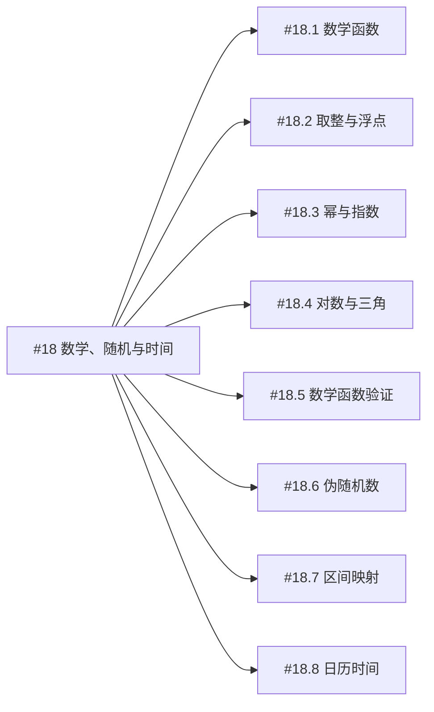

### 18.1 数学函数

> [!note]- 知识图与目录
>
> ```mermaid
> flowchart LR
>   R["#18.1 数学函数"]
>   N0["#960. 绝对值函数不会改实参"]
>   R --> N0
>   N1["#961. int 绝对值用 abs"]
>   R --> N1
>   N2["#962. 宽整数绝对值"]
>   R --> N2
>   N3["#963. 浮点绝对值用 fabs"]
>   R --> N3
>   N4["#964. 最小负值取绝对值会越界"]
>   R --> N4
>   class R,N0,N1,N2,N3,N4 internal-link;
> ```
>
> - [[#960. 绝对值函数不会改实参|960. 绝对值函数不会改实参]]
> - [[#961. int 绝对值用 abs|961. int 绝对值用 abs]]
> - [[#962. 宽整数绝对值|962. 宽整数绝对值]]
> - [[#963. 浮点绝对值用 fabs|963. 浮点绝对值用 fabs]]
> - [[#964. 最小负值取绝对值会越界|964. 最小负值取绝对值会越界]]

#### 960. 绝对值函数不会改实参

abs像toupper一样，返回计算出的值，不自动把调用者的变量改成该值。需要保留结果，应赋给目标对象；函数调用与赋值不是同一步。

#### 961. int 绝对值用 abs

abs由`<stdlib.h>`声明，参数与结果都是int。不要因为名字与fabs都含abs，就认为参数和返回类型可以任意混用。

#### 962. 宽整数绝对值

labs处理long并返回long，llabs处理long long并返回long long，均由`<stdlib.h>`声明。应按需要保留的整数类型选择接口，不能先窄化到int再指望abs恢复丢失范围。

#### 963. 浮点绝对值用 fabs

fabs声明于`<math.h>`，普通版本接收double并返回double；它不同于`<stdlib.h>`里的整数abs。数学意义类似，C接口类型契约不同。

#### 964. 最小负值取绝对值会越界

C23补码signed整数的负数范围比正数多一个值，因此abs(INT_MIN)的正结果装不进int，行为未定义；labs/llabs也有各自极小值问题。数学上存在结果，不表示当前C类型可表示它，不能把“先取绝对值”当作无条件安全处理。

### 18.2 取整与浮点

> [!note]- 知识图与目录
>
> ```mermaid
> flowchart LR
>   R["#18.2 取整与浮点"]
>   N0["#965. floor 朝负无穷取整"]
>   R --> N0
>   N1["#966. floor 结果仍是 double"]
>   R --> N1
>   N2["#967. ceil 朝正无穷取整"]
>   R --> N2
>   N3["#968. ceil 结果仍是 double"]
>   R --> N3
>   N4["#969. 正零与负零数值相等"]
>   R --> N4
>   class R,N0,N1,N2,N3,N4 internal-link;
> ```
>
> - [[#965. floor 朝负无穷取整|965. floor 朝负无穷取整]]
> - [[#966. floor 结果仍是 double|966. floor 结果仍是 double]]
> - [[#967. ceil 朝正无穷取整|967. ceil 朝正无穷取整]]
> - [[#968. ceil 结果仍是 double|968. ceil 结果仍是 double]]
> - [[#969. 正零与负零数值相等|969. 正零与负零数值相等]]

#### 965. floor 朝负无穷取整

floor(x)取不大于x的最大整数值，方向朝负无穷，不是简单删掉小数。floor(3.7)为3.0，floor(-3.7)为-4.0；负数是检验“向下”含义的关键情景。

#### 966. floor 结果仍是 double

floor的结果即使数学上是整数，普通版本的C返回类型仍为double。需要转成int时还要检查目标范围；输出时不能因没有小数就错误使用%d。

#### 967. ceil 朝正无穷取整

ceil(x)取不小于x的最小整数值：ceil(3.7)为4.0，ceil(-3.7)为-3.0。它的方向朝正无穷，不能把负数情形按“绝对值变大”理解。

#### 968. ceil 结果仍是 double

ceil普通版本接收double并返回double。取整改变的是数值，不自动变成整数类型；若后续需要其他类型，仍要另行执行合法、可表示的转换。

#### 969. 正零与负零数值相等

支持带符号零的浮点实现可区分+0.0、-0.0，但普通数值比较中两者相等，`0.0 == -0.0`为真。符号差异不表示它们是一正一负的非零量。

### 18.3 幂与指数

> [!note]- 知识图与目录
>
> ```mermaid
> flowchart LR
>   R["#18.3 幂与指数"]
>   N0["#970. pow 先底数后指数"]
>   R --> N0
>   N1["#971. pow 返回 double"]
>   R --> N1
>   N2["#972. exp 底数固定为 e"]
>   R --> N2
>   class R,N0,N1,N2 internal-link;
> ```
>
> - [[#970. pow 先底数后指数|970. pow 先底数后指数]]
> - [[#971. pow 返回 double|971. pow 返回 double]]
> - [[#972. exp 底数固定为 e|972. exp 底数固定为 e]]

#### 970. pow 先底数后指数

pow(a,b)的第一个参数是底数，第二个是指数；pow(2.0,3.0)计算$2^3$。不要将两参数顺序颠倒成$3^2$。

#### 971. pow 返回 double

`<math.h>`中pow普通版本返回double，即使数学结果恰好是整数。用pow再强转，不能无条件保证任意整数幂精确，或保证转成的整数类型能装下结果。

数学乘方与 C 异或的区别见 [[#531. 异或不是乘方|异或不是乘方]]。

#### 972. exp 底数固定为 e

exp(x)计算$e^x$，底数固定为数学常数e；pow(a,b)的底数由a指定。exp(3.0)、pow(2.0,3.0)、浮点常量2e3分别是$e^3$、$2^3$、$2\times10^3$，不能把三种e/指数语境混同。

### 18.4 对数与三角

> [!note]- 知识图与目录
>
> ```mermaid
> flowchart LR
>   R["#18.4 对数与三角"]
>   N0["#973. log10 是十进制对数"]
>   R --> N0
>   N1["#974. log 是自然对数"]
>   R --> N1
>   N2["#975. 对数输入与结果符号"]
>   R --> N2
>   N3["#976. 三角函数使用弧度"]
>   R --> N3
>   N4["#977. 奇点附近不保证无穷"]
>   R --> N4
>   class R,N0,N1,N2,N3,N4 internal-link;
> ```
>
> - [[#973. log10 是十进制对数|973. log10 是十进制对数]]
> - [[#974. log 是自然对数|974. log 是自然对数]]
> - [[#975. 对数输入与结果符号|975. 对数输入与结果符号]]
> - [[#976. 三角函数使用弧度|976. 三角函数使用弧度]]
> - [[#977. 奇点附近不保证无穷|977. 奇点附近不保证无穷]]

#### 973. log10 是十进制对数

log10由`<math.h>`声明，普通版本接收并返回double，求以10为底的对数。log10(10.0)为1.0，不是自然对数log的另一个拼写。

#### 974. log 是自然对数

log(x)以数学常数e为底，log(10.0)约为2.302585；不是以10为底。换底数时换的是函数含义，不是仅改输出小数位数。

#### 975. 对数输入与结果符号

实数对数输入须大于零，但结果可以为负，例如log10(0.1)约为-1。零输入涉及极点错误，负输入涉及定义域错误；不能因“输出允许负”就推断“输入也可负”。

#### 976. 三角函数使用弧度

sin/cos/tan的参数是弧度，不是角度。若输入来自角度，先按$\text{radian}=\text{degree}\times\pi/180$转换；直接把90交给sin不代表计算90度的正弦。

#### 977. 奇点附近不保证无穷

浮点pi只是近似值，tan(pi/2)不保证可靠得到某个代表数学无穷的特殊值，也可能得到很大的有限数。数学奇点、近似输入和库实现错误报告是不同层次，应按函数契约及math_errhandling支持机制判断。

### 18.5 数学函数验证

> [!note]- 知识图与目录
>
> ```mermaid
> flowchart LR
>   R["#18.5 数学函数验证"]
>   N0["#978. 数学接口完整示例"]
>   R --> N0
>   class R,N0 internal-link;
> ```
>
> - [[#978. 数学接口完整示例|978. 数学接口完整示例]]

#### 978. 数学接口完整示例

保留类型正确的完整输出示例，验证负数取整、乘方和对数；%.2f控制显示精度，不改变double返回类型。

```c
#include <stdio.h>
#include <math.h>

int main(void)
{
    printf("%.2f %.2f\n", floor(-3.7), ceil(-3.7));
    printf("%.2f %.2f\n", pow(2.0, 3.0), log10(10.0));
    return 0;
}
```

```text
-4.00 -3.00
8.00 1.00
```

有些工具链需额外数学库链接选项，如GCC环境的-lm；头文件声明不自动完成链接。

### 18.6 伪随机数

> [!note]- 知识图与目录
>
> ```mermaid
> flowchart LR
>   R["#18.6 伪随机数"]
>   N0["#979. rand 的返回范围"]
>   R --> N0
>   N1["#980. 伪随机来自算法序列"]
>   R --> N1
>   N2["#981. srand 选择序列起点"]
>   R --> N2
>   N3["#982. 同种子重现同序列"]
>   R --> N3
>   N4["#983. 不设种子相当于一"]
>   R --> N4
>   N5["#984. 通常只初始化一次"]
>   R --> N5
>   N6["#985. rand 不用于安全随机"]
>   R --> N6
>   class R,N0,N1,N2,N3,N4,N5,N6 internal-link;
> ```
>
> - [[#979. rand 的返回范围|979. rand 的返回范围]]
> - [[#980. 伪随机来自算法序列|980. 伪随机来自算法序列]]
> - [[#981. srand 选择序列起点|981. srand 选择序列起点]]
> - [[#982. 同种子重现同序列|982. 同种子重现同序列]]
> - [[#983. 不设种子相当于一|983. 不设种子相当于一]]
> - [[#984. 通常只初始化一次|984. 通常只初始化一次]]
> - [[#985. rand 不用于安全随机|985. rand 不用于安全随机]]

#### 979. rand 的返回范围

`<stdlib.h>`的rand()无参数，返回int，范围为0至RAND_MAX（含两端）。RAND_MAX至少32767，具体上界由实现决定，不要把某台机器上的数列或上界写成所有C程序保证。

#### 980. 伪随机来自算法序列

rand的数字由算法产生，看起来具有随机性，但不是天然不可预测的随机源。“伪”不表示函数失效，而是提醒它有确定的生成过程与内部状态。

#### 981. srand 选择序列起点

srand(seed)接受unsigned int种子，设置rand序列的起点，返回void。它是初始化状态的操作，不是直接返回随机数；随机值还要调用rand取得。

#### 982. 同种子重现同序列

在同一个实现中，使用相同种子会重现同一rand序列；不同编译器/标准库不保证生成相同数字。可把种子看成选定一条数列的起跑线，重设同起点就会重走同一路线。

#### 983. 不设种子相当于一

从未调用srand时，标准规定rand的效果相当于先使用种子1。因此“没设种子每次就自动按当前时间变化”不是标准规则。

#### 984. 通常只初始化一次

程序开头通常设一次种子，后面连续rand向前走。若快速循环每次都srand(time(NULL))，时间值可能相同，于是反复回到同一起跑线并取得同一个第一项；不是rand突然坏了。

```text
设置同一种子 → 第一个数
再次设置它   → 又回到第一个数
```

#### 985. rand 不用于安全随机

rand不提供密码学安全保证，不适合密钥、口令令牌等需要不可预测性的场景。时间种子也不会自动把它变成安全随机源。

### 18.7 区间映射

> [!note]- 知识图与目录
>
> ```mermaid
> flowchart LR
>   R["#18.7 区间映射"]
>   N0["#986. 取模限制数字范围"]
>   R --> N0
>   N1["#987. 取模可能产生偏差"]
>   R --> N1
>   N2["#988. 骰子是先取模再平移"]
>   R --> N2
>   N3["#989. 一般闭区间公式的前提"]
>   R --> N3
>   class R,N0,N1,N2,N3 internal-link;
> ```
>
> - [[#986. 取模限制数字范围|986. 取模限制数字范围]]
> - [[#987. 取模可能产生偏差|987. 取模可能产生偏差]]
> - [[#988. 骰子是先取模再平移|988. 骰子是先取模再平移]]
> - [[#989. 一般闭区间公式的前提|989. 一般闭区间公式的前提]]

#### 986. 取模限制数字范围

rand()%10的余数落在0至9，可作基础数字练习。它限制范围，不额外保存生成器状态，也不表示每个数字已被证明等概率。

#### 987. 取模可能产生偏差

如果生成器可能的输出总数不能被区间宽度整除，一些余数对应的来源数会比另一些多，取模就可能有分布偏差；生成器自身分布也有影响。范围正确不等于概率严格均匀。

#### 988. 骰子是先取模再平移

`rand()%6+1`先得到0至5，再整体加1，映射为1至6。

```text
rand()%6 → 0、1、2、3、4、5
      +1 → 1、2、3、4、5、6
```

这几个原内部步骤属于同一个平移推导，不机械分成独立句子。概率均匀性仍需另作论证。

#### 989. 一般闭区间公式的前提

教学公式`rand()%(max-min+1)+min`用于闭区间，要求min<=max、宽度为正且计算不溢出、宽度在可覆盖范围内、最终加法也可表示。它不保证严格均匀或安全随机，不能只因公式短就跳过类型与范围检查。

### 18.8 日历时间

> [!note]- 知识图与目录
>
> ```mermaid
> flowchart LR
>   R["#18.8 日历时间"]
>   N0["#990. time 返回 time_t"]
>   R --> N0
>   N1["#991. 纪元和表示依实现"]
>   R --> N1
>   N2["#992. 时间转为种子的情景"]
>   R --> N2
>   N3["#993. 时间种子完整程序"]
>   R --> N3
>   class R,N0,N1,N2,N3 internal-link;
> ```
>
> - [[#990. time 返回 time_t|990. time 返回 time_t]]
> - [[#991. 纪元和表示依实现|991. 纪元和表示依实现]]
> - [[#992. 时间转为种子的情景|992. 时间转为种子的情景]]
> - [[#993. 时间种子完整程序|993. 时间种子完整程序]]

#### 990. time 返回 time_t

`<time.h>`中的time(NULL)获取当前日历时间，返回time_t；NULL表示不另存到调用者给出的对象。无法取得时间时返回(time_t)-1，不要把它按固定int或long类型猜测。

#### 991. 纪元和表示依实现

常见系统的time值表示从1970-01-01 UTC起的秒数，但ISO C不强制所有time_t采用这一纪元、单位或整数表示。不能无前提把time_t当long用%ld打印。

#### 992. 时间转为种子的情景

`srand((unsigned int)time(NULL))`可按“取当前时间→转成种子类型→初始化数列”理解。常见整数time_t环境里，不同时刻启动通常可能取到不同种子；同一时刻粒度或转换截断仍可能相同，不能保证每次启动不同。特殊浮点time_t实现还要先保证种子转换可表示。

#### 993. 时间种子完整程序

保留只初始化一次并检查取得时间是否失败的完整程序；三次输出属于同一序列，不在循环里反复重置。

```c
#include <stdio.h>
#include <stdlib.h>
#include <time.h>

int main(void)
{
    time_t now = time(NULL);
    if (now == (time_t)-1) {
        fputs("Cannot obtain current time\n", stderr);
        return EXIT_FAILURE;
    }
    /* 常见整数型 time_t 环境中的基础随机种子用法。 */
    srand((unsigned int)now);
    for (int i = 0; i < 3; ++i)
        printf("%d\n", rand());
    return EXIT_SUCCESS;
}
```

---

## 19 预处理与多文件

最后回到构建过程，把声明、定义、预处理、链接和私有接口串成能拆分和维护的多文件程序。

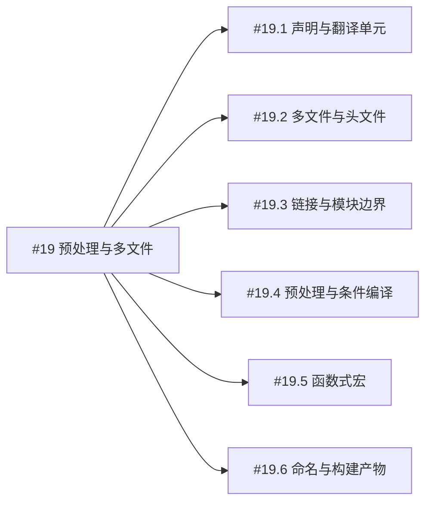

### 19.1 声明与翻译单元

函数声明提供调用接口，定义提供函数体；基础区别见 [[#148. 声明介绍函数接口|声明介绍函数接口]] 与 [[#149. 定义提供函数体|定义提供函数体]]。单有声明不会自动补出实现。

> [!note]- 知识图与目录
>
> ```mermaid
> flowchart LR
>   R["#19.1 声明与翻译单元"]
>   N0["#994. 声明和定义的参数名可不同"]
>   R --> N0
>   N1["#995. 声明与定义的类型须兼容"]
>   R --> N1
>   N2["#996. 翻译单元包含展开的头文件"]
>   R --> N2
>   N3["#997. 包含头文件不自动编译源文件"]
>   R --> N3
>   N4["#998. 头文件菜单与库厨房"]
>   R --> N4
>   N5["#999. 头文件通常承载共享接口"]
>   R --> N5
>   class R,N0,N1,N2,N3,N4,N5 internal-link;
> ```
>
> - [[#994. 声明和定义的参数名可不同|994. 声明和定义的参数名可不同]]
> - [[#995. 声明与定义的类型须兼容|995. 声明与定义的类型须兼容]]
> - [[#996. 翻译单元包含展开的头文件|996. 翻译单元包含展开的头文件]]
> - [[#997. 包含头文件不自动编译源文件|997. 包含头文件不自动编译源文件]]
> - [[#998. 头文件菜单与库厨房|998. 头文件菜单与库厨房]]
> - [[#999. 头文件通常承载共享接口|999. 头文件通常承载共享接口]]

#### 994. 声明和定义的参数名可不同

声明`double average(int a, int b);`可对应下面的定义：
```c
double average(int x, int y)
{
    return ((double)x + (double)y) / 2.0;
}
```
参数名不属于函数类型；a/b与x/y不同不影响兼容。相加前先转为浮点，避免先发生int加法溢出；浮点结果仍须在可表示范围内。

#### 995. 声明与定义的类型须兼容

参数名称可以变化，返回类型、参数类型和数量等却须兼容。不能把`double average(int, int);`后面接成接受两个`double`的普通定义，再指望链接时自动修复合同。

#### 996. 翻译单元包含展开的头文件

“翻译”指把C源程序转成计算机可执行的形式，不是中译英。源文件经过预处理、展开包含的头文件后，形成一个翻译单元的编译输入：
```text
main.c + 展开的头文件       → 一个翻译单元
math_utils.c + 展开的头文件 → 另一个翻译单元
```
普通.h文件不天然单独构成翻译单元。

#### 997. 包含头文件不自动编译源文件

`#include "math_utils.h"`让当前翻译单元处理头文件内容；它不会自动编译、链接同名`math_utils.c`。即使调用方成功编译，最终构建仍须提供所调用函数的兼容定义。

#### 998. 头文件菜单与库厨房

`stdio.h`中的声明像菜单：说明有`printf`、应交什么实参；库实现像厨房：实际完成输出工作。菜单不会自动把厨房的全部实现复制到当前源码。函数也可能由宏等标准允许的形式提供，不能把教学比喻当作每次调用的固定机器过程。

#### 999. 头文件通常承载共享接口

工程中通常在.h中放共享声明、类型和宏等接口，在.c中放普通外部函数及对象的实现定义。不能反向说“头文件只能放函数声明”，但普通外部定义放入头文件容易造成多个翻译单元的重复定义。

### 19.2 多文件与头文件

> [!note]- 知识图与目录
>
> ```mermaid
> flowchart LR
>   R["#19.2 多文件与头文件"]
>   N0["#1000. 三文件协作实现接口"]
>   R --> N0
>   N1["#1001. 包含定界符是语法"]
>   R --> N1
>   N2["#1002. 尖括号按实现方式查找"]
>   R --> N2
>   N3["#1003. 引号形式的查找也由实现定义"]
>   R --> N3
>   N4["#1004. 头文件保护避免本单元重复展开"]
>   R --> N4
>   N5["#1005. ifndef 判断宏尚未定义"]
>   R --> N5
>   N6["#1006. 首次包含先建立保护标记"]
>   R --> N6
>   N7["#1007. 保护宏不是整个头文件"]
>   R --> N7
>   N8["#1008. 保护宏不能消除跨单元重复定义"]
>   R --> N8
>   class R,N0,N1,N2,N3,N4,N5,N6,N7,N8 internal-link;
> ```
>
> - [[#1000. 三文件协作实现接口|1000. 三文件协作实现接口]]
> - [[#1001. 包含定界符是语法|1001. 包含定界符是语法]]
> - [[#1002. 尖括号按实现方式查找|1002. 尖括号按实现方式查找]]
> - [[#1003. 引号形式的查找也由实现定义|1003. 引号形式的查找也由实现定义]]
> - [[#1004. 头文件保护避免本单元重复展开|1004. 头文件保护避免本单元重复展开]]
> - [[#1005. ifndef 判断宏尚未定义|1005. ifndef 判断宏尚未定义]]
> - [[#1006. 首次包含先建立保护标记|1006. 首次包含先建立保护标记]]
> - [[#1007. 保护宏不是整个头文件|1007. 保护宏不是整个头文件]]
> - [[#1008. 保护宏不能消除跨单元重复定义|1008. 保护宏不能消除跨单元重复定义]]

#### 1000. 三文件协作实现接口

以下三个文件共同组成一个程序。

**math_utils.h**

```c
#ifndef MATH_UTILS_H
#define MATH_UTILS_H

int add(int a, int b);

#endif
```

**math_utils.c**

```c
#include "math_utils.h"

int add(int a, int b)
{
    return a + b; /* 调用前提：结果可以由int表示 */
}
```

**main.c**

```c
#include <stdio.h>
#include "math_utils.h"

int main(void)
{
    printf("%d\n", add(3, 5)); /* 8 */
    return 0;
}
```

GCC工具链下可一起构建：

```text
gcc -std=c23 -Wall -Wextra -Wpedantic main.c math_utils.c -o demo
```

也可以分别生成目标文件后链接：

```text
gcc -std=c23 -Wall -Wextra -Wpedantic -c main.c
gcc -std=c23 -Wall -Wextra -Wpedantic -c math_utils.c
gcc main.o math_utils.o -o demo
```

具体命令、目标文件后缀与运行方式由工具链和平台决定。源文件也包含自己的头文件，能让编译器检查声明与定义是否一致。

#### 1001. 包含定界符是语法

`#include <stdio.h>`中的尖括号与`#include "math_utils.h"`中的双引号都是包含语法的一部分，不是为了排版加上的装饰。

#### 1002. 尖括号按实现方式查找

`#include <...>`常用于实现提供的标准库等头文件。具体查找目录与顺序由实现定义，不是C规定的一条固定磁盘路径。

#### 1003. 引号形式的查找也由实现定义

`#include "..."`常用于项目头文件。GCC通常先看包含该指令的文件所在目录，再查配置路径；这是工具链行为，不能推成所有C实现必须先查当前工作目录，也不会搜索整块磁盘。

#### 1004. 头文件保护避免本单元重复展开

同一头文件可能被间接包含多次。保护宏让同一预处理过程只保留一次受保护内容，避免相应的重复定义问题；重复包含时，它检查的是已经记录的宏状态，不是执行一段运行时检测代码。

#### 1005. ifndef 判断宏尚未定义

`ifndef`可拆成`if + not + defined`。`#ifndef MATH_UTILS_H`表示宏尚未定义时，保留受控区域；它不检查某个运行时变量是否为零。

#### 1006. 首次包含先建立保护标记

```c
#ifndef MATH_UTILS_H
#define MATH_UTILS_H

int add(int a, int b);

#endif
```
首次包含时：宏未定义 → 保留区域 → 定义保护宏 → 保留add声明 → 到endif结束区域。声明被保留供编译使用，不是此时调用add。

#### 1007. 保护宏不是整个头文件

`#define MATH_UTILS_H`只把这个宏名记录为已定义，不创建int变量，也不是把整份头文件变成一个宏。随后`#ifndef`通过这个标记决定是否再次处理受控内容。

#### 1008. 保护宏不能消除跨单元重复定义

保护宏的状态分别属于各翻译单元的预处理过程。若把同一个普通外部对象定义放在头文件中，两个.c文件仍可能各自得到一份定义；不能靠保护宏解决最终链接的重复定义。共享对象一般在头文件写extern声明、一个源文件提供定义。

### 19.3 链接与模块边界

> [!note]- 知识图与目录
>
> ```mermaid
> flowchart LR
>   R["#19.3 链接与模块边界"]
>   N0["#1009. 链接决定声明是否指同一实体"]
>   R --> N0
>   N1["#1010. extern 不带初始化通常仅声明"]
>   R --> N1
>   N2["#1011. extern 不负责加载或执行文件"]
>   R --> N2
>   N3["#1012. extern 带初始化仍是定义"]
>   R --> N3
>   N4["#1013. 文件作用域无初始化声明可暂定定义"]
>   R --> N4
>   N5["#1014. 跨文件引用同一个外部对象"]
>   R --> N5
>   N6["#1015. extern 不能穿透局部作用域"]
>   R --> N6
>   N7["#1016. 文件作用域 static 具有内部链接"]
>   R --> N7
>   N8["#1017. 同一单元可以直接使用静态名字"]
>   R --> N8
>   class R,N0,N1,N2,N3,N4,N5,N6,N7,N8 internal-link;
> ```
>
> ```mermaid
> flowchart LR
>   R["#19.3 链接与模块边界"]
>   N0["#1018. 文件 static 与局部 static 的链接不同"]
>   R --> N0
>   N1["#1019. 内部链接仍可通过接口访问对象"]
>   R --> N1
>   N2["#1020. 静态函数具有内部链接"]
>   R --> N2
>   N3["#1021. 普通函数声明通常具有外部链接"]
>   R --> N3
>   N4["#1022. 静态函数不自动记住状态"]
>   R --> N4
>   N5["#1023. 公开接口封装私有辅助"]
>   R --> N5
>   N6["#1024. 调用的实参数量须符合原型"]
>   R --> N6
>   class R,N0,N1,N2,N3,N4,N5,N6 internal-link;
> ```
>
> - [[#1009. 链接决定声明是否指同一实体|1009. 链接决定声明是否指同一实体]]
> - [[#1010. extern 不带初始化通常仅声明|1010. extern 不带初始化通常仅声明]]
> - [[#1011. extern 不负责加载或执行文件|1011. extern 不负责加载或执行文件]]
> - [[#1012. extern 带初始化仍是定义|1012. extern 带初始化仍是定义]]
> - [[#1013. 文件作用域无初始化声明可暂定定义|1013. 文件作用域无初始化声明可暂定定义]]
> - [[#1014. 跨文件引用同一个外部对象|1014. 跨文件引用同一个外部对象]]
> - [[#1015. extern 不能穿透局部作用域|1015. extern 不能穿透局部作用域]]
> - [[#1016. 文件作用域 static 具有内部链接|1016. 文件作用域 static 具有内部链接]]
> - [[#1017. 同一单元可以直接使用静态名字|1017. 同一单元可以直接使用静态名字]]
> - [[#1018. 文件 static 与局部 static 的链接不同|1018. 文件 static 与局部 static 的链接不同]]
> - [[#1019. 内部链接仍可通过接口访问对象|1019. 内部链接仍可通过接口访问对象]]
> - [[#1020. 静态函数具有内部链接|1020. 静态函数具有内部链接]]
> - [[#1021. 普通函数声明通常具有外部链接|1021. 普通函数声明通常具有外部链接]]
> - [[#1022. 静态函数不自动记住状态|1022. 静态函数不自动记住状态]]
> - [[#1023. 公开接口封装私有辅助|1023. 公开接口封装私有辅助]]
> - [[#1024. 调用的实参数量须符合原型|1024. 调用的实参数量须符合原型]]

#### 1009. 链接决定声明是否指同一实体

链接（linkage）处理不同位置的声明是否代表同一实体，尤其涉及跨翻译单元时的名字关系。它与“名字在哪可见”的作用域、“对象活多久”的存储期分开；完整三概念对照见生命周期章节。

#### 1010. extern 不带初始化通常仅声明

文件作用域的`extern int score;`通常仅声明一个对象，不在本句定义它。像贴一张寻人启事：“有一个叫score的int，请把这里的引用与它对上。”实际对象仍须有相应定义。

#### 1011. extern 不负责加载或执行文件

`extern`声明不自动加载另一个源文件，不搜索文件路径，不执行那个文件。名字的引用与实际定义通过程序的编译、链接组织相接，不是运行时的“打开文件”命令。

#### 1012. extern 带初始化仍是定义

文件作用域`extern int score = 90;`有初始化，仍是对象定义。因此“extern永远不创建对象”过于绝对，要限定为不带初始化的相应声明。

#### 1013. 文件作用域无初始化声明可暂定定义

`int score;`在文件作用域是暂定定义，不能与`extern int score;`一律当成同一种“仅声明”。须结合整个翻译单元的其他声明与结尾规则判断最终定义。

#### 1014. 跨文件引用同一个外部对象

下面三个文件展示跨文件共享同一个对象；头文件放声明，只有一个源文件放定义。

**score.h**

```c
#ifndef SCORE_H
#define SCORE_H

extern int score;

#endif
```

**score.c**

```c
#include "score.h"

int score = 90;
```

**main.c**

```c
#include <stdio.h>
#include "score.h"

int main(void)
{
    score += 5;
    printf("%d\n", score); /* 95 */
    return 0;
}
```

GCC构建示例：`gcc -std=c23 main.c score.c -o demo`。这里不存在“每个包含头文件的源文件各自定义一个score”的设计；各处通过兼容声明引用同一外部对象。

#### 1015. extern 不能穿透局部作用域

`extern`不是打通所有作用域的钥匙，不能让另一个函数直接引用本函数的普通局部变量。需要跨函数访问时，应通过参数、返回值或其他明确接口传递。

#### 1016. 文件作用域 static 具有内部链接

文件作用域的`static int current;`具有内部链接，其他翻译单元不能用extern直接接到这个内部链接实体。精确边界是翻译单元，不只是操作系统中的某个磁盘文件。

#### 1017. 同一单元可以直接使用静态名字

```c
#include <stdio.h>

static int b = 0;

void test(void)
{
    ++b;
}

int main(void)
{
    test();
    test();
    b = 10; /* 同一翻译单元、可见作用域内，合法 */
    printf("%d\n", b); /* 10 */
    return 0;
}
```

这里main与test处在同一翻译单元且声明后的可见范围内，故b=10合法并输出10。static不表示整个文件中只有某个函数能访问它。

#### 1018. 文件 static 与局部 static 的链接不同

文件作用域static对象具有内部链接；块作用域static对象的名字通常无链接。二者都可有静态存储期，但不能因同有static，就认为局部名字也能靠extern跨文件访问。

#### 1019. 内部链接仍可通过接口访问对象

不能直接通过外部声明引用内部链接名字，不等于对象对整个程序绝对不可接触。模块可公开函数，让其他翻译单元通过该函数读写状态；这与强行用extern穿透边界不同。

#### 1020. 静态函数具有内部链接

文件作用域函数定义前加static，例如`static int double_value(int x)`，把函数名限制为内部链接。其他翻译单元不能通过普通外部声明直接引用这个同名实体。

#### 1021. 普通函数声明通常具有外部链接

`int process(int x);`通常具有外部链接，`extern int process(int x);`可显式写出extern而不改变这种普通情景。若已有可见的内部链接声明，还须遵守先前声明的链接规则，不能只看当前一行是否省略static。

#### 1022. 静态函数不自动记住状态

函数上的static主要约束名字的链接，不会让函数自动记住上次返回值。跨调用保存数据须由具有合适存储期的对象等实现，不能把静态函数与静态局部变量混为一谈。

#### 1023. 公开接口封装私有辅助

把需要给其他模块使用的函数公开，把仅用于内部辅助的函数声明为static。以下counter模块提供编号接口：

**counter.h**

```c
#ifndef COUNTER_H
#define COUNTER_H

int next_number(void);

#endif
```

**counter.c**

```c
#include <limits.h>
#include "counter.h"

static int current = 0;

static int can_advance(void)
{
    return current < INT_MAX;
}

int next_number(void)
{
    if (!can_advance())
        return -1;
    return ++current;
}
```

**main.c**

```c
#include <stdio.h>
#include "counter.h"

int main(void)
{
    printf("%d\n", next_number()); /* 1 */
    printf("%d\n", next_number()); /* 2 */
    return 0;
}
```

`next_number` 是公开接口；`current` 与 `can_advance` 是模块内部细节。本例用−1表示编号用尽，正常编号从1开始，因此哨兵不会与成功结果冲突。普通函数声明通常具有外部链接，无须总是显式写 `extern`；若已有可见的内部链接声明，还须遵循已有声明的链接规则。

#### 1024. 调用的实参数量须符合原型

若已声明`int process(int x);`，`process(5)`是带一个实参的调用；`process()`试图传零个实参，不符合原型。`process`单独用在适当表达式中可转为函数指针；`int process(int x);`本身只是声明，不执行函数。C23空参数声明的历史区别见函数章节。

### 19.4 预处理与条件编译

> [!note]- 知识图与目录
>
> ```mermaid
> flowchart LR
>   R["#19.4 预处理与条件编译"]
>   N0["#1025. 预处理器是软件而非 CPU"]
>   R --> N0
>   N1["#1026. 预处理先处理特定指令"]
>   R --> N1
>   N2["#1027. 宏替换针对预处理记号"]
>   R --> N2
>   N3["#1028. 宏展开结果继续重扫"]
>   R --> N3
>   N4["#1029. ifdef 只检查名字已定义"]
>   R --> N4
>   N5["#1030. if 检查展开后表达式的值"]
>   R --> N5
>   N6["#1031. 空替换宏可用作存在标记"]
>   R --> N6
>   N7["#1032. 已定义宏保留调试分支"]
>   R --> N7
>   N8["#1033. else 保留条件不成立的分支"]
>   R --> N8
>   class R,N0,N1,N2,N3,N4,N5,N6,N7,N8 internal-link;
> ```
>
> ```mermaid
> flowchart LR
>   R["#19.4 预处理与条件编译"]
>   N0["#1034. elif 选择多个候选分支"]
>   R --> N0
>   N1["#1035. elif 同样按表达式取值"]
>   R --> N1
>   N2["#1036. 条件编译不同于运行时 if"]
>   R --> N2
>   N3["#1037. undef 取消后续宏定义状态"]
>   R --> N3
>   N4["#1038. undef 不撤销已处理代码"]
>   R --> N4
>   class R,N0,N1,N2,N3,N4 internal-link;
> ```
>
> - [[#1025. 预处理器是软件而非 CPU|1025. 预处理器是软件而非 CPU]]
> - [[#1026. 预处理先处理特定指令|1026. 预处理先处理特定指令]]
> - [[#1027. 宏替换针对预处理记号|1027. 宏替换针对预处理记号]]
> - [[#1028. 宏展开结果继续重扫|1028. 宏展开结果继续重扫]]
> - [[#1029. ifdef 只检查名字已定义|1029. ifdef 只检查名字已定义]]
> - [[#1030. if 检查展开后表达式的值|1030. if 检查展开后表达式的值]]
> - [[#1031. 空替换宏可用作存在标记|1031. 空替换宏可用作存在标记]]
> - [[#1032. 已定义宏保留调试分支|1032. 已定义宏保留调试分支]]
> - [[#1033. else 保留条件不成立的分支|1033. else 保留条件不成立的分支]]
> - [[#1034. elif 选择多个候选分支|1034. elif 选择多个候选分支]]
> - [[#1035. elif 同样按表达式取值|1035. elif 同样按表达式取值]]
> - [[#1036. 条件编译不同于运行时 if|1036. 条件编译不同于运行时 if]]
> - [[#1037. undef 取消后续宏定义状态|1037. undef 取消后续宏定义状态]]
> - [[#1038. undef 不撤销已处理代码|1038. undef 不撤销已处理代码]]

#### 1025. 预处理器是软件而非 CPU

预处理器和编译器都是软件或工具链中的处理阶段，不是CPU本身。它们运行时也需要CPU执行指令，就像其他程序一样；CPU是在程序运行时执行机器指令的硬件。

#### 1026. 预处理先处理特定指令

`#include`、`#define`、`#ifndef`等由预处理阶段处理；随后编译器再处理相应C程序。`#`可有前导空白，但须处在相应预处理行的指令位置；不是程序运行时让CPU扫描源代码文字。

#### 1027. 宏替换针对预处理记号

宏是预处理阶段的记号（token）替换规则。它不先建立普通函数形参对象再执行函数体，也不是任意文本字符的无条件查找替换。

对象式宏和函数式宏都遵循这个机制：
```c
#define SIZE 10
#define ADD(x, y) ((x) + (y))
```
`SIZE`按名字替换；`ADD(2, 3)`还会按函数式宏规则替换实参记号。名字里有括号，不表示它变成了普通C函数。

#### 1028. 宏展开结果继续重扫

替换结果还会继续扫描，其中出现的其他宏可进一步展开：
```c
#define A 3
#define B (A + 2)
```
`B`先引入替换列表中的`A`，再展开为：
```text
(3 + 2)
```
预处理负责展开记号；普通C表达式`(3 + 2)`的数值5由后续编译阶段按C规则得到。不能把“宏替换”理解为预处理器先执行一遍普通C算术。

#### 1029. ifdef 只检查名字已定义

`#ifdef DEBUG`检查宏DEBUG是否已经定义；不检查它代表的数字是否非零。它与`#ifndef`的存在条件相反。

#### 1030. if 检查展开后表达式的值

`#define DEBUG 0`后，`#ifdef DEBUG`仍成立，但`#if DEBUG`不成立。宏已定义不代表宏值非零，存在性判断与数值判断须分开。

#### 1031. 空替换宏可用作存在标记

`#define DEBUG`允许只定义名字而不放替换内容，适合与`#ifdef DEBUG`配合。不能不加区分地把空内容当成`#if DEBUG`中的数值表达式。DEBUG只是程序员约定的名字，不是C自动启用调试功能的特殊关键字。

#### 1032. 已定义宏保留调试分支

```c
#include <stdio.h>

#define DEBUG

int main(void)
{
#ifdef DEBUG
    printf("Debug mode\n");
#endif

    printf("Program running\n");
    return 0;
}
```

由于前面有：

```c
#define DEBUG
```

所以 `#ifdef DEBUG` 条件成立，预处理器会保留其中的 `printf`。

这里的 `DEBUG` 只是程序员自行约定的宏名，C 语言并没有赋予它特殊功能。

#### 1033. else 保留条件不成立的分支

可在同一条件编译区域写`#else`。以下是函数体内片段，已包含stdio.h：
```c
#ifdef DEBUG
    puts("Debug mode");
#else
    puts("Release mode");
#endif
```
DEBUG已定义时保留Debug分支；未定义时保留Release分支。只保留其中一种，不是运行到这里再检查一个DEBUG变量。

#### 1034. elif 选择多个候选分支

`#elif`在前面条件未选中时提供后续候选，作用类似预处理阶段的else if：
```c
#define LEVEL 2
#if LEVEL == 1
#define MODE_NAME "basic"
#elif LEVEL == 2
#define MODE_NAME "advanced"
#else
#define MODE_NAME "custom"
#endif
```
这里保留advanced对应的定义。

#### 1035. elif 同样按表达式取值

`#elif`与`#if`一样判断预处理表达式值，而不是仅判断宏名字是否存在。需要判断存在性时可使用相应的defined形式或存在性条件指令，不能省掉判断依据。

#### 1036. 条件编译不同于运行时 if

条件编译像编译前决定哪些段落进入最终稿；普通if像运行时决定走哪条道路。运行条件恒假，不等于其中不合法的C语法自动获得预处理排除的待遇。

#### 1037. undef 取消后续宏定义状态

`undef`来自undefine。`#undef DEBUG`取消预处理器记录的宏定义，影响之后的条件编译与宏替换；它不是删除同名变量。

#### 1038. undef 不撤销已处理代码

以下片段放在已包含stdio.h的函数体中：
```c
#define DEBUG
#ifdef DEBUG
    puts("A");
#endif
#undef DEBUG
#ifdef DEBUG
    puts("B");
#endif
```
预处理先保留A语句，后来取消宏只使B区域被跳过，不会回头删除已保留的A，所以程序只输出A。

### 19.5 函数式宏

> [!note]- 知识图与目录
>
> ```mermaid
> flowchart LR
>   R["#19.5 函数式宏"]
>   N0["#1039. 宏与函数的机制不同"]
>   R --> N0
>   N1["#1040. 展开后仍按优先级分组"]
>   R --> N1
>   N2["#1041. 宏参数需要括号保护"]
>   R --> N2
>   N3["#1042. 宏整体也需要外层括号"]
>   R --> N3
>   N4["#1043. 宏形参没有独立声明类型"]
>   R --> N4
>   N5["#1044. 宏展开后的 C 表达式仍检查类型"]
>   R --> N5
>   N6["#1045. 宏可重复实参中的函数调用"]
>   R --> N6
>   N7["#1046. 重复自增实参可能导致未定义行为"]
>   R --> N7
>   N8["#1047. 普通函数只求值一次该实参"]
>   R --> N8
>   class R,N0,N1,N2,N3,N4,N5,N6,N7,N8 internal-link;
> ```
>
> ```mermaid
> flowchart LR
>   R["#19.5 函数式宏"]
>   N0["#1048. 带副作用的值可先保存再调用"]
>   R --> N0
>   class R,N0 internal-link;
> ```
>
> - [[#1039. 宏与函数的机制不同|1039. 宏与函数的机制不同]]
> - [[#1040. 展开后仍按优先级分组|1040. 展开后仍按优先级分组]]
> - [[#1041. 宏参数需要括号保护|1041. 宏参数需要括号保护]]
> - [[#1042. 宏整体也需要外层括号|1042. 宏整体也需要外层括号]]
> - [[#1043. 宏形参没有独立声明类型|1043. 宏形参没有独立声明类型]]
> - [[#1044. 宏展开后的 C 表达式仍检查类型|1044. 宏展开后的 C 表达式仍检查类型]]
> - [[#1045. 宏可重复实参中的函数调用|1045. 宏可重复实参中的函数调用]]
> - [[#1046. 重复自增实参可能导致未定义行为|1046. 重复自增实参可能导致未定义行为]]
> - [[#1047. 普通函数只求值一次该实参|1047. 普通函数只求值一次该实参]]
> - [[#1048. 带副作用的值可先保存再调用|1048. 带副作用的值可先保存再调用]]

#### 1039. 宏与函数的机制不同

```c
#define DOUBLE(x) ((x) * 2)

int double_value(int x)
{
    return x * 2; /* 前提：结果可由int表示 */
}
```
二者可完成相同翻倍任务，但宏先替换记号；函数按函数调用规则求实参值并传给形参。宏展开本身不建立一次普通函数调用。

#### 1040. 展开后仍按优先级分组

宏替换不会冻结“看起来像函数调用”的整体边界，替换后的运算符仍参与普通表达式分组。`#define DOUBLE(x) ((x) * 2)`与`#define DOUBLE(x) (x) * 2`在简单使用时可能相同，放入其他算式就可能不同。

#### 1041. 宏参数需要括号保护

替换体中的参数使用`(x)`，避免传入表达式后意外结合：
```text
#define BAD_DOUBLE(x) x * 2
BAD_DOUBLE(2 + 3) → 2 + 3 * 2 → 8
```
加上参数括号后，`(2 + 3) * 2`才得到10。

#### 1042. 宏整体也需要外层括号

只给参数加括号仍不够：
```text
#define PARTIAL_DOUBLE(x) (x) * 2
10 / PARTIAL_DOUBLE(2)
→ 10 / (2) * 2
→ 10
```
正确整体写法`#define DOUBLE(x) ((x) * 2)`使同一算式为`10 / ((2) * 2)`，得到整数2。内层保护参数，外层保护整个展开结果。

#### 1043. 宏形参没有独立声明类型

`#define ADD(x, y) ((x) + (y))`中的x、y不声明为int或double；预处理阶段只按记号替换，不执行普通函数的参数类型接收。

#### 1044. 宏展开后的 C 表达式仍检查类型

`ADD(2, 3.5)`展开成`((2) + (3.5))`，随后编译器按`int + double`的正常类型规则得到double的5.5。宏阶段没有形参类型声明，不等于最终C代码没有类型检查。

#### 1045. 宏可重复实参中的函数调用

```c
#define SQUARE(x) ((x) * (x))
```
`SQUARE(3)`展开为`((3) * (3))`；`SQUARE(get_number())`则展开为两次`get_number()`调用。若它读取输入或改变状态，就不是“一次取值再平方”；括号不能自动缓存结果。

#### 1046. 重复自增实参可能导致未定义行为

```c
#define DOUBLE_BY_SUM(x) ((x) + (x))
/* 错误示例，不要执行：
int i = 2;
int y = DOUBLE_BY_SUM(i++);
*/
```
它展开成`((i++) + (i++))`，对同一对象的两次修改彼此未排序，属于未定义行为。`++i`、`i += 1`等会改状态的实参也须检查重复展开。

#### 1047. 普通函数只求值一次该实参

```c
int double_sum(int x)
{
    return x + x; /* 前提：结果可由int表示 */
}

/* 函数体内片段：
int i = 2;
int y = double_sum(i++); // y为4，i为3
*/
```
这里i++只为这一个实参求值一次，函数体重复使用的是形参副本x，不会再次执行i++。

#### 1048. 带副作用的值可先保存再调用

若只希望取值一次，先保存再计算：
```c
int square(int x)
{
    return x * x; /* 前提：结果可由int表示 */
}

/* get_number已有兼容声明，以下为函数体片段：
int value = get_number();
int result = square(value);
*/
```
先把“取数据”与“重复用数值”分开，避免让宏重复取数据。

### 19.6 命名与构建产物

> [!note]- 知识图与目录
>
> ```mermaid
> flowchart LR
>   R["#19.6 命名与构建产物"]
>   N0["#1049. 标识符不能包含空格"]
>   R --> N0
>   N1["#1050. 减号不是标识符字符"]
>   R --> N1
>   N2["#1051. 标识符区分大小写"]
>   R --> N2
>   N3["#1052. 普通标识符不能数字开头"]
>   R --> N3
>   N4["#1053. 关键字不能充当普通名字"]
>   R --> N4
>   N5["#1054. 避免占用实现保留名字"]
>   R --> N5
>   N6["#1055. 命名风格属于工程约定"]
>   R --> N6
>   N7["#1056. 临时变量可以使用短名"]
>   R --> N7
>   N8["#1057. 命名优先可读与一致"]
>   R --> N8
>   class R,N0,N1,N2,N3,N4,N5,N6,N7,N8 internal-link;
> ```
>
> ```mermaid
> flowchart LR
>   R["#19.6 命名与构建产物"]
>   N0["#1058. 不同实体有常见命名习惯"]
>   R --> N0
>   N1["#1059. utils 是工具函数的习惯缩写"]
>   R --> N1
>   N2["#1060. 头源文件成对命名便于定位"]
>   R --> N2
>   N3["#1061. 具体职责比笼统工具名明确"]
>   R --> N3
>   N4["#1062. 目标文件后缀是工具链习惯"]
>   R --> N4
>   N5["#1063. 文件角色与内部格式分开"]
>   R --> N5
>   N6["#1064. ELF 可承载多种目标角色"]
>   R --> N6
>   class R,N0,N1,N2,N3,N4,N5,N6 internal-link;
> ```
>
> - [[#1049. 标识符不能包含空格|1049. 标识符不能包含空格]]
> - [[#1050. 减号不是标识符字符|1050. 减号不是标识符字符]]
> - [[#1051. 标识符区分大小写|1051. 标识符区分大小写]]
> - [[#1052. 普通标识符不能数字开头|1052. 普通标识符不能数字开头]]
> - [[#1053. 关键字不能充当普通名字|1053. 关键字不能充当普通名字]]
> - [[#1054. 避免占用实现保留名字|1054. 避免占用实现保留名字]]
> - [[#1055. 命名风格属于工程约定|1055. 命名风格属于工程约定]]
> - [[#1056. 临时变量可以使用短名|1056. 临时变量可以使用短名]]
> - [[#1057. 命名优先可读与一致|1057. 命名优先可读与一致]]
> - [[#1058. 不同实体有常见命名习惯|1058. 不同实体有常见命名习惯]]
> - [[#1059. utils 是工具函数的习惯缩写|1059. utils 是工具函数的习惯缩写]]
> - [[#1060. 头源文件成对命名便于定位|1060. 头源文件成对命名便于定位]]
> - [[#1061. 具体职责比笼统工具名明确|1061. 具体职责比笼统工具名明确]]
> - [[#1062. 目标文件后缀是工具链习惯|1062. 目标文件后缀是工具链习惯]]
> - [[#1063. 文件角色与内部格式分开|1063. 文件角色与内部格式分开]]
> - [[#1064. ELF 可承载多种目标角色|1064. ELF 可承载多种目标角色]]

#### 1049. 标识符不能包含空格

空格用于分隔记号，不能作为普通C标识符内部的一部分。多个英文单词需要组合成名字时，可使用下划线或大小写约定连接。

#### 1050. 减号不是标识符字符

`int student-count = 10;`不能定义一个叫student-count的变量：中间的`-`是减号。文件名或URL可用kebab-case，不表示C变量名也允许这一形式。

#### 1051. 标识符区分大小写

`count`与`Count`是两个不同名字。字母大小写不是显示装饰，而参与标识符身份。

#### 1052. 普通标识符不能数字开头

`count2`可以作为名字，`2count`不能作为普通C标识符。不要把数字后缀与数字开头混为一谈。

#### 1053. 关键字不能充当普通名字

`int`、`return`、`if`等关键字不能拿来作普通变量名。名字看起来简短，也不能绕过关键字的语法用途。

#### 1054. 避免占用实现保留名字

某些以下划线开头的形式为C实现保留，保留规则还与名字位置有关。初学时优先用有业务含义的字母开头名字，避免自行制造这类实现命名空间中的名字。

#### 1055. 命名风格属于工程约定

常见风格包括：
| 风格 | 示例 |
|---|---|
| snake_case | student_count |
| camelCase | studentCount |
| PascalCase | StudentCount |
| 全大写蛇形 | MAX_STUDENTS |
| kebab-case | student-count |
前四种可在合适位置作C名字；最后一种常用于文件名或URL，不能直接作C标识符。风格名称不是语言关键字。

#### 1056. 临时变量可以使用短名

简单循环中的i、j，短暂中间值temp，都很正常。名字短不自动意味着难读；要看作用范围与含义是否清楚。

#### 1057. 命名优先可读与一致

名字应准确描述角色，并在项目内前后一致。不同职责不要只因同用int就取相同模糊名字；也不必为了偏好某种形式牺牲可理解性。

#### 1058. 不同实体有常见命名习惯

普通变量、函数与文件常用snake_case，如student_count、count_digits、math_utils.c；宏常量常用大写下划线，如MAX_STUDENTS。结构体标签可用struct Student等统一形式。这是项目约定，不是强制所有项目采用同一种大小写。

#### 1059. utils 是工具函数的习惯缩写

math意为数学；util来自utility，utils常指utilities。math_utils可直译为“数学辅助工具”。utils不是C关键字或特殊语法，只是开发者常见命名。

#### 1060. 头源文件成对命名便于定位

接口与实现常成对命名为math_utils.h、math_utils.c，读到头文件容易找到对应实现。成对后缀不会使include自动编译源文件。

#### 1061. 具体职责比笼统工具名明确

如果文件负责学生成绩统计，student_statistics.c通常比student_utils.c更准确。名字像零件上的标签，应说明职责，不要把所有不知如何归类的代码都塞进“工具箱”。

#### 1062. 目标文件后缀是工具链习惯

Unix/Linux/macOS等工具链常用.o，Windows/MSVC等常用.obj表示目标文件后缀；.o不是.obj的缩写，可记为“角色相似，后缀不同”。具体源/汇编/可执行文件角色的基础表见程序与构建章节。

#### 1063. 文件角色与内部格式分开

可执行文件是运行环境赋予的角色，不必带.exe。PE、ELF、Mach-O是内部格式家族，不能只看扩展名认定格式或可执行性。Linux常见ELF、Windows常见PE、macOS常见Mach-O，这些是平台惯例而非C语法。

#### 1064. ELF 可承载多种目标角色

ELF像一种容器规格，可装不同阶段的产物：
| 文件示例 | 可能的ELF角色 |
|---|---|
| main.o | 可重定位目标文件 |
| program | 可执行文件 |
| libx.so | 共享对象 |
不能把ELF一律解释为最后成品；共享对象也不是可重定位.o文件的同义名。

---

## 代码索引

索引指向代码所在知识点；代码与其前提、解释放在一起，避免同一实现多处拷贝。

**01 程序与构建**

- [[#1. main 是宿主入口|1. main 是宿主入口]]：`main`
- [[#6. argv 保存参数字符串|6. argv 保存参数字符串]]：`main`
- [[#9. 零表示成功退出|9. 零表示成功退出]]：`main`

**02 类型与数值**

- [[#39. 用 %zu 输出大小|39. 用 %zu 输出大小]]：`main`

**03 表达式与转换**

- [[#72. 后赋值不改此前输出|72. 后赋值不改此前输出]]：`main`
- [[#91. 按位与不负责短路|91. 按位与不负责短路]]：`main`
- [[#104. 正偶数先检查再调整|104. 正偶数先检查再调整]]：`positiveOddOrZero`
- [[#105. 运算之前检查边界|105. 运算之前检查边界]]：`increment_int`
- [[#112. 有无符号比较要核对|112. 有无符号比较要核对]]：`main`

**04 分支与循环**

- [[#129. switch 选择入口|129. switch 选择入口]]：`classify`
- [[#132. for 更新在循环体之后|132. for 更新在循环体之后]]：`main`
- [[#145. 分号跳转冒号标记|145. 分号跳转冒号标记]]：`main`

**05 函数与作用域**

- [[#149. 定义提供函数体|149. 定义提供函数体]]：`main`、`add`
- [[#156. 形参也能成为实参|156. 形参也能成为实参]]：`show`、`update`、`main`
- [[#158. 值传递复制参数值|158. 值传递复制参数值]]：`change_copy`、`main`
- [[#161. 返回值不是屏幕输出|161. 返回值不是屏幕输出]]：`square`
- [[#170. 合法结果不能兼作失败哨兵|170. 合法结果不能兼作失败哨兵]]：`add_checked`

**06 数组与扫描**

- [[#178. 真正数组可用sizeof计数|178. 真正数组可用sizeof计数]]：`main`
- [[#187. 统计能被三整除的项|187. 统计能被三整除的项]]：`countDivisibleBy3`
- [[#188. 累计负数之和|188. 累计负数之和]]：`sumNegative`、`main`
- [[#189. 累计偶数之和|189. 累计偶数之和]]：`sumEven`
- [[#190. 正数平均值须有分母|190. 正数平均值须有分母]]：`averagePositive`
- [[#191. 求最大值|191. 求最大值]]：`maximum`、`main`
- [[#192. 求最小值|192. 求最小值]]：`minimum`
- [[#193. 新冠军重置次数|193. 新冠军重置次数]]：`maximumCount`
- [[#194. 一次扫描同时求两端最值|194. 一次扫描同时求两端最值]]：`minMax`
- [[#197. 偶数中的最大值|197. 偶数中的最大值]]：`maximumEven`
- [[#198. 奇数中的最小值|198. 奇数中的最小值]]：`minimumOdd`
- [[#199. 正数中的最大值|199. 正数中的最大值]]：`maximumPositive`
- [[#200. 第一个最小值位置|200. 第一个最小值位置]]：`firstMinPosition`
- [[#201. 最后一个最小值位置|201. 最后一个最小值位置]]：`lastMinPosition`
- [[#202. 第一个最大值位置|202. 第一个最大值位置]]：`firstMaxPosition`
- [[#203. 最后一个最大值位置|203. 最后一个最大值位置]]：`lastMaxPosition`
- [[#206. 同时保存最大值首末位置|206. 同时保存最大值首末位置]]：`maximumPositions`
- [[#211. 一遍扫描求严格第二大|211. 一遍扫描求严格第二大]]：`secondDistinct`

**07 指针与多维数组**

- [[#219. 空指针表示未指向对象|219. 空指针表示未指向对象]]：`example`
- [[#240. 查找后相减得到下标|240. 查找后相减得到下标]]：`main`
- [[#251. 半开区间不处理终点|251. 半开区间不处理终点]]：`main`
- [[#255. 逆序遍历先退再读|255. 逆序遍历先退再读]]：`main`
- [[#271. 整数组除叶子大小求总数|271. 整数组除叶子大小求总数]]：`main`
- [[#288. 数组形参只调整最外层|288. 数组形参只调整最外层]]：`print_rows`、`main`
- [[#295. 单参数函数指针声明|295. 单参数函数指针声明]]：`square`、`example`
- [[#298. 回调把操作交给调用者|298. 回调把操作交给调用者]]：`add`、`multiply`、`calculate`、`main`
- [[#302. 函数指针别名简化声明|302. 函数指针别名简化声明]]：`calculate`

**08 字符串与字节操作**

- [[#307. strlen 遇首个零停止|307. strlen 遇首个零停止]]：`main`
- [[#322. 大小写转换要赋值|322. 大小写转换要赋值]]：`lower_text`
- [[#330. 统计目标字符次数|330. 统计目标字符次数]]：`count_target`
- [[#371. memset 按字节填充|371. memset 按字节填充]]：`fillBytes`
- [[#372. 填字节一不是整数一|372. 填字节一不是整数一]]：`main`
- [[#373. 全零不是通用初始化|373. 全零不是通用初始化]]：`clearIntegers`
- [[#374. 负一先转字节值|374. 负一先转字节值]]：`fillOnes`
- [[#375. 填充可能破坏终止符|375. 填充可能破坏终止符]]：`overwriteText`

**09 格式化输入输出**

- [[#402. 进制输出验证程序|402. 进制输出验证程序]]：`main`
- [[#450. 完整有界格式化程序|450. 完整有界格式化程序]]：`main`

**10 文本解析与错误诊断**

- [[#454. 用消费位置验证尾部|454. 用消费位置验证尾部]]：`parse_score_line`
- [[#467. 严格转换为 int|467. 严格转换为 int]]：`parse_int`

**11 整数表示与位运算**

- [[#545. 单比特掩码由一左移生成|545. 单比特掩码由一左移生成]]：`main`
- [[#567. UINT_MAX 左移展示无符号绕回|567. UINT_MAX 左移展示无符号绕回]]：`example`

**12 排序、查找与复杂度**

- [[#586. 选择排序扫完再交换|586. 选择排序扫完再交换]]：`selectionSort`
- [[#590. 选择排序降序选最大|590. 选择排序降序选最大]]：`selectionSortDescending`
- [[#591. 插入排序像整理摸到的牌|591. 插入排序像整理摸到的牌]]：`insertionSort`
- [[#597. 插入降序移动较小值|597. 插入降序移动较小值]]：`insertionSortDescending`
- [[#598. 冒泡只交换相邻逆序项|598. 冒泡只交换相邻逆序项]]：`bubbleSort`
- [[#603. 冒泡降序反转比较方向|603. 冒泡降序反转比较方向]]：`bubbleSortDescending`
- [[#605. 整趟无交换说明已有序|605. 整趟无交换说明已有序]]：`bubbleSortOptimized`
- [[#608. 顺序查找不要求有序|608. 顺序查找不要求有序]]：`linearSearch`
- [[#614. 普通二分命中任意位置|614. 普通二分命中任意位置]]：`binarySearch`
- [[#615. 首个命中后继续向左|615. 首个命中后继续向左]]：`firstPosition`
- [[#617. 末个命中后继续向右|617. 末个命中后继续向右]]：`lastPosition`
- [[#618. 首末位置推出出现次数|618. 首末位置推出出现次数]]：`countOccurrences`
- [[#620. 下界不是存在性判断|620. 下界不是存在性判断]]：`lowerBound`

**13 递归**

- [[#630. 乘法等待递归结果|630. 乘法等待递归结果]]：`triplePower`
- [[#640. 从一到n递归求和|640. 从一到n递归求和]]：`sum`
- [[#641. 递归阶乘|641. 递归阶乘]]：`factorial`
- [[#642. 递归平方和|642. 递归平方和]]：`sumSquares`
- [[#643. 递归立方和|643. 递归立方和]]：`sumCubes`
- [[#644. 偶数递归步长须匹配输入|644. 偶数递归步长须匹配输入]]：`sumEven`
- [[#645. 任意非负上界求奇数和|645. 任意非负上界求奇数和]]：`sumOdd`
- [[#646. 奇数和停在一要返回一|646. 奇数和停在一要返回一]]：`sumOddAtOne`
- [[#647. 奇数和走过一返回空和|647. 奇数和走过一返回空和]]：`sumOddPastOne`
- [[#649. 递归前打印得到降序|649. 递归前打印得到降序]]：`printDescending`
- [[#650. 递归后打印得到升序|650. 递归后打印得到升序]]：`printAscending`
- [[#654. 递归数位和|654. 递归数位和]]：`digitSum`
- [[#655. 单数位基例兼容零的数位积|655. 单数位基例兼容零的数位积]]：`digitProduct`
- [[#656. 空积基例只适用正数入口|656. 空积基例只适用正数入口]]：`digitProductPositive`
- [[#657. 递归统计数位数量|657. 递归统计数位数量]]：`countDigits`
- [[#659. 逻辑或判断指定数位存在|659. 逻辑或判断指定数位存在]]：`containsDigit`
- [[#660. 加法统计指定数位次数|660. 加法统计指定数位次数]]：`countDigit`
- [[#661. 逻辑与判断全部数位|661. 逻辑与判断全部数位]]：`allEvenDigits`
- [[#663. 递归数组求和|663. 递归数组求和]]：`sumArray`
- [[#665. 数组计数累加比较结果|665. 数组计数累加比较结果]]：`countValue`
- [[#666. 数组存在性使用短路或|666. 数组存在性使用短路或]]：`containsValue`
- [[#668. 循环与递归都能表达归约|668. 循环与递归都能表达归约]]：`sumLoop`
- [[#671. 朴素Fibonacci递归|671. 朴素Fibonacci递归]]：`fib`
- [[#674. 静态缓存Fibonacci的实现|674. 静态缓存Fibonacci的实现]]：`fibMemo`
- [[#676. 迭代Fibonacci只留最近两项|676. 迭代Fibonacci只留最近两项]]：`fibIter`
- [[#683. 尾递归求和在下探前累加|683. 尾递归求和在下探前累加]]：`sumTail`
- [[#684. 尾递归阶乘在下探前累乘|684. 尾递归阶乘在下探前累乘]]：`factorialTail`
- [[#687. 包装函数隐藏累计初值|687. 包装函数隐藏累计初值]]：`factorial`、`factorialTail`

**14 结构体、联合体与枚举**

- [[#698. 同类型结构体可以整体赋值|698. 同类型结构体可以整体赋值]]：`example`
- [[#705. 结构体输入输出完整流程|705. 结构体输入输出完整流程]]：`main`
- [[#709. 结构体按值传参只改副本|709. 结构体按值传参只改副本]]：`changeCopy`
- [[#710. 结构体指针参数可改原对象|710. 结构体指针参数可改原对象]]：`changeOriginal`
- [[#711. const结构体指针限制经指针修改|711. const结构体指针限制经指针修改]]：`printBook`
- [[#720. 逻辑相等应逐成员判断|720. 逻辑相等应逐成员判断]]：`sameGrade`
- [[#729. 状态机用当前状态与输入转移|729. 状态机用当前状态与输入转移]]：`report`

**15 生命周期与动态内存**

- [[#743. 自动对象每次执行重新初始化|743. 自动对象每次执行重新初始化]]：`automaticExample`
- [[#744. static局部值跨调用保留|744. static局部值跨调用保留]]：`staticExample`
- [[#747. 参数接口可操作隐藏状态|747. 参数接口可操作隐藏状态]]：`updateState`
- [[#751. 返回自动数组地址不会延寿|751. 返回自动数组地址不会延寿]]：`badText`
- [[#752. 返回动态字符串转移释放责任|752. 返回动态字符串转移释放责任]]：`makeText`
- [[#754. static局部地址可在返回后使用|754. static局部地址可在返回后使用]]：`makeNumber`
- [[#756. 返回指针可修改同一静态对象|756. 返回指针可修改同一静态对象]]：`counter`、`main`
- [[#765. 分配失败先检查空指针|765. 分配失败先检查空指针]]：`makeItem`
- [[#770. 元素数量乘大小先查溢出|770. 元素数量乘大小先查溢出]]：`allocateInts`
- [[#772. calloc将分配区域位清零|772. calloc将分配区域位清零]]：`zeroInts`
- [[#779. 安全调整动态数组的接口|779. 安全调整动态数组的接口]]：`resizeInts`
- [[#781. 释放后别名成为失效指针|781. 释放后别名成为失效指针]]：`releaseExample`
- [[#789. 数组成员与指针目标复制不同|789. 数组成员与指针目标复制不同]]：`shallowExample`
- [[#793. 独立字符串副本互不影响|793. 独立字符串副本互不影响]]：`main`
- [[#794. 记录克隆成功后再交出结果|794. 记录克隆成功后再交出结果]]：`cloneRecord`、`destroyRecord`

**16 单链表**

- [[#800. 链顺序取决于链接而非声明顺序|800. 链顺序取决于链接而非声明顺序]]：`linkExample`
- [[#806. 遍历沿next逐站前进|806. 遍历沿next逐站前进]]：`printList`
- [[#811. 动态头插失败时保留旧链|811. 动态头插失败时保留旧链]]：`pushFront`
- [[#822. 删除首个匹配找到即停|822. 删除首个匹配找到即停]]：`deleteFirst`
- [[#826. 删除全部匹配扫描到终点|826. 删除全部匹配扫描到终点]]：`deleteAll`
- [[#828. 二级指针可统一定位待改链接|828. 二级指针可统一定位待改链接]]：`deleteFirstLink`
- [[#829. 销毁整链每个节点释放一次|829. 销毁整链每个节点释放一次]]：`freeList`
- [[#833. 构建失败也要清理已建部分|833. 构建失败也要清理已建部分]]：`main`

**17 文件与流**

- [[#955. 大写与数字统计程序|955. 大写与数字统计程序]]：`main`
- [[#959. 完整复制并保护已有目标|959. 完整复制并保护已有目标]]：`main`

**18 数学、随机与时间**

- [[#978. 数学接口完整示例|978. 数学接口完整示例]]：`main`
- [[#993. 时间种子完整程序|993. 时间种子完整程序]]：`main`

**19 预处理与多文件**

- [[#994. 声明和定义的参数名可不同|994. 声明和定义的参数名可不同]]：`average`
- [[#1000. 三文件协作实现接口|1000. 三文件协作实现接口]]：`add`、`main`
- [[#1014. 跨文件引用同一个外部对象|1014. 跨文件引用同一个外部对象]]：`main`
- [[#1017. 同一单元可以直接使用静态名字|1017. 同一单元可以直接使用静态名字]]：`test`、`main`
- [[#1023. 公开接口封装私有辅助|1023. 公开接口封装私有辅助]]：`can_advance`、`next_number`、`main`
- [[#1032. 已定义宏保留调试分支|1032. 已定义宏保留调试分支]]：`main`
- [[#1039. 宏与函数的机制不同|1039. 宏与函数的机制不同]]：`double_value`
- [[#1047. 普通函数只求值一次该实参|1047. 普通函数只求值一次该实参]]：`double_sum`
- [[#1048. 带副作用的值可先保存再调用|1048. 带副作用的值可先保存再调用]]：`square`

## 标准与参考

- 正文以 [ISO/IEC 9899:2024（C23）](https://www.iso.org/standard/82075.html) 为口径。
- 语言与库的细节可核对 [WG14 N3220 公开工作草案](https://www.open-std.org/jtc1/sc22/wg14/www/docs/n3220.pdf)；它是 C23 周期结束后、进入下一周期时的工作文本，不能把后续提案直接当作已发布 C23 规则。
- [WG14 C23 问题记录](https://open-std.org/JTC1/SC22/WG14/issues/c23/log.html) 用于追踪已发布规则的疑义；问题提出或仍在讨论，不等于规则已被修改。
- [GCC 标准支持说明](https://gcc.gnu.org/onlinedocs/gcc/Standards.html) 用于选择编译模式；语言标准支持与目标 C 库的接口支持须分别看待。
- 笔记采用 [Obsidian 官方高级语法](https://obsidian.md/help/advanced-syntax) 中的 Mermaid、数学公式和表格，并以原生双链导航。
